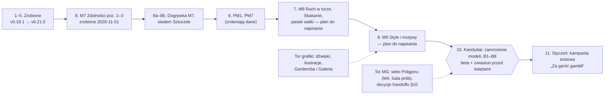
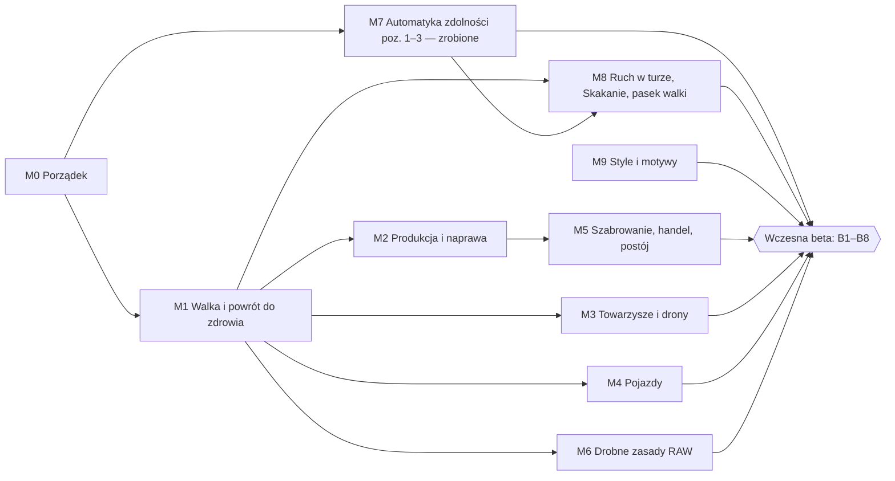

# PLAN — Droga do wczesnej bety

> Status: **AKTYWNY** (2026-09-26, moduł v0.16.0; przegląd 2026-10-03, v0.17.1; v0.18.0 2026-10-08 —
> M0, M1 i M2 zrobione; **v0.19.0 2026-10-15 — M3 i M5 wydane**; przegląd 2026-10-17 przed migracją; **v0.20.0
> 2026-10-18 — migracja na Foundry 14.369 i dnd5e 6.0.6, kampania przeniesiona**; **v0.21.0 2026-10-31 — M4 (pojazdy,
> pościgi, wierzchowce) i M6 wydane**; przegląd 2026-10-31 — §0.1; **2026-11-01 — M7 (automatyka zdolności poziomów
> 1–3) zamknięte, w `master` bez wydania**). Etap bieżący: **późna alfa** — każdy rozdział RAW ma narzędzia w Foundry;
> przed betą zostają ruch w turze ze skakaniem, PM1/PM7, style i dokumentacja. Bramki spełnione: B3, B4, B5, B6 — bramka wydania v0.21.0 zielona na `5ac17bb` (e2e 44/44 w świecie
> gołym i zalecanym, Quench 1385/1385, 0 ostrzeżeń zgodności z naszego kodu). Otwarte: B1 (Skakanie), B2 (zamrożenie
> przy kandydacie), B7 (dokumentacja dla graczy pojazdów i pościgu), B8 (przegląd przy kandydacie) — §0.1.
> **Poligon** (warstwa 7, `PLAN_human_testing.md`) działa od 2026-10-12; weto M3 i M5: MG przeszedł je slice po
> slice'ie przy wdrażaniu, formalne przejście sond odłożone; weto M4 (Garaż, Pościg, Stajnia) czeka.
> Kolejność do bety — **§0**. **Cel (2026-10-18): beta i zwiastun przed świętami, w styczniu kampania testowa** —
> jesteśmy przed harmonogramem (§0.1).
>
> Skąd ten plan: przegląd IMPLEMENTATION.md ↔ RAW z 2026-09-26. Macierz pokrycia RAW mieszka
> w [IMPLEMENTATION.md § Stan projektu](IMPLEMENTATION.md#stan-projektu) i to ona jest źródłem
> prawdy o tym, co działa. Ten plik mówi, **w jakiej kolejności** domykamy luki i **kiedy**
> możemy nazwać wydanie betą.
>
> RAW = `Neuro 5e/Podrecznik/NOE/` — konwersja PDF-a „październik” (jedyne źródło; stare zrzuty
> `source.txt` / `podrecznik.md` usunięte 2026-09-26). Odwołania `s. N` niżej to strony drukowane
> tego wydania; różnice względem marca: `Neuro 5e/Podrecznik/CHANGELOG.md`.

---

## 0. Kolejność do bety (od 2026-10-18; przegląd 2026-10-31)

**Cel (MG, 2026-10-18): beta i zwiastun przed świętami; w styczniu krótka kampania testowa „Za garść gambli”**
(scenariusz wprowadzający NOE) — testy przy stole i materiały promocyjne. Nazwa wydania jest drugorzędna; bramki
służą temu celowi (B2 zmieniona — §1). Dotychczasowe kamienie podobnej wielkości (M3, M5, migracja) szły w 1–2
dni pracy agentów — wąskim gardłem są decyzje i przeglądy MG oraz grafika, nie kod.

**Przegląd 2026-10-31:** kroki 1–5 zrobione w 13 dni (v0.20.0 i v0.21.0). Dwie pozycje przed betą zapadły już po
ułożeniu tej kolejności i nie miały w niej miejsca — **M7 w zakresie D2** (`PLAN_m7_zdolnosci.md`, MG 2026-10-25)
i **ruch w turze ze skakaniem** (`HANDOFF_movement_hotbar.md`; M6 oddał mu skakanie). Wchodzą jako kroki 7 i 8;
style przesuwają się za M7. Kolejność kroków 6–11 i harmonogram (§0.1) to **propozycja agenta, do decyzji MG**.

**2026-11-02 — po M7:** MG puścił M7 przed krokami 6–7 (`PLAN_m7_zdolnosci.md` D10, 2026-10-31) i M7 zamknął się
w dwa dni (E0–E8, pregeni Jazdy Próbnej — D17), zamiast szacowanych 4–7. E0 postawił warstwę akcji w minimalnym
kształcie (znaczniki Reakcji i Akcji Bonusowej, bez budżetu ruchu), którą handoff ruchu rozbuduje — więc to teraz
trzy zdolności M7 czekają na krok 7, a nie M7 na niego. Następne: krok 6 (PM1, PM7), potem 7 i 9; kod stylów jest
odblokowany. Wydanie z M7 przed kandydatem (jak v0.21.0 po M4 i M6) — propozycja agenta, do decyzji MG: paczki M7
są zmienione, `resync` kampanii zrobiony, `master` ma 19 commitów po v0.21.0.

**Decyzje MG 2026-11-02:** testerzy bety **budują własne postacie** — każda Sztuczka jest osiągalna na 1. poziomie,
więc Sztuczki bez automatyki wchodzą przed betę. Kolejność do ruchu: **8a. dogrywka M7** (plakietki zdolności-parasoli
i tanie reguły bez osądu MG), **8b. siedem Sztuczek z nowymi atakami albo przyciskami**, potem krok 6 (PM1, PM7).
Ruch (krok 7) i style (krok 9) dostają **własne plany M — M8 i M9** (§3); ruch robi osobna sesja, a oba plany są do
napisania — ten plik ich nie zastępuje.

1. **Drobiazgi** — `HANDOFF_przed_migracja.md`. **Zrobione 2026-10-17: v0.19.1.**
2. **Migracja na Foundry 14.369 i dnd5e 6.0.6** — [PLAN_migracja_dnd5e6.md](PLAN_migracja_dnd5e6.md). **Zrobione
   2026-10-18: v0.20.0** (e2e 21/21 w świecie gołym i zalecanym, Quench 1211/1211, 0 ostrzeżeń zgodności z naszego
   kodu); kampania na dnd5e 6.0.6. Reszta — lista PM tego planu (§9).
3. **Porządki po migracji** (S) — **zrobione 2026-10-18**: prace Codexa nad ikonami zacommitowane jako propozycja
   (`PLAN_icon_design.md`, tablica wzorców dnd5e); PM15 — skrypt i style Roll20 usunięte ze świata kampanii; porty:
   zakres efemeryczny Windows zaczyna się tu od 1024, więc `listen(0)` dawał czasem port z listy „bad port” standardu
   Fetch (Node i Chrome odmawiają) — `dev/agent/lib/ports.mjs` dla serwerów testów ikon i dla portu nowych
   piaskownic; `validate-packs` czyta kopie (koniec commitów z obrotem logów LevelDB, działa też przy uruchomionym
   Foundry); nagłówek „Stan projektu” w IMPLEMENTATION.md. Poligon: klon kampanii zostaje na dysku, zwykłe
   `poligon:start` (bez `--klon`) otwiera świat Poligonu. **MG:** zgłoszenie błędu dnd5e `Infinite`
   (`data/active-effect/condition.mjs`, nadal na `master`; 6.0.6 to wciąż najnowsze wydanie) — nasza podkładka
   `config/dnd5e-fixes.mjs` do zdjęcia po poprawce.
4. **M4 Pojazdy — w całości, przed betą; przed M6** (MG, 2026-10-18) — **plan:
   [PLAN_m4_pojazdy.md](PLAN_m4_pojazdy.md)**. **Zrobione 2026-10-30, wydane w v0.21.0 (2026-10-31):** część 1
   (pojazdy na mapie taktycznej, jadący, silnik, awarie, naprawy; E0–E8, 2026-10-19), 1b (pojazdy między scenami,
   E9–E11), część 2 (plansza na złożonej drodze P1–P4, mechanika pościgu P5–P6), część 3 (wierzchowce W0–W5) i
   przejście końcowe (skala grafiki istot, paleta kierowcy, kotwica tury). **Zostaje:** weto MG na Poligonie (Garaż,
   Pościg Start–meta, Stajnia — tam też wielkość jeźdźca w siodle i pierścień żetonu dnd5e; 13 nowych wraków —
   `PLAN_m4_pojazdy.md` §10) i 7 dźwięków (`dev/icons/MISSING.md` §P).
5. **M6 z Biegłościami profesji** (dziura w B6) i pozostałymi drobnymi zasadami (§3) — **zrobione 2026-10-27 (E0–E8),
   wydane w v0.21.0**; notatki etapów — `PLAN_m6_drobne_zasady.md` §11. Zostaje przegląd biegłości istniejących BG
   (`HANDOFF_bieglosci_retro.md`) — sprawa kampanii, nie bramki.
6. **PM1 i PM7** — zmieniają zapisane dane (TT jako obliczenia KP dnd5e, identyfikatory istot), więc przed
   zamrożeniem modeli. Pozostałe PM po becie, chyba że coś blokują (MG, 2026-10-18). *2026-10-31:* następne w
   kolejce, nie czekają na decyzje MG (projekt w `PLAN_migracja_dnd5e6.md` §9). TT liczy się wszędzie — po PM1
   pełna bramka wydania i krótki obchód Poligonu.
7. **M8 — Ruch w turze, akcje wrodzone, Skakanie i pasek walki** (nowe 2026-10-31; MG 2026-10-25; własny plan M —
   MG 2026-11-02, §3 M8, do napisania w osobnej sesji) — wejście:
   [HANDOFF_movement_hotbar.md](HANDOFF_movement_hotbar.md) (projekt i kolejność dostawy §8; dowody dostępności akcji —
   `AUDIT_shared_actions.md`; ruchu jeszcze nie ma). Przed betą z trzech powodów: Skakanie to jedyny ❌ w macierzy
   spoza listy §4 (B1); trzy zdolności M7 czekają na budżet ruchu — Skok Gladiatora, Skoczek, Szybkie nogi (warstwę
   akcji ze znacznikami R i B postawił już E0 M7: `config/actions-data.mjs`, `actors/actions.mjs`; handoff dokłada do
   niej ruch); budżet ruchu i szablony paska to nowy zapisany stan (B2). **Przed kodem MG rozstrzyga §10 handoffu** —
   przede wszystkim, czy czerwona trasa jest tylko kolorem, czy blokadą końca ruchu. Kroki 1–3 (budżet, akcje, skok)
   i 4–6 (linijka zielono-czerwona, szablony paska sześciu klas, stanowisko Poligonu) przed kandydatem — pasek walki
   to też materiał zwiastuna.
8. **M7 — automatyka zdolności poziomów 1–3** (nowe 2026-10-31; zakres D2, MG 2026-10-25) —
   [PLAN_m7_zdolnosci.md](PLAN_m7_zdolnosci.md): wszystkie zdolności poziomów 1–3 klas i profesji oraz Sztuczki i
   Pochodzenia pregenów (D3 — testerzy dojdą do poziomu 3). XL, etapy E0–E8, dziesięć rodzin zamiast zdolności po
   jednej. Status: **zamknięte 2026-11-01, bez wydania** — E0–E8 (notatki etapów: `PLAN_m7_zdolnosci.md` §8); pokrycie
   zdolności klasowych i profesji 100/133 (45 pełnych), Pochodzeń 34/36 (20), Sztuczek 41/53 (19); `resync` kopii
   w kampanii zrobiony (kopia zapasowa przed); dla graczy `docs/Zdolnosci.md`; Poligon — 23 persony M7 i stanowisko
   „Sala prób”; pregeni Jazdy Próbnej zbudowani od nowa kreatorem (D17), persony Poligonu dostają Sztuczkę tą samą
   drogą. Zostaje: trzy zdolności czekające na krok 7, obchód MG w „Sali prób”, wydanie. Kryterium końca — §3 M7.
   - **8a. Dogrywka M7** (MG 2026-11-02, przed krokiem 6; **zrobione 2026-11-02**) — plakietki zdolności-parasoli (Mój wróg, Wyjadacz Twardziela
     i Zwiadowcy: wybór wariantu to awans, mechanika w opcji); reguły bez osądu MG: Trening w zbroi (Skradanie bez kary
     z pancerza), Człowiek-aligator (pływanie = Szybkość), Pierwotny instynkt (+5 Inicjatywa i Percepcja), Miotacz
     i Siekierezada (zasięg broni rzucanej ×2, Miotacz +2 do ataku), Ukryty cel (osłona ½ i ¾, Unikanie), Pancerny
     (Próg obrażeń 10 w ciężkim pancerzu), Padnij/Powstań (Szybkość +3 m; reszta — M8); pod pregenów: Ciszej niż cień
     (podpowiedź Utrudnienia w Percepcji BN, gdy postać jest ukryta) i Pan Plaster (pół dawki leku przewlekłego).
     Przebudowa paczek i `resync` kampanii (kopia zapasowa przed).
   - **8b. Siedem Sztuczek z nowymi atakami albo przyciskami** (MG 2026-11-02: testerzy budują własne postacie;
     **zrobione 2026-11-02** — Sztuczki 53/53) —
     Karateka, Barbarka, Nożownik, Robin Hood, Benzyna zamiast krwi, Jest zajebiście, Plug & Play. Notatki obu kroków
     — `PLAN_m7_zdolnosci.md` §8.
9. **M9 — Style i motywy (graficzne odświeżenie)** (własny plan M — MG 2026-11-02, §3 M9, do napisania) — przed
   betą, bo zwiastun to przekrój wszystkiego, co NOE ma w
   Foundry: pościg, drony z kamerą i OSD, walka z efektami, karty postaci, handel (MG, 2026-10-18). Czat (ciemne karty
   dnd5e 6 po D8 migracji), PM13 (podsumowania kart), stanowiska Poligonu Garderoba i Galeria, reszta ilustracji M5
   (`dev/icons/MISSING.md`); **język ikon** (`PLAN_icon_design.md`) — na samym końcu tego etapu. Plan zdjęć do
   zwiastuna: sceny Poligonu, na których każdy podsystem da się pokazać od ręki. *2026-10-31:* kod stylów (karty
   czatu, PM13) **po M7**, bo E1 M7 dokłada przyciski „po rzucie” do kart rzutu — restyl kart raz, po nich. Grafika
   (ilustracje, Garderoba, Galeria) może iść równolegle od zaraz. *2026-11-02:* M7 zrobione — kod stylów odblokowany.
10. **Kandydat do wydania → beta i zwiastun przed świętami** — zamrożenie modeli (B2), bramki B1–B8, dokumenty.
11. **Styczeń: kampania testowa „Za garść gambli”** — świat MG (poza repo, obok świata kampanii na tej samej
   instalacji), testerzy tylko przez przeglądarkę na serwer MG (przekierowany port). Przed pierwszą sesją: HTTPS
   (hasła i ciasteczka sesji nie idą otwartym tekstem), hasło na każdym koncie, testerzy jako Gracz (nie Zaufany
   — bez wgrywania plików), przekierowany **tylko** port kampanii (nie piaskownice, Poligon, port DevTools Chrome
   ani serwer przeglądu ikon), `fvtt` w trybie `runtime` na czas sesji. Znaleziska jako wydania bety bez niszczących
   migracji. Także: pregeni stoją na poziomie 1 (zbudowani kreatorem 2026-11-01, D17); poziomy 2–3 z wyborami
   profesji — MG albo testerzy przy stole (`PLAN_m7_zdolnosci.md` P7). Moduł treści „Za garść gambli” powstaje dopiero po testach bety (plan w repo map, poza tym repo).

**Poza kolejnością, przed betą (MG):** lepsze narzędzia przeglądu ręcznego — termin i zakres MG. Dalej (2026-10-31):
weto Poligonu (M4 — krok 4; formalne sondy M3 i M5 odłożone 2026-10-17; od 2026-11-01 także „Sala prób” M7 —
12 prób); decyzje handoffu §10 (decyzje M7 zapadły: D1–D17); zgłoszenie
błędu dnd5e `Infinite` (krok 3); `stash@{0}` „codex-wip” z 2026-10-30 — przestarzały (CREDITS i paczka `towarzysze`
są już w `master`), została w nim jedna linia `tokens/PROMPT.md`: zastosować albo porzucić.

**W dowolnej chwili, bez decyzji MG (agenci):** dokumentacja dla graczy pojazdów, wierzchowców i mechaniki pościgu
(B7 — `docs/Poscigi.md` opisuje tylko planszę, stan z 2026-10-06); `tokens/aliases.json` — usunąć 8 martwych aliasów
istot, które mają już własny żeton, i poprawić komentarz (pisze „aliases win”, a builder daje pierwszeństwo własnemu
plikowi — `dev/packs/build-packs.mjs`, `tokenArtFor`); etykieta rozmiaru `huge` = „Wielki” wg NOE (globalnie,
`PLAN_m4_pojazdy.md` §10).

**Grafika i dźwięk:** 7 dźwięków pojazdów (MISSING §P). Sześć istot Bestiariusza (Bit-boy przewodnik, Cyngiel, Gangus
żołnierz, Kitchin, Spawacz, Techmorwa średnia) ma własne portrety, ale żetony pożyczone z dnd5e przez
`tokens/aliases.json` — licencja na odwołanie pozwala, więc to nie blokuje bety; własne żetony, jeśli MG chce
kompletu do zwiastuna.

### 0.1 Przegląd 2026-10-31 — sesje od 2026-10-18, bramki, harmonogram (uzupełniony 2026-11-02 po M7)

**Sesje agentów od poprzedniego przeglądu** (Claude — kod i wydania; Codex — grafika, audyty i wybrane poprawki;
Copilot — projekty planów). Dwa wydania, trzy kamienie (migracja, M4, M6), ok. 200 commitów; Quench 1211 → 1385,
paczki e2e 21 → 44.

| Kiedy | Kto | Co | Ślad |
|---|---|---|---|
| 10-17–18 | Claude | migracja na Foundry 14.369 i dnd5e 6.0.6 (E0–E12), kampania przeniesiona | v0.20.0 |
| 10-18 | Codex | ikony biegłości i umiejętności (552 karty przeglądu zamknięte); studium stylów dnd5e → propozycja „emalia na stali” | `5fc0d06`, `PLAN_icon_design.md` |
| 10-19 | Claude | M4 rundy projektowe 1–5; część 1 (E0–E8) w nocy, 1b (E9–E11), pościg P1–P4 | bramka zielona na `490adc1`, bez wydania |
| 10-19–22 | Codex | pościg: Nuklearna zima i Ruiny Ameryki (tła, pierwszy plan, śnieg, ślady opon), pauza zatrzymuje animacje, tekstury po uśpieniu komputera; Ctrl+Z pojazdów; MG sadza wskazany żeton; ilustracje szabrowania | `724ee92` |
| 10-21–31 | Codex | grafika pojazdów (14 zestawów, wnętrza, wraki, wieże), skala jadących; potem 23 pary portret/żeton (16 istot, 3 konie, 4 towarzysze), 12 ikon instrumentów, ikony wody, animowane zanurzenie | `b4aea67`, `a496cc6`, `5dc38a9` |
| 10-24–25 | Codex | audyt akcji wspólnych (gracz w piaskownicy), szablony paska sześciu klas do dyskusji na forum, poprawki pięciu ikon paska, handoff ruchu | `AUDIT_shared_actions.md`, `HANDOFF_movement_hotbar.md` — bez kodu ruchu |
| 10-24–25 | Claude | repo map: mapa silosu, decyzje modułu treści „Za garść gambli” (Z1–Z5) | poza tym repo |
| 10-25 | Copilot | projekty M6 i M7, decyzje MG (M6 D1–D12, M7 D1–D5) | `PLAN_m6_drobne_zasady.md`, `PLAN_m7_zdolnosci.md` |
| 10-26 | Claude | zakładki panelu Poligonu (rdzeń rezerwuje akcję `tab`), jeden układ `dev/art/**/in` i `out`, push | `4ad85d0`, `724ee92` |
| 10-27 | Claude | M6 E0–E8: biegłości profesji i instrumenty, broń improwizowana i Łyżeczka, obiekty, latanie, woda i wspinaczka | `98363ef` … `58f7041` |
| 10-28 | Copilot, Claude | pełna lista zasad WKK (`docs/Kobalt.md`, `kobalt-doc-check` w `npm test`); wraki i wieże w kodzie; źródła grafiki pojazdów w repo (≈ 212 MB w historii) | `63aab03`, `b340286`, `70cc1ef` |
| 10-29 | Copilot | M4 przejście końcowe — runda 6 (D34–D45) | `ced4a43` |
| 10-29–31 | Claude | M4 K1–K3, KT, S0–S1, P5–P6, W0–W5; integracja grafiki Codexa; wydanie — bramka trzy razy (`explosive-art` zamykał interfejs rdzenia, timeout sprzątania Quench `drony`) | v0.21.0 na `5ac17bb` |
| 10-31–11-01 | Claude | M7 E0–E8 z rundami decyzji MG (D6–D17); krwawienia — każde osobnym efektem (`docs/Krwawienia.md`, WKK 43); `resync` kampanii; Poligon: 23 persony M7, „Sala prób”; pregeni Jazdy Próbnej od nowa kreatorem (D17) | `4433dd4` … `a30a4c6`, bez wydania |
| 11-01 | agent grafiki | ikony stanów M7 (Reakcja, Akcja Bonusowa, krwawienia), 7 dźwięków pojazdów M4, ostatnie sześć par Bestiariusza, portrety i żetony sześciu pregenów | `d70adb6` |

**Bramki (2026-10-31; stan po M7 — 2026-11-02):**

| # | Stan | Co zostaje |
|---|:-:|---|
| B1 | 🟡 | W macierzy dwa ❌: Kolory Neuroshimy (na liście §4 — w porządku) i **Skakanie** (krok 7 — albo MG przenosi je do §4) |
| B2 | ⏳ | Przed zamrożeniem: PM1, PM7, stan ruchu (krok 7). Dane paczek M7 (E3) i `resync` kampanii (E8) — zrobione 2026-11-01. Zamrożenie — krok 10 |
| B3 | ✅ | 19 paczek; krok `packs` bramki v0.21.0; po M7 przebudowane (2026-11-01), `validate-packs` zielone |
| B4 | ✅ | Bramka v0.21.0: Quench 1385/1385, e2e 44/44 w obu światach, `npm test`. Po M7 w piaskownicy: Quench 1510/1510, nowe paczki e2e M7 i regresja zielone — pełna bramka przy następnym wydaniu |
| B5 | ✅ | Plakietka na każdej zdolności. Pokrycie po M7 i dogrywce (8a–8b): klasowe 103/133 (48 pełnych), Sztuczki 53/53 (29), Pochodzenia 35/36 (21) — przed M7 33/133, 19/53, 4/36 |
| B6 | ✅ | `release:check` v0.21.0 — świat goły i zalecany, moduł z `module.zip` |
| B7 | 🟡 | `docs/` bez pojazdów, wierzchowców i mechaniki pościgu; `docs/Zdolnosci.md` jest (M7 E8); nagłówek macierzy poprawiony 2026-10-31 |
| B8 | ⏳ | Przegląd przy kandydacie; listy WKK pilnuje `kobalt-doc-check` od 2026-10-28; odczyty RAI M7 w tabeli `scripts/wkk/README.md` |

**Harmonogram — propozycja agenta, do decyzji MG.** Tempo ostatnich dwóch tygodni: kamień L–XL w 1–3 dni pracy
agentów plus rundy pytań MG. Szacunek: PM1 + PM7 — 1–2 dni; ruch (kroki 1–6 handoffu) — 2–4 dni z decyzjami §10;
M7 — 4–7 dni w 2–3 rundach weta; style — 1–2 tygodnie, zależnie od grafiki i przeglądów; kandydat i zdjęcia do
zwiastuna — 3–5 dni. Razem około 4–5 tygodni: **kandydat w pierwszej połowie grudnia**, beta około połowy grudnia,
tydzień zapasu przed świętami.

- **A (zalecana): cel „przed świętami” bez zmian, a zapas na to, czego agenci nie zrobią** — weto Poligonu (M4,
  zaległe sondy M3 i M5), pregeny poziomów 1–3, świat „Za garść gambli”, HTTPS i konta, jedna próbna sesja z jednym
  testerem przez przekierowany port przed styczniem.
- **B: beta pod koniec listopada** — tylko z M7 przyciętym do drużyny kampanii i pregenów (D1) i stylami ograniczonymi
  do kart czatu i PM13. Koszt: zwiastun bez języka ikon, a testerzy na poziomach 2–3 trafią na zdolności z plakietką
  „brak”.

*2026-11-02, po M7:* M7 zajęło dwa dni zamiast 4–7, bez osobnych rund weta (decyzje D6–D17 zapadały w trakcie).
Zostaje: PM1 + PM7 (1–2 dni), ruch (2–4 dni z decyzjami §10), style (1–2 tygodnie), kandydat (3–5 dni) — około 3–4
tygodni, **kandydat na przełomie listopada i grudnia**; cel „przed świętami” z większym zapasem. Wariant B przestał
być cięciem M7 — M7 jest w całym zakresie D2; zostaje jako „style tylko karty czatu i PM13”.

*2026-11-02, decyzje MG:* przed PM1/PM7 wchodzą dogrywka M7 (ok. 1 dzień) i siedem Sztuczek (1–2 dni); ruch i style
czekają na własne plany (M8, M9) — ich szacunek dopiero z planów.

---

## 1. Definicja wczesnej bety — bramki

Wczesna beta to wydanie, w którym **każdy podsystem RAW jest reprezentowany** (dane + przepływ
w Foundry, choćby częściowo ręczny i jawnie opisany), modele danych przestały się przepisywać,
a moduł da się postawić na czystym świecie bez świata kampanii. Nie wymagamy pełnej automatyki
zdolności.

| # | Bramka | Jak sprawdzamy |
|---|---|---|
| B1 | **Pokrycie RAW** — w macierzy w IMPLEMENTATION.md każdy wiersz ma ✅ albo 🟡 z opisaną częścią ręczną; ❌ tylko na liście z §4 („po becie") | Przegląd macierzy |
| B2 | **Stabilne modele** — od kandydata do wydania modele danych (magazynki, przedmioty podręczne, Zranienie, KP/TT, pojazdy, paczki) się nie zmieniają; żadnej niszczącej migracji w kolejce. *Zmiana 2026-10-18 (MG): sesji przed betą nie ma — test przy stole to styczniowa kampania „Za garść gambli” na becie* | Changelog od kandydata; lista PM bez pozycji zmieniających dane |
| B3 | **Paczki** — wszystkie (19 przy v0.21.0) zbudowane z bieżących danych, `npm run validate:packs` zielone, po starcie Foundry rekordy identyczne z świeżym buildem (zmiany plików `.log`/`MANIFEST`/`LOG` to kompaktowanie LevelDB przy otwarciu, nie migracja) | `build:packs` przy zamkniętym Foundry, start, `build-packs.mjs --out=<tmp>` + `node dev/packs/diff-packs.mjs <tmp>` |
| B4 | **Testy** — `npm test` i pełny Quench zielone; każda mechanika z §3 ma testy warstwy 1 (czyste funkcje, `TESTING.md`) | `game.neuroshima.tests.run()` |
| B5 | **Rejestr automatyki dla zdolności klasowych** — jak dla Sztuczek i Pochodzeń; każda zdolność, Sztuczka i zdolność Pochodzenia ma plakietkę pokrycia (auto / częściowo / brak + „Nie automatyzujemy: …") | `game.neuroshima.<rejestr>.report()` |
| B6 | **Czysta instalacja** — świeży świat dnd5e 6.0.6 (do v0.19.1: 5.3), sam moduł (+ opcjonalnie Sequencer): zero błędów w konsoli przy starcie, paczki się otwierają, postać powstaje od zera przez awans (klasa → Pochodzenie → Sztuczka), walka P/KS z amunicją i Zranieniem działa. *Uwaga 2026-10-10: profesja nie nadaje biegłości — M6 „Biegłości profesji”* | `npm run release:check` — moduł z `module.zip` w piaskownicy wydania, świat goły i zalecany, paczki e2e (lista kontrolna w M0) |
| B7 | **Dokumentacja** — IMPLEMENTATION.md zgodny z kodem (tabela plików, macierz), `docs/` opisuje z perspektywy gracza każdą mechanikę widoczną na karcie | Przegląd |
| B8 | **Granica treści** — treść WKK tylko w `scripts/wkk/`, zero spoilerów fabularnych w repo | `scripts/wkk/README.md`, przegląd |

Treść WKK (Kolor Kobaltu) **nie liczy się** do bram — to nakładka stołu, nie RAW.

---

## 2. Zasady pracy (bez zmian, przypomnienie)

- **Oznaczane, nie blokowane.** Moduł podpowiada domyślne Utrudnienie / koszt akcji, MG nadpisuje.
- **Wykrycie, nie zastosowanie**, gdy RAW zostawia decyzję MG (karta z przyciskiem). Automat tylko
  tam, gdzie RAW nie zostawia wyboru.
- **Jeden magazyn stanu, N widoków, jeden lejek zapisu** (wzorzec Zranienia i magazynków).
- **NOE czy WKK?** — reguła w `scripts/wkk/README.md`, przed napisaniem pierwszej linii.
- Każda nowa reguła: czysta funkcja + test Quench warstwy 1, potem hooki.

---

## 3. Kamienie milowe

Rozmiar: **S** mały, **M** średni, **L** duży (względnie, bez szacunku czasu).
Kolejność jest priorytetem: waga mechaniczna × częstotliwość przy stole ÷ koszt.

### M0 — Porządek i zamrożenie (S)

Cel: tracker mówi prawdę, paczki są aktualne, otwarte decyzje zamknięte.

- [x] Przebudować paczki przy zamkniętym Foundry; potwierdzić brak churnu — 2026-09-26: 15/15 z danych
  NOE, po starcie świata **0 różnic w rekordach** (`dev/packs/diff-packs.mjs`); kształty v14 z buildera
  działają, zmiany plików w `git status` to tylko kompaktowanie LevelDB
- [x] **Rejestr automatyki zdolności klasowych** — 2026-10-03: `config/class-features-coverage.mjs`,
  tabela `COVERAGE` w `dev/classes/gen_features.py`, plakietki w `buildFeature`. **22/133** (6 pełnych,
  16 częściowych). Przy okazji: Kondycha nie leczyła (teraz aktywność `heal`), karta Wściekłego ciosu
  przechwytywała Motywację, Łeb jak sklep, Twardość i Kocie kości. **Zostaje:** przebudowa paczek
  (zamknięty Foundry) i `game.neuroshima.zdolnosci.resync({ commit: true })` dla kopii na kartach
- [x] Zamknąć decyzje z `TODO_mechanika.md` — 2026-10-03: Laska zatwierdzona; Rewolwerowiec na całą
  BPK → wariant WKK Pistolero (2026-10-01); pojedynczy nabój do magazynka wymiennego wdrożony (WKK:
  siatka ST, porażka — nabój na ziemi, pechowa jedynka — zacięcie)
- [x] Pierwszy przebieg **czystej instalacji** (B6) — 2026-10-08, v0.18.0. Lista kontrolna jest kodem:
  bramka wydania (`npm run release:check`, `RELEASING.md`) instaluje moduł **z `module.zip`** w osobnej
  ścieżce danych z dnd5e 5.3.0 i przechodzi wszystkie paczki e2e w świecie gołym (sam moduł) i
  zalecanym (+ Quench, Sequencer, Splatter, plus baterie Quench). Kryteria B6 → dowód:

  | Kryterium | Dowód |
  |---|---|
  | zero błędów w konsoli przy starcie | e2e `boot` — błędy konsoli każdego klienta i log serwera liczą się jak porażka, w każdej paczce |
  | paczki się otwierają | `boot`: każde kompendium z liczbą rekordów z dysku; krok `packs` bramki: zip = świeży build |
  | postać od zera przez awans | e2e `postac` (nowa): MG zakłada pustą kartę gracza, gracz przeciąga Twardziela (AdvancementManager: KW, umiejętności, zdolności, Wyjadacz), Posterunek (+1/+1, zdolność regionu) i Sztuczkę; rzut umiejętności z nowej postaci |
  | walka P/KS z amunicją i Zranieniem | e2e `combat`: strzał pojedynczy (1 nabój), krytyk → Stopień Zranienia, granat gracza; **KS z B 93R** (nowy krok: Utrudnienie domyślnie, 3 naboje, druga KS w tej rundzie odmówiona) |

  Lista błędów, które przebieg znalazł (wszystkie naprawione, każdy z testem):
  - postać od zera startowała z **8/16 PW** — advancement dnd5e dodawał kość, moduł liczy PW płasko
    (`actors/pw.mjs`, `dnd5e.preAdvancementManagerComplete`);
  - postać od zera miała **Szybkość 0** — dnd5e bierze ją z gatunku, NOE gatunków nie ma, RAW daje
    każdemu 9 m (`actors/character-defaults.mjs`). Istniejące postacie bez gatunku poprawia MG ręcznie;
  - po awansie nie odświeżały się pasek skrótów zdolności ani Cichy krok (`advancementManagerComplete`
    w 5.3 podaje tylko menedżera);
  - przewodnik `docs/Pierwsze-kroki.md` kazał przeciągać profesję i pomijał Pochodzenie i Sztuczkę.

  Wcześniej, przy przygotowaniu (2026-10-03): `module.zip` pomijał `*.log` (puste kompendia) i `vfx/` —
  stąd zip budowany przez `dev/release/build-zip.mjs` i instalacja z niego, nie z katalogu deweloperskiego.
- [x] Zdecydować o formie macierzy pokrycia: od teraz status zmienia się **w macierzy**, fazy 1–5
  zostają jako historia (obowiązuje od 2026-09-26)

**Gotowe gdy:** B3 i B5 spełnione, macierz zgodna z kodem. *Stan 2026-10-08:* **zrobione** — B3 i B5 od
2026-10-03, B6 przy v0.18.0 (wyżej); bramka wydania pilnuje B3 przy każdym wydaniu (krok `packs`).

### M1 — Walka i powrót do zdrowia wg RAW (M–L) — najwyższy priorytet

Cel: różnice RAW względem 5e, które dziś trzeba pamiętać przy każdej walce, a każdą ranę leczyć
kliknięciem w piki. **Plan: [PLAN_m1_walka.md](PLAN_m1_walka.md)** (zatwierdzony 2026-10-06,
decyzje MG D1–D10; etapy E0–E8 — wszystkie zrobione 2026-10-07). Szczegóły i rozstrzygnięcia są
tam — poniżej tylko lista.

- [x] **Neutralizacja Stopnia Zranienia** (s. 32–33, powtórzone w Postoju s. 46) — 2026-10-07, E5–E6
  - Regeneracja: licznik ukończonych DO od pierwszego Stopnia — podróż, obrażenia ani nowe Stopnie
    go nie zerują (D3); ≥ 3 → RO na Kondycję ST 15, sukces = −1 stopień i licznik od zera, porażka —
    powtórka po każdym następnym DO
  - Pomoc medyczna: po DO leczący z biegłością w Medycynie i narzędziami małego medyka → −1 stopień,
    bez testu. Bez łączenia z Regeneracją — jedna droga na DO, wybrana przed rzutem (D4).
    WKK: kosztuje ładunek narzędzi i zajmuje leczącego i pacjenta
  - Wyczerpanie z Krytycznego: NOE — zwykłe (DO je zdejmuje); RAI — zejście z Krytycznego je
    zdejmuje; WKK — uporczywe do zejścia z Krytycznego (D5)
  - Kalendarzyk zdrowia: prognoza „najszybciej / zwykle / 9 na 10” z licznika, szansy RO i medyka
  - Wyczerpanie na karcie: uporczywe jako koło w kwadratowej ramce, przejściowe jako samo koło; tor opróżnia się od
    prawej w kolejności zdejmowania; kolejność zdejmowania przez DO przestaje być przypadkowa
- [x] **Rzuty przeciw śmierci przy obrażeniach na 0 PW** (s. 34) — 2026-10-07, E1: +1 porażka, atak wręcz +2.
  dnd5e 5.3 tego nie robi (`actor.mjs` dopisuje porażki tylko przy rzucie). Rzut przeciw śmierci to
  czysta k20 — bez premii do RO, bez Przerzutów i Fuksów (D1, F12)
- [x] **Olbrzymie obrażenia** (s. 34) — 2026-10-07, E1: jednorazowo ≥ 2× maks. PW → śmierć; maks. PW = 0 → śmierć.
  Śmierć BG potwierdza MG kartą (D1). BN przy 0 PW domyślnie martwi, z kartą MG „Rzuty przeciw
  śmierci”, gdy gracze mają mieć szansę go ratować (D2)
- [x] **Stabilizacja** (s. 34) — 2026-10-07, E2 (+ Staza) — Test INT (Medycyna) ST 10 jako akcja Pomagania; stabilny bez leczenia
  odzyskuje 1 PW po 1k8 h (zegar świata, `world-clock.mjs`). Ten sam wzorzec „Pomaganie + Medycyna
  ST 10” tamuje krwawienie w Kolorach Neuroshimy (s. 201–202, zmiana z października)
- [x] **Akcja Bieganie** (s. 21) — 2026-10-07, E4: +2× Szybkość do początku następnej tury, Utrudnienie do własnych
  Testów Ataku, ataki dystansowe przeciw biegnącemu z Utrudnieniem do końca tury; nie dla istot
  nie chodzących. AE z `duration` + `dnd5e.postBuildAttackRollConfig`
- [x] **Domyślne Utrudnienie w dialogu ataku** — 2026-10-07, E3 — jeden silnik okoliczności ataku (D6), nadpisywalne:
  atak dystansowy w zwarciu (s. 28 — wróg ≤ 1,5 m, widzi, przytomny, Szybkość > 0; wyjątki stanów),
  cel w zasięgu dalekim. dnd5e 5.3 nie egzekwuje żadnego z nich
- [x] **Stany w rzucie ataku** (s. 35) — 2026-10-07, E3 — znalezione przy planie M1 (F1/F2): Przerażenie i Zatrucie
  nie dają Utrudnienia (dnd5e nie czyta `conditionEffects.attackDisadvantage`), stany celu nie
  działają wcale, brak auto-krytyku ≤ 1,5 m w Nieprzytomnego / Sparaliżowanego. Ten sam silnik
- [x] **Osłona przy ataku wręcz** (s. 27) — 2026-10-07, E3 — dziś pytana tylko przy dystansowych (U9)
- [x] **`ppanc` / `przebijająca` a pancerz BG** — 2026-10-03: `combat/armour-piercing.mjs` ustawia
  natywne `options.ignore.resistance/threshold` dla broni i amunicji z tą właściwością; ustępują próg
  pancerza BG, odporności i Próg obrażeń Bestiariusza. Paczka testów `przebicie`. Zamyka
  `PLAN_weapon_properties.md` §3.2
- [x] **Trudność Trafienia wg NOE i reakcje po trafieniu** — 2026-10-03, `PLAN_tt.md`: silnik TT
  (metody konkurują, premie się sumują, dymek z rozkładem), jeden rozstrzygacz trafienia, Test Ataku
  i obrażenia zawsze osobno (koniec auto-obrażeń), okno „Reakcje celu” na karcie ataku, Krytyczna
  ochrona hełmu, reakcje BN z Bestiariusza
- [x] **Stopień Zranienia z Trafienia Krytycznego** (s. 32) — 2026-10-03: nie działał nigdy
  (`combat/zranienie.mjs` słuchał `dnd5e.rollDamage` w sygnaturze, której żadna wersja dnd5e nie miała).
  Teraz nadawany przy nakładaniu obrażeń tacką MG (`dnd5e.applyDamage`), krytyk z żywego werdyktu
  karty ataku; raz na kartę i cel; krytyk zbijający PW do 0 — jeden Stopień; krytyk bez obrażeń —
  bez Stopnia (interpretacja MG, czeka na autora). PLAN_tt W6, D15
- [x] **Zagrożenia bez wyzwalacza** — 2026-10-07, E7 (narzędzie MG „Zagrożenia”):
  Sen (s. 45 — doba bez snu → RO KON ST 20), Uduszenie (s. 259 — 1 + mod. KON minut, potem
  Wyczerpanie co turę, zdejmowane po złapaniu oddechu), Przemarznięcie (s. 258 — RO KON ST 5 + 1/°C
  poniżej zera co godzinę, zdejmowane DO w cieple). Przyciski MG, jak Skażenie

**Gotowe gdy:** każda pozycja ma test warstwy 1 i weryfikację na żywo; wiersze Walka i Postój
w macierzy bez ❌. *Stan 2026-10-07:* wszystkie pozycje odhaczone, każda z testem warstwy 1 i e2e w
piaskownicy; w Postoju zostaje ❌ tylko Rozrywka i Długi postój (M5, poza M1). Do zrobienia przez
człowieka: ręczny przebieg MG zagrożeń w kampanii (E7).

### M2 — Produkcja i naprawa (L)

Cel: panel Surowców przestaje być samą księgowością. Tożsamość klasy Spec (Chemik, Medyk, Monter)
i Sztuczek Fabrykator / Złomiarz / Przydasie stoi na tym rozdziale. RAW: s. 144–146.

> Projekt szczegółowy i decyzje MG (2026-09-27, brane poza kolejnością):
> [PLAN_produkcja.md](PLAN_produkcja.md). Tam, gdzie lista niżej się z nim rozjeżdża, wygrywa tamten plik.
>
> **Zrobione w v0.17.0 (2026-09-28)** — wszystkie pozycje niżej; szczegóły i odstępstwa w
> PLAN_produkcja §13 / §13a, dla graczy [docs/Produkcja.md](docs/Produkcja.md).

- [x] **Czyste zasady** (`config/production-rules.mjs` + testy): surowce = ⌊cena/2⌋ w gb, podział
  na typy proponowany, edytowalny przez MG; czas = cena (w górę) × 0,5 h dla jednorazowych, × 1 h
  dla wielorazowych; maks. 10 h pracy na dobę; ST wg wartości (≤10: 5, ≤25: 10, ≤50: 15, ≤75: 20,
  ≤100: 25, więcej: 30); pomocnik — Test narzędzi ST 10, sukces = Ułatwienie; porażka = od nowa
  z tymi samymi surowcami
- [x] **Projekt produkcji na aktorze** (flaga, jeden magazyn): przedmiot, zarezerwowane surowce
  (schodzą z `surowce-inventory.mjs`), przepracowane godziny; „przepracuj N h" przez zegar świata;
  Test ostatniego dnia; wynik = przedmiot z paczki / katalogu
- [x] **Wymagania**: biegłość w narzędziach + zestaw w ekwipunku (logika `tool-availability.mjs`),
  schemat dla przedmiotów > 10 gb
- [x] **Schematy jako dane** (`config/schematy-data.mjs`): pirotechniczne (s. 80), rusznikarskie
  (s. 81), farmaceutyczne (s. 82), hakerskie (s. 83), elaboracja amunicji (s. 136). Znane schematy
  na aktorze; Spec 3. poziomu dostaje je z wyboru profesji
- [x] **Szybka produkcja** (zdolność Speca): raz na odpoczynek ≤ 25 gb (50 gb od 11. poz.),
  1 min × 1 gb
- [x] **Naprawa** — generyczna akcja na przedmiocie: Drobnostka / Trochę roboty / Skomplikowana
  harówa → ST 10/15/20, koszt 10/30/50 % ceny w surowcach, czas 1k4 min / 1k4 h / 2k4 h.
  Podpiąć istniejące: uszkodzenie broni palnej (`jams.mjs`), degradacja białej (`toolkit-kowal.mjs`),
  łatanie pancerza
- [x] `gear-data.mjs`: zaślepki `craftingPlaceholder` stają się prawdziwym wyjściem produkcji

**Gotowe gdy:** postać ze schematem planuje, przepracowuje i kończy przedmiot, surowce schodzą
z panelu, naprawa broni i pancerza idzie jedną ścieżką.

### M3 — Towarzysze i drony (M → L–XL) — ZROBIONE 2026-10-10

Cel: profesje, których rdzeniem jest druga postać na mapie. Dotyczy m.in. Partnera Victora (Sędzia).
Zrobione według `PLAN_m3_towarzysze.md` (E0–E11). Zakres urósł względem tej listy: **drony pełne** (produkcja,
kontrolery, tryb zdalny z obrazem kamery i OSD, zasilanie, awarie, naprawy, wrak), **s. 205** — istoty Bestiariusza
ze Stopniem Zranienia umierają jak BG, **Emiter EMP** z D27. Szukanie nowego towarzysza — M5 (D30).

- [x] **Aktor-towarzysz** powiązany z właścicielem (`flags.<mod>.companion.ownerId`). Statystyki
  pochodne od właściciela (PB, mod. MDR, poziom klasy — np. Psi partner: TT 12 + PB, PW 10 + 10 ×
  mod. MDR, KW k6 × poziom Zwiadowcy) liczy moduł i synchronizuje po `updateActor` właściciela —
  dnd5e nie umie formuł z cudzego aktora
- [x] **Szablony w nowej paczce `towarzysze`**: Psi partner (s. 100), Ludzki partner (s. 101 —
  szkielet do dokończenia przez gracza), Zmutowany owad / ssak / gad (Oswajanie zwierząt, s. 99),
  Dron kroczący i latający (s. 83), Prawa ręka Mafiozo (s. 76 — szablon postaci)
- [x] Tura towarzysza zawsze po turze właściciela (porządek w Combat), „bez komendy → Unikanie"
  jako notka
- [x] Śmierć jak BG: Stopnie Zranienia i rzuty przeciw śmierci na NPC-towarzyszu (`zranienie.mjs`)
- [x] Wyżywienie towarzyszy w dziennym zapotrzebowaniu drużyny (`party-supplies.mjs`)
- [x] Emiter EMP (Zabójca maszyn, s. 101) — karta z RO i efektem na maszynach

**Gotowe gdy:** towarzysz stoi na scenie, rośnie z awansem właściciela, ginie według zasad BG.

### M4 — Pojazdy: domknięcie rozdziału (M–L) — przed betą, w całości (MG, 2026-10-18) — ZROBIONE 2026-10-30

Cel: pościg od startu do mety bez notatek MG. Projekt: `PLAN_m4_pojazdy.md` §6.2 (plansza od nowa, 2026-10-19),
grafika planszy — `PLAN_poscigi.md` §2.2.

- [x] Pojazdy między scenami: skala w metrach, pamięć obsady, Ctrl+X / Ctrl+V z załogą (M4 E9–E11, 2026-10-19)
- [x] **Wierzchowce jako nośniki** (z M6, MG 2026-10-25): ten sam kod dla pickupa, roweru, konia i czołgu; Inicjatywa
  jeźdźca razem z „turą pasażera za kierowcą”, spadanie z siodła, atak z grzbietu — `PLAN_m4_pojazdy.md` §6.3 (W0–W5,
  2026-10-30)
- [x] Plansza — złożona droga, metryka drogi, jadący na planszy, serie z celowaniem (M4 P1–P4, 2026-10-19)

- [x] Tabela Awarii pojazdów k20 (s. 265) + wyzwalacz (≥ Próg awarii, porażka kierowcy o 5+) — `pojazdy/awarie.mjs`
  (M4 część 1, 2026-10-19)
- [x] Komplikacje pościgu k20 (s. 267) i ST pościgu na planszy (M4 P5, 2026-10-30)
- [x] Paleta manewrów kierowcy (s. 268): karta i efekt do następnej tury kierowcy, ruchy wymuszone przyciskami (D41, M4 P5,
  2026-10-30)
- [x] Karta pojazdu: TT, Próg obrażeń, Próg awarii, paliwo, załoga (`pojazdy/karta.mjs`); spalanie i bak w
  `KATALOG_POJAZDOW` i we fladze `paliwo` aktorów z paczki (`PALIWO_DOMYSLNE` zostaje dla pojazdów spoza katalogu)
- [x] Wsiadanie, kierowanie, wypadanie, trudny teren a Szybkość — okno miejsc, karty jazdy z testami (`pojazdy/`)
- [x] Atakowanie z pojazdu — Utrudnienie w oknie ataku (Akrobatyka ST 10 z HUD-u znosi), domyślna osłona jadącego

**Gotowe gdy:** wiersz Pojazdy i pościgi w macierzy = ✅/🟡. — **Spełnione 2026-10-30, wydane w v0.21.0
(2026-10-31).** Zostaje weto MG na Poligonie i 7 dźwięków (§0 krok 4).

### M5 — Szabrowanie, bebeszenie, handel, postój (M → L) — ZROBIONE 2026-10-12

Cel: dzień w mieście i wyprawa po ruinach mają narzędzia w Foundry. Zależy od M2 (surowce muszą
mieć odbiorcę). **Plan: [PLAN_m5_postoj.md](PLAN_m5_postoj.md)** (projekt 2026-10-11, decyzje MG D1–D45,
ustalenia U1–U58 przyjęte jako robocze; etapy E0–E11 **wdrożone 2026-10-12**, postęp — §11 planu). Zakres urósł: zawsze barter (portfel gb
ukryty), interfejs handlu dla MG, doba postoju „gracz proponuje, MG zatwierdza”, Fuksy trwałe i ulotne, Fanty,
autodestrukcja maszyn z wrakiem na mapie, przeskok narracyjny, rozbiórka. Lista niżej to skrót — wiążący jest
plan.

- [x] **Szabrowanie ruin** (s. 270–271): rodzaj ruin → czas, szansa komplikacji k100, surowce;
  Tabela komplikacji k10 (s. 270, spotkania z Bestiariusza); wykrywacz metalu = Ułatwienie.
  RollTables w paczce + dialog MG; wynik trafia do panelu Surowców
- [x] **Bebeszenie** bestii (rozmiar → czas, ST, materiały organiczne, mięso) i maszyn Molocha
  (CE/CZ/MK) (s. 269) — przycisk na martwym żetonie, kategoria z `creature-types.mjs`; **autodestrukcja**
  przy 0 PW (s. 204) z odliczaniem, wybuchem i wrakiem na mapie
- [x] **Gambling** (s. 43–44): modyfikatory dostępności lokalizacji, ceny regionalne; punkty handlowe z listą
  towaru (RAW) jako domyślna droga handlu, generator listy z danych RAW; zamówienie specjalne (k100 − CHA, limit
  transakcji) na to, czego nie ma na liście; stół wymiany (barter) z wyceną widoczną tylko dla MG; przeróbki
  broni u fachowca (s. 128)
- [x] **Aktywności postoju** w dobie postoju (s. 45–47): Rozrywka (10 h + 50 gb → Fuks na
  7 dni), Plotkowanie (5 gb + Test CHA (Śledztwo) ST 10, +1 informacja za każde 5), Hazard (ST 20,
  wygrana ×2 / utrata stawki); Długi postój: Praca, Trening/Nauka, Budowa bazy, Koszt utrzymania
  (także towarzyszy); sen 6 h (NOE i WKK; WKK: RO za krótki sen, odsypianie); przeskok narracyjny dla długich postojów
- [x] **Szukanie nowego towarzysza** (`PLAN_m3_towarzysze.md` D30): zajęcie Postoju — Partner 24 h dzielone przez
  gracza, oswajanie zwierzęcia 3 dni; dziś podpowiedź na pasku towarzyszy i narzędzie MG „Nowy towarzysz”
- [x] **Fuksy trwałe i ulotne** (źródło, termin — Gotowanie 24 h dziś nie wygasa) i **Fanty** (s. 132–133)

**Gotowe gdy:** wiersze Eksploracja (gambling), Postój i Teczka MG (szabrowanie) bez ❌. — **Spełnione 2026-10-12.**
Zostaje: dźwięki i część ilustracji (zamówienia w `dev/icons/MISSING.md`), test przy stole (B7). Stanowiska Bazar
i Złomowisko stoją na Poligonie od 2026-10-12. Wydane w v0.19.0 (2026-10-15).

### M6 — Drobne zasady RAW (S każda → L po decyzjach MG 2026-10-25) — ZROBIONE 2026-10-27, wydane w v0.21.0

> **Plan: [PLAN_m6_drobne_zasady.md](PLAN_m6_drobne_zasady.md)** (projekt 2026-10-25, decyzje MG D1–D12). Zakres urósł:
> broń improwizowana z dowolnego przedmiotu w ręce, fizyczność obiektów na żądanie, Regiony wody z eksportu map.
> **Walka na wierzchowcu przeniesiona do M4** (część 3, `PLAN_m4_pojazdy.md` §6.3), **skakanie** — do
> `HANDOFF_movement_hotbar.md`. Tam, gdzie lista niżej się z nim rozjeżdża, wygrywa tamten plik.

- [x] **Biegłości profesji** (s. 69–101, „BIEGŁOŚCI <PROFESJI>”) — M6 E1; przegląd BG — `HANDOFF_bieglosci_retro.md` — znalezione przy migracji Evie (M3 E5,
  2026-10-10): profesja nie nadaje swoich biegłości (umiejętności, zestaw narzędzi, kategoria broni), choć
  `dev/classes/professions.json` ma ich tekst (`proficiencies`). Dotyczy wszystkich 18 profesji i każdej
  postaci zbudowanej przez awans — **dziura w B6**, której lista kontrolna nie łapała. Do zrobienia: awans
  `Trait` na poziomie profesji w `buildProfession` (stałe biegłości + wybory, np. Sędzia: Śledztwo,
  Zastraszanie, 1 zestaw narzędzi, 1 kategoria broni), sprawdzenie w `validate-packs` i krok w e2e `postac`;
  potem przegląd MG istniejących BG (co który wybrał). Victor: kategoria broni (palna pośrednia) zrobiona w M3
  E5 (D14 planu M3); brak mu jeszcze Śledztwa, Zastraszania i zestawu narzędzi z biegłości Sędziego.

- [x] **Niszczenie obiektów** (s. 253) — M6 E4 (fizyczność na żądanie MG, P8): tabele TT (materiał) i PW (rozmiar × kruchość); szablon aktora
  „Obiekt" (niewrażliwy na truciznę i psychiczne, automatyczna porażka RO); `burząca` ×2
  i `karczująca` automatycznie na takim celu — zamyka `PLAN_weapon_properties.md` §5
- [x] **Broń improwizowana** (s. 253) jako reguła ogólna — M6 E3 (bliźniak przedmiotu w ręce, Łyżeczka): 1k4, bez PB, rzut 3/9 m — przełącznik
  w dialogu ataku / szablon przedmiotu (dziś jedyny przykład to Pochodnia)
- [x] Właściwości broni: `dluga`, `ciezka`, `jednorazowa` — M6 E2; (blokada przeładowania) —
  `PLAN_weapon_properties.md` §3.3
- [x] Latanie (M6 E5): Nieprzytomność lub Szybkość 0 → upadek (`falling.mjs`); Powalenie → opadnięcie bez obrażeń
- [x] Pływanie i woda, wspinaczka (s. 255–257) — M6 E6; Regiony wody z eksportu map — `TODO.md` repo map — `PLAN_m6_drobne_zasady.md` §5.6. Walka na
  wierzchowcu → M4 część 3; skakanie → `HANDOFF_movement_hotbar.md`

### M7 — Automatyka zdolności poziomów 1–3 (XL) — ZROBIONE 2026-11-01 (bez wydania)

> **Plan: [PLAN_m7_zdolnosci.md](PLAN_m7_zdolnosci.md)** (projekt 2026-10-25, decyzje MG D1–D17). Przed betą (D2):
> wszystkie zdolności poziomów 1–3 klas i profesji + Sztuczki i Pochodzenia drużyny i pregenów; kolejność wg drużyny
> kampanii; dziesięć rodzin mechanizmów zamiast zdolności po jednej. Tam, gdzie lista niżej się z nim rozjeżdża,
> wygrywa tamten plik. *Stan 2026-11-02:* zamknięte — E0–E8 i pregeni (D17), notatki etapów w `PLAN_m7_zdolnosci.md`
> §8. M7 poszedł przed handoffem ruchu (D10); trzy zdolności zależne od ruchu czekają na krok 7 §0. Jeździec, Rodeo
> i Zawsze w siodle zrobione w M4 W5.

- [x] Weto MG: ustalenia U1–U30 (§5.2) i pytania P1–P7 (§5.3) — rundy 2026-10-31 i 11-01, decyzje D6–D17
- [x] E0 — fundament: znacznik „Reakcja zużyta” (i akcji bonusowej, jeśli P1), rejestr „po rzucie”, rejestr
  warunkowych Ułatwień, bramki raz na turę/rundę; trzy spiki
- [x] E1 — po rzucie (R3): Motywacja, Szczęście, Amen, Łeb jak sklep, Spieprzysz to!, Twardość, Fart…
- [x] E2 — wsparcie sojusznika (R7): Dobra rada, Łaska boża, Let's rock…
- [x] E3 — Efekty Aktywne i awanse na featach (R1, R2), ASI i biegłości wszystkich Sztuczek (P4) — **zmienia dane paczek**
- [x] E4 — walka z kontekstem (R4, R5): Ulubiona broń, Mój wróg, Rzeźnik…
- [x] E5 — kości raz na turę (R6) na `class-resource-dice.mjs`: Bolesny atak, Podstępny atak, Mój bóg kule nosi,
  Skuteczny cios — z wykrywaniem spustu
- [x] E6 — Przycelowanie (R8)
- [x] E7 — karty MG, śmierć i krytyki (R9, R10); zdolności zależne od M6 (zależne od handoffu ruchu — po kroku 7)
- [x] E8 — plakietki w paczkach, `resync` kopii w kampanii za zgodą MG, `docs/Zdolnosci.md`, macierz, tabela RAI,
  stanowisko Poligonu „Sala prób”
- [x] Bramka bety to **plakietka pokrycia na każdej zdolności** (B5), nie pełna automatyka — spełniona od 2026-10-03

**Gotowe gdy:** każda zdolność drużyny kampanii co najmniej częściowa; w całym zakresie D2 ≥ 75 % pełnych albo
częściowych (`PLAN_m7_zdolnosci.md` §6, E8).

*Wynik 2026-11-02:* w zakresie D2 75 % (100/133). Drużyna kampanii (odczyt świata po `resync`): 53 zdolności, 29
pełnych, 22 częściowe, dwie z plakietką „brak” — **Mój wróg i Wyjadacz u Victora**, zdolności-parasole, których
mechanika siedzi w opcji wybranej przy awansie. *Po dogrywce (8a, `resync` 2026-11-02):* plakietki parasoli
poprawione — w drużynie kampanii nie ma już żadnej zdolności „brak”; kryterium spełnione w całości.

*Dalej (MG 2026-11-02, §0 kroki 8a–8b):*

- [x] 8a. Dogrywka M7 — plakietki parasoli, tanie reguły bez osądu MG, Ciszej niż cień i Pan Plaster (2026-11-02); paczki, `resync`
- [x] 8b. Siedem Sztuczek dla własnych postaci testerów — Karateka, Barbarka, Nożownik, Robin Hood, Benzyna zamiast
  krwi, Jest zajebiście, Plug & Play (2026-11-02; Sztuczki 53/53 — 29 pełnych)
- Zdolności częściowe z powodu ekonomii akcji i ruchu — do zakresu M8 (niżej)

### M8 — Ruch w turze, akcje wrodzone, Skakanie i pasek walki — plan do napisania

> **Własny plan M — MG 2026-11-02; robi go osobna sesja.** Plik planu (`PLAN_m8_ruch.md`) jeszcze nie istnieje;
> ten wpis tylko wyznacza zakres i wejścia. Wejście: [HANDOFF_movement_hotbar.md](HANDOFF_movement_hotbar.md)
> (projekt, kolejność dostawy §8, pytania do MG §10), [AUDIT_shared_actions.md](AUDIT_shared_actions.md) (dowody
> dostępności akcji), warstwa akcji z M7 E0 (`config/actions-data.mjs`, `actors/actions.mjs` — znaczniki Reakcji
> i Akcji Bonusowej), budżet ruchu pojazdów i wierzchowców z M4.

Zakres do zaplanowania (§0 krok 7):

- budżet ruchu w turze, akcje wrodzone przy pustym pasku, Skakanie (jedyny ❌ macierzy spoza §4 — B1), linijka
  zielono-czerwona, szablony paska sześciu klas, stanowisko Poligonu;
- zdolności częściowe z powodu ekonomii akcji (propozycja agenta 2026-11-02): liczba ataków w akcji Atakowanie
  (Drugi atak, Trzeci atak, Grad ołowiu), koszt Akcji i Akcji Bonusowej (Zryw, Z bara!, manewry Mistrza walki wręcz,
  Szybki Bill, Aramis, Pancerna fura), darmowe interakcje (Samuraj, Pakowanie, Rewolwerowiec, Pistolero), ruch
  (Skok Gladiatora, Skoczek, Szybkie nogi, Padnij/Powstań).

**Gotowe gdy:** — określi plan.

### M9 — Style i motywy (graficzne odświeżenie) — plan do napisania

> **Własny plan M — MG 2026-11-02.** Plik planu (`PLAN_m9_style.md`) jeszcze nie istnieje; ten wpis tylko wyznacza
> zakres i wejścia: §0 krok 9, [PLAN_icon_design.md](PLAN_icon_design.md) (język ikon — propozycja „emalia na stali”),
> PM13 i wygląd kart czatu (`PLAN_migracja_dnd5e6.md` §9, D8), `dev/icons/MISSING.md`, stanowiska Poligonu Garderoba
> i Galeria, plan zdjęć do zwiastuna. Kod stylów jest odblokowany od zamknięcia M7.

**Gotowe gdy:** — określi plan.

---

## 4. Świadomie po becie

Pozycje z projektem albo opisem zakresu mieszkają w [PLAN_1_0.md](PLAN_1_0.md) (od 2026-10-26; pierwsza: materiał
przegród z encji CDDA, M6 P5); tu zostaje krótka lista bez projektu.

| Pozycja | Dlaczego później |
|---|---|
| Kolory Neuroshimy (Rdza, Rtęć, Stal, Chrom — s. 201) jako profile świata | Opcjonalne w RAW; framework powinien uogólnić przełącznik WKK, co jest osobnym projektem. Brać wersję z października: krwawienie tamuje Pomaganie + INT (Medycyna) ST 10 |
| Pełna automatyka reszty — po M7 bez automatyki zostają 33 zdolności klasowe, 12 Sztuczek i 2 zdolności Pochodzeń; częściowe do pełnych; 260 zdolności Bestiariusza | Długi ogon; beta wymaga tylko plakietek (B5) |
| Własne żetony sześciu istot Bestiariusza (dziś pożyczone z dnd5e przez `tokens/aliases.json`; 46 ma własne od 2026-10-31), kalibracja skali, pozostałe ikony | Grafika, nie mechanika |
| Screen shake DS/MS, iskry i krew trafienia | Oprawa |
| Zorganizowane grupy, Front | Treść świata, brak mechaniki |
| Tłumaczenie EN | Brak oficjalnego wydania EN |

---

## 5. Ryzyka

- **RAW sam jest w alfie** — sprzeczności (zasięg granatu), literówki; wydanie „październik”
  uzupełniło „str. XXX”. Każde rozstrzygnięcie RAI trafia do tabeli RAI w `scripts/wkk/README.md`,
  a przy nowym PDF-ie: `Podrecznik/tools/pdf2md.py` + `diff_editions.py` dają listę zmian.
- **Aktualizacje dnd5e / FVTT** — na betę przypiąć wersje (`verified` w `module.json`),
  a pułapki v14 dopisywać do `ARCHITECTURE.md` §11.
- **Paczki LevelDB** — `build:packs` tylko przy zamkniętym Foundry (serwer trzyma blokady, gdy świat
  jest uruchomiony — także na ekranie `/join`); po budowie sprawdzić, że
  `packs/<nazwa>/` ma niepusty `.log` albo `.ldb` (patrz `.gitignore`).
- **Rozrost zakresu przez WKK** — nowe pomysły stołu idą do `scripts/wkk/` i nie blokują bram.
- **Przeglądy MG to wąskie gardło** (2026-10-31) — weto M3 i M5 odłożone, M4 czeka, M7 i handoff ruchu potrzebują
  rund decyzji przed kodem. Agenci kończą kamień szybciej, niż MG zdąży go przejść na Poligonie. Zaradczo: decyzje
  M7 §5 i handoffu §10 zebrać od razu, w jednej rundzie, a weto robić stanowiskami, nie całością. *2026-11-02:*
  decyzje M7 zapadały w trakcie (D6–D17); czekają weto M4, obchód „Sali prób” i decyzje handoffu §10.
- ~~**Zakres M7 (XL)**~~ — *zamknięte 2026-11-01:* M7 w całym zakresie D2, cięcie według D1 niepotrzebne.
- **Rozmiar repozytorium** — źródła grafiki pojazdów dodały ok. 212 MB do historii (2026-10-28; paczki git ≈ 500 MB).
  Kolejne źródła grafiki (`dev/art/**/in`, `out`) zostają poza gitem, jak ustala `.gitignore`.
