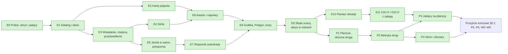
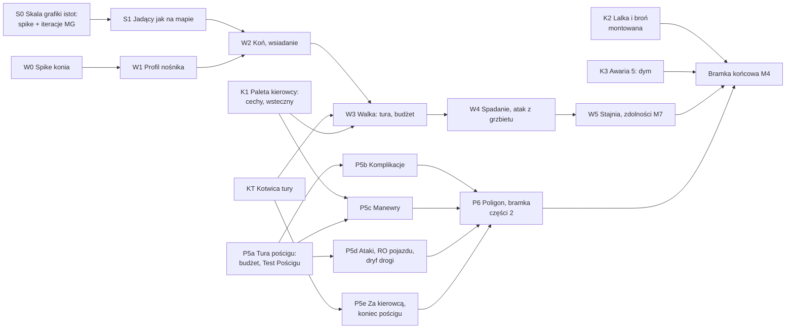

# PLAN — M4: Pojazdy (część 1) i pościgi (część 2)

> Status (2026-10-30): **M4 ZROBIONE** — część 1 i 1b (E0–E11), grafika (14 pojazdów, 7 wnętrz, 14 wraków, 2 wieże),
> część 2 (P1–P6), część 3 — wierzchowce (W0–W5) i całe przejście końcowe (§0.1: S0–S1, K1–K3, KT, P5a–P5e, P6,
> W0–W5); przebieg i bramka — §11. Do weta MG na Poligonie: Garaż, Pościg (Start–meta), Stajnia (§10). Zostały zasoby:
> 7 dźwięków (§8); żetony koni z góry dostarczone 2026-10-31. Decyzje MG D1–D45 (§1). Rozmiar: **XL**.
> Wywołanie: `PLAN_beta.md` §0, krok 4 (przesunięty przed M6, MG 2026-10-18).
> Zastępuje §4–§7 `PLAN_poscigi.md` (karta pojazdu, manewry, awarie), a od 2026-10-19 także geometrię planszy
> (tamten §2.1, §2.3–§2.6 i D2) — §6.2 tutaj. Grafika planszy (motywy, pustynia, kołysanie — tamten §2.2) zostaje.
>
> RAW = `Neuro 5e/Podrecznik/NOE/` (październik), `s. N` = strona drukowana: pojazdy s. 260–265, pościgi s. 266–268,
> Wojownik autostrady s. 88–89. Warstwy: **NOE** (RAW), **RAI**, **WKK** — `scripts/wkk/README.md`. Repozytorium
> jest publiczne: parafrazy i numery stron, bez cytatów i bez fabuły.
>
> **Zasady tego planu:** oznaczać, nie blokować (MG cofa, co się nie wydarzyło); pojazd to samobieżna skrzynia, nie
> istota — działa w turze kierowcy i nie ma własnej lojalności; to, co da się policzyć, liczy moduł po kliknięciu MG,
> resztę pisze na karcie.

---

## 0. W skrócie

| Część | Co dostaje stół | Stan | Gdzie |
|---|---|---|---|
| **1. Pojazdy** | katalog 14 pojazdów (paczka), karta pojazdu, wsiadanie na miejsca z żetonami jadącymi razem z pojazdem, prześwietlenie i kropki, silnik (uruchom/zgaś, dym, drgania, dźwięk), jazda w turze kierowcy, skręty, potrącenia, awarie k20 ze skutkami i naprawami, Wojownik autostrady, stanowisko Poligonu | ✅ E0–E8 (weto MG i znane braki — §10) | §4–§6 |
| **1b. Między scenami** | jedna reguła skali (obrys w metrach, znacznik na mapach w km), pamięć obsady i karta „Posadzić?”, Ctrl+X / Ctrl+V z załogą | ✅ E9–E11 | §4.14–§4.16 |
| **Grafika** | 14 żetonów z góry i portretów, 7 wnętrz (prześwietlenie), 14 wraków, osobne wieże Bradleya i Abramsa (oś pod przyszłe celowanie), Garaż z podglądami | ✅ (brak 7 dźwięków; 13 wraków do oceny MG) | §8, §11 |
| **2. Pościgi** | plansza od nowa — złożona droga (pojazdy w prawdziwej skali, tor = 36 m), metryka drogi dla zasięgów i obszarów, serie z celowaniem, jadący na planszy; paleta manewrów, Test Pościgu, komplikacje k20, ataki, wypadanie, koniec pościgu | ✅ P1–P6 | §6.2 |
| **3. Wierzchowce** (z M6, 2026-10-25) | nośnik = pojazd albo istota: koń wiezie widocznego jeźdźca tym samym kodem co pickup; Inicjatywa jeźdźca, spadanie z siodła, atak z grzbietu; Jeździec, Rodeo, Zawsze w siodle | ✅ W0–W5 (żetony koni z góry — 2026-10-31) | §6.3 |
| **Przejście końcowe** (2026-10-29) | skala grafiki istot i jadących, paleta kierowcy, kotwica tury, braki części 1, P5–P6, W0–W5 | ✅ 2026-10-30 | §0.1, §11 |

---

## 0.1 Przejście końcowe (runda 6, 2026-10-29)

> **Stan 2026-10-30: wszystkie pakiety zrobione** (commity `0d13846`–ostatni z §11; po drodze D45 — f = 0,8 i
> pojazdy ×1,1). Opis poniżej zostaje jako zapis planu.

Wszystkie pytania rozstrzygnięte (D34–D44). Zostało dziesięć pakietów. Każdy kończy się commitem z testami (zasady
repozytorium: `AGENTS.md`). Drzewo robocze może zawierać cudzą, niezacommitowaną pracę (np. M5: wraki maszyn,
materiały wybuchowe) — commituj tylko swoje pliki. Kod części 1 jest świeży i ma pokrycie: e2e `pojazd`,
`pojazd-prezentacja`, `pojazd-miejsca`, `pojazd-undo`, `garaz-grafika`, `poscig`, `poscig-jadacy`, Quench `pojazdy`
i `poscig` — każda zmiana wspólnego kodu idzie pod te testy.

| Pakiet | Zakres | Rozmiar | Zależy od | Gotowe gdy |
|---|---|---|---|---|
| **S0** | Spike skali grafiki istot (D42), rozszerzenie istniejącej sondy Garażu `skala-grafiki` (dziś: ludzie dnd5e, własna grafika i Gangus Kapo w Osobówce, auto +20%): wycinek mapy kampanii z narysowanymi autami, pojazdy z katalogu z jadącymi (także motocykl z pasażerem i deskorolka), postacie stockowe dnd5e, NOE i kampanii (z pierścieniem i bez), koń z bestiariusza; warianty mnożnika f = 1,0 / 0,8 / 0,7 / 0,6 obok siebie, do porównania także pojazdy ×1,1–1,2 (tylko podgląd). Iteracje z MG, bez zmian w danych. | S | — | MG wybiera f; wpis w D42 i §11 |
| **S1** | Mnożnik grafiki istot jako ustawienie świata i jadący rysowany dokładnie jak na mapie (D42, §4.1) | S–M | S0 | Quench: siatka jadącego = siatka tej postaci poza pojazdem (14 podwozi, po ruchu, obrocie, przesiadce, schowku); e2e `pojazd-prezentacja` i `garaz-grafika` |
| **K1** | Paleta kierowcy (D41): akcje cech pojazdu i bieg wsteczny, doliczane do budżetu jazdy; ta sama paleta przyjmie manewry P5c i akcje wierzchowca W3 | M | — | e2e `pojazd`: Gaz do dechy podnosi budżet i ST, wsteczny liczy ½ (Autobus ¼ z Utrudnieniem) |
| **K2** | Lalka a broń montowana (§10, znane braki) | S | — | Quench/e2e: ręce na broni, upuszczenie i schowanie oznaczane |
| **K3** | Awaria 5 — dym: Region przypięty do pojazdu i Oślepienie jadących na zakrytych miejscach (§4.8) | S | — | e2e: [Zastosuj] → jadący zakryci oślepieni; wysiadka, wsiadanie i naprawa uzgadniają efekt |
| **KT** | Kotwica tury (D39): rejestr kotwic uogólniający `_kotwica` z `combat/towarzysze-walka.mjs` | S–M | — | Quench sortowania i pomijania tury; regresja e2e towarzyszy |
| **P5a–P5e** | Mechanika pościgu (§6.2.5) | L | K1, KT | e2e `poscig-p5`: pościg od startu do mety bez notatek MG (`PLAN_beta.md`, M4) |
| **P6** | Poligon i bramka części 2: sondy D34–D41 na stanowisku Pościg | M | P5 | stanowisko z sondami; e2e w obu światach |
| **W0–W5** | Wierzchowce (§6.3) | L | S1, K1, KT | e2e `wierzchowiec`; stanowisko Stajnia |
| **Zasoby** | 7 dźwięków (MISSING §P); żetony koni z góry ×3 (✅ 2026-10-31, §8); ocena MG 13 wraków | — | — | MISSING §P bez pozycji M4 |

**Zamknięcie M4:** `release:check` zielony; macierz `IMPLEMENTATION.md` (wiersze „Walka na wierzchowcu”, „Pojazdy
i pościgi”, „Pojazdy poza pościgiem”, „Manewry pościgu…”) i `PLAN_beta.md` (M4) zaktualizowane; M7 dostaje sygnał,
że Jeździec, Rodeo i Zawsze w siodle mają nośnik (W5); `HANDOFF_m4_pojazdy.md` usunięty, jego pułapki są już w
`ARCHITECTURE.md` §11.

**Nie robimy w tym przejściu** (świadomie): obrót wież i zasady stanowisk (D33 — po becie, potwierdzone
2026-10-29); Paka — Akrobatyka stojących zostaje tekstem cechy; pościg konny (W-P1); TT w bezruchu poza walką;
spalanie z jazdy po mapie (liczy karta drużyny); etykiety rozmiarów (§10 — sprawa globalna, nie M4); przycięcie
rysunku wybuchu na planszy (D31 — po pierwszej grze); własny żeton GMT400 (grafika kampanii).

---

## 1. Decyzje MG (2026-10-18 – 2026-10-30)

| # | Decyzja |
|---|---|
| D1 | **Podział.** Część 1 — pojazdy poza pościgiem (s. 260–265) z awariami i naprawami, bo RAW wyzwala awarie także poza pościgiem; komplikacje 1–3 pościgu losują z tej samej tabeli. Część 2 — tylko tryb pościgu (s. 266–268). |
| D2 | **Jadący na mapie (wariant b).** Żetony postaci zostają na mapie, zmniejszone do miejsca i poza siatką, i jadą z pojazdem: pozycja, obrót (kierowca patrzący do przodu dalej patrzy do przodu po obrocie o 180°) i drgania silnika. |
| D3 | **Widok (doprecyzowanie D32, 2026-10-25).** Zakryte miejsca ukrywają jadących i pokazują kropki. Prześwietlenie mają MG, właściciele i jadący; sparowana grafika pokazuje wnętrze, pozostałe nadwozia przygasają. Otwarte miejsca ujawniają pełny żeton zamiast kropki. Układ miejsc może być dopasowany do grafiki. |
| D4 | **Wybór miejsca** w małym oknie z obrazem pojazdu z góry i klikalnymi miejscami; to samo okno dla „Przesiądź się”. |
| D5 | **Awarie: [Zastosuj] stosuje skutki mierzalne** (Szybkość, TT, pożar, wyciek paliwa, dym, zegary); fabularne — tekst na karcie. Zegary: **2k10 rund** wg RAW (w walce rundy, poza walką zegar świata, runda = 6 s). Płonący pojazd: **2k6 od ognia** na końcu tury kierowcy, jak jadący. |
| D6 | **10 pojazdów bez statbloku: improwizujemy.** Interpolacja z czterech statbloków jako podstawa plus własne, tanie i pewne cechy (§5), oznaczone jako RAI/WKK. |
| D7 | **Dwie wolne ręce: oznaczane.** MG mówi „nie, to się nie stało”, gracz robi **Zgaś** (bez kosztu) i wracamy do punktu wyjścia. Uruchomienie nie zużywa paliwa. Akcji nie liczymy ściśle właśnie po to, żeby dało się cofać pomyłki. |
| D8 | **Efekty silnika:** dym i drgania dla pojazdów silnikowych, trzy zestawy (benzyna, diesel, motocykl), ustawienie klienta wyłączające drgania. Ten sam efekt później dla maszyn Molocha. **Dźwięk: tylko uruchomienie i zgaszenie.** |
| D9 | **Tura pojazdu = tura kierowcy** (RAW: inicjatywa kierowcy). Pojazd nie wchodzi do trackera walki. |
| D10 | **Skręty wykrywane z ruchu:** zmiana kierunku ≥ 90° w turze kierowcy → karta MG z Testem MDR (Pojazdy). |
| D11 | **Dostęp i własność — dwie warstwy.** Własność stała (zwykła własność Foundry, ustawia MG) — dostęp także spoza pojazdu. Dostęp z obecności (postać siedzi w środku) — przesuwanie żetonu, karta, uruchamianie **i ładownia** pojazdu, w którym siedzisz (MG, 2026-10-19: upraszczamy). Bez stanów „kradziony” i „sporny”. (§4.4) |
| D12 | **Kluczyki i odpalanie na krótko (WKK).** Kluczyki pasują do jednego pojazdu (nie do innych tego typu; kopia żetonu tego samego pojazdu na innej scenie — pasują). MG tworzy kluczyki z karty pojazdu i ustawia stan: na kluczyk / odpalony na krótko. Na krótko wymaga narzędzi małego mechanika **albo** elektronika, ST wg klasy pojazdu; porażka — alarm, duża porażka — awaria 17, a gdzie nie ma awarii — obrażenia pojazdu; sukces trwale przełącza pojazd na „odpalony na krótko”. (§4.5) |
| D13 | **Obrys:** najpierw próba E0 z prostokątami; jeśli zawiedzie — kwadraty wg rozmiaru dnd5e. (§4.3) |
| D14 | **Kropki to uchwyty celowania:** wycelowanie w kropkę celuje w (dalej ukrytego) jadącego; karta ataku poda jego imię — to akceptowalne. (§4.2) |
| D15 | **Przesiądź się:** odległość między miejscami ×2 bez testu albo ×1 z ZRC (Akrobatyka) ST 10 (tylko w jadącym pojeździe; porażka o 5+ — Powalenie); stojący pojazd zawsze ×2. **WKK:** w jadącym pojeździe zmiana rzędu (przód↔tył, kabina↔paka) zawsze wymaga Akrobatyki. (§4.10) |
| D16 | **Broń montowana:** gdy strzelec siedzi na stanowisku, broń przechodzi do niego (flaga „zamontowana”: bez wagi, ręce na broni) i wraca do pojazdu, gdy opuści stanowisko — magazynki, tryby ognia i zacięcia działają bez zmian. **Montaż to Robota produkcji** zakładana przyciskiem MG na karcie pojazdu; moduł liczy godziny, surowce i test (MG, 2026-10-19). Browning na GMT400 leży dziś w bagażniku, nie jest zamontowany. (§4.11) |
| D17 | **Pojazd przy 0 PW:** wrak (grafika wraku, jadący wysadzeni obok, bez uruchamiania i ruchu); płonący (awaria 1) z paliwem w baku — odliczanie k4 rund i wybuch baku (ogień wg rozmiaru, RO ZRC — połowa). (§4.12) |
| D18 | **Światła:** przełącznik na pojeździe silnikowym (kierowca i MG), stożek do przodu; działają też przy zgaszonym silniku; awaria 17 je gasi. (§4.5) |
| D19 | **Naprawy, PW i wrak — improwizacja** (MG, 2026-10-19: „improwizuj”). Wzór: naprawa drona z M3 i tabela Naprawiania s. 146; liczby w §4.9, do weta przy E6. |

**Runda 5 (2026-10-19, po nocy) — pojazdy między scenami i plansza pościgu:**

| # | Decyzja |
|---|---|
| D20 | **Jeden aktor, wiele widoków.** Wspólny stan (PW, awarie, zegary, silnik, paliwo, ładownia, broń, wrak, pamięć obsady) ma pojazd o **powiązanym** aktorze — tak jest GMT400. Pojazdy z paczki są niepowiązane (bandyci: każdy żeton to osobna kopia, jak Hammer Posterunku). Pojazd drużyny musi być powiązany: karta drużyny czyta paliwo z aktora świata (`primaryVehicle`). |
| D21 | **Jedna reguła skali.** Obrys w metrach: rozmiar żetonu = metry ÷ metry na kratkę sceny — skala prawdziwa na każdej scenie taktycznej (także siatka 3 m) i na planszy pościgu. Gdy 1,5 m wychodzi za małe do narysowania (mapy w km) — pojazd jest zwykłym znacznikiem, bez miejsc. Na mapie podróży pojazd reprezentuje żeton drużyny (paliwo z `primaryVehicle`); znacznik pojazdu to ozdoba. (§4.14) |
| D22 | **Ctrl+X / Ctrl+V przenosi pojazd z załogą** między scenami — rdzeń 14 wycina między scenami z zachowaniem id. Bez przycisku z wyborem sceny. (§4.16) |
| D23 | **Pamięć obsady i karta „Posadzić?”** — pojazd pamięta, kto siedzi na którym miejscu; gdy pojazd albo zapamiętana postać pojawia się na scenie, MG dostaje kartę [Posadź] / [Pomiń]. Nic nie sadza się samo. (§4.15) |
| D24 | **Plansza pościgu — złożona droga.** Pojazdy w prawdziwej skali (70 px na 1,5 m, jak mapy kampanii); tor 280 px rysowany jako 6 m, mierzony jako 36 m. Między pojazdami w osi x liczą się znaczniki, w osi y — prawdziwe metry; wewnątrz pojazdu — prawdziwe metry w obu osiach („wyspy”). Plansza ×1,4. Przepisanie pościgów od nowa dozwolone. Odrzucone: osobna skala pionków (pojazdy nie w skali) i droga w prawdziwej skali (tor 1680 px, plansza ~23 500 px — wbrew abstrakcji znaczników RAW, ciągłe przybliżanie). (§6.2) |
| D25 | **Twardo w torach.** W pasie gry środek pojazdu zawsze na środku toru — bez Shift, bez połówek; to, co wyląduje obok (makro, cofnięcie), MG dociąga po ruchu. Kolejność w znaczniku — rzędy (y wolne, w metrach). Nakładania się żetonów pilnuje MG; pojazd dłuższy niż tor zachodzi na obrazie na sąsiedni, plakietka pokazuje jego znacznik. Strefa swobodna zostaje swobodna. |
| D26 | **Jadący jadą na planszę jako żetony** (odwraca D2 `PLAN_poscigi.md`): miejsca, kropki, prześwietlenie i przesiadka z części 1; ataki na kierowcę i pasażerów idą zwykłą drogą broni. |
| D27 | **Odległość na planszy liczy tylko metryka drogi** — zasięgi, cechy zależne od zasięgu, linijka (znów 36 m na tor), rzut, krawędzie, obszary; nigdy piksele. Strażnik w Quench. |
| D28 | **Serie (Długa, Miażdżąca) na planszy się celuje, nie przeciąga.** Podgląd na żywo, trafieni liczeni na drodze. Seria trafia **wielu jadących w jednym pojeździe i wiele pojazdów, jeśli ustawią się w linii** — jadących i same pojazdy (RAW wg MG). Karta z listą i [Zaznacz trafionych]. (§6.2.4) |
| D29 | **Ogień zaporowy na planszy przykleja się do pojazdu**, na którym go położono — łapie jego jadących także przy przesiadce. |
| D30 | **Rzeczy na drodze** (kolczatka, flara, mina) — wg znacznika, wyzwalane wjazdem pojazdu w ten znacznik (wynika z D25). |
| D31 | **Obraz między pojazdami nie musi zgadzać się z geometrią:** smuga może iść w bok albo do tyłu, obowiązuje lista trafionych. Rysunek wybuchu przycięty do pojazdów, których dosięga — **po pierwszej grze** (§10). |
| D32 | **Prezentacja miejsc, MG 2026-10-25.** Wspólny model rozdziela otwarte/zakryte miejsce i kolejność grafiki. Właz Hammera: pełny żeton zawsze widoczny zgodnie ze zwykłą widocznością Foundry, **nad dachem**, bez kropki. Kabina nadal zakryta. Grafiki Hammera bez zmian; rysowanie pod osobnym dachem odłożone. To fundament W1, bez uruchamiania całej części 3. |
| D33 | **Obsługa wieżyczek po becie, MG 2026-10-26.** Rozbudowane zasady stanowisk i wieżyczek odkładamy. Wstępne założenie: użycie broni na odpowiednim stanowisku ma niwelować wymogi/kary właściwości **Ciężka** oraz **Utrudnienie za atak z jadącego pojazdu**. To kierunek do doprecyzowania po becie, nie bieżąca zmiana mechaniki. |

**Runda 6 (2026-10-29) — przegląd planu przed przejściem końcowym: pytania P5, wierzchowce, skala, zakres:**

| # | Decyzja |
|---|---|
| D34 | **Ruch na planszy (P5, pyt. 1).** Kierowca przeciąga pojazd po torach, moduł liczy znaczniki z budżetu i oznacza przekroczenie. Metryka drogi już daje 36 m na tor, więc budżet z E5 działa na planszy bez nowej geometrii. **RAI: reszta metrów przechodzi na następną turę** — zapas = budżet + poprzedni zapas − 36 × przebyte znaczniki, najwyżej 35 m (Autobus 24 m awansuje dwa razy na trzy tury; niewykorzystane pełne znaczniki przepadają jak w RAW). Na planszy pojazd o Szybkości > 0 zawsze „jedzie”. Karta MG [Cofnij o znacznik] na końcu tury kierowcy pojawia się tylko, gdy pojazd stał: Szybkość 0 (oś, silnik, wrak), Hample bez dalszej jazdy albo brak kierowcy. Ruchy wymuszone (Hample −2, komplikacje, nat. 20 +1) to przyciski na kartach (stary D4). |
| D35 | **Test Pościgu (pyt. 2, 2b).** Karta na początku tury kierowcy pojazdu z rolą pościgu, rzut po kliknięciu — kierowca może najpierw zadeklarować manewr (Ostrożna jazda — Ułatwienie; Gaz do dechy, Szósty bieg — ST +5). ST ze środowiska planszy. Sukces — nic; porażka — komplikacja; nat. 20 — bez komplikacji i [+1 znacznik]; nat. 1 — dwie komplikacje. **Porażka o 6+ — dodatkowo karta awarii k20** (RAW s. 264 obejmuje każdy Test (Pojazdy); hak w `awarie.mjs` już ją wystawia, MG może pominąć). |
| D36 | **Komplikacje, atak na kierowcę, RO pojazdu (pyt. 3, 5, 10).** Komplikacje k20 (s. 267): [Zastosuj] dla mierzalnych (znaczniki, obrażenia, Szybkość ½, trudny teren, stany; 1–3 → awaria z tabeli k20), testy jako przyciski, reszta tekstem. Trafiony kierowca na planszy → Test (Pojazdy) ST max(10, ½ obrażeń); porażka [Cofnij o znacznik], o 5+ [Przewrócenie] (awaria 8). **Pojazd trafiony serią albo obszarem rzuca RO ZRC jak istota** (ZRC z katalogu; Slalom kierowcy daje Ułatwienie w Reakcji), potem Próg obrażeń. |
| D37 | **Wręcz na znaczniku (pyt. 4, RAW).** Ten sam znacznik = zasięg wręcz bez względu na rząd; opuszczenie wspólnego znacznika nie prowokuje ataków okazyjnych. Jedyny wyjątek od D27 i tylko dla zasięgu wręcz — zasięgi dystansowe, obszary i linijka dalej z metryki. |
| D38 | **Dryf drogi (pyt. 6, rozszerzone).** Wszystko na planszy poza pojazdami i ich jadącymi — wypadnięci, przedmioty, rzeczy na drodze (D30), przepaść z komplikacji 15 — cofa się o 3 znaczniki na początku każdej rundy. Aktywny MG przesuwa, karta wymienia, co minęło po drodze (interakcje rozstrzyga MG). Wypadnięty ląduje znacznik za pojazdem (3k6, Powalenie — część 1); zjazd z tyłu planszy — „został w tyle”, poza pościgiem. |
| D39 | **Kotwica tury (pyt. 7, 7b; W-U6).** Jedno narzędzie dla trzech przypadków: towarzysz po właścicielu (M3, istnieje), pasażer „Za kierowcą” (jednorazowo, przycisk HUD-u jadącego; RAW na planszy, **RAI także na mapie taktycznej**), wierzchowiec prowadzony przez jeźdźca (Inicjatywa jeźdźca, własna tura pomijana, rusza się w turze jeźdźca; po zsiadaniu zachowuje wartość i dostaje własną turę). Rejestr kotwic zamiast drugiego owinięcia `Combat#_sortCombatants`. |
| D40 | **Koniec pościgu i Rajdowiec (pyt. 8, 11).** Karta MG przy przewadze 7 znaczników, po 10 rundach (wygrywa najdalszy) i przy wyeliminowaniu (wrak, Szybkość 0 na stałe); meta — logiczny znacznik ustawiany przez MG, przeżywa recentrowanie. Runda pościgu = runda walki na scenie planszy. Rajdowiec na planszy działa zawsze, także poza walką. |
| D41 | **Paleta kierowcy (pyt. 9 i znane braki).** Jeden przycisk na HUD-zie pojazdu i kierowcy otwiera paletę: akcje cech pojazdu (Gaz do dechy, Szósty bieg, Przerzutka, Akrobacja, Skok, Syrena, Działko wodne, Lemiesz, Uciąg, Ollie; Slalom jako Reakcja), bieg wsteczny (Cofanie ½; Autobus i Ciężarówka ¼ z Utrudnieniem), a na planszy sześć manewrów (Gazu!, Hample, Obrót 180°, Ostrożna jazda, Stuknięcie, Zajechanie). Wybór = karta + efekt na pojeździe do początku następnej tury kierowcy, który zmienia budżet, ST i Utrudnienia. Koszt akcji oznaczany, nie pobierany (D7). |
| D42 | **Skala grafiki istot (MG 2026-10-29: „jeszcze bardziej radykalnie”; wartość po S0).** Różnicę skali między jadącym a postacią na mapie zmniejszamy od strony istot: **mnożnik f rysowania wszystkich istot** — stockowe dnd5e, NOE i kampania; ustawienie świata, tylko obraz (dokumenty, przestrzeń, zasięgi i `tokens/scale-overrides.json` bez zmian). **Jadący rysuje się dokładnie jak na mapie** (jego rozmiar sprzed wsiadania × f), niezależnie od rozmiaru dokumentu na miejscu (0,5 kratki zostaje polem kliknięcia i odstępem foteli). Rekomendacja: pojazdy zostają w prawdziwej skali (D21, D24, auta i ulice na mapach kampanii); powiększenie pojazdów tylko wtedy, gdy S0 pokaże, że bez niego nie wystarczy. Przewidziane kilka iteracji z MG. **Wartość (MG 2026-10-30, po S0): f = 0,8** — domyślne ustawienie świata „Skala grafiki istot” (`scenes/skala-istot.mjs`, zakres 0,5–1); razem z D45. |
| D43 | **Wierzchowce (MG 2026-10-29).** Obrys kwadratowy wg rozmiaru dnd5e (koń Duży — 2 × 2, zamiana obrysu się nie odpala). Kierowanie: **jedna wolna ręka** (RAI z Jeźdźca s. 97 — „nie musisz używać rąk”; oznaczane z lalki, Jeździec bez rąk). Budżet ruchu nośnika **teraz**, na wzorcu E5 (W-P3 — handoff ruchu nie ma kodu, przejmie budżet później). Żetony koni z góry, trzy warianty (zamówienie, §8). Inicjatywa przez kotwicę tury (D39). W-U1–W-U6 i W-P1–W-P2 przyjęte bez weta. |
| D44 | **Zakres przejścia końcowego (MG 2026-10-29).** Zamykamy znane braki: lalka a broń montowana, bieg wsteczny i akcje cech (D41), dym awarii 5 (Region + Oślepienie). Paka zostaje tekstem cechy. **Wieże po becie — D33 potwierdzone**: grafika wieży nadal obraca się razem z kadłubem. Dziennik grafiki w §11 skrócony do tabeli. |
| D45 | **Pojazdy ×1,1 (MG 2026-10-30, po S0, razem z f = 0,8).** MG wybrał w S0 wariant f = 0,8 z pojazdami większymi o 10%. Pojazdy rosną od strony obrysu: `SKALA_POJAZDOW = 1.1` i `obrysWSkali` (`config/vehicles-data.mjs`) mnożą obrys katalogu i własny obrys aktora, więc żeton, miejsca, kratki i paczka `pojazdy` rosną razem — to jedyna zmiana skali, która dotyka dokumentów. Wierzchowce nie (to istoty — f). Na planszy pościgu istota stawiana w rozmiarze prototypu dostaje prawdziwą skalę (człowiek — ¼ toru, D24), bo jadący rysuje się z rozmiaru sprzed wsiadania (S1). |

---

## 2. RAW w pigułce

**Część 1 (s. 260–265):**
- *Wsiadanie jako kierowca* — pojazd ≤ 1,5 m, połowa Szybkości (w dół); potem reszta ruchu przepada, a postać jedzie
  Szybkością pojazdu. Silnik wymaga **akcji** uruchomienia; pojazd mięśniowy — ruchu kierowcy. **Kierownica = dwie
  wolne ręce.**
- *Wsiadanie jako pasażer* — bez dodatkowego kosztu; drzwi, fotel, okno — połowa Szybkości.
- *Kierowanie* — pojazdy specjalne (buldożer, czołg, dźwig): MG może zażądać Testu MDR (Pojazdy). Przyspieszenie
  daje dodatkowy ruch. Skręt o 90°: Szybkość ×½, chyba że MDR (Pojazdy) ST 10. Wsteczny: ×½. Obrót o 180° w ruchu:
  ST 20, porażka — awaria Przewrócenie.
- *Wypadanie* — 9 (3k6) obuchowych i Powalenie. *Trudny teren* — Szybkość ×½ i co turę test o ST MG, porażka —
  Szybkość 0; pojazdy terenowe: ×½ bez testów.
- *Atakowanie w jadącym pojeździe* — przed atakiem ZRC (Akrobatyka) ST 10, porażka — Utrudnienie w Testach Ataku do
  następnej tury.
- *Tabela statystyk* (s. 262), statbloki Autobusu, Roweru, Motocykla, Osobówki (s. 262–264): Cofanie, Potrącenie,
  Skok, Akrobacja, Przerzutka [B], Szósty bieg [B], Gaz do dechy [B], Slalom [R].
- *Awarie pojazdów silnikowych* (s. 264–265): k20 przy obrażeniach ≥ Próg awarii albo porażce kierowcy w teście o
  więcej niż 5; naprawa tymczasowa w jeździe (akcja + test, 1 minuta) i fachowa na postoju (narzędzia małego
  mechanika, biegłość, części; Naprawianie s. 146).
- *Ruch wewnątrz jadącego pojazdu* (s. 266, pkt 3 — w rozdziale pościgów, ale opisuje każdy jadący pojazd): z połową
  Szybkości; „normalny ruch” — ZRC (Akrobatyka) ST 10, porażka o 5+ — Powalenie.

**Część 2 (s. 266–268):** znaczniki co 36 m, inicjatywa (przesunięcie tury za kierowcę), Test Pościgu (ST 5/10/15,
nat. 20 — znacznik więcej, nat. 1 — dwie komplikacje), ataki (osłona ½ = TT +2, atak na kierowcę), wypadanie (−3
znaczniki na rundę), koniec pościgu, komplikacje k20, manewry: Gazu!, Hample, Obrót 180°, Ostrożna jazda,
Stuknięcie, Zajechanie.

**Wojownik autostrady** (Twardziel, s. 88–89): Drzwi w drzwi (Rajdowiec, Konwojent, Taranowanie), Kaskader (schody,
skoki, dwa koła), Pancerna fura (OC, AC [B] — uruchomienie i zatrzymanie w akcji bonusowej). Biegłości: Pojazdy +
narzędzia małego mechanika (M6).

**Część 3 — wierzchowce (s. 257) i zdolności wokół nich** (odczyt 2026-10-29):
- *Wierzchowiec* — istota ≥ 1 rozmiar większa od jeźdźca, z siodłem (albo czymś podobnym). Dosiadanie i zsiadanie w
  ruchu, w zasięgu 1,5 m, za połowę Szybkości. Dosiada się tylko wyszkolonego; ujeżdżony (Rodeo) — tylko ten, kto go
  ujeździł.
- *Kontrola* — Inicjatywa wierzchowca wyrównuje się z jeźdźcem; rusza się w turze jeźdźca i ma tylko jedną z czterech
  akcji (s. 29–30): **Bieganie** (+2× Szybkości do początku następnej tury, Utrudnienie do jego Testów Ataku, ataki
  dystansowe przeciw niemu z Utrudnieniem do końca tury; nie dla istot, które nie chodzą na nogach), **Przyspieszenie**
  (+1× Szybkości w tej turze), **Odstąpienie**, **Unikanie**. Może działać już w turze dosiadania. Niewyszkolony robi,
  co chce. Po zsiadaniu w walce zachowuje Inicjatywę jeźdźca, dba o siebie (Unikanie, Odstąpienie), może uciec.
- *Spadanie* — przemieszczenie wierzchowca wbrew jego woli albo Powalenie jeźdźca lub wierzchowca → RO ZRC ST 10;
  porażka — 1,5 m obok, Powalenie i „możliwe obrażenia” (MG).
- *Walka z grzbietu* — jeździec albo pasażer bez biegłości w Tresurze atakuje z grzbietu **jadącego** wierzchowca z
  Utrudnieniem.
- **Jeździec** (Zwiadowca, Wyjadacz, s. 97): kieruje bez rąk (czyli zwykle ręce są potrzebne — D43), ataki dystansowe
  bez Utrudnienia z niestabilnego podłoża, dosiadanie i zsiadanie za 1,5 m, TT wierzchowca + Premia Biegłości.
  **Rodeo** (Sztuczka, s. 106): Dżokej — ujeżdżenie przyjaznego zwierzęcia ≥ 1 rozmiar większego bez siodła, Test MDR
  (Tresura) ST 10 + mod. SIŁ istoty; Kawalerzysta — TT wierzchowca + Premia Biegłości. **Zawsze w siodle** (Kowboj,
  s. 88): koń albo motocykl na najbliższym Długim odpoczynku — fabularne. **Ale jazda!** (Pochodzenie, s. 61):
  strzelając z jadącego pojazdu, z wierzchowca albo spadając, ignorujesz Utrudnienia z niestabilnego podłoża.
- Bestiariusz: koń zdrowy (Duży, 24 m), skażony (Duży, 18 m), teksańczyk (Duży, 36 m) — `dev/bestiary/bestiary.json`;
  żetony to dziś atrapy (`tokens/_placeholder/kon-*.webp`).

---

## 3. Co już mamy (stan 2026-10-29)

| Obszar | Stan | Kod / dane | Testy |
|---|---|---|---|
| Dane | 14 podwozi (s. 262, rozbieżności RAW opisane) + katalog: obrysy, strefy z prezentacją i kolumnami dopasowanymi do grafiki, rura, cechy, `GRAFIKI_WRAKOW`, `wiezaGrafiki` (Bradley, Abrams); ST środowisk i stałe pościgu (`SRODOWISKA`, `znacznikiZDystansu`) | `config/vehicles-data.mjs` | Quench `pojazdy` |
| Paczka | `pojazdy` — 14 aktorów, 52 cechy jako zdolności pojazdu | `dev/packs/build-pojazdy.mjs` | `validate-packs` |
| Kampania | GMT400 (podwozie Hammera, obrys 1,5 × 3,5, 8 miejsc) i Hammer Posterunku po migracji E1; GMT400 jeździ na grafice Hammera | `migration/migrate-pojazdy.mjs` | — |
| Część 1 i 1b | 22 moduły (mapa plików w `pojazdy/index.mjs`), API `game.neuroshima.pojazdy`; karta = podklasa stockowej `VehicleActorSheet` dnd5e 6 | `scripts/pojazdy/` | e2e `pojazd`, `pojazd-prezentacja`, `pojazd-miejsca`, `pojazd-undo`, `garaz-grafika`; Quench `pojazdy` 42/42 |
| Otwarte miejsca (D32, W-U1) | dane gotowe na 10 pojazdach: Motocykl, Rower, Buggy, Hammer (właz), Ciężarówka (paka), Wóz strażacki (działko), Buldożer, Traktor, Motorower, Deskorolka; zakryte tylko Osobówka, Autobus, Czołg, BWP | `prezentacja.mjs`, katalog | e2e `pojazd-prezentacja` |
| Wieże | osobna warstwa grafiki: oś, wycinek, transformacja kadłuba; **bez** własnego kąta (D33) | `pojazdy/wieza.mjs` | e2e `garaz-grafika` |
| Pościg P1–P4 | złożona droga, metryka drogi, serie i obszary; z mechaniki tylko powłoka: role (ścigany/ścigający), przewaga, ST środowiska, runda ręczna, raport przewagi 7 i 10 rund | `scenes/poscig*.mjs`, `scenes/droga.mjs`, `scenes/poscig-serie.mjs` | e2e `poscig`, `poscig-jadacy`, `nevada-art`, `urban-art`; Quench `poscig` 72/72 |
| Brak (P5) | Test Pościgu, komplikacje, manewry, budżet w znacznikach, ataki na planszy, dryf, koniec pościgu, runda z walki | — | — |
| Brak (część 3) | profil nośnika, wierzchowiec, kotwica tury dla nośników | — | — |
| Wokół, do użycia | Naprawa M2 (`production/naprawa.mjs`), lalka (`actors/doll.mjs` `freeHands`), okoliczności ataku (`combat/okolicznosci.mjs` — `zarejestrujZrodloOkolicznosci`, gałąź planszy w `odlegloscKrawedzi`), towarzysze w walce (`combat/towarzysze-walka.mjs` — `_kotwica`, `CombatantGroup`), Regiony przypięte do żetonu (ogień zaporowy D29), Sequencer + JB2A | | |
| Handoff ruchu | `HANDOFF_movement_hotbar.md` — tylko projekt, **bez kodu** (budżetu ruchu postaci nie ma) | — | — |
| dnd5e 6 / rdzeń 14 | `vehicle`: `crew`/`passengers`/`draft` (listy UUID), `hp.dt`, `hp.mt`; **brak** jeźdźca i wierzchowca w dnd5e (także reguły „controlled mount”); rdzeń przypina do żetonu tylko Regiony; `CombatantGroup` ze wspólną inicjatywą (dnd5e i M3 go używają) | `fvtt-dnd5e/module/data/actor/vehicle.mjs`, `common/documents/region.mjs` | — |

---

## 4. Architektura części 1

### 4.1 Jadący — żetony, które jadą z pojazdem (D2)

**Skala jadących — D42, pakiety S0–S1 (2026-10-29).** Diagnoza 2026-10-26
([pomiary](dev/audits/vehicle-occupant-scale-2026-10-26.md)): rozmiar miejsca 0,5 kratki pomniejsza też grafikę
jadącego o połowę, na 14/14 podwozi. Na zakrytym fotelu to nie razi (MG: „w aucie dobrze”), ale na motocyklu,
deskorolce i — po części 3 — na koniu „malutki żetonik” wygląda źle. Poprawka rozdziela dwie odpowiedzialności:

- **Dokument** jadącego zostaje 0,5 kratki pojazdu: pole kliknięcia, odstępy foteli, kotwice, schowek, Quench
  geometrii. Nie zmieniać `ROZMIAR_MIEJSCA` (odstępy w `ukladMiejsc`) ani skal prototypów.
- **Siatka** jadącego rysuje się w jego rozmiarze sprzed wsiadania (`jazda.rozmiar`) — w `_refreshMeshSizeAndScale`
  podklasy z `zeton.mjs`, tak jak dziś obrys naturalny pojazdu (`obrysSiatki`). Postać w pojeździe jest więc tak
  duża jak obok niego; na otwartym siodle wystaje poza motocykl jak prawdziwy człowiek. Kolejność w obrębie pojazdu:
  przednie miejsce nad tylnym (sprawdzić w S0 na motocyklu z pasażerem).
- **Mnożnik f istot** (D42) nakłada się na końcu, jednakowo na mapie i w pojeździe. Nowy `scenes/skala-istot.mjs`:
  ustawienie świata `skalaGrafikiIstot` (domyślnie 1,0 do decyzji po S0, zakres 0,5–1,0) i czysta funkcja
  `mnoznikGrafiki(tokenDoc)` — f dla aktorów `character` i `npc` (także wierzchowców), 1 dla pojazdów, pojemników typu
  `vehicle`, `group`, żetonów bez aktora, obiektów (`scenes/obiekty.mjs`), przedmiotów na ziemi i znaczników.
  Mnożenie `mesh.scale` w tej samej podklasie żetonu (jedyna podklasa modułu), po `super` i po rozmiarze jadącego.
  Zmiana ustawienia odświeża siatki (`renderFlags.set({refreshMesh: true})`). Nic nie trafia do bazy, więc
  `tokens/scale-overrides.json`, Szafy z potworami i postaciami oraz test `skala-zetonow` zostają bez zmian.
- **Do oceny w S0:** pierścień dnd5e skaluje się z siatką; paski, nazwa, ramka i pole kliknięcia zostają w obrysie
  dokumentu — czy przerwa między grafiką a paskiem przy f ≈ 0,6–0,7 przeszkadza; czytelność okrągłych portretów.
- **Testy S1:** Quench — `mnoznikGrafiki` dla typów aktorów; siatka jadącego = siatka tej samej postaci obok pojazdu
  (14 podwozi, po ruchu, obrocie, przesiadce, Ctrl+X/V); wsiadanie i wysiadanie nie zmieniają `texture.scaleX`.
  Dotychczasowe testy sprawdzały tylko obrys 0,5 — nie wykryłyby tej wady.

Poniżej opis mechanizmu jadących (bez zmian od E0).

Rdzeń 14 ma już ten wzorzec dla Regionów przypiętych do żetonu: zmiany Regionu idą w tej samej operacji co ruch
żetonu, a w animacji Region odświeża się co klatkę (`client/documents/token.mjs` — `#computeAttachedRegionUpdates`,
`client/canvas/placeables/token.mjs` — `#animateAttachments`). Jadący robią to samo — **bez przepinania obiektów
PIXI**:

- **Stan:** flaga na żetonie jadącego `jazda = {pojazd: tokenId, miejsce, obrot}` (`obrot` — własny obrót względem
  pojazdu) i lista UUID aktorów w `crew`/`passengers` pojazdu (nośnik dnd5e, z którego korzysta też pościg).
- **Klatka:** w animacji pojazdu rdzeń wpisuje do dokumentu pośrednie `x/y/rotation` i woła wywołania co klatkę
  (`context.onAnimate`). Każdy klient liczy pozycję miejsca obróconą o kąt pojazdu i ustawia jadącego — z wizją,
  więc FOV 220° obraca się razem z pojazdem. Obrót jadącego = obrót pojazdu + `obrot`.
- **Koniec ruchu:** MG zapisuje końcowe pozycje jadących jedną operacją, bez animacji.
- **Drgania:** jeden ticker modułu dodaje to samo przesunięcie do siatki pojazdu i jego jadących — drżą razem.
- **Rozmiar:** w czasie jazdy dokument jadącego dostaje rozmiar miejsca (0,5 kratki pojazdu), oryginalny zapisany
  we fladze; wysiadanie, usunięcie pojazdu i przycisk MG „Wysadź wszystkich” go przywracają. Grafika — patrz
  „Skala jadących” wyżej (S1: siatka w rozmiarze oryginalnym × f).
- **Wizja:** rdzeń nie wiąże wizji z widocznością żetonu (`Token#_isVisionSource` nie czyta `isVisible`), więc ukryty
  jadący dalej widzi — gracz patrzy z wnętrza pojazdu.

### 4.2 Prezentacja miejsc, kropki i prześwietlenie (D3, D32)

- **Ukrycie lokalne**, nie `hidden` dokumentu (ukryty dokument odebrałby graczowi własny żeton): nadpisanie
  `Token#isVisible` dla zakrytych miejsc — `false`, chyba że klient prześwietla pojazd albo kontroluje jadącego.
  Otwarte miejsce przechodzi zwykłą widoczność Foundry: mgła, ściany i ręczne `hidden` nadal obowiązują.
- **Kropki:** nakładka pojazdu, jedna kropka na postać na zakrytym miejscu (bez tożsamości), widoczna dla tych, którzy
  widzą pojazd. **Kropka jest uchwytem celowania (D14):** wycelowanie w nią ustawia cel na ukrytym jeźdźcu.
- **Prześwietlenie:** po najechaniu na pojazd — nadwozie do ok. 35% krycia, jadący widoczni i klikalni. Mają je MG,
  właściciele pojazdu i gracze z postacią w środku. Pozostali widzą kropki.
- **Zaznaczanie pojazdu:** ukryci jadący nie przyjmują kliknięć, więc klik w pojazd zaznacza pojazd; w
  prześwietleniu klik w jadącego zaznacza jadącego, Alt+klik przechodzi do pojazdu.

**Model D32.** Strefa może zawierać `prezentacja: { widocznosc: "otwarta", warstwa: "nad" }`;
`geometria.mjs` przenosi te dane na miejsca. Brak ustawienia oznacza `zakryta` i `nad`.
`prezentacja.mjs` rozstrzyga wspólnie widoczność, rozpoznawanie jadącego i kolejność rysowania.
`warstwa` jest względna wobec całej grafiki nośnika (`nad`/`pod`); osobny dach i maska włazu nie są wdrażane.
Hammer używa wyłącznie `nad`: pełny żeton strzelca pozostaje nad zamkniętym nadwoziem oraz odsłoniętym wnętrzem.
Względny porządek siatek liczony jest lokalnie po odświeżeniu rdzenia; nie zapisuje zmian sortowania przy najazdach.
Otwarte miejsce nie nadaje własności, dostępu do ładowni ani prawa prześwietlenia reszty kabiny. Okno Miejsca
i lista Załogi mogą rozpoznać widoczną postać na otwartym miejscu, pozostawiając pozostałe miejsca jako „zajęte”.
Prezentacja jest niezależna od `stanowisko` i `oslona`; właz zachowuje osłonę ¾ oraz mechanikę broni.
Istniejące własne strefy wymagają jawnego dodania prezentacji; podgląd Hammera w Poligonie aktualizujemy punktowo.

### 4.3 Obrys pojazdu (D13 — próba E0)

Rdzeń liczy kształt, pole kliknięcia, zajmowane kratki i odległości z `width`/`height` **bez obrotu**
(`Token#getShape`). Prostokątny samochód obrócony o 90° wyglądałby poziomo, a zajmował pionowo. Propozycja:
**prostokątny obrys w czterech kierunkach** — gdy kierunek jazdy przekracza 45°, moduł zamienia `width`↔`height`
(środek bez zmian), a obraz obraca się w środku. Kratki, odległości, sąsiedztwo i ataki okazyjne liczą się wtedy jak
dla każdej dużej istoty, tylko nieskwadratowej; skosy przybliża najbliższy kierunek. Obrót w miejscu nie jest
darmowy: pojazd obraca się w ruchu (D10), a nowe kratki po zamianie obrysu sprawdzają potrącenie (§4.7).
Wariant zapasowy, jeśli próba E0 się nie uda: kwadratowy obrys wg rozmiaru dnd5e.

### 4.4 Dostęp i własność (D11)

Pojazd nie ma lojalności — to samobieżna skrzynia. Dwie warstwy:
1. **Własność stała** — zwykła własność Foundry, ustawiana przez MG; pełny dostęp, z ładownią.
2. **Dostęp z obecności** — gracz, którego postać siedzi w środku, ma na czas jazdy prawa właściciela (przesuwa
   żeton, widzi kartę i ładownię, uruchamia, przesiada się). Wysiadka przywraca poprzednie prawa (zapis we fladze,
   zapis przez MG).

Cudzy pojazd z graczem w środku to po prostu warstwa 2; MG robi z niego własny, nadając własność. Upuszczone w
pojeździe (WKK) ląduje w ładowni, którą jadący i tak widzi.

### 4.5 Silnik (D7, D8)

- **Uruchom** (akcja; Pancerna fura — akcja bonusowa) i **Zgaś** (bez kosztu) z miejsca kierowcy. Oznaczenia: brak
  dwóch wolnych rąk (lalka), brak paliwa, awaria 15 (silnik) i 17 (zapłon), brak kluczyków. Uruchomienie nie zużywa
  paliwa.
- **Kluczyki (D12, WKK):** przedmiot z identyfikatorem pojazdu. Identyfikator żyje na aktorze pojazdu (żeton
  niepowiązany — w jego delcie), nadawany przy utworzeniu, więc duplikat aktora dostaje nowy, a skopiowany żeton
  tego samego pojazdu zachowuje stary. MG: **Utwórz kluczyki** i przełącznik **na kluczyk / odpalony na krótko** na
  karcie. Uruchom sprawdza kluczyki u kierowcy i w stacyjce (ładownia).
- **Na krótko (D12, WKK):** akcja kierowcy z narzędziami małego mechanika albo elektronika (test narzędzi), ST wg
  klasy pojazdu (jednoślady 10, osobowe i terenowe 15, ciężkie i pancerne 20). Porażka — alarm (dźwięk, szept do
  MG); porażka o 5+ — awaria 17, a pojazd bez awarii dostaje obrażenia; sukces — pojazd trwale „odpalony na krótko”
  (Uruchom bez kluczyków).
- **Stan:** flaga `silnik` na aktorze pojazdu. Pojazd silnikowy przy zgaszonym silniku: Szybkość 0 (oznaczane).
- **Efekty:** dym z rury — natywny `ParticleGenerator` rdzenia 14 (tryb efektu, kotwica na żetonie, obrót i rura w
  układzie pojazdu), liczony lokalnie na każdym kliencie z flagi `silnik` — nic nie zapisuje się w scenie. Darmowy
  JB2A nie ma kłębów spalin (tylko jasna mgła i linia dymu), więc teksturę kłębu generujemy sami (miękki gradient,
  `vfx/`). Drgania — ticker z §4.1. Zestawy: **benzyna** (jasne, rzadkie kłęby, drobne szybkie drgania), **diesel**
  (ciemna sadza, wolniejsze, większe drgania), **motocykl** (siwe obłoczki, bzyczenie). Później **maszyna** dla
  Molocha. Ustawienie klienta „Drgania pojazdów” (wł./wył.).
- **Dźwięk:** uruchomienie (per zestaw), zgaszenie, nieudane odpalenie (awaria 17), alarm (na krótko).
- **Światła (D18):** przełącznik **Światła** dla kierowcy i MG — światło żetonu stożkiem ok. 60° do przodu (jasne
  18 m, przyćmione 36 m), obraca się z pojazdem; działa bez silnika (akumulator); awaria 17 je gasi.

### 4.6 Jazda w walce (D9, D10)

- Pojazd poza trackerem; jego ruch liczy się w turze kierowcy. Moduł sumuje drogę pojazdu w turze kierowcy i oznacza
  przekroczenie Szybkości (Przyspieszenie kierowcy dodaje drugą Szybkość, wsteczny ×½).
- **Skręt ≥ 90°** w turze kierowcy → karta MG: MDR (Pojazdy) ST 10, porażka — Szybkość ×½ (do końca tury). **Obrót
  180° w ruchu** → ST 20, porażka — awaria 8 (Przewrócenie).
- **Trudny teren:** istniejące regiony trudnego terenu → karta MG z testem (ST MG), pojazdy terenowe bez testu.
- **Atak z jadącego pojazdu:** pojazd, który ruszył się w tej rundzie, daje jadącym atakującym domyślne Utrudnienie
  w oknie ataku z przyciskiem ZRC (Akrobatyka) ST 10 — silnik okoliczności ataku; Konwojent je wyłącza.
- **Osłona jadących:** domyślnie ½ (TT +2, RAW s. 266), stanowiska i pojazdy pancerne wg §5 — podpowiedź w oknie osłony.
- **Wypadanie:** usunięcie jadącego z jadącego pojazdu (przycisk MG albo awaria) → 3k6 i Powalenie, żeton obok.
- **Ale jazda!** (Pochodzenie, s. 61) — brak w kodzie: dopisać w K1 do tego samego źródła okoliczności co Konwojent
  (zdejmuje Utrudnienie z niestabilnego podłoża przy strzelaniu z pojazdu; W4 rozszerzy je na wierzchowca).

**Paleta kierowcy — K1 (D41, D44).** Zamyka znane braki „Akcje bonusowe cech” i „Bieg wsteczny”, a P5c i W3
dokładają do niej swoje pozycje.

- **Gdzie:** nowy `pojazdy/paleta.mjs`; przycisk na HUD-zie pojazdu i kierowcy (`okno-miejsc.mjs`
  `_onRenderTokenHUD`, obok Uruchom/Światła). Lista budowana z danych: cechy z `KATALOG_POJAZDOW[...].cechy` i ich
  definicje z polem `czas` (`bonus`, `akcja`, `reakcja`) w `config/vehicles-data.mjs` — każda definicja dostaje
  opcjonalny `skutek`. Nie-kierowca widzi paletę tylko do odczytu (oznaczanie, nie blokada).
- **Skutek = efekt na aktorze pojazdu** z flagą `paleta: {id, walka, runda}`. Zdejmuje go aktywny MG na początku
  następnej tury kierowcy (`combatTurnChange`); poza walką — zegar świata (runda = 6 s, jak zegary awarii E6).
- **Budżet:** `szybkoscPojazdu` i budżet `tura.droga` (`jazda.mjs`) czytają efekty palety: Gaz do dechy i Szósty bieg
  +2× Szybkości, Gazu! (P5) +1×, Ostrożna jazda (P5) ×½, Przerzutka — mnożnik rowerzysty ×3 / ×2 / ×1. Awaria 11
  blokuje Gaz do dechy, Szósty bieg i Gazu! (oznaczenie); trudny teren — Gaz do dechy z kartą Przewrócenia (RAW).
- **Testy:** `testKierowcy` (`jazda.mjs`) czyta ST +5 (Gaz do dechy, Szósty bieg — do końca następnej tury) i
  Ułatwienie (Ostrożna jazda).
- **Utrudnienia ataków:** nowe źródło okoliczności (`zarejestrujZrodloOkolicznosci`) — przy Gazie do dechy ataki
  jadących i ataki na pojazd i jadących z Utrudnieniem; przy Szóstym biegu — motocyklisty i na niego.
- **Wsteczny (Cofanie):** przełącznik w palecie. Gdy włączony, `preMoveToken` w `zeton.mjs` nie ustawia
  `autoRotate` (pojazd cofa przodem do przodu), budżet liczy drogę ×2 (Cofanie ½), a z `cwierc: true` (Autobus,
  Ciężarówka) ×4 i Utrudnienie do Testów (Pojazdy). Wyłącza się sam na początku następnej tury kierowcy.
- **Reszta cech** (Akrobacja, Skok, Ollie, Syrena, Działko wodne, Lemiesz, Uciąg, Slalom) — karta z testem albo RO i
  [Zaznacz trafionych] tam, gdzie RAW daje obszar; Kaskader dalej przez `trikKaskadera`.
- **Testy K1:** Quench budżetu z efektami palety; e2e `pojazd` — Gaz do dechy (budżet i ST), wsteczny (bez obrotu,
  ½), zdjęcie efektu na początku następnej tury kierowcy.

**Kotwica tury — KT (D39).** `combat/towarzysze-walka.mjs` owija już `Combat#_sortCombatants` i `rollInitiative`
funkcją `_kotwica(combatant)` (towarzysz → uczestnik właściciela). KT zamienia ją w rejestr
`zarejestrujKotwice(id, fn)` (np. w `combat/kotwica-tury.mjs`, importowanym przez towarzyszy) — pierwsza niepusta
kotwica wygrywa, kolejność: wierzchowiec prowadzony → pasażer „Za kierowcą” → towarzysz. Uczestnik z kotwicą
sortuje się tuż za nią, a jego `initiative` przyjmuje wartość kotwicy (RAW: „wyrównuje się”), więc tracker pokazuje
spójną liczbę. Drugiego owinięcia `_sortCombatants` nie dodawać. Pomijanie tury (wierzchowiec prowadzony) — wzór
„bez komendy” towarzyszy: aktywny MG, krok naprzód, karta „jedzie z {jeździec}”, `nextTurn()`. Testy: Quench
sortowania (trzy rodzaje kotwic, remisy), e2e towarzyszy jako regresja.

### 4.7 Potrącenie i Taranowanie

Po ruchu pojazdu moduł liczy kratki, przez które przejechał obrys (droga + zamiana obrysu przy skręcie), i istoty w
nich. Karta MG: lista potrąconych z RO ZRC ST 15 (Taranowanie kierowcy — z Utrudnieniem), obrażenia wg rozmiaru
pojazdu (§5), Powalenie, „już Powalony — drugi raz tyle”. Ofiara mniejsza od pojazdu o dwa rozmiary lub więcej — RO i
obrażenia; większa — obrażenia dostają ofiara, pojazd i jadący (wzorzec Osobówki i Autobusu). Nic nie dzieje się bez
kliknięcia MG.

### 4.8 Awarie (D5)

Rzut k20 z karty: po obrażeniach ≥ `hp.mt` (wzorzec `maszyny.mjs`) i po porażce kierowcy o więcej niż 5. [Zastosuj]
tworzy efekt na pojeździe:

| k20 | Skutek po [Zastosuj] |
|---|---|
| 1 Pożar | Podpalenie pojazdu; koniec tury kierowcy — 2k6 ognia pojazdowi i każdemu jadącemu (karta) |
| 2 Guma | Szybkość −18 m |
| 3 Sprzęgło | przy każdym Teście (Pojazdy) kierowcy dodatkowy k6: 1–2 — pojazd traci ruch w tej turze (karta) |
| 4 Kierowanie | −5 do Testów (Pojazdy) kierowcy tego pojazdu |
| 5 Dym | Region przypięty do żetonu: wnętrze całkowicie przesłonięte |
| 6 Drzwi | wsiadanie i wysiadanie przez okno miejsc wymaga SIŁ (Atletyka) albo ZRC (Zwinne dłonie) ST 10 |
| 7 Oś | Szybkość 0 |
| 8 Przewrócenie | pojazd Powalony; 4k10 obuchowych pojazdowi i jadącym, RO SIŁ ST 10 — połowa (karta) |
| 9 Wyciek | −0,5 l paliwa na rundę (zegar) |
| 10 Kierownica | tylko prosto — skręt oznaczany |
| 11 Gaz | Szybkość ×½; bez Gaz do dechy, Szóstego biegu i Gazu! |
| 12 Błotnik | co turę kierowcy 50%: awaria 2 (karta) |
| 13 Chłodnica | zegar 2k10 rund → awaria 15 |
| 14 Hamulce | „Hamuj” na karcie pojazdu: MDR (Pojazdy) ST 15, porażka — awaria 8 |
| 15 Silnik | silnik gaśnie; trzy tury rozpędu z ½ Szybkości (zegar), potem 0 |
| 16 Maska | naprawa poprzedzona SIŁ (Atletyka) ST 15 |
| 17 Elektryka | Uruchom oznaczane „zapłon zawodzi”; światła pojazdu zgaszone |
| 18 Pancerz | TT −1 |
| 19 Jadący | losowy jadący: połowa obrażeń pojazdu, min. 2k10 (karta) |
| 20 Broń | broń montowana uszkodzona; bez broni — awaria 19 |

**Awaria 5 — K3 (D44).** Dziś tylko znacznik z tekstem. Docelowo: (1) Region przypięty do żetonu pojazdu
(`attachment.token`, wzorzec ognia zaporowego D29) w obrysie pojazdu — obraz i granica dymu, z JB2A
`jb2a.smoke.*` jak w `scenes/fx-markers.mjs`; (2) status **Oślepienie** na jadących **zakrytych** miejsc (otwarte —
właz, paka, siodła — bez zmian), nakładany przez moduł przy [Zastosuj], posadzeniu i przesiadce, zdejmowany przy
wysiadce, przesiadce na otwarte miejsce i naprawie (także tymczasowej — na czas zawieszenia). Zachowanie Regionu
`applyActiveEffect` z rdzenia 14 wymaga UUID efektu i zdarzeń wejścia, które przy ruchu `displace` jadących są
niepewne — nie opierać na nim mechaniki. Testy: e2e awarii 5 z dwoma jadącymi (zakryty i właz).

### 4.9 Naprawy, PW i wrak (D19 — improwizacja do weta)

Wzór: naprawa drona z M3 (`actors/drony-naprawa.mjs` — „Napraw PW” i „Napraw awarię” przez Robotę M2) i tabela
Naprawiania (s. 146), która sama podaje przykłady samochodowe: świece — Drobnostka, sprzęgło — Trochę roboty,
silnik — Skomplikowana harówa.

- **Cena części** = 10% ceny pojazdu. Od niej liczą się procenty z tabeli s. 146 — inaczej wymiana sprzęgła w
  Osobówce kosztowałaby 300 gb.
- **Tymczasowa** (w jeździe): akcja + test o ST „jazda”, sukces zawiesza skutek na 1 minutę (10 rund), potem
  wraca. Narzędzia małego mechanika albo przedmiot, który MG uzna; bez kolumny „jazda” — tylko na postoju.
- **Fachowa** (postój): ST awarii z kolumny „postój” wyznacza stopień — 10 Drobnostka, 15 Trochę roboty, 20
  Skomplikowana harówa. Koszt: 10 / 30 / 50% ceny części w surowcach (Osobówka 10 / 30 / 50 gb, Czołg 30 / 90 /
  150 gb). Czas: 1k4 min / 1k4 h / 2k4 h. Narzędzia małego mechanika i biegłość (RAW); awaria 17 — mechanika
  albo elektronika. Drobnostka to od razu test; wyższe stopnie — Robota M2 (godziny, surowce, test na końcu,
  zajęcie w Postoju). Skutek Roboty zdejmuje awarię (przekaźnik MG).
- **PW** („Napraw karoserię”, wzór drona): godzina pracy = 2k6 + mod. INT naprawiającego, narzędzia małego
  mechanika; koszt w surowcach: przywrócone PW × 10% ceny pojazdu / maks. PW — cała karoseria za 10% ceny
  (Osobówka ok. 100 gb i ok. 8 h, Czołg ok. 300 gb i kilka dni). W Postoju — zajęcie w budżecie pracy.
- **Wrak** (D17): najpierw **Odbudowa** — Skomplikowana harówa liczona od ceny pojazdu (ST 20, 50% ceny,
  2k4 h × rozmiar: Duża ×1, Wielka ×2, Ogromna ×4), potem pojazd ma 1 PW i jedną losową awarię „pamiątkę” (k20)
  do naprawy zwykłym trybem. Grafika wraku wraca do oryginału.

### 4.10 Przesiadka (D15)

RAW s. 266 pkt 3 (ruch wewnątrz jadącego pojazdu) czytany tak: połowa Szybkości bez testu, pełna — z ZRC
(Akrobatyka) ST 10. **Przesiądź się** w oknie miejsc: koszt = odległość między miejscami ×2 (sąsiednie ≈ 3 m) albo
×1 z testem, tylko w jadącym pojeździe; porażka o 5+ — Powalenie na nowym miejscu. Stojący pojazd: zawsze ×2, bez
testu. **WKK:** w jadącym pojeździe zmiana rzędu (przód↔tył, kabina↔paka) zawsze wymaga Akrobatyki. „Jadący”
pojazd = ruszył się w tej albo poprzedniej turze kierowcy.

### 4.11 Broń montowana (D16)

**D33, 2026-10-26 — po becie.** Rozbudowa obsługi wieżyczek i reguły stabilizacji są odłożone.
Wstępnie stanowisko ma niwelować wymogi/kary właściwości **Ciężka** i Utrudnienie wynikające
ze strzelania z jadącego pojazdu. Zakres stanowisk, sektory ostrzału, obracanie i szczegóły akcji
pozostają do ustalenia po becie. Poniższa dotychczasowa obsługa montażu i przekazywania broni
nie wprowadza jeszcze tych wyjątków.

**Grafika D33, MG 2026-10-27:** Bradley ma osobny kadłub i wyciętą z zatwierdzonego żetonu
wieżę. Oś to środek pierścienia kosza: (300,790) px w kadrze 720×1350, czyli (219,204)
w wycinku 495×627 zaczynającym się w (81,586). Teraz wieża dziedziczy obrót, skalę,
widoczność i drgania kadłuba, znika przy prześwietleniu. To warstwa grafiki bez stanu
niezależnego obrotu. **Docelowo po becie** ma obrócić się w kierunku celu przed strzałem;
ten sam obrót musi wtedy prowadzić dwa miejsca załogi wieży i ich znaczniki wokół osi.

**M1A1 Abrams, 2026-10-27:** ten sam renderer obsługuje osobną wieżę czołgu. Kadr 780×2100,
oś (389,884), wycinek (70,458,638,1588), oś w wycinku (319,426). Obrys kadłuba 2,6×5,6
kratki odpowiada viewportowi 780×1680; tekstura `fit: width`, kotwica (0,5; 0,4). Lufa
wystaje przed zajmowane pole. Celowanie po becie musi prowadzić **trzy** miejsca wieży
(dowódca, działonowy, ładowniczy); kierowca pozostaje związany z kadłubem.

**2026-10-29 — MG potwierdza D33: wieże po becie.** W przejściu końcowym wieża nadal obraca się z kadłubem.
Szkic na później, żeby nie zgubić ustaleń: kąt wieży względem kadłuba jako flaga żetonu pojazdu (`wieza.kat`),
`odswiezWieze` dodaje go do `body.rotation`, a strefa wieży (`obracaZWieza: true`) liczy miejsca wokół osi z
`wiezaGrafiki` zamiast środka pojazdu (`srodekMiejsca` z drugim środkiem obrotu); obrót ku celowi przy ataku ze
stanowiska wieży; dopiero potem reguły D33.

**Montaż i demontaż to Roboty produkcji.** Produkcja już dziś ma Robotę ad hoc MG (dowolny przedmiot, cena i
narzędzia od MG — `production/okna.mjs` `oknoAdHoc`) i wyniki trzech rodzajów: przedmiot, aktor (dron), naprawa z
wtyczkami (`zarejestrujNaprawe` — tak naprawia się dron). Brakuje wyniku, który jest **skutkiem na innym
dokumencie**. E2 dodaje rejestr `zarejestrujSkutek(klucz, fn)` obok `zarejestrujNaprawe`: Robota niesie klucz i
dane, a po udanym teście woła skutek przez przekaźnik MG. Ten sam rejestr posłuży innym „projektom” MG.

- **Zamontuj (Robota)** na zakładce Uzbrojenie (MG): broń z ładowni, stanowisko, wykonawca. Domyślnie Trochę
  roboty liczone od ceny broni — ST 15, 30% ceny broni w surowcach, 1k4 h; narzędzia małego mechanika albo
  rusznikarza. MG zmienia wszystko w oknie, jak w Robocie ad hoc. Skutek: broń na stanowisku.
- **Zdejmij** — Drobnostka bez kosztów (1k4 × 10 min), skutek: broń w ładowni.
- MG może też zamontować od ręki (bez Roboty) — pojazd z katalogu albo z fabuły.

Zajęcie stanowiska przenosi broń do
strzelca ścieżką przenoszenia przedmiotów (`production/przenoszenie.mjs`), z flagą `zamontowana: <uuid pojazdu>`:
Udźwig jej nie liczy, lalka pokazuje ręce na broni montowanej, upuścić ani schować jej nie można. Opuszczenie
stanowiska, wysiadka, wypadnięcie, śmierć strzelca i przycisk MG oddają ją pojazdowi; sprawdzenie przy starcie
świata zwraca broń, której strzelec nie siedzi już na stanowisku.

**K2 (D44) — lalka a broń montowana.** Stan dziś: waga 0 działa, ale `equipped: true` nadpisuje lalka
(`actors/doll.mjs`), więc ręce nie są na broni, a upuszczenie i schowanie nie są oznaczane. Do zrobienia: lalka
traktuje `jestZamontowana(item)` (`pojazdy/bron.mjs`) jak broń trzymaną oburącz na czas siedzenia na stanowisku
(`freeHands` ją liczy), a upuszczenie (`ground-items.mjs`), schowanie
i przeniesienie do innego aktora pokazują ostrzeżenie „broń zamontowana — wraca do pojazdu przy opuszczeniu
stanowiska” (oznaczać, nie blokować). Testy: Quench `freeHands` ze strzelcem; e2e `pojazd` — strzelec Browninga
na włazie Hammera.

### 4.12 Wrak i wybuch (D17)

Przy 0 PW: osobna grafika każdego z 14 podwozi (`GRAFIKI_WRAKOW` w `vehicles-data.mjs`),
oryginalna pełna tekstura we fladze i [Przywróć]
u MG; jadący wysadzeni na wolne pola obok, silnik zgaszony, Uruchom i ruch oznaczane. Płonący pojazd z paliwem:
odliczanie k4 rund i wybuch tym samym kodem co autodestrukcja — ogień wg rozmiaru (Duża 3k6 / 3 m, Wielka 4k6 /
4,5 m, Ogromna 6k6 / 6 m; RO ZRC ST 15 — połowa); wrak zostaje. Odbudowa wraku — §4.9.

### 4.13 Pojazdy, które nie są pojazdami

Moduł używa typu aktora `vehicle` także jako pojemnika: **Stos** z bebeszenia (`postoj/bebeszenie.mjs`) i
**Miejsce** z przenoszenia (`production/przenoszenie.mjs`). Każdy hak M4 sprawdza najpierw „prawdziwy pojazd” —
flagę podwozia nadaną przez katalog i migrację (E1) — i pomija pojemniki.

### 4.14 Skala sceny i obrys w metrach (D21, E9)

Dziś obrys w kratkach 1,5 m trafia wprost do `width`/`height` (paczka, migracja, `zeton.mjs` `instrukcjePoRuchu` po
każdym ruchu), a miejsca liczą się od `grid.size`. Na siatce 3 m pojazd wychodzi dwa razy za duży, na mapie w km —
kilometry, a MG po każdym ruchu przywraca ten rozmiar.

- **Kratka pojazdu** = px na 1,5 m = `grid.size × 1,5 / grid.distance` (km → ×1000); rozmiar żetonu w kratkach sceny
  = obrys × 1,5 / `grid.distance`. Geometria (`geometria.mjs`) już bierze kratkę parametrem — zmienia się tylko
  źródło liczby. Prototyp dalej niesie obrys dla 1,5 m; nowy żeton przelicza się przy utworzeniu wg sceny.
- **Znacznik:** kratka pojazdu < 20 px (mapy kampanii w km) → bez zamiany obrysu, miejsc, kropek, prześwietlenia,
  kart jazdy i potrąceń; rozmiar żetonu zostawia MG. Stan aktora działa dalej.
- **Plansza pościgu do czasu P1:** M4 nie rusza pionków — bez zmiany rozmiaru, wymuszonego obrotu i kart jazdy.
  Dziś (z kodu, nie odtworzone): po pierwszym ruchu MG robi z pionka 1×1 obrys GMT400 1,5×3,5 toru, przeciągnięcie
  na sąsiedni tor obraca go o 90°, a każda zmiana toru wystawia kartę jazdy.
- **Ostrzeżenie MG:** pojazd drużyny (`primaryVehicle`) z niepowiązanym prototypem albo żetonami (D20).

Mapy kampanii (2026-10-19): 33 taktyczne po 64 albo 70 px na 1,5 m, trzy mapy podróży w km (1, 5, 140 km na kratkę).

### 4.15 Pamięć obsady (D23, E10)

Dziś miejsce to flaga `jazda` na żetonie jadącego z id żetonu pojazdu **na tej samej scenie** — nowa scena, nowe id,
nikt nie siedzi. Aktor pojazdu zna tylko listy `crew`/`passengers` (UUID aktorów), bez miejsc.

- **Flaga `obsada`** na aktorze pojazdu: lista par `[uuid aktora, id miejsca]` (lista, nie obiekt — pułapka delty
  żetonu niepowiązanego, §11 E3). Zapis przez MG po posadzeniu, przesiadce i świadomej wysiadce (gracz, wypadnięcie,
  „Wysadź wszystkich”). Zdjęcie techniczne (usunięcie pojazdu, sprzątanie przy starcie świata, wycięcie do schowka)
  pamięci **nie** czyści. Posadzenie w innym pojeździe zdejmuje postać z pamięci poprzedniego.
- `crew`/`passengers` i dostęp z obecności (D11) liczą się z pamięci, nie z żetonów jednej sceny — koniec
  przeskakiwania dostępu, gdy ten sam pojazd stoi na dwóch scenach.
- **Karta MG** „{pojazd}: posadzić według ostatniego składu? {postać} — {miejsce}, …” [Posadź] [Pomiń]. Wyzwalacze:
  pojazd pojawia się na scenie taktycznej albo planszy bez zapamiętanej załogi; żeton zapamiętanej postaci pojawia się
  na scenie z tym pojazdem. [Posadź] tworzy brakujące żetony postaci powiązanych z prototypu i sadza. Nie na
  mapach-znacznikach.
- Później (miłe): okno miejsc na mapie podróży na samej pamięci — gracze wybierają miejsca w drodze.

### 4.16 Ctrl+X / Ctrl+V z załogą (D22, E11)

Rdzeń 14 (`client/canvas/layers/base/placeables-layer.mjs`, `pasteObjects`): wycięcie i wklejenie na innej scenie
tworzy żetony z **tym samym id**, jeśli wolne (`keepId`), potem kasuje oryginały (`replacements`); hak
`pasteToken(objects, data, {cut})` przychodzi przed utworzeniem. Flaga `jazda` wskazuje id pojazdu, więc zachowane id
= załoga dalej posadzona, bez przemapowania.

- **Wycinanie i kopiowanie:** owinięcie `TokenLayer#_getCopyableObjects` — jadący zaznaczonego pojazdu dołączają do
  schowka (są ukryci, MG ich nie zaznacza).
- **Wklejenie:** MG dopasowuje rozmiar pojazdu i miejsca do skali sceny docelowej (§4.14) jednym `moveTokens`
  (wzorzec `zapiszPoRuchu`).
- **Ctrl+C / Ctrl+V** pojazdu z załogą (bandyci z obsadą): nowe id, przemapowanie `jazda.pojazd` w `pasteToken`.
- **Na mapę-znacznik:** tylko pojazd; postacie powiązane zostają w pamięci obsady (§4.15); niepowiązani jadący —
  odmowa z ostrzeżeniem (straciliby PW z delty), zostają obok dawnego miejsca pojazdu.
- Schowek żyje w przeglądarce MG; nic nie znika przed wklejeniem. Bandycki pojazd z „Dodaj pojazd” na planszy to
  świeża kopia aktora bazowego (bez szkód z mapy taktycznej) — Ctrl+X / Ctrl+V niesie deltę żetonu.

---

## 5. Katalog pojazdów

Obrys w kratkach 1,5 m (szerokość × długość), do potwierdzenia w E0. SIŁ/ZRC/KON z interpolacji: ciężar i rozmiar →
SIŁ, zwrotność → ZRC, wytrzymałość → KON; kotwice — cztery statbloki RAW. **TT w bezruchu** = TT − 5 (wzorzec RAW).
**Potrącenie wg rozmiaru** (kotwice RAW: Wielka 3k10 / 4k10, Ogromna 6k10 / 8k10): Duża — 2k10 / 3k10. Niewrażliwości
jak w statblokach RAW.

| Pojazd | Rozmiar | Obrys | Miejsca | Silnik | SIŁ/ZRC/KON | Cechy (RAW / *RAI* / **WKK**) |
|---|---|---|---|---|---|---|
| Osobówka | Wielka | 1,5×3 | 1+4 | benzyna | 20/12/16 | Cofanie, Potrącenie, Skok, Gaz do dechy [B], Slalom [R] |
| Autobus | Ogromna | 2×8 | 1+20 | diesel | 26/8/20 | Cofanie (¼, Utrudnienie), Potrącenie, Skok |
| Motocykl | Duża | 0,5×1,5 | 1+1 | motocykl | 16/16/12 | Akrobacja, Skok, Szósty bieg [B], Slalom [R] |
| Rower | Średnia | 0,6×1,5 | 1 | — | 10/18/10 | Akrobacja, Skok, Uciążliwy pancerz, Przerzutka [B], Slalom [R] |
| Buggy | Duża | 1,4×2,8 | 1+1 | benzyna | 16/16/12 | *Terenówka* (trudny teren ×½ bez testów — s. 261), *Skok* jak motocykl, *Potrącenie*, Slalom [R]; **Otwarta rama** — jadący nigdy nie mają więcej niż ½ osłony |
| Hammer | Wielka | 1,5×3 | 1+4 | diesel | 20/10/18 | *Terenówka*, *Cofanie*, *Potrącenie*, *Gaz do dechy* [B]; **Wieżyczka** — stanowisko na dachu: ¾ osłony, broń montowana strzela w każdą stronę |
| Ciężarówka | Ogromna | 2×6 | 3 + paka 8 | diesel | 24/8/18 | *Cofanie* jak Autobus, *Potrącenie*; **Paka** — miejsca stojące: ½ osłony, w jadącej ciężarówce ZRC (Akrobatyka) ST 10 na początku tury albo Powalenie |
| Wóz strażacki | Ogromna | 2×5,5 | 1+5 | diesel | 24/8/18 | *Cofanie*, *Potrącenie*; **Działko wodne** [A, stanowisko] — linia 18 m: gasi Podpalenie i ogień, istoty RO SIŁ ST 13 albo odepchnięte o 3 m i Powalone, zbiornik na 10 strzałów; **Syrena** [B] — Utrudnienie do Testów MDR (Percepcja) opartych na słuchu w promieniu 30 m do następnej tury |
| Buldożer | Ogromna | 2,5×4 | 1+1 | diesel | 28/6/22 | **Gąsienice** — gruz i trudny teren bez kary; **Lemiesz** [A] — spycha przeszkody i mniejsze pojazdy, istoty przed lemieszem RO SIŁ ST 15 albo przepchnięte i Powalone; Niszczenie obiektów ×2 (M6); bez Gazu do dechy |
| Czołg — M1A1 Abrams | Ogromna | 2,6×5,6 kadłub; lufa poza obrysem | 4: kierowca, dowódca, działonowy, ładowniczy | diesel | 28/6/24 | *Gąsienice*; **Wieża** — stanowisko działonowego strzela w każdą stronę; **Pancerne wnętrze** — jadący mają całkowitą osłonę, strzelają tylko z broni montowanej; **Miażdżenie** — Powalona istota nie ma RO przeciw Potrąceniu |
| Bojowy wóz piechoty — M2A2 Bradley | Ogromna | 2,4×4,5 | 3 + desant 6 (WKK, wybór MG) | diesel | 26/8/22 | *Gąsienice*, *Pancerne wnętrze*; **Desant** — rampa: desant wysiada bez kosztu ruchu; **Strzelnice** — desant strzela ze środka z ¾ osłony |
| Traktor | Wielka | 1,5×2,5 | 1+1 | diesel | 22/8/18 | *Terenówka*; **Uciąg** [A] — holuje pojazd do swojego rozmiaru albo przyczepę (Szybkość obu ×½), wyciąga z rowu i gruzu |
| Motorower | Średnia | 0,6×1,56 | 1 | motocykl | 12/14/10 | *Akrobacja* (ST 10), Slalom [R]; **Oszczędny** — 2 l/100 km |
| Deskorolka | Mała | 0,6×0,72 | 1 | — | 6/16/8 | *Uciążliwy pancerz*; **Ollie** — raz w turze za ½ Szybkości ZRC (Akrobatyka) ST 10: przeskok przez krawężnik lub przeszkodę do 1 m, porażka — Powalenie |

Zasada doboru własnych cech: jedna–dwie na pojazd, każda to tekst na karcie plus co najwyżej jedna flaga albo jedna
karta z RO — nic, co wymaga nowej geometrii. Cechy pościgowe (Rajdowiec, Stuknięcie większym pojazdem) — część 2.

---

## 6. Etapy

### 6.1 Część 1 i 1b — zrobione (E0–E11; przebieg w §11, braki w §10)

| Etap | Zakres | Rozmiar | Gotowe gdy |
|---|---|---|---|
| **E0** | **Próba w piaskownicy**: obrys prostokątny z zamianą w czterech kierunkach (§4.3), jadący w animacji (pozycja, obrót, wizja, FOV), drgania wspólne, ukrycie i prześwietlenie, Alt+klik. Osobówka z czterema jadącymi, jazda po łuku i obrót o 180°. | S–M | nagranie i zrzuty w przekazaniu; decyzja MG: prostokąt czy wariant zapasowy |
| **E1** | **Katalog i dane**: 14 pojazdów → paczka `pojazdy` (cechy jako zdolności pojazdu z aktywnościami tam, gdzie tanio), obrysy, miejsca, zestaw silnika, punkt rury, flaga podwozia (§4.13); `validate-packs`; GMT400 i Hammer Posterunku — nasza migracja (podwozie, miejsca, obrys). | M | paczka zbudowana, Quench danych |
| **E2** | **Karta pojazdu**: podklasa z zakładkami Pojazd, Załoga, Ładownia, Uzbrojenie, Awarie, Opis; stan własności (§4.4); martwe pola dnd5e ukryte; obie dotychczasowe wstawki działają; rejestr skutków Roboty i montaż broni (§4.11). | M–L | e2e karty, zrzuty; Robota montażu kończy się bronią na stanowisku |
| **E3** | **Wsiadanie i miejsca**: okno miejsc, Wsiądź / Wysiądź / Przesiądź się (koszty z RAW, §2), jadący i ich rozmiar, kropki, prześwietlenie, dostęp z obecności, **WKK:** upuszczone w pojeździe ląduje w ładowni, wypadanie. | L | e2e: gracz wsiada, jedzie, przesiada się, wysiada; drugi gracz widzi kropki |
| **E4** | **Silnik**: Uruchom/Zgaś, kluczyki i na krótko, oznaczenia, zestawy efektów, ustawienie drgań, dźwięki, światła, paliwo i wyciek. | M | e2e i Quench; zrzuty efektów |
| **E5** | **Jazda w walce**: tura kierowcy, budżet ruchu, wsteczny, skręty i obrót, trudny teren, atak z jadącego pojazdu, osłona jadących, potrącenie, broń montowana. | L | e2e `pojazd` w walce |
| **E6** | **Awarie, naprawy, wrak**: dane k20, wyzwalacze, skutki z §4.8, zegary, naprawy tymczasowe i fachowe, „Napraw karoserię”, wrak, wybuch i Odbudowa (§4.9, §4.12). | L | Quench każdej awarii i kosztów; e2e naprawy i wraku |
| **E7** | **Wojownik autostrady** poza pościgiem: Konwojent, Taranowanie, Kaskader (karty testów), Pancerna fura (OC, AC [B]); Rajdowiec — Ułatwienie w walce i +50% Szybkości. Plakietki pokrycia. | S–M | rejestr zdolności zaktualizowany |
| **E8** | **Grafika, Poligon, testy**: zamówienia w `dev/icons/MISSING.md` (14 żetonów z góry, 14 portretów, dźwięki), stanowisko Poligonu **Garaż**, pełna bramka. | M | bramka zielona; stanowisko z sondami |
| **E9** | **Skala sceny** (§4.14): obrys w metrach, znacznik poniżej progu, plansza pościgu nietknięta do P1, ostrzeżenie o niepowiązanym pojeździe drużyny. | S–M | Quench formuły (1,5 m / 3 m / km / plansza); e2e `poscig` z pojazdem z katalogu — bez zmiany rozmiaru i obrotu |
| **E10** | **Pamięć obsady** (§4.15): flaga `obsada`, załoga i dostęp z pamięci, karta „Posadzić?” z tworzeniem żetonów. | S–M | Quench pamięci; e2e: pojazd na drugiej scenie, karta, posadzenie |
| **E11** | **Ctrl+X / Ctrl+V z załogą** (§4.16). | S | e2e: wycięcie pojazdu z trzema jadącymi, wklejenie na scenie o innej siatce, jadący na miejscach |

### 6.2 Część 2 — pościg na złożonej drodze (D24–D31)

RAW abstrahuje pościg do znaczników co 36 m; jadący, miejsca, wybuchy i serie potrzebują prawdziwych metrów. Jedna
skala siatki zawsze psuje jedno z dwojga: tor 36 m robi z pojazdu 8 px, tor w skali pojazdów każe serii (36 m)
przeciąć osiem torów. Złożona droga trzyma oba: **każdy pojazd to wyspa w prawdziwej skali, przypięta do drogi
środkiem**; między wyspami liczą się znaczniki.

#### 6.2.1 Plansza

| Parametr | Dziś (`PLAN_poscigi.md` §2.1) | Nowa |
|---|---|---|
| Tor = kratka siatki | 200 px, `grid.distance` 36 m | 280 px, `grid.distance` 6 m — pojazdy i szablony w prawdziwej skali (70 px na 1,5 m) |
| Szerokość (12 torów + 2 marginesy) | 2800 px | 3920 px (×1,4) |
| Pionek | 1×1 tor | pojazd z obrysem w prawdziwej skali, przodem w prawo |
| Pas gry | 1300 px | jezdnia na trzy pojazdy obok siebie (~13,5 m); wysokość pasa i warstw motywów — w P1 |

- **Przyciąganie (D25):** x zawsze na środek toru, y wolne; plakietka toru na pojeździe, poświata kolumny toru
  pojazdu gracza (jest). Pojazdy do 6 m (GMT400 5,25 m, Hammer, jednoślady) mieszczą się w torze; ciężarówka 9 m
  zajmuje 1,5 toru, najdłuższe 12 m — dwa.
- **Rozstawianie** (`dodajPojazd`): wg prawdziwej długości i szerokości, w wolnym rzędzie; potem karta „Posadzić?”
  (E10). Przejście z mapy taktycznej: Ctrl+X / Ctrl+V z załogą (E11).
- **Recentrowanie** przesuwa o całe tory także szablony i rzeczy na drodze; jadący jadą z pojazdem (część 1).
- **Obrót:** plansza już stawia pojazdy przodem w prawo (`poscig-motion.mjs`); M4 nie wymusza obrotu z ruchu.
- **Grafika:** motywy ×1,4 — pasy są kafelkowane po szerokości sceny, rekwizyty strumieniowane wg widoku; pomiar FPS
  w e2e `poscig`. Stanowiska Poligonu `poscig` i `droga` — od nowa.

#### 6.2.2 Metryka drogi (D27)

Każdy żeton na planszy ma współrzędne drogi w metrach:

- **S (wzdłuż)** = 36 m × tor środka jego pojazdu + przesunięcie od środka pojazdu w prawdziwych metrach;
- **T (w poprzek)** = prawdziwe metry z y;
- przynależność: jadący i pojazd — swój pojazd; punkt na obrysie pojazdu albo do 1,5 m od niego (środek wybuchu,
  punkt linijki) — ten pojazd; reszta — goła droga, S = 36 m × tor pod punktem;
- odległość = linia prosta w (S, T).

Przykład MG — dwa autobusy, B o znacznik przed A, rzędy 4,5 m od siebie: strzelec 4,5 m przed środkiem A, cel 4,5 m
za środkiem B → 27 m wzdłuż i 4,5 m w poprzek, ok. 27,4 m do przodu, choć na obrazie cel jest za strzelcem i rząd
niżej (D31). To jest pierwszy test Quench metryki.

Podpięcia, wyłącznie na planszy:

| Konsument | Gdzie | Jak |
|---|---|---|
| zasięgi, cechy zależne od zasięgu, linijka i ruch rdzenia | `canvas.grid.measurePath` (`combat/okolicznosci.mjs`, `combat/pack-tactics.mjs`, `weapons/addons.mjs`, linijka) | nadpisanie na instancji siatki planszy |
| odległość krawędzi | `combat/okolicznosci.mjs` `odlegloscKrawedzi` | gałąź planszy — dziś liczy zajęte kratki, czyli całe tory |
| rzut | `scenes/area-picker.mjs` `measureMeters` | naprawa: `measurePath([{A, B}])` ma zły kształt i po cichu schodzi do pikseli |
| obszary | `weapons/fire-modes.mjs` `_templateContainsToken`, granaty i ładunki (`actors/grenade-inventory.mjs`) | punkt wirtualny (§6.2.3) |
| zasięg sygnału dronów | `actors/drony-zdalne.mjs` | dziś `dystansZnacznikow` — przejście na metrykę |

Strażnik: Quench sprawdza, że każdy konsument z tabeli daje na planszy wynik metryki, nie pikseli; reguła trafia do
`ARCHITECTURE.md` razem z P2.

#### 6.2.3 Obszary — wybuchy i ogień zaporowy

- Szablon rysuje się w prawdziwej skali w miejscu trafienia (siatka 6 m na tor — rdzeń sam przelicza metry).
- **Kto w środku:** punkt wirtualny = środek szablonu na obrazie + (pozycja drogi żetonu − pozycja drogi środka) ×
  px/m, potem `region.testPoint` — działa dla każdego kształtu. Trafieni podświetleni i wypisani na karcie.
- **Ogień zaporowy (D29):** strefa przyklejona do pojazdu (współrzędne w układzie wyspy) — jedzie z nim i łapie
  jadących przy przesiadce; wyzwalacz `onUpdateTokenSuppressiveFire` sprawdza metryką drogi.
- Rysunek dużego wybuchu może zachodzić na pojazd w sąsiednim rzędzie, którego nie trafia — lista decyduje (D31),
  przycięcie po pierwszej grze (§10).

#### 6.2.4 Serie — tryb celowania (D28)

Dziś Długa seria (linia 36 × 1,5 m) i Miażdżąca (150 × 3 m) to aktywności z RO: dnd5e daje przeciągnąć linię, a RO
rzuca ten, kto naciśnie przycisk, za **zaznaczone** żetony (`rollSaveWithCover`) — kto jest w linii, ocenia oko. Na
planszy oko widzi obraz, nie geometrię, więc trafionych liczy moduł:

1. Na planszy `dnd5e.preCreateMeasuredTemplate` → `false`; zamiast przeciągania startuje tryb celowania.
2. Linia biegnie od miejsca strzelca, kierunkiem po drodze ku temu, co pod kursorem (pojazd — prawdziwe metry; goła
   droga — znaczniki wzdłuż, metry w poprzek).
3. Podgląd na żywo: obwódka na każdym żetonie, który linia trafi, smuga od strzelca do kursora. Klik — ognia; Esc
   albo prawy — rezygnacja.
4. Trafieni: jadący, których miejsce leży w długości i połowie szerokości linii, i **pojazdy**, przez które linia
   przechodzi. Własny pojazd strzelca domyślnie pominięty (strzela się z niego); bratobójczy ogień — decyzja MG.
5. Karta: trafieni jadący i osobno pojazdy, [Zaznacz trafionych]; dalej istniejący przycisk RO (osłona, ZRC/SIŁ,
   Powalenie) bez zmian.

**Wiele celów:** linia wzdłuż pojazdu bierze każdego jadącego w połowie szerokości od niej — GMT400 ma 2,25 m i trzy
miejsca w rzędzie: Miażdżąca bierze wszystkie, Długa większość, zależnie od celowania. **Wiele pojazdów:** w jednym
rzędzie Miażdżąca (150 m) sięga ok. czterech znaczników, Długa (36 m) następnego (tył GMT400 o znacznik dalej to ok.
31 m od strzelca z przodu własnego pojazdu). Po skosie przez rzędy (4,5 m w poprzek na 36 m wzdłuż) linia z rzędu 1
przez pojazd w rzędzie 2 o znacznik dalej wchodzi w rząd 3 o dwa znaczniki — kąt jest prawdziwy, stromy skos wyjeżdża
z drogi. Później (miłe): Shift+klik drugiego celu — „poprowadź przez oba”.

#### 6.2.5 Mechanika pościgu — P5 (rozstrzygnięte 2026-10-29: D34–D41)

Plansza daje geometrię (tor = znacznik: `torX`, `xNaTor`, `dystansZnacznikow`, `znacznikiZDystansu`), część 1 —
jazdę i jadących. P5 dokłada **turę pościgu**: co dzieje się na początku i końcu tury kierowcy i na początku rundy.
Nowe pliki: `scenes/poscig-zasady.mjs` (czyste funkcje — zapas, limit znaczników, komplikacje, warunki końca; pod
Quench) i `scenes/poscig-tura.mjs` (haki walki, karty, przyciski). `poscig.mjs` ma już 23 KB — nie dopisywać do
niego. Na planszy pojazd zawsze „jedzie” (`jedzie()`): przesiadka zawsze z kosztem RAW, atak z jadącego pojazdu
domyślnie z Utrudnieniem i przyciskiem Akrobatyki (część 1). Stan dziś: role, przewaga, ST środowiska, ręczna
runda i raport przewagi 7 / 10 rund (`poscig.mjs`, `poscig-ui.mjs`) — reszta nie istnieje.

**P5a — tura pościgu (D34, D35, D40).**
1. Runda pościgu = `combat.round` walki na scenie planszy; pole „runda” w `poscig-ui.mjs` zostaje dla MG poza walką.
2. Początek tury combatanta, który siedzi na miejscu kierowcy pojazdu z rolą (`combatTurnChange`, aktywny MG):
   karta „Test Pościgu” — ST ze środowiska sceny (`SRODOWISKA`, nadpisanie MG), Rajdowiec — Ułatwienie
   (`wojownik.mjs`), efekty palety — Ułatwienie / ST +5. [Rzuć] u kierowcy → `testKierowcy` (`jazda.mjs`). Wynik:
   nat. 20 → [+1 znacznik]; sukces → nic; porażka → [Losuj komplikację]; nat. 1 → [Losuj dwie]; porażka o 6+ →
   dodatkowo istniejący hak awarii (`awarie.mjs`, `dnd5e.rollSkill`).
3. Budżet: na planszy ten sam `tura.droga` co w E5 — gałąź planszy jest dziś wyłączona w haku ruchu `jazda.mjs`;
   włączyć **tylko budżet** (bez kart skrętu, potrąceń i trudnego terenu, które na planszy nie mają sensu). Limit
   znaczników = ⌊(Szybkość efektywna + dodatki palety + zapas) / 36⌋; przekroczenie oznaczane (D7), nie blokowane.
4. Koniec tury kierowcy: zapas (D34) zapisany we fladze pojazdu `poscig.zapas`; pojazd, który stał (Szybkość 0,
   Hample bez dalszej jazdy, brak kierowcy) → karta [Cofnij o znacznik].
5. Jedna funkcja ruchów wymuszonych `przesunOZnaczniki(pojazdDoc, n)` — dla nat. 20, cofania, Hample, Obrotu,
   komplikacji, ataku na kierowcę: przesuwa pojazd o n torów (jadący jadą z nim — część 1), nie liczy się do
   `tura.droga`, po niej zwykłe recentrowanie.

**P5b — komplikacje k20 (D36).** Tabela s. 267 jako dane `KOMPLIKACJE_POSCIGU` w `config/vehicles-data.mjs`
(nazwa, parafraza, skutek: `znaczniki`, `obrazenia`, `test {cecha, umiejetnosc, st}`, `efekt`, `awaria`). Karta na
wzór awarii (`zaproponujAwarie` / `rzucAwarie` / `zastosujAwarie`). Po [Zastosuj]: 1–3 → `rzucAwarie`; 4 → efekt
Szybkość ½ (naprawa jak awaria 2); 6 i porażka 20 (ST 15) → 2k12 obrażeń pojazdu (karta obrażeń grupowych E6); 7 → efekt
„bez kontaktu wzrokowego” do początku następnej tury kierowcy (tekst i plakietka, ataki rozstrzyga MG); 8, 19 i
porażka 16 → −1 znacznik; 9 → lista RO SIŁ ST 15 jadących (1k6 obuchowych, porażka o 5+ — Powalenie); 11 → efekt
trudnego terenu do końca następnej tury; porażka 13 → −2 znaczniki i komplikacja 7; porażka 14 → k4 rozmiar
przeszkody i obrażenia; 15 → rzecz na drodze „przepaść” (k4 szerokość, D30, dryf D38) i karta [Hample] / [Skok];
17 → RO KON ST 15 kierowcy i pasażerów (porażka — bez akcji i akcji bonusowej w najbliższej turze); 18 → RO KON
ST 15 kierowcy (porażka — Oślepienie do końca następnej tury); 5, 10 (ST 20) i 12 (ST 15) — test, porażka →
`zastosujAwarie(8)` (sukces 12 → [+1 znacznik]). Komplikacja nie przesuwa niczego bez kliknięcia.

**P5c — manewry (D41, w palecie K1).** Na planszy paleta kierowcy dostaje sześć pozycji; cel (Stuknięcie,
Zajechanie) = zaznaczony pojazd albo jadący w nim **na tym samym torze**.
- **Gazu! [A]** — +1× Szybkości do początku następnej tury (awaria 11 — oznaczone).
- **Hample [B]** — test ST 10 (porażka → komplikacja), −2 znaczniki; kierowcy jadących pojazdów na tych dwóch
  torach dostają kartę testu ST 10 albo kolizja (rozstrzyga MG).
- **Obrót 180° [A]** — tylko pojazdy Wielkie i mniejsze; test ST 20 (porażka → awaria 8), −2 znaczniki, potem jazda
  w drugą stronę (zmiana roli — MG); pojazd na znaczniku docelowym: test ST 15 albo kolizja.
- **Ostrożna jazda [A]** — Szybkość ½ i Ułatwienie do Testów (Pojazdy) do początku następnej tury; wyklucza Gaz do
  dechy i Szósty bieg w tej turze.
- **Stuknięcie [A]** — rozmiar własny ≥ rozmiar celu; test ST 10 (porażka o 5+ → komplikacja); sukces → cel test
  ST 15, z Utrudnieniem gdy nasz pojazd większy; porażka celu → komplikacja celu.
- **Zajechanie [A]** — test ST 10 (porażka o 5+ → komplikacja); sukces → Szybkość celu ½ do końca jego następnej tury.

**P5d — ataki, RO pojazdu, wypadanie, dryf (D36–D38).**
- **Wręcz na znaczniku (D37):** wyjątek wyłącznie w sprawdzeniu zasięgu wręcz — dwa żetony w różnych pojazdach (albo
  jadący i ktoś na gołej drodze) na tym samym torze są w zasięgu. **Nie** zmieniać ogólnej `odlegloscKrawedzi`
  (`combat/okolicznosci.mjs`): z niej idzie też „wróg w 1,5 m” dla ataków dystansowych, który ma dalej liczyć metryka.
  Ataki okazyjne przy opuszczeniu znacznika — brak (moduł ich i tak nie automatyzuje; tekst na karcie).
- **Atak na kierowcę (D36):** obrażenia aktora na miejscu kierowcy pojazdu na planszy — ten sam rodzaj haka, którym
  E6 wyzwala awarię po obrażeniach ≥ Próg awarii (`awarie.mjs`) → karta Testu (Pojazdy) ST max(10, ⌊obrażenia / 2⌋);
  [Cofnij o znacznik], o 5+ [Przewrócenie] (awaria 8).
- **RO pojazdu (D36):** karta „trafieni na drodze” (`poscig-serie.mjs`) i karta wybuchu dostają dla pojazdów przycisk
  RO ZRC z ZRC pojazdu (sprawdzić `rollSavingThrow` dnd5e 6 dla aktora `vehicle`; jeśli zawodzi — karta rzuca k20 +
  mod. sama) i [Slalom — Reakcja kierowcy: Ułatwienie]; obrażenia dalej przez `hp.dt` (Próg obrażeń). To samo na mapie
  taktycznej (Długa i Miażdżąca seria, granaty), bo RAW Slalomu nie zależy od pościgu.
- **Wypadanie (D38):** `wypadnij` (`jadacy.mjs`) na planszy kładzie żeton na gołej drodze **tor za pojazdem**
  (zamiast pola obok) i nadaje flagę `dryf`; 3k6 i Powalenie bez zmian.
- **Dryf (D38):** początek rundy (`combatRound`, aktywny MG) — żetony z flagą `dryf`, przedmioty na ziemi
  (`ground-items.mjs`), rzeczy na drodze i szablony leżące na gołej drodze (nie przypięte do pojazdu — D29) → −3 tory;
  karta wymienia pojazdy minięte po drodze. Za tyłem planszy → zdjęcie z pasa i karta „został w tyle”. Recentrowanie
  przesuwa już te obiekty o całe tory — dryf jest dodatkowym przesunięciem względem drogi.

**P5e — Za kierowcą, koniec pościgu (D39, D40).**
- Przycisk HUD-u jadącego „Za kierowcą” (raz na walkę; kotwica KT) — na planszy i na mapie taktycznej.
- Początek rundy: karta MG warunków końca — przewaga ≥ 7 (raport już jest), runda > 10 (wygrywa najdalszy),
  pojazd wyeliminowany (wrak, oś, Szybkość 0 bez naprawy w jeździe), pojazd na torze mety. Meta = znacznik „Meta”
  (rysunek albo kafelek z flagą, ustawia MG w interfejsie pościgu), przesuwany przez recentrowanie jak szablony.
  [Zakończ pościg] wyłącza karty tury i dryf, plansza zostaje.

**Gotowe gdy:** e2e `poscig-p5` (MG + dwóch graczy): start → Test Pościgu z komplikacją i [Zastosuj] → Gazu! i ruch
o dwa znaczniki → Hample bandytów z kartą kolizji → atak na kierowcę → wypadnięcie i dryf przez dwie rundy → seria z
RO pojazdu i Slalomem → przewaga 7 albo meta → [Zakończ]. Quench: zapas metrów (Autobus 24 m: 0, 1, 1 znacznik w
trzech turach), limit znaczników z paletą, każda komplikacja → skutek, warunki końca, wręcz na znaczniku, ST ataku
na kierowcę.

#### 6.2.6 Etapy części 2

| Etap | Zakres | Rozmiar | Gotowe gdy |
|---|---|---|---|
| **P1** ✅ | **Plansza od nowa** (§6.2.1): tory 280 px, rzędy, twarde przyciąganie, plakietki, rozstawianie wg obrysu, recentrowanie z szablonami, motywy ×1,4. | M | e2e `poscig`: rozstawienie, zmiana toru, recentrowanie; pomiar FPS |
| **P2** ✅ | **Metryka drogi** (§6.2.2) i jej podpięcia, strażnik Quench, reguła w `ARCHITECTURE.md`. | M | Quench: przykład MG, każdy konsument z tabeli |
| **P3** ✅ | **Jadący na planszy** (D26): wyspy z części 1, pojazd zawsze jedzie, osłona ½. (Atak na kierowcę przeszedł do P5d.) | S–M | e2e: posadzenie, przesiadka, atak między pojazdami z zasięgiem z metryki |
| **P4** ✅ | **Serie i obszary** (§6.2.3–§6.2.4). | M | e2e: Miażdżąca przez dwa pojazdy w rzędzie, granat w jednym pojeździe, ogień zaporowy jadący z pojazdem |
| **P5a** ✅ | Tura pościgu: runda z walki, Test Pościgu, budżet w znacznikach z zapasem, [Cofnij], `przesunOZnaczniki`. | M | Quench zapasu i limitu; e2e: karta testu na początku tury kierowcy |
| **P5b** ✅ | Komplikacje k20 — dane i karta. | S–M | Quench: 20 skutków |
| **P5c** ✅ | Sześć manewrów w palecie K1. | M | e2e: Gazu!, Hample z kartą kolizji, Zajechanie |
| **P5d** ✅ | Wręcz na znaczniku, atak na kierowcę, RO pojazdu ze Slalomem, wypadanie na planszy, dryf. | M | e2e: atak na kierowcę, wypadnięcie i dwie rundy dryfu |
| **P5e** ✅ | Za kierowcą (KT), koniec pościgu, meta. | S | e2e `poscig-p5` od startu do mety |
| **P6** ✅ | **Poligon i bramka**: stanowisko Pościg przebudowane (2026-10-19, sondy D21–D31); dodane sondy D34–D41 i plansza „Start–meta” — pościg od startu do mety (2026-10-30); `release:check` (§11). | M | bramka zielona |

### 6.3 Część 3 — nośniki: wierzchowce (z M6, MG 2026-10-25)

> Przeniesione z `PLAN_m6_drobne_zasady.md` (tamten §5.7, decyzje D7 i D10, ustalenia U17–U21, otwarte P4 i P6).
> Powód: to refaktor kodu części 1 (`pojazdy/stan.mjs`, jadący, żeton) pod te same testy (e2e `pojazd`, Garaż), a dwie
> niedokończone sprawy tego planu to ten sam problem dla pojazdu i konia — **Inicjatywa za kierowcą** (§10, pyt. 7 →
> D39, kotwica tury) i **budżet ruchu nośnika z deklarowanymi akcjami** (dawny brak „Akcje bonusowe cech” → K1, D41;
> `HANDOFF_movement_hotbar.md` §3 zostawia ruch pojazdów temu planowi). Rozmiar: **L**. Nie blokuje M6 ani M7.

**RAW (s. 257) — pełny odczyt w §2.** Wierzchowiec ≥ 1 rozmiar większy od jeźdźca, z siodłem; wsiadanie i zsiadanie
za ½ Szybkości, w zasięgu 1,5 m. Wyszkolony: Inicjatywa jeźdźca, rusza się w jego turze, ma tylko Bieganie,
Przyspieszenie, Odstąpienie, Unikanie; niewyszkolony robi, co chce; po zsiadaniu w walce zachowuje Inicjatywę i dba o
siebie. Przemieszczenie wierzchowca wbrew woli albo Powalenie jeźdźca lub wierzchowca → RO ZRC ST 10, porażka —
spadasz 1,5 m obok z Powaleniem. Atak z grzbietu jadącego wierzchowca bez biegłości w Tresurze — Utrudnienie.
Zdolności: Jeździec (Wyjadacz Zwiadowcy), Rodeo (Sztuczka), Zawsze w siodle (Kowboj), Ale jazda! (Pochodzenie).
dnd5e 6 i rdzeń 14: brak wierzchowców i przypinania żetonu do żetonu (§3) — stąd mechanizm jadących z części 1.

**Decyzje MG (2026-10-25).** **W-D1:** kierunek pełny, z generycyzacją mechaniki pojazdów — ten sam kod obsługuje
pickupy, rowery, konie i czołgi. **W-D2:** gotowe przed betą („drużyna graczy jest absolutnie nieprzewidywalna”).
**2026-10-29 (D42, D43):** obrys kwadratowy wg rozmiaru dnd5e; jedna wolna ręka do kierowania (RAI); budżet ruchu
teraz, na wzorcu E5; Inicjatywa przez kotwicę tury (D39); żetony koni z góry; jeździec rysowany jak na mapie (S1 —
warunek W2, bo jeździec 0,5 kratki na koniu 2 × 2 byłby ćwiercią jego szerokości).

**Pojęcie.** *Nośnik* = aktor, którego żeton wiezie żetony jadących na miejscach. Dziś: pojazd (`vehicle` z flagą
`pojazd`). Po części 3: także istota z flagą `wierzchowiec`. Profil nośnika decyduje o reszcie:

| Cecha | `pojazd` | `wierzchowiec` |
|---|---|---|
| Aktor | `vehicle` | `npc` (Bestiariusz: koń zdrowy, skażony, teksańczyk; ujeżdżone Rodeo) |
| Obrys | prostokąt w kratkach 1,5 m z katalogu, zamiana w czterech kierunkach (§4.3) | **kwadrat wg rozmiaru dnd5e** (Duży 2 × 2, Wielki 3 × 3 — tak, jak dnd5e stawia żeton istoty), liczony **z bieżącego rozmiaru żetonu** (kratki sceny ÷ `skalaPojazdu`). Moduł **nigdy** nie zmienia rozmiaru żetonu istoty — `preCreateToken`, bezpiecznik po utworzeniu i `zapiszPoRuchu` (`zeton.mjs`) pomijają wierzchowce; `obrysZamieniony` dla kwadratu i tak zwraca `false` (D43) |
| Miejsca, ruch jadących w animacji, wsiadanie/wysiadanie, wypadanie, pamięć obsady, Ctrl+X/V | wspólne (`stan.mjs`, `jadacy.mjs`, `zeton.mjs`, `schowek.mjs`) | wspólne; domyślne miejsca z rozmiaru: siodło (jeździec, środek, lekko z przodu) + pasażer za nim, oba `otwarta/nad` |
| Jadący | ukryci + kropki + prześwietlenie albo widoczni na otwartych miejscach (D32, W-U1) | **widoczni**, nad nośnikiem, rysowani jak na mapie (S1) |
| Sterowanie | kierowca, test Pojazdów, karty jazdy, silnik, paliwo, kluczyki, awarie, wrak | jeździec; wyszkolony — w turze jeźdźca, tylko Bieganie / Przyspieszenie / Odstąpienie / Unikanie (paleta, W3); niewyszkolony — MG |
| Ręce | kierownica — dwie wolne ręce (oznaczane) | wodze — **jedna** wolna ręka (oznaczane, D43); Jeździec — bez rąk |
| Inicjatywa | tura kierowcy; „Za kierowcą” dla pasażera (D39) | Inicjatywa wierzchowca = jeźdźca przez **kotwicę tury** (KT, D39): tura wierzchowca pomijana, póki jeździec go prowadzi; po zsiadaniu zachowuje wartość i ma własną turę (MG: Unikanie/Odstąpienie, może uciec) |
| Budżet ruchu | Szybkość pojazdu + paleta (Gazu!, Gaz do dechy…) | Szybkość wierzchowca + jego akcja z palety (Przyspieszenie +1×, Bieganie +2×) — ten sam `tura.droga` co E5, na aktorze wierzchowca (D43, W-P3) |
| Wsiadanie | koszty z części 1 | ½ Szybkości jeźdźca w zasięgu 1,5 m; Jeździec — 1,5 m (M7); rozmiar i wyszkolenie oznaczane |
| Wypadanie | część 1 | przemieszczenie wbrew woli albo Powalenie jeźdźca/wierzchowca → karta RO ZRC ST 10; porażka — 1,5 m obok, Powalenie, obrażenia wg MG (ścieżka wypadania części 1 bez 3k6) |
| Atak z grzbietu | Utrudnienie z jadącego pojazdu, Akrobatyka znosi, Konwojent i Ale jazda! znoszą | Utrudnienie z jadącego wierzchowca bez biegłości w Tresurze (`ani`); Jeździec znosi dla dystansowych, Ale jazda! dla strzelania — nowe źródło okoliczności, „jedzie” jak `jedzie()` pojazdu |
| TT | ½ osłony jadących (część 1) | Jeździec i Kawalerzysta (Rodeo): TT wierzchowca + Premia Biegłości jeźdźca na czas jazdy (efekt nakładany przy wsiadaniu — W5) |
| Cel | pojazd albo jadący przez kropkę | wierzchowiec albo jeździec — zwykłe celowanie |
| Utrzymanie | paliwo | jedzenie i woda — M5 (`consumeDailyNeeds`), jeśli koń jest towarzyszem albo w drużynie; reszta MG; Zawsze w siodle — karta (M7) |

**Kod (W1).** Warstwa w `pojazdy/stan.mjs`: `profilNosnika(actor)` (`pojazd` | `wierzchowiec` | `null`),
`jestNosnikiem`, `jestZetonemNosnika`, `daneNosnika`, `miejscaNosnika`. Stare nazwy (`jestPojazdem`,
`jestZetonemPojazdu`, `danePojazdu`, `miejscaPojazdu`) zostają z **węższym** znaczeniem — tylko pojazd. Wierzchowiec
= aktor `npc` z flagą `wierzchowiec: {wyszkolony, ujezdzony?: [uuid], strefy?}`; `daneNosnika` liczy obrys z
rozmiaru żetonu (na scenie — bieżący żeton, poza nią — prototyp) i domyślne strefy siodła z rozmiaru (nadpisanie we fladze, jak `pojazd.strefy` dla GMT400), więc
„dowolna istota z flagą” (W-P2) działa bez wpisu w katalogu. Klasyfikacja wywołań (stan 2026-10-29:
`jestZetonemPojazdu` 31×, `danePojazdu` 32×, `jestPojazdem` 22×, `pojazdJadacego` 25×, `jadacyPojazdu` 20×):
- **wspólne → nośnik:** `stan.mjs`, `geometria.mjs`, `prezentacja.mjs`, `zeton.mjs` (jadący w animacji, kropki,
  prześwietlenie, kolejność — obrys kwadratu bez zamiany), `jadacy.mjs` (wsiadanie, wysiadanie, przesiadka,
  wypadanie, dostęp z obecności — dla wierzchowca tylko wyszkolonego, W-U4), `okno-miejsc.mjs` (HUD: „Dosiądź”),
  `obsada.mjs`, `schowek.mjs`, `historia.mjs`;
- **tylko pojazd:** `silnik.mjs`, `efekty-silnika.mjs`, `awarie.mjs`, `naprawy.mjs`, `wrak.mjs`, `bron.mjs`,
  `katalog.mjs`, `karta.mjs`, `wojownik.mjs`, `wieza.mjs`, karty skrętów, potrąceń i terenu w `jazda.mjs`,
  `scenes/droga.mjs`, `scenes/poscig-serie.mjs` (pościg konny — W-P1);
- **`jazda.mjs` dzielony:** budżet `tura.droga` i źródło okoliczności „atak z jadącego” — wspólne (razem z
  `jedzie()`/`zapiszRuch` z `jadacy.mjs`); reszta pojazdowa.

`crew`/`passengers` dnd5e piszemy tylko dla `vehicle` (`zapiszZaloge` w `jadacy.mjs`); wierzchowiec trzyma obsadę we
fladze `obsada` (już istnieje). Pole `draft` pojazdu dnd5e (zwierzęta pociągowe) zostaje nieużywane — wóz konny to
nie ten plan. Bestiariusz (`dev/bestiary/gen_bestiary.py`, `AUTOMATION`) nadaje koniom flagę `wierzchowiec`
(`wyszkolony: true`).

**Wykonalność:** wysoka złożoność, średnie ryzyko — część 1 jest świeża i każda zmiana idzie pod e2e `pojazd` i
Garaż. Spike W0 przed refaktorem.

**Ustalenia — przyjęte bez weta (MG 2026-10-29).**

| # | Ustalenie | Warstwa |
|---|---|---|
| W-U1 | Otwarte miejsca per miejsce (wspólny model D32), więc nośnik może mieć jednocześnie zakrytą kabinę i otwarte stanowisko. **Dane gotowe** na 10 pojazdach (§3: Motocykl, Rower, Buggy, Hammer — właz, Ciężarówka — paka, Wóz strażacki — działko, Buldożer, Traktor, Motorower, Deskorolka); dla wierzchowca — domyślne siodło `otwarta/nad` (W1). | RAI |
| W-U2 | Wierzchowiec zawsze ≥ 1 rozmiar większy od jeźdźca — sprawdzane przy wsiadaniu (oznaczane) | NOE |
| W-U3 | Wyszkolenie: flaga `wyszkolony` na aktorze (domyślnie tak dla koni z Bestiariusza; Rodeo — wyszkolony tylko dla ujeżdżającego, lista `ujezdzony`) | NOE |
| W-U4 | Niewyszkolony wierzchowiec: jeździec jedzie, ruchem steruje MG — dostęp z obecności (D11) nie nadaje graczowi prawa ruchu, tura wierzchowca nie jest pomijana | NOE |
| W-U5 | Obsada konia przechodzi Ctrl+X / Ctrl+V jak pojazdu (E9–E11) | — |
| W-U6 | Inicjatywa wierzchowca i „Za kierowcą” — jedno narzędzie: **kotwica tury** (KT, D39). Bez nowej `CombatantGroup`: wierzchowiec sortuje się za jeźdźcem, przejmuje jego wartość, jego tura jest pomijana. Koń, który jest też towarzyszem (M3), w siodle słucha kotwicy jeźdźca (pierwsza w rejestrze). | NOE |

**Rozstrzygnięte (2026-10-29).** **W-P1** pościg konny — po becie; kod nie blokuje konia na planszy, ale mechanika
pościgu (P5) dotyczy pojazdów. **W-P2** na betę koń + „dowolna istota z flagą” (muł, neogator z Rodeo, gigamut — MG
nadaje flagę). **W-P3** budżet ruchu nośnika **teraz**: `tura.droga` z E5 na aktorze wierzchowca + akcja wierzchowca
z palety; `HANDOFF_movement_hotbar.md` nie ma kodu — kiedy dojdzie do kroku 2, przejmie ten budżet zamiast go
dublować (dopisać tam odsyłacz).

| Etap | Zakres | Rozmiar | Gotowe gdy |
|---|---|---|---|
| **W0** ✅ | Spike w piaskownicy, dwóch klientów: koń (Duży 2 × 2, atrapa) z jeźdźcem przez animację jadących — `posadzGM` na aktorze `npc` z tymczasowo poluzowanym `podwozieAktora`. Sprawdzić: dostęp z obecności na `npc` (gracz rusza koniem, nie dostaje niczego więcej), `zapiszPoRuchu` dla kwadratu, pierścień dnd5e na koniu, jeździec jak na mapie (S1), szkic kotwicy tury (sortowanie, pomijanie). | S | notatka tak/nie w §11 |
| **W1** ✅ | Warstwa profilu w `stan.mjs` i klasyfikacja wywołań (wyżej); `daneNosnika` dla wierzchowca z rozmiaru dnd5e; domyślne siodło. | M | Quench profilu; e2e `pojazd`, `pojazd-prezentacja`, `poscig-jadacy` zielone bez zmian |
| **W2** ✅ | Flaga `wierzchowiec` z Bestiariusza (trzy konie), HUD „Dosiądź / Zsiądź” (okno miejsc), koszty (½ Szybkości; Jeździec — 1,5 m), rozmiar, wyszkolenie i jedna wolna ręka oznaczane (D43). | S–M | Quench; e2e: dosiadanie konia, jeździec rysowany jak obok konia |
| **W3** ✅ | Walka: kotwica tury (KT) — wierzchowiec za jeźdźcem, tura pomijana; akcja wierzchowca w palecie (K1): Bieganie +2× (Utrudnienie ataków wierzchowca, ataki dystansowe przeciw niemu z Utrudnieniem do końca tury), Przyspieszenie +1×, Odstąpienie, Unikanie; budżet `tura.droga` na wierzchowcu; niewyszkolony — tura dla MG; zsiadanie w walce — kotwica zdjęta, wartość zostaje, karta MG „dba o siebie”. | M | e2e `wierzchowiec` (MG + gracz): dosiadanie w walce, dwie rundy z Bieganiem, zsiadanie i własna tura konia |
| **W4** ✅ | Spadanie: Powalenie jeźdźca albo wierzchowca (także wierzchowiec przy 0 PW) → karta RO ZRC ST 10 jeźdźca i pasażera; porażka — `wypadnij` w wariancie wierzchowca (1,5 m obok, Powalenie, obrażenia przyciskiem MG). „Wbrew woli” — z Odepchnięcia (`combat/melee-maneuvers.mjs`), Lemiesza, Działka wodnego i przycisku MG na HUD-zie. Atak z grzbietu — źródło okoliczności (Tresura, Jeździec, Ale jazda!). Utrzymanie — sprawdzić, że koń-towarzysz zjada w M5. | S–M | e2e: Powalenie konia → karta RO; atak z grzbietu bez Tresury z Utrudnieniem, z Tresurą bez |
| **W5** ✅ | Poligon — stanowisko **Stajnia** obok Garażu (trzy konie, jeździec z Tresurą i bez, Zwiadowca z Jeźdźcem, postać z Rodeo, manekin do Odepchnięcia); zdolności M7: Jeździec (TT + Premia Biegłości, 1,5 m, bez rąk, bez Utrudnienia dystansowego), Rodeo (Dżokej — karta ujeżdżenia: MDR (Tresura) ST 10 + mod. SIŁ, dopisuje `ujezdzony`; Kawalerzysta — TT + Premia Biegłości), Zawsze w siodle (karta); plakietki pokrycia. | S–M | sondy W-U1–W-U6, D39, D43 zielone; M7 powiadomione |

---

## 7. Testy i Poligon

- **Quench:** czyste funkcje — obrys po obrocie, pozycja miejsca w układzie pojazdu, koszt przesiadki, potrącenie
  (kratki drogi), skutki awarii, zegary, interpolacja katalogu.
- **e2e `pojazd`:** MG + dwóch graczy: wsiadanie, uruchomienie, jazda z obrotem, kropki u gracza spoza pojazdu,
  prześwietlenie u gracza w środku, atak z jadącego pojazdu, potrącenie manekina, awaria i naprawa.
- **Poligon — stanowisko Garaż:** Osobówka, Motocykl, Rower, Ciężarówka z paką, Wóz strażacki; manekiny do potrąceń;
  sondy dla każdej decyzji D2–D10 i każdej własnej cechy z §5.
- **Część 1b:** Quench kratki pojazdu (1,5 m, 3 m, km, plansza) i pamięci obsady; e2e: druga scena z kartą
  „Posadzić?”, Ctrl+X / Ctrl+V pojazdu z trzema jadącymi na scenę o innej siatce.
- **Część 2:** Quench metryki drogi (przykład MG z dwoma autobusami) i strażnik konsumentów (D27); e2e `poscig` —
  rozstawienie, serie przez dwa pojazdy, ogień zaporowy jadący z pojazdem; stanowiska Poligonu `poscig` i `droga`.
- **Część 3:** Quench profilu nośnika i kotwicy tury; e2e `wierzchowiec` i regresja `pojazd`; stanowisko Poligonu
  **Stajnia** (§6.3).
- **Przejście końcowe (§0.1):** S0 — rozszerzona sonda Garażu `skala-grafiki` (warianty f); S1 — Quench siatki
  jadącego = siatka postaci obok pojazdu (14 podwozi); K1 — Quench budżetu z paletą, e2e `pojazd` (Gaz do dechy,
  wsteczny); K2 — Quench `freeHands` ze strzelcem; K3 — e2e awarii 5; KT — Quench sortowania i pomijania, regresja
  e2e towarzyszy; P5 — e2e `poscig-p5` od startu do mety, Quench `poscig-zasady.mjs`.
- **Bramka końcowa:** `release:check` (oba światy piaskownicy, wszystkie suity). Poligon zostaje otwarty — straż
  `poligon:stop` liczy okna stanowisk jako ludzi; `--force` tylko na słowo MG.

## 8. Grafika i dźwięk

**Dostarczone (2026-10-25 – 2026-10-28, §11):** 14 żetonów z góry (`tokens/pojazdy/`), 14 portretów
(`tokens/portraits/`), 7 wnętrz do prześwietlenia (`tokens/pojazdy/wnetrza/`: Osobówka, Hammer, Autobus,
Ciężarówka, Wóz strażacki, BWP, Czołg), osobne kadłuby i wieże BWP i Czołgu (`kadluby/`, `wieze/`), 14 wraków
(`tokens/wraki/pojazd-*.webp`, `GRAFIKI_WRAKOW`); źródła, prompty i pomiary w `dev/art/m4/<pojazd>/README.md`.
Atrapy w `tokens/pojazdy/_placeholder/` zostają jako awaryjne.

**Brakuje:**
- **7 dźwięków** (`dev/icons/MISSING.md` §P): `start-benzyna.ogg`, `start-diesel.ogg`, `start-motocykl.ogg`,
  `zgaszenie.ogg`, `nieudane-odpalenie.ogg`, `alarm.ogg`, `syrena.ogg` → `sounds/pojazdy/` (katalogu jeszcze nie
  ma). Kod gra je, gdy plik istnieje — bez zmian w kodzie. Źródło z licencją wpisać do `CREDITS.md`.
- ✅ **Konie z góry (D43), dostarczone 2026-10-31** (Codex; siodło zmierzone: siedzisko 0,60 od przodu, poduszka
  pasażera 0,69 — `STREFY_SIODLA`). Zamówienie było takie: trzy żetony (zdrowy, skażony, teksańczyk) w konwencji pojazdów —
  przodem w dół, przezroczyste tło, kadr kwadratowy 2 × 2 (800 × 800 przy 400 px na pole, jak `tokens/README.md`),
  siodło na jeźdźca i pasażera, sylwetka ok. 2,4 m długości (po S0 dopasować do wybranego f, bo koń jest istotą i
  też dostaje mnożnik). Kotwice siodła mierzone na gotowym obrazie, jak przy pojazdach. Portrety koni — z Bestiariusza.
- **Ocena MG:** 13 nowych wraków (Garaż → Karta prób → „Grafika: Wraki — wszystkie pojazdy”).
- **GMT400:** własny żeton Suburbana (450 × 1050) — grafika kampanii, nie modułu.

Dym i wybuch — z JB2A.

## 9. Ryzyka

| Ryzyko | Ograniczenie |
|---|---|
| Synchronizacja jadących w animacji (wiele odcinków drogi, łańcuch animacji) | próba E0 przed czymkolwiek innym; zapis końcowy przez MG zawsze naprawia obraz |
| Obrys prostokątny niezgodny z rdzeniem | E0; wariant zapasowy — kwadrat |
| Zmiana rozmiaru jadącego zostaje po awarii klienta | przywracanie przy wysiadce, usunięciu pojazdu, przycisk MG, sprawdzenie przy starcie |
| Ukrycie lokalne a inne moduły (Splatter, nazwy) | ukrycie przez `isVisible` — rdzeń sam chowa pasek, nazwę, efekty |
| Wydajność efektów silnika | jeden ticker na scenę, ustawienie klienta |
| Nowy kod liczy na planszy piksele zamiast drogi | D27: strażnik Quench i reguła w `ARCHITECTURE.md` |
| Celowanie serii zbyt czułe na gołej drodze (x ściśnięty 6×) | kursor na pojeździe daje prawdziwe metry; później Shift+klik „przez oba” |
| Wycinanie między scenami — zmiana zachowania rdzenia | e2e E11 łapie brak zachowanego id |
| Wydajność szerszej planszy | pomiar FPS w e2e `poscig` (progi `PLAN_poscigi.md` §2.2a — zalecenia) |
| Mnożnik grafiki istot (D42) zmienia wygląd całej kampanii | tylko obraz, ustawienie świata z domyślnym 1,0 do decyzji MG po S0; zero zmian w danych — cofnięcie = zmiana liczby |
| Mnożnik a pierścień dnd5e, paski i nazwa (rysowane w obrysie dokumentu) | S0 pokazuje oba warianty pierścienia i przerwę pasek–grafika przy f ≈ 0,6–0,7, zanim cokolwiek wejdzie do kodu |
| Druga warstwa nad `Combat#_sortCombatants` (towarzysze + nośniki) | KT: jeden rejestr kotwic w miejscu dzisiejszego `_kotwica`, bez drugiego owinięcia; regresja e2e towarzyszy |
| Dryf drogi kontra recentrowanie (dwa przesunięcia w jednej rundzie) | dryf przesuwa względem drogi o −3 tory, recentrowanie przesuwa wszystko o całe tory — kolejność: recentrowanie po dryfie; Quench pozycji po rundzie |
| Refaktor nośnika psuje świeżą część 1 | W0 przed W1; W1 bez zmiany zachowania pojazdów (e2e `pojazd`, `pojazd-prezentacja`, `poscig-jadacy` zielone bez zmian) |
| Paleta (K1) rozjeżdża budżet poza walką (brak tur) | efekty palety poza walką na zegarze świata (runda = 6 s), jak zegary awarii |

## 10. Otwarte pytania i weto

Brak blokujących. Jedyna otwarta liczba to mnożnik f (D42) — wybiera go MG po S0. **Do weta MG** (improwizacje
nocy 2026-10-19, nadal bez formalnego weta; każde na Poligonie, stanowisko Garaż):

| Co | Gdzie | Sonda Garażu |
|---|---|---|
| Obrys prostokątny (E0 — agent wybrał prostokąt, bo nie był znacząco problematyczny) | §4.3, `pojazdy/zeton.mjs` | `obrys` |
| Katalog: statystyki 10 pojazdów bez statbloku, obrysy, miejsca, bak i spalanie, własne cechy | §5, `config/vehicles-data.mjs` | `cechy` |
| ST na krótko (10/15/20 wg klasy), wybuch baku (k4 rund, ogień wg rozmiaru, RO ZRC ST 15) | §4.5, §4.12 | `kluczyki`, `wrak` |
| Naprawy: cena części 10%, stopnie z ST „postój”, karoseria 2k6 + INT na godzinę, Odbudowa | §4.9 | `naprawy`, `wrak` |
| Montaż broni: Trochę roboty od ceny broni, CZ/MK po połowie; narzędzia mechanika albo rusznikarza | §4.11 | `bron` |
| Efekty silnika: gęstość i barwa dymu, siła drgań w trzech zestawach | §4.5, `pojazdy/efekty-silnika.mjs` (`ZESTAWY`) | `silnik`, `drgania` |
| Kropka jako uchwyt celowania — prawy klik (klawisz T nie celuje w ukrytego jadącego) | D14 | `celowanie` |
| 13 nowych wraków (2026-10-28) | §8, `tokens/wraki/` | `grafika-wraki` |

**Runda pytań P5 — rozstrzygnięta 2026-10-29** (RAW s. 266–268; propozycje agenta przyjęte bez weta, poza 1b):

| Pyt. | Sprawa | Rozstrzygnięcie | Decyzja |
|---|---|---|---|
| 1 | Ruch po znacznikach | przeciąganie po torach z budżetem; [Cofnij o znacznik] tylko gdy pojazd stał | D34 |
| 1b | Reszta metrów < 36 m | **przechodzi na następną turę** (RAI; MG wybrał wbrew propozycji „RAW dosłownie”) | D34 |
| 2, 2b | Test Pościgu | karta na początku tury kierowcy, rzut po kliknięciu; porażka o 6+ — także karta awarii | D35 |
| 3 | Komplikacje k20 | [Zastosuj] dla mierzalnych, testy jako przyciski, reszta tekstem | D36 |
| 4 | Wręcz na planszy | RAW: ten sam znacznik = zasięg wręcz | D37 |
| 5 | Atak na kierowcę | Test (Pojazdy) ST max(10, ½ obrażeń); [Cofnij], o 5+ [Przewrócenie] | D36 |
| 6 | Wypadanie w pościgu | moduł przesuwa, karta MG; rozszerzone na **dryf drogi** dla wszystkiego poza pojazdami | D38 |
| 7, 7b | Za kierowcą | przycisk HUD-u jadącego, raz na walkę; także na mapie taktycznej (RAI); kotwica tury | D39 |
| 8 | Koniec pościgu | karta MG (przewaga 7, 10 rund, wyeliminowany, meta); meta przeżywa recentrowanie | D40 |
| 9 | Manewry — gdzie | paleta kierowcy na HUD-zie, razem z akcjami cech pojazdu | D41 |
| 10 | Pojazd trafiony serią | RO ZRC pojazdu jak istoty (Slalom — Ułatwienie), potem Próg obrażeń | D36 |
| 11 | Rajdowiec | na planszy zawsze, także poza walką | D40 |

### Znane braki części 1 — stan po przejściu końcowym (2026-10-30)

| Brak | Los | Gdzie |
|---|---|---|
| **Lalka a broń montowana** (D16): waga 0 działa, ale lalka nie pokazuje rąk na broni i nie oznacza upuszczenia ani schowania (`equipped` nadpisuje lalka) | ✅ **K2** (2026-10-30) | §4.11 |
| **Bieg wsteczny**: pojazd zawsze obraca się w kierunku jazdy; Cofanie (½, Autobus i Ciężarówka ¼ z Utrudnieniem) to tylko tekst cechy | ✅ **K1** (2026-10-30) | §4.6 |
| **Akcje bonusowe cech** (Gaz do dechy, Szósty bieg, Przerzutka, Slalom, Syrena, Działko wodne, Lemiesz, Uciąg, Ollie) — karty z opisem, budżet ich nie dolicza | ✅ **K1** — paleta (2026-10-30) | §4.6 |
| **Awaria 5 (dym)** — znacznik z tekstem, bez Regionu i bez przesłonięcia | ✅ **K3** (2026-10-30) | §4.8 |
| **Ale jazda!** (Pochodzenie) — brak w źródle okoliczności | ✅ **K1** (pojazd), **W4** (wierzchowiec) | §4.6 |
| **Skala jadących** — grafika jadącego zmniejszona razem z miejscem | ✅ **S0–S1** (f = 0,8, D45) | §4.1 |
| **Paka** (Akrobatyka stojących na początku tury) — tekst cechy | zostaje (D44) | — |
| **TT w bezruchu** — tylko w walce; **spalanie** z jazdy po mapie — nie (podróż liczy karta drużyny) | zostaje | — |
| **Dźwięki** — cisza do dostawy 7 plików (MISSING §P) | zasoby | §8 |
| **Etykiety rozmiarów**: NOE ma Dużą / Wielką / Ogromną maszynę (s. 262–264: Motocykl Duża, Osobówka Wielka, Autobus Ogromna), czyli dnd5e `lg` / `huge` / `grg`; tymczasem etykieta modułu dla `huge` brzmi „Ogromny” (`tokens/README.md` liczy Wielki = `huge` poprawnie). Rozjazd sprzed M4 dotyczy wszystkich istot | poza M4 — zgłosić jako globalną poprawkę etykiet; nagłówek zakładki Pojazd pisze po NOE | — |
| **GMT400** jeździ na grafice Hammera — własny żeton z góry (Suburban, 1,5 × 3,5 kratki → 450 × 1050) | grafika kampanii | §8 |

### Znane braki części 2 (świadome, D31)

- **Rysunek wybuchu na planszy** — szablon rysowany w całości, może zachodzić na pojazdy, których nie trafia;
  przycięcie do trafionych pojazdów (własna grafika, bo maski tu nie działają) — **po pierwszej grze**.
- **Smugi między pojazdami** idą po obrazie (w bok, do tyłu) — zgodnie z D31, nie do naprawy.

## 11. Postęp

**2026-10-29 – 2026-10-31 — przejście końcowe zrobione, wydanie v0.21.0.** Pakiety w kolejności commitów: KT
(`0d13846`, rejestr kotwic tury), K1 (`5d1fe7b`, paleta kierowcy), K2 (`540e544`), K3 (`9f12b8b`), P5a–P5e (`aa041f8`),
S0–S1 i W1–W4 z D45 (`d22ba04`), W5 (`3e81b55`, Stajnia), P6 (`a1c7479`, plansza Start–meta, sondy D34–D41), dokumenty
(`27caaa5`), poprawki z bramki (`b7b08c6`). W0 nie był osobnym spike'em: jego sprawdzenia (dostęp z obecności,
siodło, jeździec jak na mapie, kotwica) pokrywa e2e `wierzchowiec`; pierścień dnd5e na koniu — do oka MG w Stajni.

- **S0 → D42/D45:** MG wybrał f = 0,8 i pojazdy ×1,1. Skutek uboczny ×1,1, złapany dopiero przez bramkę: obrys 3,3 ×
  1,65 kratki ma połówki pikseli, a rdzeń przy zmianie wymiarów zaokrągla środek — każdy obrót tam i z powrotem
  przesuwał pojazd o piksel, Ctrl+Z nie wracał do pozy (`pojazd-undo`). Zamiana obrysu stawia teraz własny narożnik
  (`naroznikPoZamianie`: w dół przy przejściu w pion, w górę przy powrocie — odwraca się dokładnie).
- **S1 → plansza:** jadący rysuje się z rozmiaru sprzed wsiadania, a istota postawiona na planszy z paska albo z karty
  „Posadzić?” miała tor szerokości — na otwartym siodle motocykla 224 px. Nowa istota na planszy w rozmiarze
  prototypu dostaje prawdziwą skalę (¼ toru, D24).
- **Bramka wydania** na `27caaa5`: część czerwieni to moje testy (19 → 20 narzędzi Garażu, rozmiar motocykla
  sprzed D45, dwa e2e wiązały wynik `createEmbeddedDocuments` po pozycji — bandyta siadał za kierownicą Osobówki);
  reszta — strona MG w świecie wydania straciła cały interfejs w trakcie `garaz-grafika` i kolejne suity padały na
  `null` w czacie i pasku bocznym; w piaskownicy 17 z nich przeszło od razu, przyczyny nie odtworzono.
- **Grafiki (Codex, `5dc38a9`) i integracja (`ec1bb53`):** konie dostały własne żetony z góry z siodłem na dwoje
  (zamówienie D43 zamknięte), skale 19 istot przeliczone dla nowych grafik (konie z 1,41 na 1,0). Siodło
  zmierzone na gotowych żetonach: siedzisko 0,60 od przodu, poduszka pasażera 0,69 (wcześniej 0,42 / 0,60 — jeździec
  siadał na szyi).
- **Kampania (2026-10-31, na słowo MG):** trzy istoty Bestiariusza i ich sześć żetonów na Silosie na nowych grafikach,
  GMT400 na trzech mapach taktycznych w obrysie ×1,1, Lorentz dostał harmonijkę (Sesja 11).
- **Poligon:** stanowiska Garaż, Pościg i Stajnia zasiane na nowych paczkach; sondy czekają na weto MG.

Zostały: 7 dźwięków (MISSING §P), ocena MG 13 wraków, weto sond Garażu, Pościgu i Stajni.

**2026-10-29 — runda 6: przegląd planu przed przejściem końcowym.** Przejrzane: plan, kod (`scripts/pojazdy/`,
`scenes/poscig*.mjs`, `scenes/droga.mjs`), zasoby, RAW (s. 29–30, 61, 88–89, 97, 106, 257, 260–268) oraz źródła
dnd5e 6.0.6 i rdzenia 14.369. Ustalenia: z mechaniki P5 istnieje tylko powłoka (role, przewaga, ST środowiska, ręczna
runda); `HANDOFF_movement_hotbar.md` nie ma kodu, więc W-P3 „czekać na handoff” blokowałoby wierzchowce; dnd5e 6 nie
ma jeźdźców ani „controlled mount”, rdzeń przypina do żetonu tylko Regiony — zostaje mechanizm jadących z części 1;
`_kotwica` towarzyszy M3 to gotowy wzorzec Inicjatywy; konie mają tylko atrapy żetonów; jeździec 0,5 kratki na koniu
2 × 2 to ćwierć jego szerokości — S1 jest warunkiem W2. Rozmowa z MG: odpowiedzi na 11 pytań P5 (D34–D41), wierzchowce
(D43), skala (D42 — MG proponuje radykalnie: mniejsze wszystkie istoty; agent: tylko obraz, mnożnik f, pojazdy bez
zmian, chyba że S0 pokaże inaczej), zakres (D44). Plan uzupełniony: §0.1 (pakiety S0–S1, K1–K3, KT, P5a–P5e, P6,
W0–W5), §2 (RAW wierzchowców), §3 (stan), §4.1, §4.6, §4.8, §4.11, §6.2.5, §6.3, §7–§10. Dziennik grafiki niżej
skrócony do tabeli — pełne wpisy: historia git tego pliku (wersja sprzed 2026-10-29), `HANDOFF_m4_pojazdy.md`
(„For the GM”; plik usunięty 2026-10-30 — w historii git) i `dev/art/m4/<pojazd>/README.md`. Kod bez zmian.

**2026-10-25 – 2026-10-28 — prezentacja miejsc i grafika (skrót).** Raporty w `logs/e2e/<znacznik>/`.

| Data | Co | MG | Sonda Garażu | Raport e2e |
|---|---|---|---|---|
| 10-25 | D32: wspólny model prezentacji (`prezentacja.mjs`) — właz Hammera otwarty nad dachem, kabina zakryta; okno Miejsca i lista Załogi rozpoznają tylko widocznego jadącego; osłona, broń i własność niezależne | zatwierdzone | `wlaz-widoczny` | `2026-10-25T20-33-50` |
| 10-25 | Motocykl: portret, żeton, oba miejsca otwarte; pojazd z samymi otwartymi miejscami nie przygasa | zatwierdzony | `grafika-motocykl` | `2026-10-25T23-18-10` |
| 10-26 | Podglądy grafiki częścią Garażu (`dev/poligon/stations/garaz-grafika.mjs`, Reset odtwarza wszystko); koniec eksperymentu 85% — skale postaci przywrócone (39 żetonów i prototypów, 63 postacie) | — | `podglady-reset` | `2026-10-26T18-52-05` |
| 10-26 | Diagnoza skali jadących: miejsce 0,5 zmniejsza grafikę o połowę, 14/14 — `dev/audits/vehicle-occupant-scale-2026-10-26.md` | → S0–S1 (D42) | — | — |
| 10-26 | Ciężarówka: kabina zakryta (3), paka otwarta (8), wnętrze v2 po korekcie przesunięcia | ocena otwarta | `grafika-ciezarowka` | `2026-10-26T19-19-25` |
| 10-26 | Buggy: rama rurowa, dwa fotele otwarte; obrys poprawiony z 1 × 2 na 1,4 × 2,8 | ocena otwarta | `grafika-buggy` | — |
| 10-26 – 10-27 | Autobus (21 miejsc, przód New Look po korekcie szyby), Traktor (dwa miejsca otwarte) | zatwierdzone | `grafika-autobus`, `grafika-traktor` | `2026-10-26T23-23-09`, `2026-10-26T23-44-08` |
| 10-27 | Wóz strażacki: bryła po odrzuceniu pierwszej pary, przód bez dachu poprawiony; 5 foteli zakrytych + operator działka otwarty | zatwierdzony | `grafika-woz-strazacki` | `2026-10-27T00-51-21` |
| 10-27 | Buldożer: oba miejsca otwarte | zatwierdzony | `grafika-buldozer` | `2026-10-27T19-08-07` |
| 10-27 | M2A2 Bradley: 3 + desant 6 (WKK, zamiast 12 z tabeli), obrys 2,4 × 4,5; osobna wieża — `wieza.mjs`, `wiezaGrafiki` (kadr, oś, wycinek), obraca się z kadłubem | zatwierdzony | `grafika-bwp` | `2026-10-27T21-20-59` |
| 10-27 | M1A1 Abrams: kadłub 2,6 × 5,6, lufa poza obrysem (`fit: width`, kotwica 0,5 / 0,4), 4 miejsca, w tym 3 w wieży; profil „diesel” to kategoria mechaniki, nie napęd (turbina) | zatwierdzony | `grafika-czolg` | `2026-10-27T22-35-25` |
| 10-28 | Motorower (0,6 × 1,56 po powiększeniu do 120%), Rower (0,6 × 1,5), Deskorolka (0,6 × 0,72 po 120%) — siodła otwarte | motorower zatwierdzony; rower i deskorolka — ocena otwarta; wielkość jadących → S0 | `grafika-motorower`, `grafika-rower`, `grafika-deskorolka` | `2026-10-28T00-15-54`, `2026-10-28T00-26-06`, `2026-10-28T01-12-07` |
| 10-28 | 14 indywidualnych wraków (decyzja MG zamiast czterech wspólnych): `GRAFIKI_WRAKOW` po podwoziu, transformacja i pełna tekstura do cofnięcia, uszkodzone wieże w grafice wraku, najechanie nie prześwietla wraku | wrak Osobówki zatwierdzony, 13 do oceny | `grafika-wraki` | `2026-10-28T01-55-11` |

Stan na koniec serii: katalog 53/53 obrazów (kolejka M4: tylko 7 dźwięków), Garaż 16 scen / 228 żetonów, `npm test`
zielony, Quench `pojazdy` **42/42**, e2e `garaz-grafika` **20/20**, bez błędów konsoli. Instalacje na żywym Poligonie
zawsze bez resetu (zachowane sceny i ręczne zmiany). Dokumenty kampanii nietknięte.

**2026-10-18 — projekt, runda 1.** Decyzje D1–D10; RAW s. 260–268 i s. 88–89 przeczytane; wykonalność jadących
sprawdzona w źródłach rdzenia 14.369 (wzorzec Regionów przypiętych do żetonu, wizja niezależna od widoczności).

**2026-10-18 — rundy 2–3.** D11–D18: własność w dwóch warstwach, kluczyki i na krótko, próba obrysu, kropki jako
uchwyty celowania, przesiadka z WKK dla zmiany rzędu, broń montowana u strzelca, wrak i wybuch baku, światła.
Znalezione po drodze: rdzeń nie obraca obrysu żetonu (§4.3); typ `vehicle` służy też za pojemnik (§4.13); darmowy
JB2A nie ma kłębów spalin — dym z natywnego `ParticleGenerator` (§4.5). Następny krok: E0.

**2026-10-19 — runda 4.** Dostęp z obecności obejmuje ładownię (bez osobnej grupy „Na siedzeniach”); montaż broni
jako Robota produkcji z nowym rejestrem skutków; naprawy, PW i odbudowa wraku zaimprowizowane wg naprawy drona i
tabeli s. 146 (D19).

**2026-10-19 (noc, agent sam) — zamówienie grafiki, E0.** MG przed wyjściem: obrys prostokątny, chyba że okaże się
*znacząco* problematyczny (wtedy kwadrat); commity na master po etapach, bez push; wolno w kampanii (migracja E1) i na
Poligonie (stanowisko Garaż). Najpierw zamówienie grafiki i dźwięków (MISSING §P, `dev/art/m4/`: 300 px na kratkę,
przód w dół, punkt rury) i atrapy `tokens/pojazdy/_placeholder/`.
*E0 — wynik: prostokąt.* Piaskownica `agent-m4-20261019`, Osobówka z czterema jadącymi: jazda po trzech odcinkach z
obrotami (w tym 180°) — 344 klatki, jadący najdalej **0,7 px** od miejsca; zamiana `width`↔`height` po dojechaniu
(pojazd bokiem 3×1,5, siatka w obrysie naturalnym 150×300 obrócona `mesh.angle`, kratki zajęte zgodnie z obrysem);
ukrycie lokalne, kropki, prześwietlenie (35%), wizja ukrytego jadącego u gracza działa. Ustalenia z rdzenia 14.369:
waypointy są zamrożone przed `preMoveToken` (nie da się dopisać zamiany obrysu do ścieżki), więc obrys i jadących
zapisuje aktywny MG po animacji jednym `moveTokens` z `displace` i `animate: false`; `_refreshState` też ustawia
`mesh.alpha` (przygaszenie trzeba nakładać w obu miejscach). Znane przybliżenia: w trakcie jazdy ramka i pole
kliknięcia mają jeszcze stary obrys; zajęte kratki dla połówek (1,5) liczy rdzeń po swojemu. Ani jedno nie psuje
mechaniki — zostaje prostokąt.

*E1 — katalog i dane.* Paczka `pojazdy` (14 aktorów, 52 cechy jako zdolności pojazdu, foldery silnikowe/mięśniowe)
z `PODWOZIA` + `KATALOG_POJAZDOW` (`dev/packs/build-pojazdy.mjs`); grafika z modułu, a do czasu dostawy atrapy.
Migracja `migrate-pojazdy.mjs` przebiegła w kampanii: GMT400 (nadpisanie: obrys 1,5×3,5, trzy rzędy — 8 miejsc,
pięć żetonów na scenach) i Hammer Posterunku dostały `pojazd = {podwozie, id}`, obrys i atrapę Hammera; okrągły kadr
z Roll20 leży we fladze `pojazd.zetonPrzed` (`api.migration.przywrocZetonyPojazdow()` go przywraca). Quench
`pojazdy` 14/14. GMT400 potrzebuje własnego żetonu z góry (Suburban, 450×1050) — to grafika kampanii, nie modułu.

*E3 — wsiadanie i miejsca.* Okno miejsc (obraz z góry, klikalne miejsca), Wsiądź / Przesiądź się / Wysiądź przez
przekaźnik MG, koszty RAW na kartach, dostęp z obecności, kropki jako uchwyty celowania (prawy klik), upuszczone w
pojeździe → ładownia (WKK), wypadanie (3k6 + Powalenie, bez RO — stosowane). Pułapki rdzenia: na aktorze żetonu
niepowiązanego `_del` nie usuwa klucza, a własność `INHERIT` zapętla `getUserLevel`; na aktorze świata `_del` w mapie
`ownership` nie przechodzi walidacji — dostęp to lista par, przywracany jawnym poziomem (INHERIT tylko u aktora świata).
*E4 — silnik.* Uruchom/Zgaś, światła (stożek 60°), kluczyki (id pojazdu, nowy dla aktora i żetonu niepowiązanego,
kopia wklejona zachowuje), na krótko; blokady: awaria 15/17, pusty bak; oznaczenia: ręce, kluczyki. Dym z
`ParticleGenerator`, drgania jednym tickerem, dźwięk tylko gdy plik jest.
*E6 — awarie, naprawy, wrak.* Tabela k20 s. 265 z ST napraw, wyzwalacze (≥ Próg awarii, porażka kierowcy o 5+),
[Zastosuj], zegary na zegarze świata (wyciek, chłodnica, rozpęd, zawieszenie, wybuch), pożar i błotnik na turze
kierowcy, karta obrażeń grupowych, naprawy przez Naprawę M2 z aktorem pojazdu jako celem, karoseria, wrak i wybuch
baku, Odbudowa. dnd5e 6: Szybkość w `movement.speeds.walk`, TT pojazdu przez `ac.flat`.
*E5 — jazda w walce.* Pojazd poza trackerem, budżet w turze kierowcy, skręty i zawracanie z ruchu (karta z testem),
trudny teren z Regionów (dnd5e liczy pola z istotami jako trudne, więc nie z kosztu drogi), potrącenie z listą istot
pod obrysem, bezruch (TT − 5), atak z jadącego pojazdu (Utrudnienie, Akrobatyka z HUD-u), domyślna osłona jadących.
*E2 — karta.* Podklasa stockowej karty pojazdu dnd5e 6 (zostają pasek boczny, cechy, ładownia, efekty, opis i obie
wcześniejsze wstawki): zakładki Pojazd, Załoga, Uzbrojenie, Awarie i naprawy; pojemniki — karta stockowa. Rejestr
skutków Roboty (`zarejestrujSkutek`): montaż broni jako Robota, broń za strzelcem (bez wagi), gotowy pojazd z
produkcji jako aktor z paczki.
*E7 — Wojownik autostrady.* Drzwi w drzwi (Rajdowiec, Konwojent, Taranowanie), Kaskader (trik z karty), Pancerna fura
(OC jako efekt w ruchu, AC [B] przy Uruchom); plakietki pokrycia, paczka `zdolnosci-klasowe` przebudowana.
*E8 — Poligon, testy.* Stanowisko **Garaż** (7 pojazdów, Osobówka z trzema jadącymi, Hammer z Browningiem na
wieżyczce, Gruzowisko, manekiny) zasiane na Poligonie — 26 sond, w tym każda decyzja D2–D18. e2e `pojazd` (MG + dwóch
graczy: wsiadanie, kropki u gracza z zewnątrz, silnik, jazda ze skrętem przez Cywila, awaria, wysiadka) zielone;
Quench całość 1229/1229 (w tym paczka `pojazdy`). Pełna bramka `release:check` — nie puszczona (Poligon zostaje otwarty:
straż `poligon:stop` liczy okna stanowisk jako ludzi, `--force` tylko na słowo MG).

**2026-10-19 — runda 5 (po nocy): pojazdy między scenami i plansza.** Pytanie MG: jak pojazd synchronizuje się
między scenami (mapa taktyczna 1,5 m, mapa regionu 1,5 km), czy jadący przechodzą razem z nim. Ustalone z kodu i
danych kampanii: wspólny stan ma tylko aktor powiązany (GMT400 tak; Hammer Posterunku i paczka — nie); miejsce
jadącego jest per scena (flaga na żetonie z id pojazdu tej sceny); obrys w kratkach psuje mapy w km i siatki inne niż
1,5 m; M4 psuje planszę pościgu (z kodu); rdzeń 14 wycina między scenami z zachowaniem id. Przyjęte: część 1b
(D20–D23) i złożona droga (D24–D31). Odrzucone po drodze: osobna skala pionków planszy (MG: pojazdy mają być w skali),
tor 4,5 m bez metryki (MG: giną zasięgi broni, cechy, wybuchy, serie), droga w prawdziwej skali (MG: wbrew abstrakcji
znaczników, ciągłe przybliżanie; zgoda najwyżej na ok. +50% planszy). Następny krok: E9.

*E9 — skala sceny.* `stan.mjs`: `kratkaPojazdu` (px na 1,5 m z siatki i jednostek sceny), `skalaPojazdu`,
`trybSceny` (taktyczna / plansza / znacznik, próg 20 px), `wymiaryZetonu`, `rozmiarMiejsca`; każdy konsument geometrii
(obrys, siatka, miejsca, kropki, prześwietlenie, potrącenie, trudny teren, rura, dym, drgania, wysiadka, odległość do
pojazdu) liczy w kratkach pojazdu, wymiary żetonów — w kratkach sceny. Nowy żeton pojazdu dostaje obrys w skali sceny;
znacznik: bez obrysu, miejsc, dymu, świateł i kart jazdy, wsiadanie odmówione; światła w jednostkach sceny (było 18 km
na mapie w km); koszt przesiadki zawsze w 1,5 m (był w metrach siatki sceny); ostrzeżenie o niepowiązanym pojeździe
drużyny. Próba w piaskownicy: dzisiejsza plansza — Osobówka z katalogu zostaje pionkiem 1×1 przodem w prawo po
przeciągnięciu i klawiszach, bez kart; siatka 3 m — 0,75×1,5, jadący 0,25 w środku, po jeździe bokiem zamiana obrysu,
po wysiadce 1×1; mapa w km — znacznik, wsiadanie odmówione. Po drodze: hak kluczyków z E4 pisał `delta.flags…` ścieżką
z kropkami — na pustej delcie (`getTokenDocument().toObject()`) walidacja odrzucała cały żeton, gdy inny hak dotknął
wcześniej źródła; teraz obiekt. Quench `pojazdy` 25/25.
*E10 — pamięć obsady.* Flaga `obsada` (pary uuid aktora / miejsce) uzgadniana w `synchronizujZaloge`: obecni na tej
scenie nadpisują swój wpis i zajęte miejsce, świadoma wysiadka (gracz, wypadnięcie, „Wysadź wszystkich”, wrak) czyści,
zdjęcie techniczne (usunięty pojazd, sprzątanie przy starcie) nie; usiąść gdzie indziej = zniknąć z pamięci innych
pojazdów. `crew`/`passengers` i dostęp z obecności liczone z pamięci. `obsada.mjs`: karta MG „Posadzić załogę?”
([Posadź] dostawia żetony postaci powiązanych z prototypu i sadza; [Pomiń] kasuje kartę) po pojawieniu się pojazdu
albo zapamiętanej postaci; sprawdzenie po całej paczce `createToken` (jeden takt MessageChannel). Próba w piaskownicy:
kierowca posadzony na A → pamięć i załoga; pojazd na B (siatka 3 m) → karta, [Posadź] dostawia żeton 0,25 i sadza, na A
dalej siedzi; usunięcie pojazdu z B — pamięć zostaje, ponowny pojazd → karta, istniejący żeton użyty; wysiadka → pamięć
i załoga puste; postać dostawiona na B do stojącego pojazdu → karta.
*E11 — Ctrl+X / Ctrl+V z załogą.* `schowek.mjs`: `TokenLayer#_getCopyableObjects` dorzuca jadących zaznaczonego
pojazdu; `pasteToken` daje pojazdowi klucz `schowek`, a jadącym ten klucz zamiast id i rozmiar miejsca sceny
docelowej; po paczce aktywny MG przepina ich na nowy żeton i ustawia na miejscach (`instrukcjePoRuchu`). Jadący bez
swojego pojazdu w schowku wraca do własnego rozmiaru. Mapa-znacznik: jedzie sam pojazd — powiązani znikają ze sceny
źródłowej (zostają w pamięci), niepowiązani zostają obok z ostrzeżeniem i wypadają z pamięci. Karta „Posadzić?” milczy,
póki pojazd czeka na przepięcie. Próba w piaskownicy: niepowiązana Osobówka (PW 33) z jadącym powiązanym i bandytą,
Ctrl+X z mapy 1,5 m → Ctrl+V na 3 m: pojazd 0,75×1,5 z PW 33, obaj na miejscach (0,25, w obrysie), bez karty; Ctrl+C /
Ctrl+V na tej samej scenie: dwa pojazdy, każdy ze swoimi dwoma jadącymi; Ctrl+X oryginału na mapę w km: na mapie sam
pojazd, żeton powiązanego zniknął, bandyta stoi obok, w pamięci — tylko powiązany.

*P1 — plansza od nowa.* `poscig.mjs`: `LANE_W` 280, `grid.distance` = `METRY_TORU_NA_OBRAZIE` (6 m — 70 px na 1,5 m),
`wersja: 2` we fladze, `staraPlansza()` (ostrzeżenie MG na starej planszy); pionki w prawdziwej skali przodem w prawo
(`wymiaryPionka`: pojazd z katalogu z obrysu, inny — prototyp w kratkach 1,5 m) z obrotem już w danych tworzenia
(inaczej obrys liczył się z obrotu 0 i autobus lądował o tor obok), rzędy wg wysokości (`yWTorze`). Pas zostaje 880 px
(ok. 19 m jezdni). `poscig-snap.mjs` (D25): łatka na `Token#_updateDragDestination`/`#_addDragWaypoint` wymusza
przyciąganie na planszy (Shift nie robi połówek), bezpiecznik MG dociąga pionek po ruchu spoza ścieżki,
recentrowanie przesuwa też kafelki, światła, rysunki i szablony w pasie; jadący wyłączeni z przyciągania i z obrotu
planszy, a kołysanie pojazdu niesie jego jadących (`poscig-motion.mjs`). Plakietka toru na pojeździe
(`poscig-canvas.mjs`). M4: bezpiecznik obrysu po utworzeniu żetonu pojazdu. Próba: Osobówka 210×105 px i Hammer na
środkach torów, autobus 560×140 w rzędzie pod Osobówką; jadący 35 px w obrysie, zmiana toru bez kart jazdy i obrotu,
pół toru obok → dociągnięcie, recentrowanie z jadącym, plakietka = numer toru z przesunięciem. Quench `poscig` 61/61,
`pojazdy` 25/25; e2e `poscig` (z nowym krokiem D25 i pomiarami FPS), `nevada-art`, `urban-art` zielone — testy liczą
pozycje z `torX`/`LANE_W`, kontrola „między torami” to żeton bez roli pościgu (pionków D25 nie wypuszcza z toru).

*P2 — metryka drogi.* `scenes/droga.mjs`: współrzędne drogi (S wzdłuż: 36 m × tor środka wyspy + przesunięcie w
prawdziwych metrach; T w poprzek: prawdziwe metry), wyspy = prostokąty pionków (+1,5 m), jadący → swój pojazd; łatka na
**prototypie** `SquareGrid#_measurePath` dla scen planszy (pierwsza wersja łatała instancję — rdzeń buduje siatkę sceny od
nowa przy każdym resecie danych, łatka ginęła po cichu); ruch żetonu (punkty z `action`/funkcją kosztu) — goła droga.
Konsumenci: linijka i zasięgi przez `measurePath`, `odlegloscKrawedzi` (gałąź planszy: środki, promienie, sąsiednie pole
1,5 m), `measureMeters` (plansza — metryka; poza planszą zostaje linia prosta, bo tak liczyło od v14: wywołanie
`measurePath([{A, B}])` było złe, a `measureDistance` już nie ma), sygnał dronów zdalnych. Reguła D27 w
`ARCHITECTURE.md` §11. Quench `poscig` 67/67 (przykład MG z dwoma autobusami: 27,4 m do przodu, w jednym autobusie 9 m,
siatka planszy: linijka po drodze, ruch o dwa tory 72 m). Próba na żywej planszy (autobusy w torach 1 i 2, rzędy 4,5 m,
strzelec z przodu A, cel z tyłu B, na obrazie cel za strzelcem): linijka 25,8 m, krawędź 26,5 m, rzut 25,8 m (piksele
dałyby 6,2 m), ruch o tor 36 m, o dwa — 72 m.

*P3 — jadący na planszy.* Część 1 działa na planszy bez zmian (wyspy w prawdziwej skali, pojazd zawsze „jedzie”,
domyślna osłona i atak z jadącego pojazdu z części 1). Doszła karta MG „Rola w pościgu?” ([Ścigany] / [Ścigający] /
[Poza pościgiem], `ustawRole`) dla pojazdu, który stanął na planszy bez roli — wklejony z mapy albo upuszczony z paska
nie liczyłby się do przewagi i recentrowania. Nowa suita e2e `poscig-jadacy` (MG + dwóch graczy) zielona: Gracz 1
kierowcą powiązanej Osobówki na mapie → Ctrl+X / Ctrl+V na nową planszę (pojazd 210×105 px przodem w prawo na torze 3,
jadący 35 px, mapa pusta, karta roli), Gracz 1 prześwietla swój pojazd, Gracz 2 widzi kropkę i nie widzi jadącego,
przesiadka w rzędzie — karta „Pojazd jedzie”, zasięg do Hammera trzy tory dalej ≈ 108 m (piksele dałyby < 30 m), zmiana
toru: kierowca w środku, bez obrotu i bez karty jazdy.

*P4 — serie i obszary.* `scenes/poscig-serie.mjs`: czysta geometria w przestrzeni drogi (`trafieniLinia` — pas linii
przez punkty miejsc i prostokąty pojazdów, `trafieniObszar` — koło / sześcian), cele planszy (jadący, pojazdy, reszta
w pasie; własny pojazd strzelca pominięty). Serie: `dnd5e.preCreateMeasuredTemplate` → `false` dla Długiej i
Miażdżącej na planszy, w zamian `pickCanvasPoint` z nowym `onPreview` (obwódki trafionych na żywo, smuga od strzelca do
kursora, licznik) i karta MG „trafieni na drodze” z [Zaznacz trafionych] / [Zaznacz pojazdy] — dalej zwykły przycisk RO.
Wybuch ładunku na planszy (`_spawnExplosiveMarker`) → ta sama karta. Ogień zaporowy: `_templateContainsToken` na planszy
— punkt wirtualny; strefa położona na pojeździe przypięta do jego żetonu (Region `attachment.token`, rdzeń 14 przesuwa
ją z pojazdem — D29). Quench `poscig` 72/72 (Miażdżąca wzdłuż rzędu: cztery znaczniki; Długa: następny; skos przez
rzędy; cały rząd siedzeń; wybuch nie sięga sąsiedniego rzędu o znacznik dalej). e2e `poscig-jadacy`: Miażdżąca kierowcy
na wóz bandytów dwa tory dalej — oba wozy i obaj jadący na karcie, własny pojazd poza listą; granat na Hammerze — tylko
Hammer; strefa na Hammerze przypięta, po zmianie toru jadący Hammera w strefie, drugi wóz poza nią.

*P6 (część) — Poligon i bramka.* Stanowisko **Pościg** przebudowane (plansza z fixture + Złożona droga z Osobówką graczy,
Hammerem i Autobusem bandytów z jadącymi, Parking z Buggy, Mapa regionu w km; sondy D21–D31) i zasiane na Poligonie
(strona MG Poligonu siedziała na starym grafie importów — twarde przeładowanie przez CDP). `release:check` na `88b630b`:
static, generatory, zip, paczki, wersje — zielone; piaskownica: wszystkie suity e2e w obu światach zielone poza
niezmiennikiem Obsady w suicie `poligon` (Drzwi w drzwi i Pancerna fura — automatyczne od E7, bez persony; dodane do
`COVERAGE` w `dev/poligon/roster.mjs`), Quench 1250/1251 (test sygnału drona na planszy pisany w pikselach toru 200 px —
pozycje z `torX`, plus nowy test złożonej drogi: tory × 36 m, w poprzek i w górę prawdziwe metry). Po poprawkach
(`490adc1`): **`release:check` zielony** — wszystkie kroki, wszystkie suity e2e w obu światach, Quench 1252/1252
(`logs/release/0.20.0-2026-10-19T15-49-55.json`). Na żywym Poligonie dobudowane dwie persony pokrycia (Obsada 44); jego
`coverage()` zgłasza jeszcze „Złomiarz” — stara persona Szczura sprzed `PROF_SZTUCZKA`, poza M4 (`poligon:obsada
--only=szczur-5 --rebuild`).
