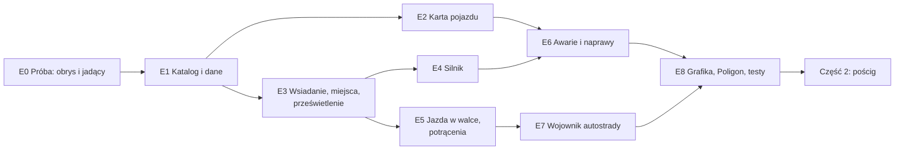

# PLAN — M4: Pojazdy (część 1) i pościgi (część 2)

> Status: **PROJEKT** (2026-10-18, rundy 1–3). Decyzje MG D1–D18 (§1); otwarte — §10. Rozmiar: **L–XL**
> (część 1: L, część 2: M). Wywołanie: `PLAN_beta.md` §0, krok 6 — przesunięty przed M6 (MG, 2026-10-18).
> Zastępuje §4–§7 `PLAN_poscigi.md` (karta pojazdu, manewry, awarie); plansza pościgu (§2 tamtego planu) zostaje.
>
> RAW = `Neuro 5e/Podrecznik/NOE/` (październik), `s. N` = strona drukowana: pojazdy s. 260–265, pościgi s. 266–268,
> Wojownik autostrady s. 88–89. Warstwy: **NOE** (RAW), **RAI**, **WKK** — `scripts/wkk/README.md`. Repozytorium
> jest publiczne: parafrazy i numery stron, bez cytatów i bez fabuły.
>
> **Zasady tego planu:** oznaczać, nie blokować (MG cofa, co się nie wydarzyło); pojazd to samobieżna skrzynia, nie
> istota — działa w turze kierowcy i nie ma własnej lojalności; to, co da się policzyć, liczy moduł po kliknięciu MG,
> resztę pisze na karcie.

---

## 0. W skrócie

| Część | Co dostaje stół | Gdzie |
|---|---|---|
| **1. Pojazdy** | katalog 14 pojazdów (paczka), karta pojazdu, wsiadanie na miejsca z żetonami jadącymi razem z pojazdem, prześwietlenie i kropki, silnik (uruchom/zgaś, dym, drgania, dźwięk), jazda w turze kierowcy, skręty, potrącenia, awarie k20 ze skutkami i naprawami, Wojownik autostrady, stanowisko Poligonu | §4–§6 |
| **2. Pościgi** | paleta manewrów, Test Pościgu, komplikacje k20, ataki w pościgu, wypadanie, koniec pościgu — na istniejącej planszy | §6.2 |

---

## 1. Decyzje MG (2026-10-18)

| # | Decyzja |
|---|---|
| D1 | **Podział.** Część 1 — pojazdy poza pościgiem (s. 260–265) z awariami i naprawami, bo RAW wyzwala awarie także poza pościgiem; komplikacje 1–3 pościgu losują z tej samej tabeli. Część 2 — tylko tryb pościgu (s. 266–268). |
| D2 | **Jadący na mapie (wariant b).** Żetony postaci zostają na mapie, zmniejszone do miejsca i poza siatką, i jadą z pojazdem: pozycja, obrót (kierowca patrzący do przodu dalej patrzy do przodu po obrocie o 180°) i drgania silnika. |
| D3 | **Widok.** Jadący są ukryci w każdym pojeździe; pojazd pokazuje **kropki** — „widzę trzy sylwetki w środku”. **Prześwietlenie** (nadwozie przygasa, jadący widoczni i klikalni) mają MG, właściciele pojazdu i gracze, których postacie siedzą w środku. Bez osobnego dachu i bez dokładnych foteli — miejsca rozkładają się ogólnie w obrysie. |
| D4 | **Wybór miejsca** w małym oknie z obrazem pojazdu z góry i klikalnymi miejscami; to samo okno dla „Przesiądź się”. |
| D5 | **Awarie: [Zastosuj] stosuje skutki mierzalne** (Szybkość, TT, pożar, wyciek paliwa, dym, zegary); fabularne — tekst na karcie. Zegary: **2k10 rund** wg RAW (w walce rundy, poza walką zegar świata, runda = 6 s). Płonący pojazd: **2k6 od ognia** na końcu tury kierowcy, jak jadący. |
| D6 | **10 pojazdów bez statbloku: improwizujemy.** Interpolacja z czterech statbloków jako podstawa plus własne, tanie i pewne cechy (§5), oznaczone jako RAI/WKK. |
| D7 | **Dwie wolne ręce: oznaczane.** MG mówi „nie, to się nie stało”, gracz robi **Zgaś** (bez kosztu) i wracamy do punktu wyjścia. Uruchomienie nie zużywa paliwa. Akcji nie liczymy ściśle właśnie po to, żeby dało się cofać pomyłki. |
| D8 | **Efekty silnika:** dym i drgania dla pojazdów silnikowych, trzy zestawy (benzyna, diesel, motocykl), ustawienie klienta wyłączające drgania. Ten sam efekt później dla maszyn Molocha. **Dźwięk: tylko uruchomienie i zgaszenie.** |
| D9 | **Tura pojazdu = tura kierowcy** (RAW: inicjatywa kierowcy). Pojazd nie wchodzi do trackera walki. |
| D10 | **Skręty wykrywane z ruchu:** zmiana kierunku ≥ 90° w turze kierowcy → karta MG z Testem MDR (Pojazdy). |
| D11 | **Dostęp i własność — dwie warstwy.** Własność stała (zwykła własność Foundry, ustawia MG) — pełny dostęp, z ładownią. Dostęp z obecności (postać siedzi w środku) — przesuwanie żetonu, karta, uruchamianie, **bez ładowni**. Bez stanów „kradziony” i „sporny”. (§4.4) |
| D12 | **Kluczyki i odpalanie na krótko (WKK).** Kluczyki pasują do jednego pojazdu (nie do innych tego typu; kopia żetonu tego samego pojazdu na innej scenie — pasują). MG tworzy kluczyki z karty pojazdu i ustawia stan: na kluczyk / odpalony na krótko. Na krótko wymaga narzędzi małego mechanika **albo** elektronika, ST wg klasy pojazdu; porażka — alarm, duża porażka — awaria 17, a gdzie nie ma awarii — obrażenia pojazdu; sukces trwale przełącza pojazd na „odpalony na krótko”. (§4.5) |
| D13 | **Obrys:** najpierw próba E0 z prostokątami; jeśli zawiedzie — kwadraty wg rozmiaru dnd5e. (§4.3) |
| D14 | **Kropki to uchwyty celowania:** wycelowanie w kropkę celuje w (dalej ukrytego) jadącego; karta ataku poda jego imię — to akceptowalne. (§4.2) |
| D15 | **Przesiądź się:** odległość między miejscami ×2 bez testu albo ×1 z ZRC (Akrobatyka) ST 10 (tylko w jadącym pojeździe; porażka o 5+ — Powalenie); stojący pojazd zawsze ×2. **WKK:** w jadącym pojeździe zmiana rzędu (przód↔tył, kabina↔paka) zawsze wymaga Akrobatyki. (§4.10) |
| D16 | **Broń montowana:** gdy strzelec siedzi na stanowisku, broń przechodzi do niego (flaga „zamontowana”: bez wagi, ręce na broni) i wraca do pojazdu, gdy opuści stanowisko — magazynki, tryby ognia i zacięcia działają bez zmian. Browning na GMT400 leży dziś w bagażniku, nie jest zamontowany. (§4.11) |
| D17 | **Pojazd przy 0 PW:** wrak (grafika wraku, jadący wysadzeni obok, bez uruchamiania i ruchu); płonący (awaria 1) z paliwem w baku — odliczanie k4 rund i wybuch baku (ogień wg rozmiaru, RO ZRC — połowa). (§4.12) |
| D18 | **Światła:** przełącznik na pojeździe silnikowym (kierowca i MG), stożek do przodu; działają też przy zgaszonym silniku; awaria 17 je gasi. (§4.5) |

---

## 2. RAW w pigułce

**Część 1 (s. 260–265):**
- *Wsiadanie jako kierowca* — pojazd ≤ 1,5 m, połowa Szybkości (w dół); potem reszta ruchu przepada, a postać jedzie
  Szybkością pojazdu. Silnik wymaga **akcji** uruchomienia; pojazd mięśniowy — ruchu kierowcy. **Kierownica = dwie
  wolne ręce.**
- *Wsiadanie jako pasażer* — bez dodatkowego kosztu; drzwi, fotel, okno — połowa Szybkości.
- *Kierowanie* — pojazdy specjalne (buldożer, czołg, dźwig): MG może zażądać Testu MDR (Pojazdy). Przyspieszenie
  daje dodatkowy ruch. Skręt o 90°: Szybkość ×½, chyba że MDR (Pojazdy) ST 10. Wsteczny: ×½. Obrót o 180° w ruchu:
  ST 20, porażka — awaria Przewrócenie.
- *Wypadanie* — 9 (3k6) obuchowych i Powalenie. *Trudny teren* — Szybkość ×½ i co turę test o ST MG, porażka —
  Szybkość 0; pojazdy terenowe: ×½ bez testów.
- *Atakowanie w jadącym pojeździe* — przed atakiem ZRC (Akrobatyka) ST 10, porażka — Utrudnienie w Testach Ataku do
  następnej tury.
- *Tabela statystyk* (s. 262), statbloki Autobusu, Roweru, Motocykla, Osobówki (s. 262–264): Cofanie, Potrącenie,
  Skok, Akrobacja, Przerzutka [B], Szósty bieg [B], Gaz do dechy [B], Slalom [R].
- *Awarie pojazdów silnikowych* (s. 264–265): k20 przy obrażeniach ≥ Próg awarii albo porażce kierowcy w teście o
  więcej niż 5; naprawa tymczasowa w jeździe (akcja + test, 1 minuta) i fachowa na postoju (narzędzia małego
  mechanika, biegłość, części; Naprawianie s. 146).
- *Ruch wewnątrz jadącego pojazdu* (s. 266, pkt 3 — w rozdziale pościgów, ale opisuje każdy jadący pojazd): z połową
  Szybkości; „normalny ruch” — ZRC (Akrobatyka) ST 10, porażka o 5+ — Powalenie.

**Część 2 (s. 266–268):** znaczniki co 36 m, inicjatywa (przesunięcie tury za kierowcę), Test Pościgu (ST 5/10/15,
nat. 20 — znacznik więcej, nat. 1 — dwie komplikacje), ataki (osłona ½ = TT +2, atak na kierowcę), wypadanie (−3
znaczniki na rundę), koniec pościgu, komplikacje k20, manewry: Gazu!, Hample, Obrót 180°, Ostrożna jazda,
Stuknięcie, Zajechanie.

**Wojownik autostrady** (Twardziel, s. 88–89): Drzwi w drzwi (Rajdowiec, Konwojent, Taranowanie), Kaskader (schody,
skoki, dwa koła), Pancerna fura (OC, AC [B] — uruchomienie i zatrzymanie w akcji bonusowej). Biegłości: Pojazdy +
narzędzia małego mechanika (M6).

---

## 3. Co już mamy

| Element | Stan |
|---|---|
| Dane | `config/vehicles-data.mjs`: 14 podwozi z s. 262, rozbieżności RAW opisane; ST środowisk i stałe pościgu |
| Aktorzy | GMT400 (podwozie Hammer), Hammer Posterunku |
| Karta | stockowa `VehicleActorSheet` dnd5e + nasze wstawki: pasek paliwa (`party-travel.mjs`), przełącznik portret/żeton (`vehicle-portrait.mjs`). dnd5e 6.0.6 zmienił w karcie pojazdu 27 linii |
| Model dnd5e | `crew`/`passengers` = listy UUID aktorów, `hp.dt` = Próg obrażeń, `hp.mt` = Próg awarii, ładownia, rozmiar, przedmioty montowane (`mountable`: własne TT/PW — Browning na GMT400). Do ukrycia: stanowiska i progi akcji (statki 2014), stępka/szerokość, jakość, tempa podróży dnd5e |
| Awarie | `combat/maszyny.mjs` — rzut, [Zastosuj] dla MG, aktywne awarie, naprawa — dla maszyn Bestiariusza i dronów; wzorzec do ponownego użycia |
| Wokół | Naprawa (M2, `production/naprawa.mjs`), lalka (wolne ręce), przedmioty na ziemi (`ground-items.mjs`), Podpalenie (`combat/podpalenie.mjs`), osłona w oknie ataku (`combat/cover.mjs`), okoliczności ataku, trudny teren (`scenes/difficult-terrain-hint.mjs`), FOV 220° z obrotu żetonu (`config/fov.mjs`), Sequencer + JB2A |
| Pościg | plansza (Nevada, Ruiny Ameryki), przyciąganie, recentrowanie, interfejs MG; stanowiska Poligonu `poscig` i `droga` |

---

## 4. Architektura części 1

### 4.1 Jadący — żetony, które jadą z pojazdem (D2)

Rdzeń 14 ma już ten wzorzec dla Regionów przypiętych do żetonu: zmiany Regionu idą w tej samej operacji co ruch
żetonu, a w animacji Region odświeża się co klatkę (`client/documents/token.mjs` — `#computeAttachedRegionUpdates`,
`client/canvas/placeables/token.mjs` — `#animateAttachments`). Jadący robią to samo — **bez przepinania obiektów
PIXI**:

- **Stan:** flaga na żetonie jadącego `jazda = {pojazd: tokenId, miejsce, obrot}` (`obrot` — własny obrót względem
  pojazdu) i lista UUID aktorów w `crew`/`passengers` pojazdu (nośnik dnd5e, z którego korzysta też pościg).
- **Klatka:** w animacji pojazdu rdzeń wpisuje do dokumentu pośrednie `x/y/rotation` i woła wywołania co klatkę
  (`context.onAnimate`). Każdy klient liczy pozycję miejsca obróconą o kąt pojazdu i ustawia jadącego — z wizją,
  więc FOV 220° obraca się razem z pojazdem. Obrót jadącego = obrót pojazdu + `obrot`.
- **Koniec ruchu:** MG zapisuje końcowe pozycje jadących jedną operacją, bez animacji.
- **Drgania:** jeden ticker modułu dodaje to samo przesunięcie do siatki pojazdu i jego jadących — drżą razem.
- **Rozmiar:** w czasie jazdy żeton jadącego dostaje rozmiar miejsca (np. 0,5 kratki), oryginalny zapisany we fladze;
  wysiadanie, usunięcie pojazdu i przycisk MG „Wysadź wszystkich” go przywracają.
- **Wizja:** rdzeń nie wiąże wizji z widocznością żetonu (`Token#_isVisionSource` nie czyta `isVisible`), więc ukryty
  jadący dalej widzi — gracz patrzy z wnętrza pojazdu.

### 4.2 Kropki i prześwietlenie (D3)

- **Ukrycie lokalne**, nie `hidden` dokumentu (ukryty dokument odebrałby graczowi własny żeton): nadpisanie
  `Token#isVisible` dla jadących — `false`, chyba że ten klient prześwietla ten pojazd albo kontroluje tego jadącego.
- **Kropki:** nakładka pojazdu, jedna kropka na postać w środku (bez tożsamości), widoczna dla wszystkich, którzy
  widzą pojazd. **Kropka jest uchwytem celowania (D14):** wycelowanie w nią ustawia cel na ukrytym jeźdźcu.
- **Prześwietlenie:** po najechaniu na pojazd — nadwozie do ok. 35% krycia, jadący widoczni i klikalni. Mają je MG,
  właściciele pojazdu i gracze z postacią w środku. Pozostali widzą kropki.
- **Zaznaczanie pojazdu:** ukryci jadący nie przyjmują kliknięć, więc klik w pojazd zaznacza pojazd; w
  prześwietleniu klik w jadącego zaznacza jadącego, Alt+klik przechodzi do pojazdu.

### 4.3 Obrys pojazdu (D13 — próba E0)

Rdzeń liczy kształt, pole kliknięcia, zajmowane kratki i odległości z `width`/`height` **bez obrotu**
(`Token#getShape`). Prostokątny samochód obrócony o 90° wyglądałby poziomo, a zajmował pionowo. Propozycja:
**prostokątny obrys w czterech kierunkach** — gdy kierunek jazdy przekracza 45°, moduł zamienia `width`↔`height`
(środek bez zmian), a obraz obraca się w środku. Kratki, odległości, sąsiedztwo i ataki okazyjne liczą się wtedy jak
dla każdej dużej istoty, tylko nieskwadratowej; skosy przybliża najbliższy kierunek. Obrót w miejscu nie jest
darmowy: pojazd obraca się w ruchu (D10), a nowe kratki po zamianie obrysu sprawdzają potrącenie (§4.7).
Wariant zapasowy, jeśli próba E0 się nie uda: kwadratowy obrys wg rozmiaru dnd5e.

### 4.4 Dostęp i własność (D11)

Pojazd nie ma lojalności — to samobieżna skrzynia. Dwie warstwy:
1. **Własność stała** — zwykła własność Foundry, ustawiana przez MG; pełny dostęp, z ładownią.
2. **Dostęp z obecności** — gracz, którego postać siedzi w środku, ma na czas jazdy prawa właściciela (przesuwa
   żeton, widzi kartę, uruchamia, przesiada się), ale karta ukrywa mu ładownię. Wysiadka przywraca poprzednie prawa
   (zapis we fladze, zapis przez MG). Ukrycie ładowni jest w interfejsie, nie w uprawnieniach Foundry — wystarcza
   przy stole, któremu MG ufa.

Cudzy pojazd z graczem w środku to po prostu warstwa 2; MG robi z niego własny, nadając własność.

**Luka do zamknięcia (WKK z D3 rundy 1):** jadący, który upuści karabin w cudzym pojeździe, nie miałby go jak
podnieść — ładownia jest ukryta. Propozycja: przedmioty upuszczone przez jadących leżą w osobnej grupie
**„Na siedzeniach”**, widocznej dla każdego jadącego, poza resztą ładowni.

### 4.5 Silnik (D7, D8)

- **Uruchom** (akcja; Pancerna fura — akcja bonusowa) i **Zgaś** (bez kosztu) z miejsca kierowcy. Oznaczenia: brak
  dwóch wolnych rąk (lalka), brak paliwa, awaria 15 (silnik) i 17 (zapłon), brak kluczyków. Uruchomienie nie zużywa
  paliwa.
- **Kluczyki (D12, WKK):** przedmiot z identyfikatorem pojazdu. Identyfikator żyje na aktorze pojazdu (żeton
  niepowiązany — w jego delcie), nadawany przy utworzeniu, więc duplikat aktora dostaje nowy, a skopiowany żeton
  tego samego pojazdu zachowuje stary. MG: **Utwórz kluczyki** i przełącznik **na kluczyk / odpalony na krótko** na
  karcie. Uruchom sprawdza kluczyki u kierowcy i w stacyjce (ładownia).
- **Na krótko (D12, WKK):** akcja kierowcy z narzędziami małego mechanika albo elektronika (test narzędzi), ST wg
  klasy pojazdu (jednoślady 10, osobowe i terenowe 15, ciężkie i pancerne 20). Porażka — alarm (dźwięk, szept do
  MG); porażka o 5+ — awaria 17, a pojazd bez awarii dostaje obrażenia; sukces — pojazd trwale „odpalony na krótko”
  (Uruchom bez kluczyków).
- **Stan:** flaga `silnik` na aktorze pojazdu. Pojazd silnikowy przy zgaszonym silniku: Szybkość 0 (oznaczane).
- **Efekty:** dym z rury — natywny `ParticleGenerator` rdzenia 14 (tryb efektu, kotwica na żetonie, obrót i rura w
  układzie pojazdu), liczony lokalnie na każdym kliencie z flagi `silnik` — nic nie zapisuje się w scenie. Darmowy
  JB2A nie ma kłębów spalin (tylko jasna mgła i linia dymu), więc teksturę kłębu generujemy sami (miękki gradient,
  `vfx/`). Drgania — ticker z §4.1. Zestawy: **benzyna** (jasne, rzadkie kłęby, drobne szybkie drgania), **diesel**
  (ciemna sadza, wolniejsze, większe drgania), **motocykl** (siwe obłoczki, bzyczenie). Później **maszyna** dla
  Molocha. Ustawienie klienta „Drgania pojazdów” (wł./wył.).
- **Dźwięk:** uruchomienie (per zestaw), zgaszenie, nieudane odpalenie (awaria 17), alarm (na krótko).
- **Światła (D18):** przełącznik **Światła** dla kierowcy i MG — światło żetonu stożkiem ok. 60° do przodu (jasne
  18 m, przyćmione 36 m), obraca się z pojazdem; działa bez silnika (akumulator); awaria 17 je gasi.

### 4.6 Jazda w walce (D9, D10)

- Pojazd poza trackerem; jego ruch liczy się w turze kierowcy. Moduł sumuje drogę pojazdu w turze kierowcy i oznacza
  przekroczenie Szybkości (Przyspieszenie kierowcy dodaje drugą Szybkość, wsteczny ×½).
- **Skręt ≥ 90°** w turze kierowcy → karta MG: MDR (Pojazdy) ST 10, porażka — Szybkość ×½ (do końca tury). **Obrót
  180° w ruchu** → ST 20, porażka — awaria 8 (Przewrócenie).
- **Trudny teren:** istniejące regiony trudnego terenu → karta MG z testem (ST MG), pojazdy terenowe bez testu.
- **Atak z jadącego pojazdu:** pojazd, który ruszył się w tej rundzie, daje jadącym atakującym domyślne Utrudnienie
  w oknie ataku z przyciskiem ZRC (Akrobatyka) ST 10 — silnik okoliczności ataku; Konwojent je wyłącza.
- **Osłona jadących:** domyślnie ½ (TT +2, RAW s. 266), stanowiska i pojazdy pancerne wg §5 — podpowiedź w oknie osłony.
- **Wypadanie:** usunięcie jadącego z jadącego pojazdu (przycisk MG albo awaria) → 3k6 i Powalenie, żeton obok.

### 4.7 Potrącenie i Taranowanie

Po ruchu pojazdu moduł liczy kratki, przez które przejechał obrys (droga + zamiana obrysu przy skręcie), i istoty w
nich. Karta MG: lista potrąconych z RO ZRC ST 15 (Taranowanie kierowcy — z Utrudnieniem), obrażenia wg rozmiaru
pojazdu (§5), Powalenie, „już Powalony — drugi raz tyle”. Ofiara mniejsza od pojazdu o dwa rozmiary lub więcej — RO i
obrażenia; większa — obrażenia dostają ofiara, pojazd i jadący (wzorzec Osobówki i Autobusu). Nic nie dzieje się bez
kliknięcia MG.

### 4.8 Awarie (D5)

Rzut k20 z karty: po obrażeniach ≥ `hp.mt` (wzorzec `maszyny.mjs`) i po porażce kierowcy o więcej niż 5. [Zastosuj]
tworzy efekt na pojeździe:

| k20 | Skutek po [Zastosuj] |
|---|---|
| 1 Pożar | Podpalenie pojazdu; koniec tury kierowcy — 2k6 ognia pojazdowi i każdemu jadącemu (karta) |
| 2 Guma | Szybkość −18 m |
| 3 Sprzęgło | przy każdym Teście (Pojazdy) kierowcy dodatkowy k6: 1–2 — pojazd traci ruch w tej turze (karta) |
| 4 Kierowanie | −5 do Testów (Pojazdy) kierowcy tego pojazdu |
| 5 Dym | Region przypięty do żetonu: wnętrze całkowicie przesłonięte |
| 6 Drzwi | wsiadanie i wysiadanie przez okno miejsc wymaga SIŁ (Atletyka) albo ZRC (Zwinne dłonie) ST 10 |
| 7 Oś | Szybkość 0 |
| 8 Przewrócenie | pojazd Powalony; 4k10 obuchowych pojazdowi i jadącym, RO SIŁ ST 10 — połowa (karta) |
| 9 Wyciek | −0,5 l paliwa na rundę (zegar) |
| 10 Kierownica | tylko prosto — skręt oznaczany |
| 11 Gaz | Szybkość ×½; bez Gaz do dechy, Szóstego biegu i Gazu! |
| 12 Błotnik | co turę kierowcy 50%: awaria 2 (karta) |
| 13 Chłodnica | zegar 2k10 rund → awaria 15 |
| 14 Hamulce | „Hamuj” na karcie pojazdu: MDR (Pojazdy) ST 15, porażka — awaria 8 |
| 15 Silnik | silnik gaśnie; trzy tury rozpędu z ½ Szybkości (zegar), potem 0 |
| 16 Maska | naprawa poprzedzona SIŁ (Atletyka) ST 15 |
| 17 Elektryka | Uruchom oznaczane „zapłon zawodzi”; światła pojazdu zgaszone |
| 18 Pancerz | TT −1 |
| 19 Jadący | losowy jadący: połowa obrażeń pojazdu, min. 2k10 (karta) |
| 20 Broń | broń montowana uszkodzona; bez broni — awaria 19 |

### 4.9 Naprawy

- **Tymczasowa** (w jeździe): akcja + test o ST „jazda” z tabeli, sukces zawiesza skutek na 1 minutę (10 rund),
  potem wraca. Bez kolumny „jazda” — tylko na postoju.
- **Fachowa** (postój): ścieżka Naprawy z M2 — narzędzia małego mechanika, biegłość, części; ST z tabeli. Koszt w
  surowcach i czas — pytanie na E6.

### 4.10 Przesiadka (D15)

RAW s. 266 pkt 3 (ruch wewnątrz jadącego pojazdu) czytany tak: połowa Szybkości bez testu, pełna — z ZRC
(Akrobatyka) ST 10. **Przesiądź się** w oknie miejsc: koszt = odległość między miejscami ×2 (sąsiednie ≈ 3 m) albo
×1 z testem, tylko w jadącym pojeździe; porażka o 5+ — Powalenie na nowym miejscu. Stojący pojazd: zawsze ×2, bez
testu. **WKK:** w jadącym pojeździe zmiana rzędu (przód↔tył, kabina↔paka) zawsze wymaga Akrobatyki. „Jadący”
pojazd = ruszył się w tej albo poprzedniej turze kierowcy.

### 4.11 Broń montowana (D16)

Zakładka Uzbrojenie: MG **montuje** broń z ładowni na stanowisku (i zdejmuje). Zajęcie stanowiska przenosi broń do
strzelca ścieżką przenoszenia przedmiotów (`production/przenoszenie.mjs`), z flagą `zamontowana: <uuid pojazdu>`:
Udźwig jej nie liczy, lalka pokazuje ręce na broni montowanej, upuścić ani schować jej nie można. Opuszczenie
stanowiska, wysiadka, wypadnięcie, śmierć strzelca i przycisk MG oddają ją pojazdowi; sprawdzenie przy starcie
świata zwraca broń, której strzelec nie siedzi już na stanowisku. Montaż jako przeróbka u fachowca (M5) — później.

### 4.12 Wrak i wybuch (D17)

Przy 0 PW: wzorzec wraku z M5 (`combat/autodestrukcja.mjs` — grafika wg rozmiaru, oryginał we fladze, [Przywróć]
u MG), jadący wysadzeni na wolne pola obok, silnik zgaszony, Uruchom i ruch oznaczane. Płonący pojazd z paliwem:
odliczanie k4 rund i wybuch tym samym kodem co autodestrukcja — ogień wg rozmiaru (Duża 3k6 / 3 m, Wielka 4k6 /
4,5 m, Ogromna 6k6 / 6 m; RO ZRC ST 15 — połowa); wrak zostaje. Naprawa wraku — tylko fachowa, decyzja MG.

### 4.13 Pojazdy, które nie są pojazdami

Moduł używa typu aktora `vehicle` także jako pojemnika: **Stos** z bebeszenia (`postoj/bebeszenie.mjs`) i
**Miejsce** z przenoszenia (`production/przenoszenie.mjs`). Każdy hak M4 sprawdza najpierw „prawdziwy pojazd” —
flagę podwozia nadaną przez katalog i migrację (E1) — i pomija pojemniki.

---

## 5. Katalog pojazdów

Obrys w kratkach 1,5 m (szerokość × długość), do potwierdzenia w E0. SIŁ/ZRC/KON z interpolacji: ciężar i rozmiar →
SIŁ, zwrotność → ZRC, wytrzymałość → KON; kotwice — cztery statbloki RAW. **TT w bezruchu** = TT − 5 (wzorzec RAW).
**Potrącenie wg rozmiaru** (kotwice RAW: Wielka 3k10 / 4k10, Ogromna 6k10 / 8k10): Duża — 2k10 / 3k10. Niewrażliwości
jak w statblokach RAW.

| Pojazd | Rozmiar | Obrys | Miejsca | Silnik | SIŁ/ZRC/KON | Cechy (RAW / *RAI* / **WKK**) |
|---|---|---|---|---|---|---|
| Osobówka | Wielka | 1,5×3 | 1+4 | benzyna | 20/12/16 | Cofanie, Potrącenie, Skok, Gaz do dechy [B], Slalom [R] |
| Autobus | Ogromna | 2×8 | 1+20 | diesel | 26/8/20 | Cofanie (¼, Utrudnienie), Potrącenie, Skok |
| Motocykl | Duża | 0,5×1,5 | 1+1 | motocykl | 16/16/12 | Akrobacja, Skok, Szósty bieg [B], Slalom [R] |
| Rower | Średnia | 0,5×1 | 1 | — | 10/18/10 | Akrobacja, Skok, Uciążliwy pancerz, Przerzutka [B], Slalom [R] |
| Buggy | Duża | 1×2 | 1+1 | benzyna | 16/16/12 | *Terenówka* (trudny teren ×½ bez testów — s. 261), *Skok* jak motocykl, *Potrącenie*, Slalom [R]; **Otwarta rama** — jadący nigdy nie mają więcej niż ½ osłony |
| Hammer | Wielka | 1,5×3 | 1+4 | diesel | 20/10/18 | *Terenówka*, *Cofanie*, *Potrącenie*, *Gaz do dechy* [B]; **Wieżyczka** — stanowisko na dachu: ¾ osłony, broń montowana strzela w każdą stronę |
| Ciężarówka | Ogromna | 2×6 | 3 + paka 8 | diesel | 24/8/18 | *Cofanie* jak Autobus, *Potrącenie*; **Paka** — miejsca stojące: ½ osłony, w jadącej ciężarówce ZRC (Akrobatyka) ST 10 na początku tury albo Powalenie |
| Wóz strażacki | Ogromna | 2×6 | 1+5 | diesel | 24/8/18 | *Cofanie*, *Potrącenie*; **Działko wodne** [A, stanowisko] — linia 18 m: gasi Podpalenie i ogień, istoty RO SIŁ ST 13 albo odepchnięte o 3 m i Powalone, zbiornik na 10 strzałów; **Syrena** [B] — Utrudnienie do Testów MDR (Percepcja) opartych na słuchu w promieniu 30 m do następnej tury |
| Buldożer | Ogromna | 2,5×4 | 1+1 | diesel | 28/6/22 | **Gąsienice** — gruz i trudny teren bez kary; **Lemiesz** [A] — spycha przeszkody i mniejsze pojazdy, istoty przed lemieszem RO SIŁ ST 15 albo przepchnięte i Powalone; Niszczenie obiektów ×2 (M6); bez Gazu do dechy |
| Czołg | Ogromna | 2,5×5 | 4 | diesel | 28/6/24 | *Gąsienice*; **Wieża** — stanowisko działonowego strzela w każdą stronę; **Pancerne wnętrze** — jadący mają całkowitą osłonę, strzelają tylko z broni montowanej; **Miażdżenie** — Powalona istota nie ma RO przeciw Potrąceniu |
| Bojowy wóz piechoty | Ogromna | 2×4,5 | 3 + desant 9 | diesel | 26/8/22 | *Gąsienice*, *Pancerne wnętrze*; **Desant** — rampa: desant wysiada bez kosztu ruchu; **Strzelnice** — desant strzela ze środka z ¾ osłony |
| Traktor | Wielka | 1,5×2,5 | 1+1 | diesel | 22/8/18 | *Terenówka*; **Uciąg** [A] — holuje pojazd do swojego rozmiaru albo przyczepę (Szybkość obu ×½), wyciąga z rowu i gruzu |
| Motorower | Średnia | 0,5×1 | 1 | motocykl | 12/14/10 | *Akrobacja* (ST 10), Slalom [R]; **Oszczędny** — 2 l/100 km |
| Deskorolka | Mała | 0,5×0,5 | 1 | — | 6/16/8 | *Uciążliwy pancerz*; **Ollie** — raz w turze za ½ Szybkości ZRC (Akrobatyka) ST 10: przeskok przez krawężnik lub przeszkodę do 1 m, porażka — Powalenie |

Zasada doboru własnych cech: jedna–dwie na pojazd, każda to tekst na karcie plus co najwyżej jedna flaga albo jedna
karta z RO — nic, co wymaga nowej geometrii. Cechy pościgowe (Rajdowiec, Stuknięcie większym pojazdem) — część 2.

---

## 6. Etapy

### 6.1 Część 1

| Etap | Zakres | Rozmiar | Gotowe gdy |
|---|---|---|---|
| **E0** | **Próba w piaskownicy**: obrys prostokątny z zamianą w czterech kierunkach (§4.3), jadący w animacji (pozycja, obrót, wizja, FOV), drgania wspólne, ukrycie i prześwietlenie, Alt+klik. Osobówka z czterema jadącymi, jazda po łuku i obrót o 180°. | S–M | nagranie i zrzuty w przekazaniu; decyzja MG: prostokąt czy wariant zapasowy |
| **E1** | **Katalog i dane**: 14 pojazdów → paczka `pojazdy` (cechy jako zdolności pojazdu z aktywnościami tam, gdzie tanio), obrysy, miejsca, zestaw silnika, punkt rury, flaga podwozia (§4.13); `validate-packs`; GMT400 i Hammer Posterunku — nasza migracja (podwozie, miejsca, obrys). | M | paczka zbudowana, Quench danych |
| **E2** | **Karta pojazdu**: podklasa z zakładkami Pojazd, Załoga, Ładownia, Uzbrojenie, Awarie, Opis; stan własności (§4.4); martwe pola dnd5e ukryte; obie dotychczasowe wstawki działają. | M–L | e2e karty, zrzuty |
| **E3** | **Wsiadanie i miejsca**: okno miejsc, Wsiądź / Wysiądź / Przesiądź się (koszty z RAW, §2), jadący i ich rozmiar, kropki, prześwietlenie, dostęp z obecności, **WKK:** upuszczone w pojeździe ląduje w ładowni, wypadanie. | L | e2e: gracz wsiada, jedzie, przesiada się, wysiada; drugi gracz widzi kropki |
| **E4** | **Silnik**: Uruchom/Zgaś, kluczyki i na krótko, oznaczenia, zestawy efektów, ustawienie drgań, dźwięki, światła, paliwo i wyciek. | M | e2e i Quench; zrzuty efektów |
| **E5** | **Jazda w walce**: tura kierowcy, budżet ruchu, wsteczny, skręty i obrót, trudny teren, atak z jadącego pojazdu, osłona jadących, potrącenie, broń montowana. | L | e2e `pojazd` w walce |
| **E6** | **Awarie, naprawy, wrak**: dane k20, wyzwalacze, skutki z §4.8, zegary, naprawy tymczasowe i fachowe, wrak i wybuch (§4.12). | L | Quench każdej awarii; e2e naprawy i wraku |
| **E7** | **Wojownik autostrady** poza pościgiem: Konwojent, Taranowanie, Kaskader (karty testów), Pancerna fura (OC, AC [B]); Rajdowiec — Ułatwienie w walce i +50% Szybkości. Plakietki pokrycia. | S–M | rejestr zdolności zaktualizowany |
| **E8** | **Grafika, Poligon, testy**: zamówienia w `dev/icons/MISSING.md` (14 żetonów z góry, 14 portretów, dźwięki), stanowisko Poligonu **Garaż**, pełna bramka. | M | bramka zielona; stanowisko z sondami |

### 6.2 Część 2 — pościg (zarys, osobna runda pytań)

Paleta manewrów (Gazu!, Hample, Obrót 180°, Ostrożna jazda, Stuknięcie, Zajechanie) dla załogi z `crew`/`passengers`;
Test Pościgu z ST planszy, nat. 20/1; komplikacje k20 (1–3 → awarie z części 1); ataki w pościgu (osłona ½, atak na
kierowcę i jego test, Przewrócenie); wypadanie (−3 znaczniki na rundę); warunki końca (meta, przewaga 7, 10 rund);
Rajdowiec w pościgu; zasada D4 starego planu — ruch tylko po kliknięciu. Przejście z mapy taktycznej na planszę z
jadącymi (część 1 daje załogę gotową).

---

## 7. Testy i Poligon

- **Quench:** czyste funkcje — obrys po obrocie, pozycja miejsca w układzie pojazdu, koszt przesiadki, potrącenie
  (kratki drogi), skutki awarii, zegary, interpolacja katalogu.
- **e2e `pojazd`:** MG + dwóch graczy: wsiadanie, uruchomienie, jazda z obrotem, kropki u gracza spoza pojazdu,
  prześwietlenie u gracza w środku, atak z jadącego pojazdu, potrącenie manekina, awaria i naprawa.
- **Poligon — stanowisko Garaż:** Osobówka, Motocykl, Rower, Ciężarówka z paką, Wóz strażacki; manekiny do potrąceń;
  sondy dla każdej decyzji D2–D10 i każdej własnej cechy z §5.

## 8. Grafika i dźwięk

Do `dev/icons/MISSING.md`: 14 żetonów z góry (jeden obraz, prostokąt zgodny z obrysem, przezroczyste tło, rura
wydechowa w stałym miejscu), 14 portretów, 4 wraki pojazdów (jednoślad, osobowy, ciężki, gąsienicowy — wraki z M5
to drony i maszyny), dźwięki: uruchomienie benzyna/diesel/motocykl, zgaszenie, nieudane odpalenie, alarm. Dym i
wybuch — z JB2A.

## 9. Ryzyka

| Ryzyko | Ograniczenie |
|---|---|
| Synchronizacja jadących w animacji (wiele odcinków drogi, łańcuch animacji) | próba E0 przed czymkolwiek innym; zapis końcowy przez MG zawsze naprawia obraz |
| Obrys prostokątny niezgodny z rdzeniem | E0; wariant zapasowy — kwadrat |
| Zmiana rozmiaru jadącego zostaje po awarii klienta | przywracanie przy wysiadce, usunięciu pojazdu, przycisk MG, sprawdzenie przy starcie |
| Ukrycie lokalne a inne moduły (Splatter, nazwy) | ukrycie przez `isVisible` — rdzeń sam chowa pasek, nazwę, efekty |
| Wydajność efektów silnika | jeden ticker na scenę, ustawienie klienta |

## 10. Otwarte pytania

- **Na E6:** koszt i czas naprawy fachowej awarii; naprawa PW pojazdu.

## 11. Postęp

**2026-10-18 — projekt, runda 1.** Decyzje D1–D10; RAW s. 260–268 i s. 88–89 przeczytane; wykonalność jadących
sprawdzona w źródłach rdzenia 14.369 (wzorzec Regionów przypiętych do żetonu, wizja niezależna od widoczności).

**2026-10-18 — rundy 2–3.** D11–D18: własność w dwóch warstwach, kluczyki i na krótko, próba obrysu, kropki jako
uchwyty celowania, przesiadka z WKK dla zmiany rzędu, broń montowana u strzelca, wrak i wybuch baku, światła.
Znalezione po drodze: rdzeń nie obraca obrysu żetonu (§4.3); typ `vehicle` służy też za pojemnik (§4.13); darmowy
JB2A nie ma kłębów spalin — dym z natywnego `ParticleGenerator` (§4.5). Następny krok: E0.
