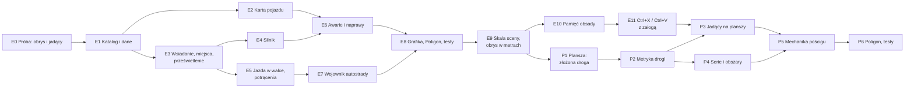

# PLAN — M4: Pojazdy (część 1) i pościgi (część 2)

> Status: **część 1 ZROBIONA** (E0–E8, noc 2026-10-19 — do weta MG, §10); **część 1b — PROJEKT** (E9–E11, pojazdy
> między scenami, §4.14–§4.16); **część 2 — PROJEKT planszy** (złożona droga, §6.2), mechanika pościgu — runda pytań
> przed P5. Decyzje MG D1–D31 (§1). Rozmiar: **XL** (część 1: L, część 1b: M, część 2: L — plansza od nowa).
> Wywołanie: `PLAN_beta.md` §0, krok 4 (przesunięty przed M6, MG 2026-10-18).
> Zastępuje §4–§7 `PLAN_poscigi.md` (karta pojazdu, manewry, awarie), a od 2026-10-19 także geometrię planszy
> (tamten §2.1, §2.3–§2.6 i D2) — §6.2 tutaj. Grafika planszy (motywy, pustynia, kołysanie — tamten §2.2) zostaje.
>
> RAW = `Neuro 5e/Podrecznik/NOE/` (październik), `s. N` = strona drukowana: pojazdy s. 260–265, pościgi s. 266–268,
> Wojownik autostrady s. 88–89. Warstwy: **NOE** (RAW), **RAI**, **WKK** — `scripts/wkk/README.md`. Repozytorium
> jest publiczne: parafrazy i numery stron, bez cytatów i bez fabuły.
>
> **Zasady tego planu:** oznaczać, nie blokować (MG cofa, co się nie wydarzyło); pojazd to samobieżna skrzynia, nie
> istota — działa w turze kierowcy i nie ma własnej lojalności; to, co da się policzyć, liczy moduł po kliknięciu MG,
> resztę pisze na karcie.

---

## 0. W skrócie

| Część | Co dostaje stół | Gdzie |
|---|---|---|
| **1. Pojazdy** | katalog 14 pojazdów (paczka), karta pojazdu, wsiadanie na miejsca z żetonami jadącymi razem z pojazdem, prześwietlenie i kropki, silnik (uruchom/zgaś, dym, drgania, dźwięk), jazda w turze kierowcy, skręty, potrącenia, awarie k20 ze skutkami i naprawami, Wojownik autostrady, stanowisko Poligonu | §4–§6 |
| **1b. Między scenami** | jedna reguła skali (obrys w metrach, znacznik na mapach w km), pamięć obsady i karta „Posadzić?”, Ctrl+X / Ctrl+V z załogą | §4.14–§4.16 |
| **2. Pościgi** | plansza od nowa — złożona droga (pojazdy w prawdziwej skali, tor = 36 m), metryka drogi dla zasięgów i obszarów, serie z celowaniem, jadący na planszy; paleta manewrów, Test Pościgu, komplikacje k20, ataki, wypadanie, koniec pościgu | §6.2 |

---

## 1. Decyzje MG (2026-10-18 – 2026-10-19)

| # | Decyzja |
|---|---|
| D1 | **Podział.** Część 1 — pojazdy poza pościgiem (s. 260–265) z awariami i naprawami, bo RAW wyzwala awarie także poza pościgiem; komplikacje 1–3 pościgu losują z tej samej tabeli. Część 2 — tylko tryb pościgu (s. 266–268). |
| D2 | **Jadący na mapie (wariant b).** Żetony postaci zostają na mapie, zmniejszone do miejsca i poza siatką, i jadą z pojazdem: pozycja, obrót (kierowca patrzący do przodu dalej patrzy do przodu po obrocie o 180°) i drgania silnika. |
| D3 | **Widok.** Jadący są ukryci w każdym pojeździe; pojazd pokazuje **kropki** — „widzę trzy sylwetki w środku”. **Prześwietlenie** (nadwozie przygasa, jadący widoczni i klikalni) mają MG, właściciele pojazdu i gracze, których postacie siedzą w środku. Bez osobnego dachu i bez dokładnych foteli — miejsca rozkładają się ogólnie w obrysie. |
| D4 | **Wybór miejsca** w małym oknie z obrazem pojazdu z góry i klikalnymi miejscami; to samo okno dla „Przesiądź się”. |
| D5 | **Awarie: [Zastosuj] stosuje skutki mierzalne** (Szybkość, TT, pożar, wyciek paliwa, dym, zegary); fabularne — tekst na karcie. Zegary: **2k10 rund** wg RAW (w walce rundy, poza walką zegar świata, runda = 6 s). Płonący pojazd: **2k6 od ognia** na końcu tury kierowcy, jak jadący. |
| D6 | **10 pojazdów bez statbloku: improwizujemy.** Interpolacja z czterech statbloków jako podstawa plus własne, tanie i pewne cechy (§5), oznaczone jako RAI/WKK. |
| D7 | **Dwie wolne ręce: oznaczane.** MG mówi „nie, to się nie stało”, gracz robi **Zgaś** (bez kosztu) i wracamy do punktu wyjścia. Uruchomienie nie zużywa paliwa. Akcji nie liczymy ściśle właśnie po to, żeby dało się cofać pomyłki. |
| D8 | **Efekty silnika:** dym i drgania dla pojazdów silnikowych, trzy zestawy (benzyna, diesel, motocykl), ustawienie klienta wyłączające drgania. Ten sam efekt później dla maszyn Molocha. **Dźwięk: tylko uruchomienie i zgaszenie.** |
| D9 | **Tura pojazdu = tura kierowcy** (RAW: inicjatywa kierowcy). Pojazd nie wchodzi do trackera walki. |
| D10 | **Skręty wykrywane z ruchu:** zmiana kierunku ≥ 90° w turze kierowcy → karta MG z Testem MDR (Pojazdy). |
| D11 | **Dostęp i własność — dwie warstwy.** Własność stała (zwykła własność Foundry, ustawia MG) — dostęp także spoza pojazdu. Dostęp z obecności (postać siedzi w środku) — przesuwanie żetonu, karta, uruchamianie **i ładownia** pojazdu, w którym siedzisz (MG, 2026-10-19: upraszczamy). Bez stanów „kradziony” i „sporny”. (§4.4) |
| D12 | **Kluczyki i odpalanie na krótko (WKK).** Kluczyki pasują do jednego pojazdu (nie do innych tego typu; kopia żetonu tego samego pojazdu na innej scenie — pasują). MG tworzy kluczyki z karty pojazdu i ustawia stan: na kluczyk / odpalony na krótko. Na krótko wymaga narzędzi małego mechanika **albo** elektronika, ST wg klasy pojazdu; porażka — alarm, duża porażka — awaria 17, a gdzie nie ma awarii — obrażenia pojazdu; sukces trwale przełącza pojazd na „odpalony na krótko”. (§4.5) |
| D13 | **Obrys:** najpierw próba E0 z prostokątami; jeśli zawiedzie — kwadraty wg rozmiaru dnd5e. (§4.3) |
| D14 | **Kropki to uchwyty celowania:** wycelowanie w kropkę celuje w (dalej ukrytego) jadącego; karta ataku poda jego imię — to akceptowalne. (§4.2) |
| D15 | **Przesiądź się:** odległość między miejscami ×2 bez testu albo ×1 z ZRC (Akrobatyka) ST 10 (tylko w jadącym pojeździe; porażka o 5+ — Powalenie); stojący pojazd zawsze ×2. **WKK:** w jadącym pojeździe zmiana rzędu (przód↔tył, kabina↔paka) zawsze wymaga Akrobatyki. (§4.10) |
| D16 | **Broń montowana:** gdy strzelec siedzi na stanowisku, broń przechodzi do niego (flaga „zamontowana”: bez wagi, ręce na broni) i wraca do pojazdu, gdy opuści stanowisko — magazynki, tryby ognia i zacięcia działają bez zmian. **Montaż to Robota produkcji** zakładana przyciskiem MG na karcie pojazdu; moduł liczy godziny, surowce i test (MG, 2026-10-19). Browning na GMT400 leży dziś w bagażniku, nie jest zamontowany. (§4.11) |
| D17 | **Pojazd przy 0 PW:** wrak (grafika wraku, jadący wysadzeni obok, bez uruchamiania i ruchu); płonący (awaria 1) z paliwem w baku — odliczanie k4 rund i wybuch baku (ogień wg rozmiaru, RO ZRC — połowa). (§4.12) |
| D18 | **Światła:** przełącznik na pojeździe silnikowym (kierowca i MG), stożek do przodu; działają też przy zgaszonym silniku; awaria 17 je gasi. (§4.5) |
| D19 | **Naprawy, PW i wrak — improwizacja** (MG, 2026-10-19: „improwizuj”). Wzór: naprawa drona z M3 i tabela Naprawiania s. 146; liczby w §4.9, do weta przy E6. |

**Runda 5 (2026-10-19, po nocy) — pojazdy między scenami i plansza pościgu:**

| # | Decyzja |
|---|---|
| D20 | **Jeden aktor, wiele widoków.** Wspólny stan (PW, awarie, zegary, silnik, paliwo, ładownia, broń, wrak, pamięć obsady) ma pojazd o **powiązanym** aktorze — tak jest GMT400. Pojazdy z paczki są niepowiązane (bandyci: każdy żeton to osobna kopia, jak Hammer Posterunku). Pojazd drużyny musi być powiązany: karta drużyny czyta paliwo z aktora świata (`primaryVehicle`). |
| D21 | **Jedna reguła skali.** Obrys w metrach: rozmiar żetonu = metry ÷ metry na kratkę sceny — skala prawdziwa na każdej scenie taktycznej (także siatka 3 m) i na planszy pościgu. Gdy 1,5 m wychodzi za małe do narysowania (mapy w km) — pojazd jest zwykłym znacznikiem, bez miejsc. Na mapie podróży pojazd reprezentuje żeton drużyny (paliwo z `primaryVehicle`); znacznik pojazdu to ozdoba. (§4.14) |
| D22 | **Ctrl+X / Ctrl+V przenosi pojazd z załogą** między scenami — rdzeń 14 wycina między scenami z zachowaniem id. Bez przycisku z wyborem sceny. (§4.16) |
| D23 | **Pamięć obsady i karta „Posadzić?”** — pojazd pamięta, kto siedzi na którym miejscu; gdy pojazd albo zapamiętana postać pojawia się na scenie, MG dostaje kartę [Posadź] / [Pomiń]. Nic nie sadza się samo. (§4.15) |
| D24 | **Plansza pościgu — złożona droga.** Pojazdy w prawdziwej skali (70 px na 1,5 m, jak mapy kampanii); tor 280 px rysowany jako 6 m, mierzony jako 36 m. Między pojazdami w osi x liczą się znaczniki, w osi y — prawdziwe metry; wewnątrz pojazdu — prawdziwe metry w obu osiach („wyspy”). Plansza ×1,4. Przepisanie pościgów od nowa dozwolone. Odrzucone: osobna skala pionków (pojazdy nie w skali) i droga w prawdziwej skali (tor 1680 px, plansza ~23 500 px — wbrew abstrakcji znaczników RAW, ciągłe przybliżanie). (§6.2) |
| D25 | **Twardo w torach.** W pasie gry środek pojazdu zawsze na środku toru — bez Shift, bez połówek; to, co wyląduje obok (makro, cofnięcie), MG dociąga po ruchu. Kolejność w znaczniku — rzędy (y wolne, w metrach). Nakładania się żetonów pilnuje MG; pojazd dłuższy niż tor zachodzi na obrazie na sąsiedni, plakietka pokazuje jego znacznik. Strefa swobodna zostaje swobodna. |
| D26 | **Jadący jadą na planszę jako żetony** (odwraca D2 `PLAN_poscigi.md`): miejsca, kropki, prześwietlenie i przesiadka z części 1; ataki na kierowcę i pasażerów idą zwykłą drogą broni. |
| D27 | **Odległość na planszy liczy tylko metryka drogi** — zasięgi, cechy zależne od zasięgu, linijka (znów 36 m na tor), rzut, krawędzie, obszary; nigdy piksele. Strażnik w Quench. |
| D28 | **Serie (Długa, Miażdżąca) na planszy się celuje, nie przeciąga.** Podgląd na żywo, trafieni liczeni na drodze. Seria trafia **wielu jadących w jednym pojeździe i wiele pojazdów, jeśli ustawią się w linii** — jadących i same pojazdy (RAW wg MG). Karta z listą i [Zaznacz trafionych]. (§6.2.4) |
| D29 | **Ogień zaporowy na planszy przykleja się do pojazdu**, na którym go położono — łapie jego jadących także przy przesiadce. |
| D30 | **Rzeczy na drodze** (kolczatka, flara, mina) — wg znacznika, wyzwalane wjazdem pojazdu w ten znacznik (wynika z D25). |
| D31 | **Obraz między pojazdami nie musi zgadzać się z geometrią:** smuga może iść w bok albo do tyłu, obowiązuje lista trafionych. Rysunek wybuchu przycięty do pojazdów, których dosięga — **po pierwszej grze** (§10). |

---

## 2. RAW w pigułce

**Część 1 (s. 260–265):**
- *Wsiadanie jako kierowca* — pojazd ≤ 1,5 m, połowa Szybkości (w dół); potem reszta ruchu przepada, a postać jedzie
  Szybkością pojazdu. Silnik wymaga **akcji** uruchomienia; pojazd mięśniowy — ruchu kierowcy. **Kierownica = dwie
  wolne ręce.**
- *Wsiadanie jako pasażer* — bez dodatkowego kosztu; drzwi, fotel, okno — połowa Szybkości.
- *Kierowanie* — pojazdy specjalne (buldożer, czołg, dźwig): MG może zażądać Testu MDR (Pojazdy). Przyspieszenie
  daje dodatkowy ruch. Skręt o 90°: Szybkość ×½, chyba że MDR (Pojazdy) ST 10. Wsteczny: ×½. Obrót o 180° w ruchu:
  ST 20, porażka — awaria Przewrócenie.
- *Wypadanie* — 9 (3k6) obuchowych i Powalenie. *Trudny teren* — Szybkość ×½ i co turę test o ST MG, porażka —
  Szybkość 0; pojazdy terenowe: ×½ bez testów.
- *Atakowanie w jadącym pojeździe* — przed atakiem ZRC (Akrobatyka) ST 10, porażka — Utrudnienie w Testach Ataku do
  następnej tury.
- *Tabela statystyk* (s. 262), statbloki Autobusu, Roweru, Motocykla, Osobówki (s. 262–264): Cofanie, Potrącenie,
  Skok, Akrobacja, Przerzutka [B], Szósty bieg [B], Gaz do dechy [B], Slalom [R].
- *Awarie pojazdów silnikowych* (s. 264–265): k20 przy obrażeniach ≥ Próg awarii albo porażce kierowcy w teście o
  więcej niż 5; naprawa tymczasowa w jeździe (akcja + test, 1 minuta) i fachowa na postoju (narzędzia małego
  mechanika, biegłość, części; Naprawianie s. 146).
- *Ruch wewnątrz jadącego pojazdu* (s. 266, pkt 3 — w rozdziale pościgów, ale opisuje każdy jadący pojazd): z połową
  Szybkości; „normalny ruch” — ZRC (Akrobatyka) ST 10, porażka o 5+ — Powalenie.

**Część 2 (s. 266–268):** znaczniki co 36 m, inicjatywa (przesunięcie tury za kierowcę), Test Pościgu (ST 5/10/15,
nat. 20 — znacznik więcej, nat. 1 — dwie komplikacje), ataki (osłona ½ = TT +2, atak na kierowcę), wypadanie (−3
znaczniki na rundę), koniec pościgu, komplikacje k20, manewry: Gazu!, Hample, Obrót 180°, Ostrożna jazda,
Stuknięcie, Zajechanie.

**Wojownik autostrady** (Twardziel, s. 88–89): Drzwi w drzwi (Rajdowiec, Konwojent, Taranowanie), Kaskader (schody,
skoki, dwa koła), Pancerna fura (OC, AC [B] — uruchomienie i zatrzymanie w akcji bonusowej). Biegłości: Pojazdy +
narzędzia małego mechanika (M6).

---

## 3. Co już mamy

| Element | Stan |
|---|---|
| Dane | `config/vehicles-data.mjs`: 14 podwozi z s. 262, rozbieżności RAW opisane; ST środowisk i stałe pościgu |
| Aktorzy | GMT400 (podwozie Hammer), Hammer Posterunku |
| Karta | stockowa `VehicleActorSheet` dnd5e + nasze wstawki: pasek paliwa (`party-travel.mjs`), przełącznik portret/żeton (`vehicle-portrait.mjs`). dnd5e 6.0.6 zmienił w karcie pojazdu 27 linii |
| Model dnd5e | `crew`/`passengers` = listy UUID aktorów, `hp.dt` = Próg obrażeń, `hp.mt` = Próg awarii, ładownia, rozmiar, przedmioty montowane (`mountable`: własne TT/PW — Browning na GMT400). Do ukrycia: stanowiska i progi akcji (statki 2014), stępka/szerokość, jakość, tempa podróży dnd5e |
| Awarie | `combat/maszyny.mjs` — rzut, [Zastosuj] dla MG, aktywne awarie, naprawa — dla maszyn Bestiariusza i dronów; wzorzec do ponownego użycia |
| Wokół | Naprawa (M2, `production/naprawa.mjs`), lalka (wolne ręce), przedmioty na ziemi (`ground-items.mjs`), Podpalenie (`combat/podpalenie.mjs`), osłona w oknie ataku (`combat/cover.mjs`), okoliczności ataku, trudny teren (`scenes/difficult-terrain-hint.mjs`), FOV 220° z obrotu żetonu (`config/fov.mjs`), Sequencer + JB2A |
| Pościg | plansza (Nevada, Ruiny Ameryki), przyciąganie, recentrowanie, interfejs MG; stanowiska Poligonu `poscig` i `droga` — geometria do przepisania (D24, §6.2) |

---

## 4. Architektura części 1

### 4.1 Jadący — żetony, które jadą z pojazdem (D2)

Rdzeń 14 ma już ten wzorzec dla Regionów przypiętych do żetonu: zmiany Regionu idą w tej samej operacji co ruch
żetonu, a w animacji Region odświeża się co klatkę (`client/documents/token.mjs` — `#computeAttachedRegionUpdates`,
`client/canvas/placeables/token.mjs` — `#animateAttachments`). Jadący robią to samo — **bez przepinania obiektów
PIXI**:

- **Stan:** flaga na żetonie jadącego `jazda = {pojazd: tokenId, miejsce, obrot}` (`obrot` — własny obrót względem
  pojazdu) i lista UUID aktorów w `crew`/`passengers` pojazdu (nośnik dnd5e, z którego korzysta też pościg).
- **Klatka:** w animacji pojazdu rdzeń wpisuje do dokumentu pośrednie `x/y/rotation` i woła wywołania co klatkę
  (`context.onAnimate`). Każdy klient liczy pozycję miejsca obróconą o kąt pojazdu i ustawia jadącego — z wizją,
  więc FOV 220° obraca się razem z pojazdem. Obrót jadącego = obrót pojazdu + `obrot`.
- **Koniec ruchu:** MG zapisuje końcowe pozycje jadących jedną operacją, bez animacji.
- **Drgania:** jeden ticker modułu dodaje to samo przesunięcie do siatki pojazdu i jego jadących — drżą razem.
- **Rozmiar:** w czasie jazdy żeton jadącego dostaje rozmiar miejsca (np. 0,5 kratki), oryginalny zapisany we fladze;
  wysiadanie, usunięcie pojazdu i przycisk MG „Wysadź wszystkich” go przywracają.
- **Wizja:** rdzeń nie wiąże wizji z widocznością żetonu (`Token#_isVisionSource` nie czyta `isVisible`), więc ukryty
  jadący dalej widzi — gracz patrzy z wnętrza pojazdu.

### 4.2 Kropki i prześwietlenie (D3)

- **Ukrycie lokalne**, nie `hidden` dokumentu (ukryty dokument odebrałby graczowi własny żeton): nadpisanie
  `Token#isVisible` dla jadących — `false`, chyba że ten klient prześwietla ten pojazd albo kontroluje tego jadącego.
- **Kropki:** nakładka pojazdu, jedna kropka na postać w środku (bez tożsamości), widoczna dla wszystkich, którzy
  widzą pojazd. **Kropka jest uchwytem celowania (D14):** wycelowanie w nią ustawia cel na ukrytym jeźdźcu.
- **Prześwietlenie:** po najechaniu na pojazd — nadwozie do ok. 35% krycia, jadący widoczni i klikalni. Mają je MG,
  właściciele pojazdu i gracze z postacią w środku. Pozostali widzą kropki.
- **Zaznaczanie pojazdu:** ukryci jadący nie przyjmują kliknięć, więc klik w pojazd zaznacza pojazd; w
  prześwietleniu klik w jadącego zaznacza jadącego, Alt+klik przechodzi do pojazdu.

### 4.3 Obrys pojazdu (D13 — próba E0)

Rdzeń liczy kształt, pole kliknięcia, zajmowane kratki i odległości z `width`/`height` **bez obrotu**
(`Token#getShape`). Prostokątny samochód obrócony o 90° wyglądałby poziomo, a zajmował pionowo. Propozycja:
**prostokątny obrys w czterech kierunkach** — gdy kierunek jazdy przekracza 45°, moduł zamienia `width`↔`height`
(środek bez zmian), a obraz obraca się w środku. Kratki, odległości, sąsiedztwo i ataki okazyjne liczą się wtedy jak
dla każdej dużej istoty, tylko nieskwadratowej; skosy przybliża najbliższy kierunek. Obrót w miejscu nie jest
darmowy: pojazd obraca się w ruchu (D10), a nowe kratki po zamianie obrysu sprawdzają potrącenie (§4.7).
Wariant zapasowy, jeśli próba E0 się nie uda: kwadratowy obrys wg rozmiaru dnd5e.

### 4.4 Dostęp i własność (D11)

Pojazd nie ma lojalności — to samobieżna skrzynia. Dwie warstwy:
1. **Własność stała** — zwykła własność Foundry, ustawiana przez MG; pełny dostęp, z ładownią.
2. **Dostęp z obecności** — gracz, którego postać siedzi w środku, ma na czas jazdy prawa właściciela (przesuwa
   żeton, widzi kartę i ładownię, uruchamia, przesiada się). Wysiadka przywraca poprzednie prawa (zapis we fladze,
   zapis przez MG).

Cudzy pojazd z graczem w środku to po prostu warstwa 2; MG robi z niego własny, nadając własność. Upuszczone w
pojeździe (WKK) ląduje w ładowni, którą jadący i tak widzi.

### 4.5 Silnik (D7, D8)

- **Uruchom** (akcja; Pancerna fura — akcja bonusowa) i **Zgaś** (bez kosztu) z miejsca kierowcy. Oznaczenia: brak
  dwóch wolnych rąk (lalka), brak paliwa, awaria 15 (silnik) i 17 (zapłon), brak kluczyków. Uruchomienie nie zużywa
  paliwa.
- **Kluczyki (D12, WKK):** przedmiot z identyfikatorem pojazdu. Identyfikator żyje na aktorze pojazdu (żeton
  niepowiązany — w jego delcie), nadawany przy utworzeniu, więc duplikat aktora dostaje nowy, a skopiowany żeton
  tego samego pojazdu zachowuje stary. MG: **Utwórz kluczyki** i przełącznik **na kluczyk / odpalony na krótko** na
  karcie. Uruchom sprawdza kluczyki u kierowcy i w stacyjce (ładownia).
- **Na krótko (D12, WKK):** akcja kierowcy z narzędziami małego mechanika albo elektronika (test narzędzi), ST wg
  klasy pojazdu (jednoślady 10, osobowe i terenowe 15, ciężkie i pancerne 20). Porażka — alarm (dźwięk, szept do
  MG); porażka o 5+ — awaria 17, a pojazd bez awarii dostaje obrażenia; sukces — pojazd trwale „odpalony na krótko”
  (Uruchom bez kluczyków).
- **Stan:** flaga `silnik` na aktorze pojazdu. Pojazd silnikowy przy zgaszonym silniku: Szybkość 0 (oznaczane).
- **Efekty:** dym z rury — natywny `ParticleGenerator` rdzenia 14 (tryb efektu, kotwica na żetonie, obrót i rura w
  układzie pojazdu), liczony lokalnie na każdym kliencie z flagi `silnik` — nic nie zapisuje się w scenie. Darmowy
  JB2A nie ma kłębów spalin (tylko jasna mgła i linia dymu), więc teksturę kłębu generujemy sami (miękki gradient,
  `vfx/`). Drgania — ticker z §4.1. Zestawy: **benzyna** (jasne, rzadkie kłęby, drobne szybkie drgania), **diesel**
  (ciemna sadza, wolniejsze, większe drgania), **motocykl** (siwe obłoczki, bzyczenie). Później **maszyna** dla
  Molocha. Ustawienie klienta „Drgania pojazdów” (wł./wył.).
- **Dźwięk:** uruchomienie (per zestaw), zgaszenie, nieudane odpalenie (awaria 17), alarm (na krótko).
- **Światła (D18):** przełącznik **Światła** dla kierowcy i MG — światło żetonu stożkiem ok. 60° do przodu (jasne
  18 m, przyćmione 36 m), obraca się z pojazdem; działa bez silnika (akumulator); awaria 17 je gasi.

### 4.6 Jazda w walce (D9, D10)

- Pojazd poza trackerem; jego ruch liczy się w turze kierowcy. Moduł sumuje drogę pojazdu w turze kierowcy i oznacza
  przekroczenie Szybkości (Przyspieszenie kierowcy dodaje drugą Szybkość, wsteczny ×½).
- **Skręt ≥ 90°** w turze kierowcy → karta MG: MDR (Pojazdy) ST 10, porażka — Szybkość ×½ (do końca tury). **Obrót
  180° w ruchu** → ST 20, porażka — awaria 8 (Przewrócenie).
- **Trudny teren:** istniejące regiony trudnego terenu → karta MG z testem (ST MG), pojazdy terenowe bez testu.
- **Atak z jadącego pojazdu:** pojazd, który ruszył się w tej rundzie, daje jadącym atakującym domyślne Utrudnienie
  w oknie ataku z przyciskiem ZRC (Akrobatyka) ST 10 — silnik okoliczności ataku; Konwojent je wyłącza.
- **Osłona jadących:** domyślnie ½ (TT +2, RAW s. 266), stanowiska i pojazdy pancerne wg §5 — podpowiedź w oknie osłony.
- **Wypadanie:** usunięcie jadącego z jadącego pojazdu (przycisk MG albo awaria) → 3k6 i Powalenie, żeton obok.

### 4.7 Potrącenie i Taranowanie

Po ruchu pojazdu moduł liczy kratki, przez które przejechał obrys (droga + zamiana obrysu przy skręcie), i istoty w
nich. Karta MG: lista potrąconych z RO ZRC ST 15 (Taranowanie kierowcy — z Utrudnieniem), obrażenia wg rozmiaru
pojazdu (§5), Powalenie, „już Powalony — drugi raz tyle”. Ofiara mniejsza od pojazdu o dwa rozmiary lub więcej — RO i
obrażenia; większa — obrażenia dostają ofiara, pojazd i jadący (wzorzec Osobówki i Autobusu). Nic nie dzieje się bez
kliknięcia MG.

### 4.8 Awarie (D5)

Rzut k20 z karty: po obrażeniach ≥ `hp.mt` (wzorzec `maszyny.mjs`) i po porażce kierowcy o więcej niż 5. [Zastosuj]
tworzy efekt na pojeździe:

| k20 | Skutek po [Zastosuj] |
|---|---|
| 1 Pożar | Podpalenie pojazdu; koniec tury kierowcy — 2k6 ognia pojazdowi i każdemu jadącemu (karta) |
| 2 Guma | Szybkość −18 m |
| 3 Sprzęgło | przy każdym Teście (Pojazdy) kierowcy dodatkowy k6: 1–2 — pojazd traci ruch w tej turze (karta) |
| 4 Kierowanie | −5 do Testów (Pojazdy) kierowcy tego pojazdu |
| 5 Dym | Region przypięty do żetonu: wnętrze całkowicie przesłonięte |
| 6 Drzwi | wsiadanie i wysiadanie przez okno miejsc wymaga SIŁ (Atletyka) albo ZRC (Zwinne dłonie) ST 10 |
| 7 Oś | Szybkość 0 |
| 8 Przewrócenie | pojazd Powalony; 4k10 obuchowych pojazdowi i jadącym, RO SIŁ ST 10 — połowa (karta) |
| 9 Wyciek | −0,5 l paliwa na rundę (zegar) |
| 10 Kierownica | tylko prosto — skręt oznaczany |
| 11 Gaz | Szybkość ×½; bez Gaz do dechy, Szóstego biegu i Gazu! |
| 12 Błotnik | co turę kierowcy 50%: awaria 2 (karta) |
| 13 Chłodnica | zegar 2k10 rund → awaria 15 |
| 14 Hamulce | „Hamuj” na karcie pojazdu: MDR (Pojazdy) ST 15, porażka — awaria 8 |
| 15 Silnik | silnik gaśnie; trzy tury rozpędu z ½ Szybkości (zegar), potem 0 |
| 16 Maska | naprawa poprzedzona SIŁ (Atletyka) ST 15 |
| 17 Elektryka | Uruchom oznaczane „zapłon zawodzi”; światła pojazdu zgaszone |
| 18 Pancerz | TT −1 |
| 19 Jadący | losowy jadący: połowa obrażeń pojazdu, min. 2k10 (karta) |
| 20 Broń | broń montowana uszkodzona; bez broni — awaria 19 |

### 4.9 Naprawy, PW i wrak (D19 — improwizacja do weta)

Wzór: naprawa drona z M3 (`actors/drony-naprawa.mjs` — „Napraw PW” i „Napraw awarię” przez Robotę M2) i tabela
Naprawiania (s. 146), która sama podaje przykłady samochodowe: świece — Drobnostka, sprzęgło — Trochę roboty,
silnik — Skomplikowana harówa.

- **Cena części** = 10% ceny pojazdu. Od niej liczą się procenty z tabeli s. 146 — inaczej wymiana sprzęgła w
  Osobówce kosztowałaby 300 gb.
- **Tymczasowa** (w jeździe): akcja + test o ST „jazda”, sukces zawiesza skutek na 1 minutę (10 rund), potem
  wraca. Narzędzia małego mechanika albo przedmiot, który MG uzna; bez kolumny „jazda” — tylko na postoju.
- **Fachowa** (postój): ST awarii z kolumny „postój” wyznacza stopień — 10 Drobnostka, 15 Trochę roboty, 20
  Skomplikowana harówa. Koszt: 10 / 30 / 50% ceny części w surowcach (Osobówka 10 / 30 / 50 gb, Czołg 30 / 90 /
  150 gb). Czas: 1k4 min / 1k4 h / 2k4 h. Narzędzia małego mechanika i biegłość (RAW); awaria 17 — mechanika
  albo elektronika. Drobnostka to od razu test; wyższe stopnie — Robota M2 (godziny, surowce, test na końcu,
  zajęcie w Postoju). Skutek Roboty zdejmuje awarię (przekaźnik MG).
- **PW** („Napraw karoserię”, wzór drona): godzina pracy = 2k6 + mod. INT naprawiającego, narzędzia małego
  mechanika; koszt w surowcach: przywrócone PW × 10% ceny pojazdu / maks. PW — cała karoseria za 10% ceny
  (Osobówka ok. 100 gb i ok. 8 h, Czołg ok. 300 gb i kilka dni). W Postoju — zajęcie w budżecie pracy.
- **Wrak** (D17): najpierw **Odbudowa** — Skomplikowana harówa liczona od ceny pojazdu (ST 20, 50% ceny,
  2k4 h × rozmiar: Duża ×1, Wielka ×2, Ogromna ×4), potem pojazd ma 1 PW i jedną losową awarię „pamiątkę” (k20)
  do naprawy zwykłym trybem. Grafika wraku wraca do oryginału.

### 4.10 Przesiadka (D15)

RAW s. 266 pkt 3 (ruch wewnątrz jadącego pojazdu) czytany tak: połowa Szybkości bez testu, pełna — z ZRC
(Akrobatyka) ST 10. **Przesiądź się** w oknie miejsc: koszt = odległość między miejscami ×2 (sąsiednie ≈ 3 m) albo
×1 z testem, tylko w jadącym pojeździe; porażka o 5+ — Powalenie na nowym miejscu. Stojący pojazd: zawsze ×2, bez
testu. **WKK:** w jadącym pojeździe zmiana rzędu (przód↔tył, kabina↔paka) zawsze wymaga Akrobatyki. „Jadący”
pojazd = ruszył się w tej albo poprzedniej turze kierowcy.

### 4.11 Broń montowana (D16)

**Montaż i demontaż to Roboty produkcji.** Produkcja już dziś ma Robotę ad hoc MG (dowolny przedmiot, cena i
narzędzia od MG — `production/okna.mjs` `oknoAdHoc`) i wyniki trzech rodzajów: przedmiot, aktor (dron), naprawa z
wtyczkami (`zarejestrujNaprawe` — tak naprawia się dron). Brakuje wyniku, który jest **skutkiem na innym
dokumencie**. E2 dodaje rejestr `zarejestrujSkutek(klucz, fn)` obok `zarejestrujNaprawe`: Robota niesie klucz i
dane, a po udanym teście woła skutek przez przekaźnik MG. Ten sam rejestr posłuży innym „projektom” MG.

- **Zamontuj (Robota)** na zakładce Uzbrojenie (MG): broń z ładowni, stanowisko, wykonawca. Domyślnie Trochę
  roboty liczone od ceny broni — ST 15, 30% ceny broni w surowcach, 1k4 h; narzędzia małego mechanika albo
  rusznikarza. MG zmienia wszystko w oknie, jak w Robocie ad hoc. Skutek: broń na stanowisku.
- **Zdejmij** — Drobnostka bez kosztów (1k4 × 10 min), skutek: broń w ładowni.
- MG może też zamontować od ręki (bez Roboty) — pojazd z katalogu albo z fabuły.

Zajęcie stanowiska przenosi broń do
strzelca ścieżką przenoszenia przedmiotów (`production/przenoszenie.mjs`), z flagą `zamontowana: <uuid pojazdu>`:
Udźwig jej nie liczy, lalka pokazuje ręce na broni montowanej, upuścić ani schować jej nie można. Opuszczenie
stanowiska, wysiadka, wypadnięcie, śmierć strzelca i przycisk MG oddają ją pojazdowi; sprawdzenie przy starcie
świata zwraca broń, której strzelec nie siedzi już na stanowisku.

### 4.12 Wrak i wybuch (D17)

Przy 0 PW: wzorzec wraku z M5 (`combat/autodestrukcja.mjs` — grafika wg rozmiaru, oryginał we fladze, [Przywróć]
u MG), jadący wysadzeni na wolne pola obok, silnik zgaszony, Uruchom i ruch oznaczane. Płonący pojazd z paliwem:
odliczanie k4 rund i wybuch tym samym kodem co autodestrukcja — ogień wg rozmiaru (Duża 3k6 / 3 m, Wielka 4k6 /
4,5 m, Ogromna 6k6 / 6 m; RO ZRC ST 15 — połowa); wrak zostaje. Odbudowa wraku — §4.9.

### 4.13 Pojazdy, które nie są pojazdami

Moduł używa typu aktora `vehicle` także jako pojemnika: **Stos** z bebeszenia (`postoj/bebeszenie.mjs`) i
**Miejsce** z przenoszenia (`production/przenoszenie.mjs`). Każdy hak M4 sprawdza najpierw „prawdziwy pojazd” —
flagę podwozia nadaną przez katalog i migrację (E1) — i pomija pojemniki.

### 4.14 Skala sceny i obrys w metrach (D21, E9)

Dziś obrys w kratkach 1,5 m trafia wprost do `width`/`height` (paczka, migracja, `zeton.mjs` `instrukcjePoRuchu` po
każdym ruchu), a miejsca liczą się od `grid.size`. Na siatce 3 m pojazd wychodzi dwa razy za duży, na mapie w km —
kilometry, a MG po każdym ruchu przywraca ten rozmiar.

- **Kratka pojazdu** = px na 1,5 m = `grid.size × 1,5 / grid.distance` (km → ×1000); rozmiar żetonu w kratkach sceny
  = obrys × 1,5 / `grid.distance`. Geometria (`geometria.mjs`) już bierze kratkę parametrem — zmienia się tylko
  źródło liczby. Prototyp dalej niesie obrys dla 1,5 m; nowy żeton przelicza się przy utworzeniu wg sceny.
- **Znacznik:** kratka pojazdu < 20 px (mapy kampanii w km) → bez zamiany obrysu, miejsc, kropek, prześwietlenia,
  kart jazdy i potrąceń; rozmiar żetonu zostawia MG. Stan aktora działa dalej.
- **Plansza pościgu do czasu P1:** M4 nie rusza pionków — bez zmiany rozmiaru, wymuszonego obrotu i kart jazdy.
  Dziś (z kodu, nie odtworzone): po pierwszym ruchu MG robi z pionka 1×1 obrys GMT400 1,5×3,5 toru, przeciągnięcie
  na sąsiedni tor obraca go o 90°, a każda zmiana toru wystawia kartę jazdy.
- **Ostrzeżenie MG:** pojazd drużyny (`primaryVehicle`) z niepowiązanym prototypem albo żetonami (D20).

Mapy kampanii (2026-10-19): 33 taktyczne po 64 albo 70 px na 1,5 m, trzy mapy podróży w km (1, 5, 140 km na kratkę).

### 4.15 Pamięć obsady (D23, E10)

Dziś miejsce to flaga `jazda` na żetonie jadącego z id żetonu pojazdu **na tej samej scenie** — nowa scena, nowe id,
nikt nie siedzi. Aktor pojazdu zna tylko listy `crew`/`passengers` (UUID aktorów), bez miejsc.

- **Flaga `obsada`** na aktorze pojazdu: lista par `[uuid aktora, id miejsca]` (lista, nie obiekt — pułapka delty
  żetonu niepowiązanego, §11 E3). Zapis przez MG po posadzeniu, przesiadce i świadomej wysiadce (gracz, wypadnięcie,
  „Wysadź wszystkich”). Zdjęcie techniczne (usunięcie pojazdu, sprzątanie przy starcie świata, wycięcie do schowka)
  pamięci **nie** czyści. Posadzenie w innym pojeździe zdejmuje postać z pamięci poprzedniego.
- `crew`/`passengers` i dostęp z obecności (D11) liczą się z pamięci, nie z żetonów jednej sceny — koniec
  przeskakiwania dostępu, gdy ten sam pojazd stoi na dwóch scenach.
- **Karta MG** „{pojazd}: posadzić według ostatniego składu? {postać} — {miejsce}, …” [Posadź] [Pomiń]. Wyzwalacze:
  pojazd pojawia się na scenie taktycznej albo planszy bez zapamiętanej załogi; żeton zapamiętanej postaci pojawia się
  na scenie z tym pojazdem. [Posadź] tworzy brakujące żetony postaci powiązanych z prototypu i sadza. Nie na
  mapach-znacznikach.
- Później (miłe): okno miejsc na mapie podróży na samej pamięci — gracze wybierają miejsca w drodze.

### 4.16 Ctrl+X / Ctrl+V z załogą (D22, E11)

Rdzeń 14 (`client/canvas/layers/base/placeables-layer.mjs`, `pasteObjects`): wycięcie i wklejenie na innej scenie
tworzy żetony z **tym samym id**, jeśli wolne (`keepId`), potem kasuje oryginały (`replacements`); hak
`pasteToken(objects, data, {cut})` przychodzi przed utworzeniem. Flaga `jazda` wskazuje id pojazdu, więc zachowane id
= załoga dalej posadzona, bez przemapowania.

- **Wycinanie i kopiowanie:** owinięcie `TokenLayer#_getCopyableObjects` — jadący zaznaczonego pojazdu dołączają do
  schowka (są ukryci, MG ich nie zaznacza).
- **Wklejenie:** MG dopasowuje rozmiar pojazdu i miejsca do skali sceny docelowej (§4.14) jednym `moveTokens`
  (wzorzec `zapiszPoRuchu`).
- **Ctrl+C / Ctrl+V** pojazdu z załogą (bandyci z obsadą): nowe id, przemapowanie `jazda.pojazd` w `pasteToken`.
- **Na mapę-znacznik:** tylko pojazd; postacie powiązane zostają w pamięci obsady (§4.15); niepowiązani jadący —
  odmowa z ostrzeżeniem (straciliby PW z delty), zostają obok dawnego miejsca pojazdu.
- Schowek żyje w przeglądarce MG; nic nie znika przed wklejeniem. Bandycki pojazd z „Dodaj pojazd” na planszy to
  świeża kopia aktora bazowego (bez szkód z mapy taktycznej) — Ctrl+X / Ctrl+V niesie deltę żetonu.

---

## 5. Katalog pojazdów

Obrys w kratkach 1,5 m (szerokość × długość), do potwierdzenia w E0. SIŁ/ZRC/KON z interpolacji: ciężar i rozmiar →
SIŁ, zwrotność → ZRC, wytrzymałość → KON; kotwice — cztery statbloki RAW. **TT w bezruchu** = TT − 5 (wzorzec RAW).
**Potrącenie wg rozmiaru** (kotwice RAW: Wielka 3k10 / 4k10, Ogromna 6k10 / 8k10): Duża — 2k10 / 3k10. Niewrażliwości
jak w statblokach RAW.

| Pojazd | Rozmiar | Obrys | Miejsca | Silnik | SIŁ/ZRC/KON | Cechy (RAW / *RAI* / **WKK**) |
|---|---|---|---|---|---|---|
| Osobówka | Wielka | 1,5×3 | 1+4 | benzyna | 20/12/16 | Cofanie, Potrącenie, Skok, Gaz do dechy [B], Slalom [R] |
| Autobus | Ogromna | 2×8 | 1+20 | diesel | 26/8/20 | Cofanie (¼, Utrudnienie), Potrącenie, Skok |
| Motocykl | Duża | 0,5×1,5 | 1+1 | motocykl | 16/16/12 | Akrobacja, Skok, Szósty bieg [B], Slalom [R] |
| Rower | Średnia | 0,5×1 | 1 | — | 10/18/10 | Akrobacja, Skok, Uciążliwy pancerz, Przerzutka [B], Slalom [R] |
| Buggy | Duża | 1×2 | 1+1 | benzyna | 16/16/12 | *Terenówka* (trudny teren ×½ bez testów — s. 261), *Skok* jak motocykl, *Potrącenie*, Slalom [R]; **Otwarta rama** — jadący nigdy nie mają więcej niż ½ osłony |
| Hammer | Wielka | 1,5×3 | 1+4 | diesel | 20/10/18 | *Terenówka*, *Cofanie*, *Potrącenie*, *Gaz do dechy* [B]; **Wieżyczka** — stanowisko na dachu: ¾ osłony, broń montowana strzela w każdą stronę |
| Ciężarówka | Ogromna | 2×6 | 3 + paka 8 | diesel | 24/8/18 | *Cofanie* jak Autobus, *Potrącenie*; **Paka** — miejsca stojące: ½ osłony, w jadącej ciężarówce ZRC (Akrobatyka) ST 10 na początku tury albo Powalenie |
| Wóz strażacki | Ogromna | 2×6 | 1+5 | diesel | 24/8/18 | *Cofanie*, *Potrącenie*; **Działko wodne** [A, stanowisko] — linia 18 m: gasi Podpalenie i ogień, istoty RO SIŁ ST 13 albo odepchnięte o 3 m i Powalone, zbiornik na 10 strzałów; **Syrena** [B] — Utrudnienie do Testów MDR (Percepcja) opartych na słuchu w promieniu 30 m do następnej tury |
| Buldożer | Ogromna | 2,5×4 | 1+1 | diesel | 28/6/22 | **Gąsienice** — gruz i trudny teren bez kary; **Lemiesz** [A] — spycha przeszkody i mniejsze pojazdy, istoty przed lemieszem RO SIŁ ST 15 albo przepchnięte i Powalone; Niszczenie obiektów ×2 (M6); bez Gazu do dechy |
| Czołg | Ogromna | 2,5×5 | 4 | diesel | 28/6/24 | *Gąsienice*; **Wieża** — stanowisko działonowego strzela w każdą stronę; **Pancerne wnętrze** — jadący mają całkowitą osłonę, strzelają tylko z broni montowanej; **Miażdżenie** — Powalona istota nie ma RO przeciw Potrąceniu |
| Bojowy wóz piechoty | Ogromna | 2×4,5 | 3 + desant 9 | diesel | 26/8/22 | *Gąsienice*, *Pancerne wnętrze*; **Desant** — rampa: desant wysiada bez kosztu ruchu; **Strzelnice** — desant strzela ze środka z ¾ osłony |
| Traktor | Wielka | 1,5×2,5 | 1+1 | diesel | 22/8/18 | *Terenówka*; **Uciąg** [A] — holuje pojazd do swojego rozmiaru albo przyczepę (Szybkość obu ×½), wyciąga z rowu i gruzu |
| Motorower | Średnia | 0,5×1 | 1 | motocykl | 12/14/10 | *Akrobacja* (ST 10), Slalom [R]; **Oszczędny** — 2 l/100 km |
| Deskorolka | Mała | 0,5×0,5 | 1 | — | 6/16/8 | *Uciążliwy pancerz*; **Ollie** — raz w turze za ½ Szybkości ZRC (Akrobatyka) ST 10: przeskok przez krawężnik lub przeszkodę do 1 m, porażka — Powalenie |

Zasada doboru własnych cech: jedna–dwie na pojazd, każda to tekst na karcie plus co najwyżej jedna flaga albo jedna
karta z RO — nic, co wymaga nowej geometrii. Cechy pościgowe (Rajdowiec, Stuknięcie większym pojazdem) — część 2.

---

## 6. Etapy

### 6.1 Część 1

| Etap | Zakres | Rozmiar | Gotowe gdy |
|---|---|---|---|
| **E0** | **Próba w piaskownicy**: obrys prostokątny z zamianą w czterech kierunkach (§4.3), jadący w animacji (pozycja, obrót, wizja, FOV), drgania wspólne, ukrycie i prześwietlenie, Alt+klik. Osobówka z czterema jadącymi, jazda po łuku i obrót o 180°. | S–M | nagranie i zrzuty w przekazaniu; decyzja MG: prostokąt czy wariant zapasowy |
| **E1** | **Katalog i dane**: 14 pojazdów → paczka `pojazdy` (cechy jako zdolności pojazdu z aktywnościami tam, gdzie tanio), obrysy, miejsca, zestaw silnika, punkt rury, flaga podwozia (§4.13); `validate-packs`; GMT400 i Hammer Posterunku — nasza migracja (podwozie, miejsca, obrys). | M | paczka zbudowana, Quench danych |
| **E2** | **Karta pojazdu**: podklasa z zakładkami Pojazd, Załoga, Ładownia, Uzbrojenie, Awarie, Opis; stan własności (§4.4); martwe pola dnd5e ukryte; obie dotychczasowe wstawki działają; rejestr skutków Roboty i montaż broni (§4.11). | M–L | e2e karty, zrzuty; Robota montażu kończy się bronią na stanowisku |
| **E3** | **Wsiadanie i miejsca**: okno miejsc, Wsiądź / Wysiądź / Przesiądź się (koszty z RAW, §2), jadący i ich rozmiar, kropki, prześwietlenie, dostęp z obecności, **WKK:** upuszczone w pojeździe ląduje w ładowni, wypadanie. | L | e2e: gracz wsiada, jedzie, przesiada się, wysiada; drugi gracz widzi kropki |
| **E4** | **Silnik**: Uruchom/Zgaś, kluczyki i na krótko, oznaczenia, zestawy efektów, ustawienie drgań, dźwięki, światła, paliwo i wyciek. | M | e2e i Quench; zrzuty efektów |
| **E5** | **Jazda w walce**: tura kierowcy, budżet ruchu, wsteczny, skręty i obrót, trudny teren, atak z jadącego pojazdu, osłona jadących, potrącenie, broń montowana. | L | e2e `pojazd` w walce |
| **E6** | **Awarie, naprawy, wrak**: dane k20, wyzwalacze, skutki z §4.8, zegary, naprawy tymczasowe i fachowe, „Napraw karoserię”, wrak, wybuch i Odbudowa (§4.9, §4.12). | L | Quench każdej awarii i kosztów; e2e naprawy i wraku |
| **E7** | **Wojownik autostrady** poza pościgiem: Konwojent, Taranowanie, Kaskader (karty testów), Pancerna fura (OC, AC [B]); Rajdowiec — Ułatwienie w walce i +50% Szybkości. Plakietki pokrycia. | S–M | rejestr zdolności zaktualizowany |
| **E8** | **Grafika, Poligon, testy**: zamówienia w `dev/icons/MISSING.md` (14 żetonów z góry, 14 portretów, dźwięki), stanowisko Poligonu **Garaż**, pełna bramka. | M | bramka zielona; stanowisko z sondami |
| **E9** | **Skala sceny** (§4.14): obrys w metrach, znacznik poniżej progu, plansza pościgu nietknięta do P1, ostrzeżenie o niepowiązanym pojeździe drużyny. | S–M | Quench formuły (1,5 m / 3 m / km / plansza); e2e `poscig` z pojazdem z katalogu — bez zmiany rozmiaru i obrotu |
| **E10** | **Pamięć obsady** (§4.15): flaga `obsada`, załoga i dostęp z pamięci, karta „Posadzić?” z tworzeniem żetonów. | S–M | Quench pamięci; e2e: pojazd na drugiej scenie, karta, posadzenie |
| **E11** | **Ctrl+X / Ctrl+V z załogą** (§4.16). | S | e2e: wycięcie pojazdu z trzema jadącymi, wklejenie na scenie o innej siatce, jadący na miejscach |

### 6.2 Część 2 — pościg na złożonej drodze (D24–D31)

RAW abstrahuje pościg do znaczników co 36 m; jadący, miejsca, wybuchy i serie potrzebują prawdziwych metrów. Jedna
skala siatki zawsze psuje jedno z dwojga: tor 36 m robi z pojazdu 8 px, tor w skali pojazdów każe serii (36 m)
przeciąć osiem torów. Złożona droga trzyma oba: **każdy pojazd to wyspa w prawdziwej skali, przypięta do drogi
środkiem**; między wyspami liczą się znaczniki.

#### 6.2.1 Plansza

| Parametr | Dziś (`PLAN_poscigi.md` §2.1) | Nowa |
|---|---|---|
| Tor = kratka siatki | 200 px, `grid.distance` 36 m | 280 px, `grid.distance` 6 m — pojazdy i szablony w prawdziwej skali (70 px na 1,5 m) |
| Szerokość (12 torów + 2 marginesy) | 2800 px | 3920 px (×1,4) |
| Pionek | 1×1 tor | pojazd z obrysem w prawdziwej skali, przodem w prawo |
| Pas gry | 1300 px | jezdnia na trzy pojazdy obok siebie (~13,5 m); wysokość pasa i warstw motywów — w P1 |

- **Przyciąganie (D25):** x zawsze na środek toru, y wolne; plakietka toru na pojeździe, poświata kolumny toru
  pojazdu gracza (jest). Pojazdy do 6 m (GMT400 5,25 m, Hammer, jednoślady) mieszczą się w torze; ciężarówka 9 m
  zajmuje 1,5 toru, najdłuższe 12 m — dwa.
- **Rozstawianie** (`dodajPojazd`): wg prawdziwej długości i szerokości, w wolnym rzędzie; potem karta „Posadzić?”
  (E10). Przejście z mapy taktycznej: Ctrl+X / Ctrl+V z załogą (E11).
- **Recentrowanie** przesuwa o całe tory także szablony i rzeczy na drodze; jadący jadą z pojazdem (część 1).
- **Obrót:** plansza już stawia pojazdy przodem w prawo (`poscig-motion.mjs`); M4 nie wymusza obrotu z ruchu.
- **Grafika:** motywy ×1,4 — pasy są kafelkowane po szerokości sceny, rekwizyty strumieniowane wg widoku; pomiar FPS
  w e2e `poscig`. Stanowiska Poligonu `poscig` i `droga` — od nowa.

#### 6.2.2 Metryka drogi (D27)

Każdy żeton na planszy ma współrzędne drogi w metrach:

- **S (wzdłuż)** = 36 m × tor środka jego pojazdu + przesunięcie od środka pojazdu w prawdziwych metrach;
- **T (w poprzek)** = prawdziwe metry z y;
- przynależność: jadący i pojazd — swój pojazd; punkt na obrysie pojazdu albo do 1,5 m od niego (środek wybuchu,
  punkt linijki) — ten pojazd; reszta — goła droga, S = 36 m × tor pod punktem;
- odległość = linia prosta w (S, T).

Przykład MG — dwa autobusy, B o znacznik przed A, rzędy 4,5 m od siebie: strzelec 4,5 m przed środkiem A, cel 4,5 m
za środkiem B → 27 m wzdłuż i 4,5 m w poprzek, ok. 27,4 m do przodu, choć na obrazie cel jest za strzelcem i rząd
niżej (D31). To jest pierwszy test Quench metryki.

Podpięcia, wyłącznie na planszy:

| Konsument | Gdzie | Jak |
|---|---|---|
| zasięgi, cechy zależne od zasięgu, linijka i ruch rdzenia | `canvas.grid.measurePath` (`combat/okolicznosci.mjs`, `combat/pack-tactics.mjs`, `weapons/addons.mjs`, linijka) | nadpisanie na instancji siatki planszy |
| odległość krawędzi | `combat/okolicznosci.mjs` `odlegloscKrawedzi` | gałąź planszy — dziś liczy zajęte kratki, czyli całe tory |
| rzut | `scenes/area-picker.mjs` `measureMeters` | naprawa: `measurePath([{A, B}])` ma zły kształt i po cichu schodzi do pikseli |
| obszary | `weapons/fire-modes.mjs` `_templateContainsToken`, granaty i ładunki (`actors/grenade-inventory.mjs`) | punkt wirtualny (§6.2.3) |
| zasięg sygnału dronów | `actors/drony-zdalne.mjs` | dziś `dystansZnacznikow` — przejście na metrykę |

Strażnik: Quench sprawdza, że każdy konsument z tabeli daje na planszy wynik metryki, nie pikseli; reguła trafia do
`ARCHITECTURE.md` razem z P2.

#### 6.2.3 Obszary — wybuchy i ogień zaporowy

- Szablon rysuje się w prawdziwej skali w miejscu trafienia (siatka 6 m na tor — rdzeń sam przelicza metry).
- **Kto w środku:** punkt wirtualny = środek szablonu na obrazie + (pozycja drogi żetonu − pozycja drogi środka) ×
  px/m, potem `region.testPoint` — działa dla każdego kształtu. Trafieni podświetleni i wypisani na karcie.
- **Ogień zaporowy (D29):** strefa przyklejona do pojazdu (współrzędne w układzie wyspy) — jedzie z nim i łapie
  jadących przy przesiadce; wyzwalacz `onUpdateTokenSuppressiveFire` sprawdza metryką drogi.
- Rysunek dużego wybuchu może zachodzić na pojazd w sąsiednim rzędzie, którego nie trafia — lista decyduje (D31),
  przycięcie po pierwszej grze (§10).

#### 6.2.4 Serie — tryb celowania (D28)

Dziś Długa seria (linia 36 × 1,5 m) i Miażdżąca (150 × 3 m) to aktywności z RO: dnd5e daje przeciągnąć linię, a RO
rzuca ten, kto naciśnie przycisk, za **zaznaczone** żetony (`rollSaveWithCover`) — kto jest w linii, ocenia oko. Na
planszy oko widzi obraz, nie geometrię, więc trafionych liczy moduł:

1. Na planszy `dnd5e.preCreateMeasuredTemplate` → `false`; zamiast przeciągania startuje tryb celowania.
2. Linia biegnie od miejsca strzelca, kierunkiem po drodze ku temu, co pod kursorem (pojazd — prawdziwe metry; goła
   droga — znaczniki wzdłuż, metry w poprzek).
3. Podgląd na żywo: obwódka na każdym żetonie, który linia trafi, smuga od strzelca do kursora. Klik — ognia; Esc
   albo prawy — rezygnacja.
4. Trafieni: jadący, których miejsce leży w długości i połowie szerokości linii, i **pojazdy**, przez które linia
   przechodzi. Własny pojazd strzelca domyślnie pominięty (strzela się z niego); bratobójczy ogień — decyzja MG.
5. Karta: trafieni jadący i osobno pojazdy, [Zaznacz trafionych]; dalej istniejący przycisk RO (osłona, ZRC/SIŁ,
   Powalenie) bez zmian.

**Wiele celów:** linia wzdłuż pojazdu bierze każdego jadącego w połowie szerokości od niej — GMT400 ma 2,25 m i trzy
miejsca w rzędzie: Miażdżąca bierze wszystkie, Długa większość, zależnie od celowania. **Wiele pojazdów:** w jednym
rzędzie Miażdżąca (150 m) sięga ok. czterech znaczników, Długa (36 m) następnego (tył GMT400 o znacznik dalej to ok.
31 m od strzelca z przodu własnego pojazdu). Po skosie przez rzędy (4,5 m w poprzek na 36 m wzdłuż) linia z rzędu 1
przez pojazd w rzędzie 2 o znacznik dalej wchodzi w rząd 3 o dwa znaczniki — kąt jest prawdziwy, stromy skos wyjeżdża
z drogi. Później (miłe): Shift+klik drugiego celu — „poprowadź przez oba”.

#### 6.2.5 Mechanika pościgu (runda pytań przed P5)

Paleta manewrów (Gazu!, Hample, Obrót 180°, Ostrożna jazda, Stuknięcie, Zajechanie) dla załogi z pamięci obsady; Test
Pościgu z ST planszy, nat. 20/1; komplikacje k20 (1–3 → awarie z części 1); ataki w pościgu (osłona ½, atak na
kierowcę i jego test, Przewrócenie); wypadanie (−3 znaczniki na rundę); warunki końca (meta, przewaga 7, 10 rund);
Rajdowiec w pościgu; zasada D4 starego planu — ruch tylko po kliknięciu; rzeczy na drodze wg znacznika (D30). Na
planszy pojazd zawsze „jedzie”: przesiadka zawsze z kosztem RAW, atak z jadącego pojazdu zawsze z Utrudnieniem.

#### 6.2.6 Etapy części 2

| Etap | Zakres | Rozmiar | Gotowe gdy |
|---|---|---|---|
| **P1** | **Plansza od nowa** (§6.2.1): tory 280 px, rzędy, twarde przyciąganie, plakietki, rozstawianie wg obrysu, recentrowanie z szablonami, motywy ×1,4. | M | e2e `poscig`: rozstawienie, zmiana toru, recentrowanie; pomiar FPS |
| **P2** | **Metryka drogi** (§6.2.2) i jej podpięcia, strażnik Quench, reguła w `ARCHITECTURE.md`. | M | Quench: przykład MG, każdy konsument z tabeli |
| **P3** | **Jadący na planszy** (D26): wyspy z części 1, pojazd zawsze jedzie, osłona ½, atak na kierowcę. | S–M | e2e: posadzenie, przesiadka, atak między pojazdami z zasięgiem z metryki |
| **P4** | **Serie i obszary** (§6.2.3–§6.2.4). | M | e2e: Miażdżąca przez dwa pojazdy w rzędzie, granat w jednym pojeździe, ogień zaporowy jadący z pojazdem |
| **P5** | **Mechanika pościgu** (§6.2.5) — po rundzie pytań. | M–L | pościg od startu do mety bez notatek MG (`PLAN_beta.md`, M4) |
| **P6** | **Poligon i bramka**: stanowiska `poscig` i `droga` od nowa, sondy D24–D31, `release:check`. | M | bramka zielona |

---

## 7. Testy i Poligon

- **Quench:** czyste funkcje — obrys po obrocie, pozycja miejsca w układzie pojazdu, koszt przesiadki, potrącenie
  (kratki drogi), skutki awarii, zegary, interpolacja katalogu.
- **e2e `pojazd`:** MG + dwóch graczy: wsiadanie, uruchomienie, jazda z obrotem, kropki u gracza spoza pojazdu,
  prześwietlenie u gracza w środku, atak z jadącego pojazdu, potrącenie manekina, awaria i naprawa.
- **Poligon — stanowisko Garaż:** Osobówka, Motocykl, Rower, Ciężarówka z paką, Wóz strażacki; manekiny do potrąceń;
  sondy dla każdej decyzji D2–D10 i każdej własnej cechy z §5.
- **Część 1b:** Quench kratki pojazdu (1,5 m, 3 m, km, plansza) i pamięci obsady; e2e: druga scena z kartą
  „Posadzić?”, Ctrl+X / Ctrl+V pojazdu z trzema jadącymi na scenę o innej siatce.
- **Część 2:** Quench metryki drogi (przykład MG z dwoma autobusami) i strażnik konsumentów (D27); e2e `poscig` —
  rozstawienie, serie przez dwa pojazdy, ogień zaporowy jadący z pojazdem; stanowiska Poligonu `poscig` i `droga`.

## 8. Grafika i dźwięk

Do `dev/icons/MISSING.md`: 14 żetonów z góry (jeden obraz, prostokąt zgodny z obrysem, przezroczyste tło, rura
wydechowa w stałym miejscu), 14 portretów, 4 wraki pojazdów (jednoślad, osobowy, ciężki, gąsienicowy — wraki z M5
to drony i maszyny), dźwięki: uruchomienie benzyna/diesel/motocykl, zgaszenie, nieudane odpalenie, alarm. Dym i
wybuch — z JB2A.

## 9. Ryzyka

| Ryzyko | Ograniczenie |
|---|---|
| Synchronizacja jadących w animacji (wiele odcinków drogi, łańcuch animacji) | próba E0 przed czymkolwiek innym; zapis końcowy przez MG zawsze naprawia obraz |
| Obrys prostokątny niezgodny z rdzeniem | E0; wariant zapasowy — kwadrat |
| Zmiana rozmiaru jadącego zostaje po awarii klienta | przywracanie przy wysiadce, usunięciu pojazdu, przycisk MG, sprawdzenie przy starcie |
| Ukrycie lokalne a inne moduły (Splatter, nazwy) | ukrycie przez `isVisible` — rdzeń sam chowa pasek, nazwę, efekty |
| Wydajność efektów silnika | jeden ticker na scenę, ustawienie klienta |
| Nowy kod liczy na planszy piksele zamiast drogi | D27: strażnik Quench i reguła w `ARCHITECTURE.md` |
| Celowanie serii zbyt czułe na gołej drodze (x ściśnięty 6×) | kursor na pojeździe daje prawdziwe metry; później Shift+klik „przez oba” |
| Wycinanie między scenami — zmiana zachowania rdzenia | e2e E11 łapie brak zachowanego id |
| Wydajność szerszej planszy | pomiar FPS w e2e `poscig` (progi `PLAN_poscigi.md` §2.2a — zalecenia) |

## 10. Otwarte pytania i weto

Brak blokujących. **Do weta MG** (wszystko zaimprowizowane tej nocy, każde na Poligonie, stanowisko Garaż):

| Co | Gdzie | Sonda Garażu |
|---|---|---|
| Obrys prostokątny (E0 — agent wybrał prostokąt, bo nie był znacząco problematyczny) | §4.3, `pojazdy/zeton.mjs` | `obrys` |
| Katalog: statystyki 10 pojazdów bez statbloku, obrysy, miejsca, bak i spalanie, własne cechy | §5, `config/vehicles-data.mjs` | `cechy` |
| ST na krótko (10/15/20 wg klasy), wybuch baku (k4 rund, ogień wg rozmiaru, RO ZRC ST 15) | §4.5, §4.12 | `kluczyki`, `wrak` |
| Naprawy: cena części 10%, stopnie z ST „postój”, karoseria 2k6 + INT na godzinę, Odbudowa | §4.9 | `naprawy`, `wrak` |
| Montaż broni: Trochę roboty od ceny broni, CZ/MK po połowie; narzędzia mechanika albo rusznikarza | §4.11 | `bron` |
| Efekty silnika: gęstość i barwa dymu, siła drgań w trzech zestawach | §4.5, `pojazdy/efekty-silnika.mjs` (`ZESTAWY`) | `silnik`, `drgania` |
| Kropka jako uchwyt celowania — prawy klik (klawisz T nie celuje w ukrytego jadącego) | D14 | `celowanie` |

Część 1b — bez otwartych pytań. Część 2 — runda pytań o mechanikę pościgu (§6.2.5) przed P5; już wiadomo, że trzeba
w niej rozstrzygnąć: **pojazd trafiony serią** (D28) — RO pojazdu na połowę czy pełne obrażenia przez Próg obrażeń.

### Znane braki części 1 (oznaczane na kartach albo do zrobienia)

- **Lalka a broń montowana** (D16): broń u strzelca ma wagę 0, ale lalka nie pokazuje rąk na niej i nie blokuje
  upuszczenia ani schowania; `equipped` zostaje fałszem (lalka go nadpisuje).
- **Bieg wsteczny**: pojazd zawsze obraca się w kierunku jazdy (D10 wykrywa skręty z obrotu); cofanie z ½ Szybkości
  i Utrudnieniem — tylko tekst cechy Cofanie.
- **Akcje bonusowe cech** (Gaz do dechy, Szósty bieg, Przerzutka, Slalom, Syrena, Działko wodne, Lemiesz, Uciąg,
  Ollie) — karty użycia z opisem; budżet ruchu ich nie dolicza (karta jazdy podaje Przyspieszenie).
- **Awaria 5 (dym)** — znacznik z tekstem, bez Regionu przesłaniającego wnętrze; **Paka** (Akrobatyka na początku
  tury stojących) — tekst.
- **TT w bezruchu** — tylko w walce (zmiana rundy); **spalanie** z jazdy po mapie — nie (podróż liczy karta drużyny).
- **Dźwięki** — cisza do dostawy plików (MISSING §P); grafika — atrapy.
- Rozmiar w pasku bocznym karty to etykiety dnd5e modułu (`huge` = „Ogromny”), a NOE mówi „Wielka maszyna” — rozjazd
  sprzed M4 (`tokens/README.md` też liczy Wielki = `huge`); nagłówek zakładki Pojazd pisze po NOE.
- GMT400 jeździ na atrapie Hammera — własny żeton z góry (Suburban, 1,5 × 3,5 kratki → 450 × 1050) to grafika kampanii.

### Znane braki części 2 (świadome, D31)

- **Rysunek wybuchu na planszy** — szablon rysowany w całości, może zachodzić na pojazdy, których nie trafia;
  przycięcie do trafionych pojazdów (własna grafika, bo maski tu nie działają) — **po pierwszej grze**.
- **Smugi między pojazdami** idą po obrazie (w bok, do tyłu) — zgodnie z D31, nie do naprawy.

## 11. Postęp

**2026-10-18 — projekt, runda 1.** Decyzje D1–D10; RAW s. 260–268 i s. 88–89 przeczytane; wykonalność jadących
sprawdzona w źródłach rdzenia 14.369 (wzorzec Regionów przypiętych do żetonu, wizja niezależna od widoczności).

**2026-10-18 — rundy 2–3.** D11–D18: własność w dwóch warstwach, kluczyki i na krótko, próba obrysu, kropki jako
uchwyty celowania, przesiadka z WKK dla zmiany rzędu, broń montowana u strzelca, wrak i wybuch baku, światła.
Znalezione po drodze: rdzeń nie obraca obrysu żetonu (§4.3); typ `vehicle` służy też za pojemnik (§4.13); darmowy
JB2A nie ma kłębów spalin — dym z natywnego `ParticleGenerator` (§4.5). Następny krok: E0.

**2026-10-19 — runda 4.** Dostęp z obecności obejmuje ładownię (bez osobnej grupy „Na siedzeniach”); montaż broni
jako Robota produkcji z nowym rejestrem skutków; naprawy, PW i odbudowa wraku zaimprowizowane wg naprawy drona i
tabeli s. 146 (D19).

**2026-10-19 (noc, agent sam) — zamówienie grafiki, E0.** MG przed wyjściem: obrys prostokątny, chyba że okaże się
*znacząco* problematyczny (wtedy kwadrat); commity na master po etapach, bez push; wolno w kampanii (migracja E1) i na
Poligonie (stanowisko Garaż). Najpierw zamówienie grafiki i dźwięków (MISSING §P, `dev/art/m4/`: 300 px na kratkę,
przód w dół, punkt rury) i atrapy `tokens/pojazdy/_placeholder/`.
*E0 — wynik: prostokąt.* Piaskownica `agent-m4-20261019`, Osobówka z czterema jadącymi: jazda po trzech odcinkach z
obrotami (w tym 180°) — 344 klatki, jadący najdalej **0,7 px** od miejsca; zamiana `width`↔`height` po dojechaniu
(pojazd bokiem 3×1,5, siatka w obrysie naturalnym 150×300 obrócona `mesh.angle`, kratki zajęte zgodnie z obrysem);
ukrycie lokalne, kropki, prześwietlenie (35%), wizja ukrytego jadącego u gracza działa. Ustalenia z rdzenia 14.369:
waypointy są zamrożone przed `preMoveToken` (nie da się dopisać zamiany obrysu do ścieżki), więc obrys i jadących
zapisuje aktywny MG po animacji jednym `moveTokens` z `displace` i `animate: false`; `_refreshState` też ustawia
`mesh.alpha` (przygaszenie trzeba nakładać w obu miejscach). Znane przybliżenia: w trakcie jazdy ramka i pole
kliknięcia mają jeszcze stary obrys; zajęte kratki dla połówek (1,5) liczy rdzeń po swojemu. Ani jedno nie psuje
mechaniki — zostaje prostokąt.

*E1 — katalog i dane.* Paczka `pojazdy` (14 aktorów, 52 cechy jako zdolności pojazdu, foldery silnikowe/mięśniowe)
z `PODWOZIA` + `KATALOG_POJAZDOW` (`dev/packs/build-pojazdy.mjs`); grafika z modułu, a do czasu dostawy atrapy.
Migracja `migrate-pojazdy.mjs` przebiegła w kampanii: GMT400 (nadpisanie: obrys 1,5×3,5, trzy rzędy — 8 miejsc,
pięć żetonów na scenach) i Hammer Posterunku dostały `pojazd = {podwozie, id}`, obrys i atrapę Hammera; okrągły kadr
z Roll20 leży we fladze `pojazd.zetonPrzed` (`api.migration.przywrocZetonyPojazdow()` go przywraca). Quench
`pojazdy` 14/14. GMT400 potrzebuje własnego żetonu z góry (Suburban, 450×1050) — to grafika kampanii, nie modułu.

*E3 — wsiadanie i miejsca.* Okno miejsc (obraz z góry, klikalne miejsca), Wsiądź / Przesiądź się / Wysiądź przez
przekaźnik MG, koszty RAW na kartach, dostęp z obecności, kropki jako uchwyty celowania (prawy klik), upuszczone w
pojeździe → ładownia (WKK), wypadanie (3k6 + Powalenie, bez RO — stosowane). Pułapki rdzenia: na aktorze żetonu
niepowiązanego `_del` nie usuwa klucza, a własność `INHERIT` zapętla `getUserLevel`; na aktorze świata `_del` w mapie
`ownership` nie przechodzi walidacji — dostęp to lista par, przywracany jawnym poziomem (INHERIT tylko u aktora świata).
*E4 — silnik.* Uruchom/Zgaś, światła (stożek 60°), kluczyki (id pojazdu, nowy dla aktora i żetonu niepowiązanego,
kopia wklejona zachowuje), na krótko; blokady: awaria 15/17, pusty bak; oznaczenia: ręce, kluczyki. Dym z
`ParticleGenerator`, drgania jednym tickerem, dźwięk tylko gdy plik jest.
*E6 — awarie, naprawy, wrak.* Tabela k20 s. 265 z ST napraw, wyzwalacze (≥ Próg awarii, porażka kierowcy o 5+),
[Zastosuj], zegary na zegarze świata (wyciek, chłodnica, rozpęd, zawieszenie, wybuch), pożar i błotnik na turze
kierowcy, karta obrażeń grupowych, naprawy przez Naprawę M2 z aktorem pojazdu jako celem, karoseria, wrak i wybuch
baku, Odbudowa. dnd5e 6: Szybkość w `movement.speeds.walk`, TT pojazdu przez `ac.flat`.
*E5 — jazda w walce.* Pojazd poza trackerem, budżet w turze kierowcy, skręty i zawracanie z ruchu (karta z testem),
trudny teren z Regionów (dnd5e liczy pola z istotami jako trudne, więc nie z kosztu drogi), potrącenie z listą istot
pod obrysem, bezruch (TT − 5), atak z jadącego pojazdu (Utrudnienie, Akrobatyka z HUD-u), domyślna osłona jadących.
*E2 — karta.* Podklasa stockowej karty pojazdu dnd5e 6 (zostają pasek boczny, cechy, ładownia, efekty, opis i obie
wcześniejsze wstawki): zakładki Pojazd, Załoga, Uzbrojenie, Awarie i naprawy; pojemniki — karta stockowa. Rejestr
skutków Roboty (`zarejestrujSkutek`): montaż broni jako Robota, broń za strzelcem (bez wagi), gotowy pojazd z
produkcji jako aktor z paczki.
*E7 — Wojownik autostrady.* Drzwi w drzwi (Rajdowiec, Konwojent, Taranowanie), Kaskader (trik z karty), Pancerna fura
(OC jako efekt w ruchu, AC [B] przy Uruchom); plakietki pokrycia, paczka `zdolnosci-klasowe` przebudowana.
*E8 — Poligon, testy.* Stanowisko **Garaż** (7 pojazdów, Osobówka z trzema jadącymi, Hammer z Browningiem na
wieżyczce, Gruzowisko, manekiny) zasiane na Poligonie — 26 sond, w tym każda decyzja D2–D18. e2e `pojazd` (MG + dwóch
graczy: wsiadanie, kropki u gracza z zewnątrz, silnik, jazda ze skrętem przez Cywila, awaria, wysiadka) zielone;
Quench całość 1229/1229 (w tym paczka `pojazdy`). Pełna bramka `release:check` — nie puszczona (Poligon zostaje otwarty:
straż `poligon:stop` liczy okna stanowisk jako ludzi, `--force` tylko na słowo MG).

**2026-10-19 — runda 5 (po nocy): pojazdy między scenami i plansza.** Pytanie MG: jak pojazd synchronizuje się
między scenami (mapa taktyczna 1,5 m, mapa regionu 1,5 km), czy jadący przechodzą razem z nim. Ustalone z kodu i
danych kampanii: wspólny stan ma tylko aktor powiązany (GMT400 tak; Hammer Posterunku i paczka — nie); miejsce
jadącego jest per scena (flaga na żetonie z id pojazdu tej sceny); obrys w kratkach psuje mapy w km i siatki inne niż
1,5 m; M4 psuje planszę pościgu (z kodu); rdzeń 14 wycina między scenami z zachowaniem id. Przyjęte: część 1b
(D20–D23) i złożona droga (D24–D31). Odrzucone po drodze: osobna skala pionków planszy (MG: pojazdy mają być w skali),
tor 4,5 m bez metryki (MG: giną zasięgi broni, cechy, wybuchy, serie), droga w prawdziwej skali (MG: wbrew abstrakcji
znaczników, ciągłe przybliżanie; zgoda najwyżej na ok. +50% planszy). Następny krok: E9.

*E9 — skala sceny.* `stan.mjs`: `kratkaPojazdu` (px na 1,5 m z siatki i jednostek sceny), `skalaPojazdu`,
`trybSceny` (taktyczna / plansza / znacznik, próg 20 px), `wymiaryZetonu`, `rozmiarMiejsca`; każdy konsument geometrii
(obrys, siatka, miejsca, kropki, prześwietlenie, potrącenie, trudny teren, rura, dym, drgania, wysiadka, odległość do
pojazdu) liczy w kratkach pojazdu, wymiary żetonów — w kratkach sceny. Nowy żeton pojazdu dostaje obrys w skali sceny;
znacznik: bez obrysu, miejsc, dymu, świateł i kart jazdy, wsiadanie odmówione; światła w jednostkach sceny (było 18 km
na mapie w km); koszt przesiadki zawsze w 1,5 m (był w metrach siatki sceny); ostrzeżenie o niepowiązanym pojeździe
drużyny. Próba w piaskownicy: dzisiejsza plansza — Osobówka z katalogu zostaje pionkiem 1×1 przodem w prawo po
przeciągnięciu i klawiszach, bez kart; siatka 3 m — 0,75×1,5, jadący 0,25 w środku, po jeździe bokiem zamiana obrysu,
po wysiadce 1×1; mapa w km — znacznik, wsiadanie odmówione. Po drodze: hak kluczyków z E4 pisał `delta.flags…` ścieżką
z kropkami — na pustej delcie (`getTokenDocument().toObject()`) walidacja odrzucała cały żeton, gdy inny hak dotknął
wcześniej źródła; teraz obiekt. Quench `pojazdy` 25/25.
*E10 — pamięć obsady.* Flaga `obsada` (pary uuid aktora / miejsce) uzgadniana w `synchronizujZaloge`: obecni na tej
scenie nadpisują swój wpis i zajęte miejsce, świadoma wysiadka (gracz, wypadnięcie, „Wysadź wszystkich”, wrak) czyści,
zdjęcie techniczne (usunięty pojazd, sprzątanie przy starcie) nie; usiąść gdzie indziej = zniknąć z pamięci innych
pojazdów. `crew`/`passengers` i dostęp z obecności liczone z pamięci. `obsada.mjs`: karta MG „Posadzić załogę?”
([Posadź] dostawia żetony postaci powiązanych z prototypu i sadza; [Pomiń] kasuje kartę) po pojawieniu się pojazdu
albo zapamiętanej postaci; sprawdzenie po całej paczce `createToken` (jeden takt MessageChannel). Próba w piaskownicy:
kierowca posadzony na A → pamięć i załoga; pojazd na B (siatka 3 m) → karta, [Posadź] dostawia żeton 0,25 i sadza, na A
dalej siedzi; usunięcie pojazdu z B — pamięć zostaje, ponowny pojazd → karta, istniejący żeton użyty; wysiadka → pamięć
i załoga puste; postać dostawiona na B do stojącego pojazdu → karta.
