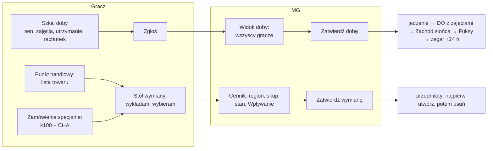

# PLAN — M5: Handel, postój, szabrowanie i bebeszenie

> Status: **PROJEKT** (2026-10-11). Decyzje MG D1–D45 z czterech rund pytań (§6.1); ustalenia projektu U1–U58 do
> weta MG (§6.2); otwarte P1–P8 rozstrzygnięte w rundzie 3 (§6.3). Rozmiar: **L** (`PLAN_beta.md` zakładał M — urosło o model Fuksów,
> Fanty, autodestrukcję maszyn, dobę postoju z zatwierdzaniem i przeskok czasu). Wywołanie: `PLAN_beta.md` M5.
>
> **Metoda (prośba MG).** Najpierw RAW, gdzie RAW ma dziurę — RAI, a gdy nie ma RAI („tę zagadkę zostawiam
> MG”) — WKK jako łata. Dla każdej reguły: *co robi dnd5e 5.3 i dlaczego* → *czy ten powód dotyczy nas* →
> *ile automatyki i za jaką cenę*. Gwiazda przewodnia: oznaczać, nie zakazywać — z granicą postawioną świadomie.
>
> **Trzy zasady tego planu, wprost od MG:**
> 1. **Zawsze barter.** Gambel to miara wartości, nie waluta. Nie da się mieć „jednego gambla”, da się mieć
>    papierosa wartego gambla. Waluty lokalne (żetony kasyn Vegas, dolary Nowego Jorku) są przedmiotami.
> 2. **Interfejs handlu jest dla MG.** Moduł daje MG wycenę zgodną z zasadami, żeby bez przygotowania zagrał
>    handlarza, który zna ceny. Gracze widzą mniej: tylko to, co sami wyłożyli, po cenach podręcznikowych.
> 3. **Gracz proponuje, MG zatwierdza.** Każdy gracz układa swoją dobę postoju; MG widzi wszystkie naraz i
>    zatwierdza dobę jednym ruchem, kiedy zgadza się z każdym. Jedyną blokadą jest to zatwierdzenie.
> 4. **Lista przed pytaniem.** Gracze pytają o trzy oczywiste rzeczy i kończą; lista towaru pokazuje to, o co
>    nikt by nie zapytał, i każe kombinować z gorszym sprzętem. Handlarz z listą jest domyślny; zamówienie
>    specjalne (rzut z RAW) zostaje na to jedno, czego na liście nie ma — i dla konkretnego przedmiotu zawsze daje
>    większą szansę (D28, D29).
>
> RAW = `Neuro 5e/Podrecznik/NOE/` (październik), `s. N` = strona drukowana. dnd5e = źródła 5.3.0
> (`module/…` względem repozytorium systemu). Warstwy: **NOE** (RAW), **RAI** (drzewo NOE z komentarzem
> o pochodzeniu), **WKK** (`scripts/wkk/`, za przełącznikiem Kobalt) — `scripts/wkk/README.md`.
> Repozytorium jest publiczne: liczby, parafrazy i numery stron, bez cytatów z podręcznika i bez fabuły.

---

## 0. W skrócie

| Filar | Co dostaje stół | Gdzie w planie |
|---|---|---|
| **Miejsce postoju** | drużyna wie, gdzie stoi: rodzaj (Dzicz / Wioska / Miasteczko / Miasto) i region z tabeli cen | §7.3 |
| **Cennik MG** | okno, w którym MG widzi cenę podręcznikową, regionalną, skup, dostępność w tym miejscu i regułę ilości — dla dowolnego przedmiotu | §7.4 |
| **Handel** | punkty handlowe z listą towaru (domyślnie); zamówienie specjalne (k100 − CHA) na to, czego nie ma na liście; stół wymiany: gracz wykłada towar i wybiera z listy, MG wycenia i zatwierdza, moduł przenosi przedmioty i montuje przeróbki | §7.5–7.8 |
| **Doba postoju** | szkic doby każdego gracza (sen, zajęcia, utrzymanie, rachunek) → jedno zatwierdzenie MG → odpoczynki, jedzenie, Zachód słońca, zegar | §7.11–7.15 |
| **Fuksy i Fanty** | Fuksy trwałe i ulotne z pochodzeniem, Fanty z tabeli k100 | §7.9–7.10 |
| **Szabrowanie, bebeszenie, rozbiórka** | narzędzie MG do ruin, bebeszenie trupów i wraków, autodestrukcja maszyn z wrakiem na mapie | §7.16–7.20 |

---

## 1. Skala automatyki i kryteria

Bez zmian względem `PLAN_m1_walka.md` §1 i `PLAN_m3_towarzysze.md` §1:

| Poziom | Nazwa | Co robi moduł | Kto rozstrzyga |
|---|---|---|---|
| T0 | Odnośnik | tekst RAW w opisie, dymku, plakietce | stół |
| T1 | Przycisk MG | MG wyzwala; moduł rzuca i prowadzi księgowość | MG |
| T2 | Wykrycie + karta | moduł wykrywa, karta czatu z przyciskiem; stosuje człowiek | MG / gracz |
| T3 | Domyślne | wartość domyślna z widocznym powodem, do zmiany | gracz / MG |
| T4 | Automat | bezwarunkowy skutek RAW stosowany od razu, z linią na czacie | RAW |

Doktryna (`PLAN_beta.md` §2, pamięć projektu): oznaczane, nie blokowane; ekonomii akcji nie liczymy; T4 tylko
tam, gdzie RAW nie zostawia wyboru. Dla M5 dochodzą dwie reguły:

- **Asymetria informacji.** Wycena (region, skup, stan) i progi rzutów trafiają tylko do MG — szeptem
  albo w częściach okna, które renderuje się tylko u MG. To granica UX, nie bezpieczeństwa: dane leżą w
  dokumentach, które każdy klient może przeczytać (U42).
- **Propozycja → zatwierdzenie.** Gracz pisze tylko swój szkic (na swoim aktorze), MG wykonuje całość. To ten
  sam wzorzec co przekaźnik MG (`flara.mjs`, prośby z `umieranie.mjs`) i Robota (`production/robota.mjs`):
  jeden magazyn stanu na aktorze, N widoków, jeden lejek zapisu.

**Korzyść:** częstość · łatwo przeoczyć · koszt pomyłki · różnica względem 5e · księgowość · wiedza, której gracz
nie powinien mieć. **Koszt:** kod i testy · przygotowanie MG · UI · ryzyko złej automatyki.

---

## 2. dnd5e 5.3 — co robi, czego nie robi, dlaczego

### 2.1 Inwentarz

| Potrzeba | dnd5e 5.3 | Gdzie |
|---|---|---|
| Drużyna | ✅ aktor `group`: `members`, `primaryVehicle`, własny ekwipunek i portfel; karta z zakładkami; moduł ją podmienia (`actors/party-sheet.mjs`) | `data/actor/group.mjs`, `applications/actor/group-sheet.mjs` |
| Odpoczynek drużyny | ✅ `GroupData#rest`: albo karta prośby do członków (gracz klika → własne okno), albo `autoRest` bez okien; zegar przesuwa raz MG; hak `dnd5e.groupRestCompleted` | `data/actor/group.mjs:315–375` |
| Prośba o rzut do członków | ✅ wiadomość typu `request` z listą celów; przycisk woła `CONFIG.DND5E.requests[handler]`; wynik dopina się do karty (sukces / porażka podświetlone). Rejestr ma dziś `rest` i `skill` — **moduł może dopisać własne** | `data/chat-message/request-message-data.mjs`, `config.mjs:4606`, `Actor5e.handleSkillCheckRequest` |
| Portfel | 🟡 `system.currency` z `CONFIG.DND5E.currencies` (moduł: jedno `gb`), `CurrencyManager` (przelicz, przekaż), okno nagród `Award` i `[[/award]]` dzielą gb | `data/shared/currency.mjs`, `applications/currency-manager.mjs`, `applications/award.mjs` |
| Cena przedmiotu | ✅ `system.price {value, denomination}`, `valueInGP`; sumy wartości na karcie | `data/item/templates/physical-item.mjs` |
| Handel, sklep, skup | ❌ — nie ma sprzedawcy, koszyka, wyceny, ograniczeń targu | — |
| Przeciąganie między aktorami | 🟡 domyślnie **kopia**; przeniesienie z Shift (`dnd5e.dragMove`); bez Właściciela źródła zawsze kopia | `base-actor-sheet.mjs` `_defaultDropBehavior` (pamięć projektu) |
| Przestój (downtime) | ❌ poza Bastionem: brak pracy, nauki, utrzymania, hulanki, plotek | — |
| Bastion | ✅ pełny system 2024: placówki (`facility`), rozkazy (Craft, Harvest, Trade, Recruit…), tura bastionu przy DO; w świecie kampanii **wyłączony** | `documents/actor/bastion.mjs`, `config.mjs:526` |
| Rzemiosło | 🟡 `CONFIG.DND5E.crafting` + `getCraftCost()` — dni i złoto dla przedmiotów 5e; moduł ma własną produkcję (M2) | `config.mjs:2126`, `data/abstract/item-data-model.mjs` |
| Skarb BN | 🟡 `details.treasure` (kategorie 2024: arcana, armaments…) — tylko etykiety, bez losowania | `data/actor/npc.mjs:100` |
| Tabele losowe | ✅ rdzeń: `RollTable` z wynikami-dokumentami (`documentUuid`), losowanie na czat, paczki tabel | rdzeń v14 |
| Inspiracja | 🟡 `attributes.inspiration` — **boolean**, bez źródła i terminu | `data/actor/character.mjs:80` |
| Kalendarz | ✅ `CalendarHUD`, `CONFIG.DND5E.calendar`; moduł ma własny zegar (`world-clock.mjs`) | `applications/calendar/` |
| Żeton | ✅ `TokenDocument.texture.src` należy do **instancji żetonu**, nie do aktora — zmiana grafiki jednego żetonu nie dotyka prototypu ani innych żetonów | rdzeń v14 |
| Siedlisko BN | ✅ `details.habitat` (arktyka, pustynia, miasto…) — filtr przeglądarki | `data/actor/npc.mjs:90` |

### 2.2 Hipotezy — dlaczego

- **R1 Gospodarka 5e to złoto.** 5e liczy wszystko w monetach, a zakupy i przestój zostawia narracji albo
  Bastionowi. Dlatego jest portfel i rozdawanie złota, a nie ma sprzedawcy ani wyceny.
- **R2 Przestój 2024 to Bastion.** Podręcznik 2024 przeniósł przestój do placówek z rozkazami; dnd5e
  zaimplementował dokładnie to, z kosztami w złocie i turą co 7 dni.
- **R3 Sklepy to treść, nie system.** Ceny ze SRD są stałe; dostępność i region to sprawa MG — w 5e nie ma
  liczb, które dałoby się zautomatyzować.
- **R4 Prośby i wspólny odpoczynek.** MG woła drużynę jednym przyciskiem, a każdy gracz odpowiada we
  własnym oknie — bo zapis do postaci gracza i rzut gracza należą do gracza.
- **R5 Inspiracja jest jedna.** Boolean wystarcza, bo 5e nie ma kilku źródeł z terminem.
- **R6 Ogólność.** Tysiące stołów — mechanizmy, nie tabele.

### 2.3 Które powody dotyczą nas — i co bierzemy

| Powód | Dotyczy nas? | Dlaczego |
|---|---|---|
| R1 Złoto | **nie** | Neuroshima to barter (D1). Portfel ukrywamy (D17), wartość liczymy w gamblach jako mierze |
| R2 Bastion | **nie** | Budowa bazy w RAW to godziny i gamble z korzyścią „ustaloną z MG” (s. 47) — Bastion wniósłby placówki, rozkazy i turę 7-dniową, których RAW nie ma. Bazą jest **Miejsce** z M2 (`production/pula.mjs`) |
| R3 Sklepy to treść | **nie** | NOE ma liczby: dostępność każdej pozycji, modyfikator lokalizacji, ceny regionalne, reguły ilości i limit transakcji (s. 43–44) |
| R4 Prośby | **tak** | Szabrowanie to rzut każdego szukającego — dokładnie prośba z wynikiem dopiętym do karty (U10). Odpoczynek drużyny bierzemy jako wzór zatwierdzenia doby (U27) |
| R5 Inspiracja | **nie** | Fuksy mają kilka źródeł i terminy (D15) — własny model, nie `inspiration` |
| R6 Ogólność | **nie** | Jeden system, dane z NOE |

**Bierzemy z dnd5e:** wiadomość `request` z własnym handlerem (`CONFIG.DND5E.requests.neuroSzabrowanie`);
wzór `GroupData#rest` (zapis po stronie MG, zegar raz); `actor.longRest({ dialog: false, … })` z konfiguracją
zajęć; `RollTable` w paczce; grafikę żetonu per instancja (wrak); `system.price`; rejestr źródeł Wyczerpania.
**Nie bierzemy:** portfela i `Award` dla gambli (R1), Bastionu (R2), `details.treasure` (R3), `inspiration` (R5).

**Wniosek.** Jak przy towarzyszach: dnd5e nie ma handlu i przestoju nie dlatego, że byłyby zbędne, tylko
dlatego, że jego gospodarka to złoto i Bastion. Nas to nie wiąże. Granicę wyznacza R4: zapisy do postaci
gracza należą do gracza albo idą przez MG.

---

## 3. RAW — inwentarz M5

### 3.1 Gambling (s. 43–44)

| Reguła | s. |
|---|---|
| Gamble nie są walutą; wartości w gb są orientacyjne. Lokalne „waluty” (żetony kasyn Vegas) poza swoim miastem są nic niewarte | 43, 162, 166 |
| Gambling trwa co najmniej godzinę; liczba kupców zależy od lokalizacji postoju | 43 |
| **Szukanie przedmiotu:** k100 minus **wartość** Charyzmy (nie modyfikator); wynik mieszczący się w dostępności przedmiotu w tej lokalizacji = handlarz go ma, można próbować wymienić | 43 |
| Modyfikator dostępności: Dzicz −50, Wioska −30, Miasteczko 0, Miasto +10 | 43 |
| Ilość u handlarza: wielorazowy — zwykle 1; jednorazowy — 2k4; amunicja — rzadko więcej niż 3k20 | 43 |
| Ceny regionalne: 11 regionów × 7 kategorii (Paliwo, Elektronika, Mechanika, Prochy, Broń, Żywność, Usługi speców), 25–200%; dotyczą „wszystkich tabel” | 44 |
| W regionie, gdzie towar jest drogi, najdrożej się go **sprzedaje** — cena regionalna działa w obie strony | 44 |
| **Limit:** w godzinie gamblingu tyle transakcji, ile wynosi PB; każda kolejna godzina tego dnia — RO na MDR albo CHA ST 10, porażka = Wyczerpanie | 44 |
| **Punkty handlowe:** MG może stworzyć punkt z określonym, wylosowanym albo wybranym towarem; wymiana bez targowania i bez ograniczeń gamblingu | 44 |
| Uproszczenie (opcja): nabój .22 LR jako umowna waluta — 1 gb | 44 |
| Ceny się nie negocjuje (to wymiana), ale Wpływanie (Perswazja, Oszustwo, Zastraszanie ST 15) może skłonić partnera do „dorzucenia kilku naboi” | 44 |
| **Skomplikowanych** ulepszeń broni dokonuje fachowiec za cenę z tabeli; tabela nie ma kolumny dostępności, ma kolumnę „Wymagania montażu” (SM, uchwyt bagnetu, rodzaj broni) | 128–129 |
| Część ulepszeń to przedmioty z produkcji (rusznikarstwo; optyka i elektronika — hakerstwo, serwisowanie) | 81, 83–84 |
| Schemat kosztuje tyle co przedmiot, dostępność ma o połowę mniejszą | 146 |

### 3.2 Postój (s. 45–47)

| Reguła | s. |
|---|---|
| **Sen:** każda istota powinna przespać co najmniej **6 h** na dobę; kto nie spał — RO KON ST 20 albo Wyczerpanie | 45 |
| KO 4 h; w tym najwyżej godzina czyszczenia broni, gamblingu, naprawy, produkcji; handel lub produkcja dłużej niż godzinę przerywa KO | 45 |
| DO 24 h; sen ≥ 6 h, reszta na lekkie zajęcia (czytanie, gambling, jedzenie, produkcja, rozmowy, warta); DO przerwany po ≥ 4 h daje korzyści KO | 45–46 |
| Gambling na postoju — wg Eksploracji | 46 |
| Gotowanie (2 h, Test kucharza ST 10; ≥ 20 — Fuks na 24 h), polowanie (1 h, Survival ST 15) | 46 |
| **Rozrywka:** tylko miasteczko lub miasto; 10 h i co najmniej 50 gb → Fuks na **7 dni**. W dziczy — Fanty, zwłaszcza kilkuosobowe | 47 |
| **Plotkowanie:** knajpa i chętni miejscowi; co najmniej 5 gb i godzina; Test CHA (Śledztwo) ST 10 → jedna informacja + jedna za każde 5 ponad ST | 47 |
| **Hazard:** MG wyznacza test umiejętności lub narzędzi ST 20 i stawkę; sukces podwaja postawione gamble, porażka je zabiera; zbyt duża wygrana albo przyłapanie na oszustwie = kłopoty | 47 |
| **Długi postój:** dni do miesięcy; wszystkie zajęcia Krótkiego + Praca, Trening/Nauka, Budowa bazy | 47 |
| Praca: 10 h/dobę, 1 gb × pasywna wartość umiejętności lub narzędzi (ustalonej z MG) | 47 |
| Trening/Nauka: 1 gb/h, konieczny trener, 30 × 10 h/dobę → biegłość w broni, umiejętności, narzędziach albo wyszkolenie w pancerzu | 47 |
| Budowa bazy: 1 gb/h, 10 h/dobę, korzyść ustalona z MG | 47 |
| Koszt utrzymania: Nędzny 5 gb/dzień (gołe niebo, najgorsza woda i jedzenie, **bez leków**), Normalny 10 (dach, zwykła woda, **leki**, pranie), Bogaty 20 (dobre jedzenie, filtrowana woda, alkohol, łóżko) | 47 |
| Podwładni: ludzkim można znaleźć robotę (sami się utrzymają); zwierzętom trzeba dać wodę i jedzenie wg s. 258, mogą pić brudną wodę, jedzenie normalnej jakości | 47 |

### 3.3 Fuksy i Fanty (s. 16–17, 57, 105, 132–133)

| Reguła | s. |
|---|---|
| Fuks = przerzut nieudanego k20, zużywa się; Fuksy z Fantów przechodzą na następne sesje, najwyżej **3** naraz; nie można ich przekazać | 16–17 |
| Fant daje Fuksa przy **pierwszym** wykorzystaniu przez danego bohatera (wypije, obejrzy, przeczyta, zagra) | 17 |
| Tabela Fantów: k100, ~70 pozycji z wartością 10–150 gb; **brak wyniku 85** (81–84, 86–87); za Fant wymagający drobnej naprawy klient da połowę wartości | 132–133 |
| Nagroda publiczności („Prezent od drużyny”): Fuks **bezterminowy**, 10 PD albo przedmiot do 20 gb | 57 |
| Pieśń otuchy (Sztuczka Muzyk): Fuks dla 1 + mod. CHA sojuszników, do zużycia w 24 h | 105 |
| Gotowanie (≥ 20): Fuks na 24 h · Rozrywka: Fuks na 7 dni | 46–47 |

### 3.4 Szabrowanie (s. 270–271) i tabele losowe (s. 130–144)

| Reguła | s. |
|---|---|
| Szabrujemy miejsca bez fabuły MG; wielkie kompleksy to osobne przygody (tabele mogą pomóc je planować) | 270 |
| Tabela ruin (7 rodzajów): czas, szansa komplikacji (k100), ilości CH / MK / CE / CZ (kości × 100 g albo × 1 kg) | 271 |
| MG w ukryciu rzuca k100 na komplikację; jeśli tak — k10 na Tabeli komplikacji; komplikacja **przed** szabrowaniem; MG może wstawić coś innego | 271 |
| Komplikacje k10: cztery „mieszkańców” (każdy z podrzutem k4 na istoty Bestiariusza i liczbę), pułapka z granatem, z siecią, uszkodzona podłoga, trujące opary, skażenie (k4 poziom), maszyny Molocha | 270 |
| Test MDR (Percepcja lub Śledztwo) ST 10; sukces — surowce z tabeli; **nie można powtarzać**, ale po porażce może spróbować ktoś inny | 271 |
| Więcej szukających: ilość się nie zwiększa, skraca się czas (np. każdy szuka innego rodzaju surowca) | 271 |
| Wynik ≥ 20 — podwójne surowce i losowy przedmiot; naturalna 20 — dodatkowo losowy Fant | 271 |
| Wykrywacz metalu: Ułatwienie do Percepcji przy szabrowaniu (zasilany baterią) | 132 |
| Tabela losowych przedmiotów k100 → kategoria (amunicja, elektronika, lekarstwa, narzędzia, prochy, różności, broń biała/miotana/palna, pancerze, granaty, miny, żywność, instrument, istota żywa, sprawny pojazd, dwa konkretne schematy, „rzuć dwa razy”) | 271 |
| Kolumna k100 w tabelach: Elektronika, Lekarstwa, Narzędzia, Prochy, Różności, Fanty, Żywność; k12: Instrumenty, Żywe istoty. **Bez** kolumny losowania: broń, pancerze, amunicja, granaty, miny | 130–144 |
| Zdobyczna apteczka: dwa rzuty k100 na Lekarstwa, 2k10 dawek | 132 |

### 3.5 Bebeszenie (s. 269) i autodestrukcja (s. 204)

| Reguła | s. |
|---|---|
| Bebeszy się wszystko, co samo biega, jeździ lub lata; dwa rodzaje: bestie (istoty organiczne) i maszyny (Moloch, SMART) | 269 |
| Bestie: rzeźnik albo medyk (zestaw); test narzędzi albo MDR (Survival); rozmiar Mały–Ogromny → czas 30 min–24 h, ST 5–20, MO 10–1000 kg, mięso 20–10 000 kg. **Brak wiersza Malutki** | 269 |
| Maszyny: elektronik, mechanik albo kowal; test narzędzi albo INT (Technika); rozmiar Malutki–Wielki → czas 1–32 h, ST 5–25, CH / MK / CE / CZ. **Brak wiersza Ogromny**. Naturalna 1 → autodestrukcja | 269 |
| Porażka: 10% teraz, 50% przepada, resztę (40%) można próbować dalej | 269 |
| Pomocnik z narzędziami, który zda Survival / Technikę ST 10, daje Ułatwienie; czas skraca pomoc albo pozyskiwanie jednego surowca — ile, decyduje MG | 269 |
| Autodestrukcja: przy 0 PW MG rzuca k100 na szansę ze statblocku; wybuch po 1k4 rundach niszczy wszystkie surowce elektroniczne, chemiczne i części zapasowe; parametry wybuchu w statblocku | 204 |

### 3.6 Surowce i recykling (s. 144–146)

| Reguła | s. |
|---|---|
| Surowce: CH, CZ, CE — 1 gb / 100 g; MK, MO — 1 gb / 1 kg | 144 |
| Źródła surowców: zakupy u handlarzy, bebeszenie, grzebanie na złomowiskach, **recykling zepsutych urządzeń**, wynagrodzenie; MG podaje ilość w gb albo kg | 146 |

### 3.7 Zdolności, które dotykają M5

| Zdolność | Skąd | s. | M5 |
|---|---|---|---|
| Gambling we krwi: nigdy nie męczy cię gambling, +5% do dostępności | Pochodzenie Nowy Jork | 63 | T4 w zamówieniu |
| Hazardzista: biegłość Zwinne dłonie i Oszustwo | Pochodzenie Vegas | 65 | dane (już są) |
| Wierzę: raz na DO drobny przedmiot do 5 gb | Pochodzenie Salt Lake City | 64 | M7 |
| Złomiarz — Śmieciarz: Ułatwienie do testów MDR i INT przy szabrowaniu | Sztuczka | 108 | T4 w szabrowaniu |
| Złomiarz — Antykwariusz: Ułatwienie do INT (Śledztwo) przy wycenie | Sztuczka | 108 | T0 (wycenia MG — D4) |
| Pieśń otuchy (Muzyk): Fuks 24 h dla 1 + mod. CHA sojuszników | Sztuczka | 105 | źródło Fuksa (U24) |
| Za garść gambli (Gwiazda): raz dziennie 4 h koncertu; wynik Występów lub instrumentu × mnożnik miejsca (0,5 / 1 / 2 / 3 gb); +1 Wyczerpanie | Cwaniak / Gwiazda | 74 | zajęcie postoju (U37) |
| Stylówa / Renoma: +1 do Wpływania za 50 gb towarów luksusowych na sobie | Gwiazda / Mafiozo | 74, 75 | M7 |
| Moja prawa ręka: wikt i 1/10 doli; nowego szuka się 24 h w miejscowości | Mafiozo | 75 | szukanie (U38), dola T0 (U39) |
| Partner: 24 h szukania, w mieście i w dziczy | Zwiadowca / Sędzia | 101 | szukanie (U38) |
| Oswajanie zwierząt: 24 h szukania, k6 na rodzaj, 3 dni oswajania | Zwiadowca / Łowca Mutantów | 99 | szukanie (U38) |

### 3.8 Kolory Neuroshimy (s. 201–202) — po becie, ale zaczepy teraz

Rdza: ceny ×2, dostępność ×½, szabrowanie ×½ surowców. Stal: broń i amunicja ×½ ceny, ×2 dostępności; Fuks
na sesję. Chrom: dostępność ×2, środki leczące ×½ ceny; Fuks na sesję. Silnik cen i dostępności (U2) ma więc
etap mnożnika „profilu świata”, a model Fuksów (U24) — termin „do końca sesji”. Profile Kolorów zostają po
becie (`PLAN_beta.md` §4).

### 3.9 Niejasności RAW → gdzie rozstrzygnięte

| Niejasność | Rozstrzygnięcie |
|---|---|
| Czym płacić, skoro gamble nie są walutą | barter zawsze, portfel ukryty (D1, D17) |
| Co to jest „transakcja” w limicie PB/h | każda próba szukania i każda sprzedaż (D2) |
| Ten sam przedmiot drugi raz tego dnia | raz na dobę w danej miejscowości (D2) |
| Po ile handlarz kupuje | NOE 100% ceny regionalnej, WKK 50%, MG koryguje (D3) |
| Kategorie cen regionalnych dla pancerzy, amunicji, narzędzi, sprzętu, surowców | mapa D8; ulepszenia — D31 |
| Które ulepszenia są „skomplikowane” | z kolumny „Wymagania montażu”: SM albo uchwyt bagnetu — nasadka, reszta — przeróbka fachowca (D31) |
| Dostępność ulepszeń | nasadki: bliźniak ze Sprzętu albo próg ceny (D32); przeróbki — usługa, bez dostępności |
| Losowanie z tabel bez kolumny k100 | ważone dostępnością (D9) |
| Punkt handlowy „z wylosowanym towarem” — jak losować | rzut dostępności bez CHA → pula → ograniczona liczba miejsc (D29, odczyt MG) |
| Bebeszenie ludzi i mutantów | dozwolone, z jawną wiadomością (D10) |
| Malutkie bestie, Ogromne maszyny | WKK — wiersze ekstrapolowane (D11) |
| Kilku szukających / pomocników — o ile krótszy czas | czas ÷ liczba osób, rodzaje dzielone (D12) |
| Pozyskiwanie tylko jednego surowca — o ile krócej | czas ÷ liczba rodzajów w tabeli (U18) |
| Powtórka bebeszenia po porażce | rekurencyjnie na reszcie puli (U17) |
| Koszt utrzymania — skutki | NOE: leki z utrzymania (Normalny = Bogaty), Nędzny bez leków (D13) |
| Ile snu; co daje sen 1–5 h | 6 h dla NOE i WKK; 4–5 h — korzyści KO (odczyt MG); WKK: RO za krótki sen i odsypianie (D20, D34, D35) |
| Czy zajęcia doby się sumują | doba = 24 h, praca ≤ 10 h (D7, U48) |
| Brak wyniku 85 w Tabeli Fantów | erratum: 81–85 „CD z muzyką rozrywkową” (U25), pytanie do autora |
| Recykling bez liczb | karta MG z propozycją (D22) |
| Woda brudna i skażona — skutki | WKK (zasada z wewnętrznej alfy systemu, D23) |

---

## 4. Stan kodu — znaleziska

- **F1 — brak miejsca postoju.** Podróż zna biom, tempo i transport (`flags.<mod>.podroz` na drużynie,
  `config/podroz-data.mjs`), ale nie rodzaj miejscowości ani region. Bez tego nie ma modyfikatora dostępności,
  cen regionalnych, Rozrywki ani Prawej ręki z Pochodzeniem miejsca werbunku.
- **F2 — portfel widoczny, choć barter.** Karta postaci i drużyny pokazują `currency.gb`; `Award` (już
  przycięty przez M3 do członków bez towarzyszy, `actors/towarzysze.mjs`) rozdaje gb. Kotwicą wstrzyknięć
  sekcji ekwipunku (amunicja, granaty, magazynki, prowiant, surowce) jest **element `.currency`** — ukrycie
  musi zostawić go w DOM (U43).
- **F3 — katalog ma ceny, nie ma kategorii regionalnych.** `KATALOG` (`config/recipes-data.mjs`) to 351 pozycji
  z `cena`, `dostepnosc`, `kategoria`, `jednorazowy`; `config/dostepnosc.mjs` i `wkk/config/dostepnosc-kobalt.mjs`
  od M3 czekają na „okno handlarza w M5”. Brakuje mapy `kategoria → kategoria cen regionalnych`.
- **F4 — 87 pozycji katalogu bez dostępności.** 26 ulepszeń (RAW: usługa — poprawnie bez), 4 `uslugi`,
  pozycje `tabela:*` (produkcja) — poprawnie; ale ~45 przedmiotów z tabel RAW, które dostępność **mają**
  (Kompas 30%, Laptop 10%, Komputer osobisty 30%, Kłódka 50%, Kwas 30%, Kolczatki 40%, Noktowizor 15% …)
  ma `null` — luka danych do zasypania z NOE (U4).
- **F5 — Fuksy to liczba.** `flags.<mod>.fuksy` 0–3 (`combat/rerolls.mjs`, `actors/fuks-pips.mjs`); bez źródła i
  terminu. Fuks z Gotowania „na 24 h” (`actors/party-supplies.mjs` `cook`) nigdy nie wygasa — błąd RAW dziś.
- **F6 — Fantów nie ma.** Ani danych, ani akcji; tymczasem dają je szabrowanie (nat. 20), Rozrywka w dziczy i
  Nagroda publiczności (przedmiot do 20 gb). Panel PD (`actors/pd-panel.mjs`, `publicznosc`) daje tylko 10 PD.
- **F7 — zajęcia odpoczynku są per okno.** Rejestr `registerRestActivity` (`actors/rest-activities.mjs`) zasila
  okna KO/DO dnd5e: produkcja, czyszczenie broni, Truciciel, Pogromca (`production/odpoczynek.mjs`), Pomoc
  medyczna i Gojenie (`actors/rekonwalescencja.mjs`), naprawa drona (`actors/drony-naprawa.mjs`). Budżet zna
  tylko „pracę” (KO 1 h, DO 10 h); snu nie ma; „W cieple” i nota choroby są poza rejestrem (`config/rest.mjs`).
- **F8 — jedyny dzienny licznik to produkcja.** `flags.<mod>.produkcjaDoba {dzien, minuty}` (`production/robota.mjs`).
- **F9 — dzień to trzy osobne kliknięcia MG.** DO każdej postaci (okno gracza), „Zapotrzebowanie” na karcie
  drużyny (`consumeDailyNeeds`), „Zachód słońca” w kontrolkach (`sunsetCheck`, strażnik `ostatniZachod`).
  Kolejność (jedzenie przed DO) zależy dziś od dyscypliny.
- **F10 — autodestrukcja to tekst.** Statblocki maszyn mają cechę „Autodestrukcja (N%)” z `automation: null`
  (`config/bestiary-data.mjs`, 9 maszyn); pozycja 20 Tabeli awarii prowadzi do karty „Śmierć” bez wizualnego
  śladu (`combat/maszyny.mjs`). Drony mają „wrak” jako stan uchwytu (`actors/drony.mjs`, U11 M3).
- **F11 — rozmiary Bestiariusza vs tabele.** Malutkie istoty organiczne: Kitchin, Neokot, Techmorwa (malutka) —
  tabela bestii ich nie ma. Maszyn Ogromnych w Bestiariuszu brak (Juggernaut jest Wielki), ale tabela powinna
  je znać. Hybrydy: Biodroid, Pulser (maszyny z bio), Techmutas, Techmorwa (organiczne z techniką).
- **F12 — eksplozja do wzięcia.** `explosiveInternals` (`actors/grenade-inventory.mjs`): `requestBlast`
  (wybuch w punkcie przez przekaźnik MG — dźwięk, błysk, ślad), `postExplosiveCard` (karta z RO i obrażeniami),
  `parseSaveSpec` / `parseDamageSpec` (parsują polski tekst statblocku).
- **F13 — mięso i surowce mają lejki.** `prowiant:mieso` (1 kg, `config/prowiant-data.mjs`); surowce przez
  `giveManySurowce` / `takeManySurowce` (`actors/surowce-store.mjs`); Miejsce = aktor `vehicle` z flagą
  `miejsce` (`production/pula.mjs`, `noweMiejsce`).
- **F14 — generator sklepów stołu jest poza modułem.** `Integracje/loot_generator.py` w vaulcie: profile
  lokalizacji (ilości, odsetek towaru spoza kategorii głównych, narzut i ilość „podstaw”), 2–3 kategorie
  główne, gwarantowane podstawy (medpak, woda, jedzenie, leki, amunicja podstawowa — min. 2 kalibry), ziarno.
  Czyta własny cennik (`Tabele/Sklepy/Dostepnosc.md`, bez ulepszeń), nie `KATALOG`. *Runda 3: nie portujemy —
  generator pisany od nowa (D29); z tego bierze tylko pomysł kategorii głównych i Podstaw.*
- **F15 — prośby dnd5e są rozszerzalne.** `CONFIG.DND5E.requests` + wiadomość `request` dopina wynik do karty
  i podświetla sukces / porażkę — gotowa karta „szukają: A, B, C”.
- **F16 — waluta lokalna istnieje jako jeden przedmiot WKK.** Żeton Luxor (`wkk/items/zeton-luxor.mjs`, 10 gb)
  nie wie, że jest walutą ani gdzie.
- **F17 — drony czekają.** „Złom i surowce rozstrzyga MG (M5)” (`actors/drony.mjs`, `actors/drony-naprawa.mjs`).
- **F18 — zdolności M5 mają plakietkę „brak”.** Gambling we krwi, Śmieciarz, Pieśń otuchy, Za garść gambli —
  rejestry pokrycia (`game.neuroshima.{pochodzenia,sztuczki,zdolnosci}.report()`).
- **F19 — tabele w vaulcie.** `Tabele/Zywnosc.md` ma zasadę jakości wody (z wewnętrznej alfy systemu — D23) i
  żywność zmutowaną; żadna nie jest w module.

---

## 5. Ocena per reguła

| Reguła | dnd5e | Powód | Częstość | Koszt błędu | Poziom | Koszt |
|---|---|---|---|---|---|---|
| Miejsce postoju (rodzaj, region) | ❌ | — | każdy postój | średni — złe ceny i dostępność | **T1** MG ustawia | S |
| Wycena MG (region, skup, stan) | ❌ | R1, R3 | każda wymiana | średni | **T3** podpowiedź, MG nadpisuje | M |
| Zamówienie specjalne (k100 − CHA) | ❌ | R3 | gdy lista zawiedzie | niski | **T4** rzut i próg jawne; ilość T4 | S |
| Limit transakcji, godziny, RO za kolejne | ❌ | — | każdy dzień handlu | niski, ale nikt nie pamięta | **T2** licznik + prośba o RO | S |
| Wymiana (przeniesienie przedmiotów) | 🟡 kopia | R1 | każda wymiana | wysoki — duplikaty, zguby | **T1** MG zatwierdza; lejek bez klonów | M |
| Punkt handlowy z listą towaru | ❌ | R3 | każda wizyta w osadzie | średni — lista za długa albo za hojna | **T1** MG generuje; towar T4 z danych RAW | M |
| Przeróbka broni u fachowca | ❌ | — | rzadko | średni — montaż na złej broni | **T1** MG zatwierdza; montaż T4 | S |
| Fuksy z terminem i źródłem | 🟡 boolean | R5 | co sesję | średni — Fuks, który powinien wygasnąć | **T4** wygasanie na zegarze | M |
| Fanty — Fuks za pierwsze użycie | ❌ | — | co kilka sesji | niski | **T4** z akcji przedmiotu | S–M |
| Doba postoju: szkic → zatwierdzenie | 🟡 prośba o odpoczynek | R4 | każdy dzień postoju | średni — kolejność, zapomniane koszty | **T1** MG zatwierdza; księgowość T4 | L |
| Koszt utrzymania (leki, jedzenie) | ❌ | R2 | każdy dzień w mieście | średni — choroby bez leku | **T4** po zatwierdzeniu | S |
| Praca, Trening, Budowa bazy | 🟡 Bastion | R2 | Długi postój | niski | **T4** postęp; korzyść Budowy T2 | M |
| Rozrywka, Plotki, Hazard, koncert | ❌ | — | w mieście | niski | **T4** rzut i księgowość; informacje T2 | S–M |
| Szukanie nowego towarzysza | ❌ | — | rzadko | niski | **T2** karta → narzędzie M3 | S |
| Przeskok narracyjny | ❌ | — | rzadko | średni | **T1** MG zaznacza | M |
| Szabrowanie | 🟡 prośba | R4 | co wyprawę | niski | **T1** MG; rzuty graczy; surowce T4 | M |
| Komplikacje szabrowania | ❌ | — | co wyprawę | średni | **T2** karta MG w ukryciu | S |
| Losowy przedmiot | 🟡 RollTable | — | rzadko | niski | **T4** z silnika; tabele w paczce | M |
| Bebeszenie | ❌ | — | po walkach z bestiami | niski | **T1** gracz; stan na trupie T4 | M |
| Autodestrukcja | ❌ | — | każda walka z Molochem | wysoki — zła zdobycz, zaskoczony stół | **T2** karta MG + odliczanie, wybuch T4 po potwierdzeniu | M |
| Rozbiórka (recykling) | ❌ | — | rzadko | niski | **T2** karta MG z propozycją | S |
| Jakość wody (WKK) | ❌ | — | codziennie na Nędznym | średni | **T4** RO przy brudnej wodzie | S |

---

## 6. Rozstrzygnięcia

### 6.1 Decyzje MG (2026-10-11, rundy 1–2)

**D1 — Zawsze barter.** Gambel to abstrakcyjna miara wartości, nie waluta; to rdzeń Neuroshimy. Mogą
istnieć waluty lokalne (żetony Luxor, dolary Nowego Jorku) — ich wartość zależy od odległości od miejsca
powszechnego użycia i reguluje ją MG.

**D2 — Transakcja.** Jedną z „PB transakcji na godzinę” zużywa każda próba szukania (udana czy nie) i każda
sprzedaż. Tego samego przedmiotu nie szuka się drugi raz tego samego dnia w tej samej miejscowości (odczyt MG
luki RAW). *Przy punkcie handlowym licznika nie ma (RAW s. 44, D28).*

**D3 — Skup i widoczność.** Handlarz domyślnie skupuje po **100%** ceny regionalnej (NOE); WKK domyślnie
**50%**. Wpływanie, zastraszanie itp. mogą to podnieść — w gestii MG. Skup, tabela regionalna i modyfikatory są
**niewidoczne dla graczy**; gracze widzą tylko to, co sami wyłożyli, po cenach podręcznikowych.

**D4 — Interfejs dla MG.** Nie ma interfejsu „jak w Fallout”. Moduł daje MG informacje, żeby wycenił
przedmioty zgodnie z zasadami i bez przygotowania zagrał wprawnego handlarza; ostatecznie cenę proponuje i
negocjuje MG.

**D5 — Późna i wczesna ewaluacja.** RAW ma obie: szukanie (późna — rzut na przedmiot, kiedy go szukasz) i
punkty handlowe z określonym, wylosowanym albo wybranym towarem (wczesna, s. 44). MG najpierw przypisał listę do
WKK; po korekcie (P1, runda 3) lista jest NOE i drogą domyślną (D28).

**D6 — Długi postój: doba po dobie.** Postoje do ~2 tygodni (najdłużej tyle, ile leczenie). Dłuższe są
narracyjne — z ręcznym ustawieniem postępu (D19).

**D7 — Doba sumuje się do 24 h.** Sen + zajęcia = 24 h, bez wyjątków. Sen: 6 h dla NOE i WKK (s. 45; MG zakładał
8 h i w rundzie 3 przyjął RAW — D34); progi poniżej 6 h w D20.

**D8 — Kategorie cen regionalnych.** Broń ← broń, amunicja, granaty, magazynki, ulepszenia, pancerze;
Mechanika ← zestawy narzędzi, pojazdy, CZ, MK; Prochy ← leki, narkotyki, używki, pirotechnika, CH;
Elektronika ← elektronika, komputery, optyka, CE; Żywność ← prowiant, woda, MO, żywe istoty; Usługi speców ←
trener, rzemieślnik; sprzęt, Fanty, schematy — bez mnożnika. *Ulepszenia rozdzielone w D31.*

**D9 — Losowanie z tabel bez kolumny k100:** ważone dostępnością (rzadsze rzadziej).

**D10 — Bebeszenie ludzi i mutantów:** dozwolone, z jawną wiadomością na czacie — gracze i MG mają wiedzieć,
co postać zdecydowała się zrobić.

**D11 — Malutkie bestie i Ogromne maszyny:** wiersze ekstrapolowane jako WKK (liczby — D36).

**D12 — Kilku szukających:** rodzaje surowców dzielone między szukających, każdy rzuca za swoje; czas = czas
z tabeli ÷ liczba osób; pole do nadpisania. Ta sama zasada dla pomocników w bebeszeniu.

**D13 — Koszt utrzymania (NOE, mechanicznie).** Nędzny = bez leków: gracz bierze dawki z ekwipunku ręcznie
albo rzuca na chorobę. W NOE Normalny = Bogaty. **WKK:** Bogaty daje szansę na Fuksa rosnącą z każdym dniem
(1/10 pierwszego, 1/9 drugiego, 1/8 trzeciego…). Psi partner na Nędznym poziomie pije złą wodę (D23) — gracz
może to obejść, dając mu ręcznie wodę i lek z ekwipunku. Bogate życie ma być **widać**: ilustracja (barłóg /
skromna izba / wygodna komnata) i inna karta czatu.

**D14 — Autodestrukcja:** karta MG przy 0 PW, odliczanie, automatyczny wybuch, ślad wybuchu i podmiana
grafiki tej instancji żetonu na wrak (mały / średni / duży / gigantyczny). To samo przy autodestrukcji z
Tabeli awarii (20). Na mapie ma być widać, że maszyna się zniszczyła — żeby nikt nie pytał „a czy z tego mogę?”.

**D15 — Fanty i Fuksy w M5.** Fanty wchodzą razem z terminami Fuksów i ich źródłami. Fuksy dzielą się na
**trwałe** i **ulotne** — jak Wyczerpanie na uporczywe i przejściowe (7 dni z Rozrywki, bezterminowy z Nagrody
publiczności). Dymek z pochodzeniem („Fuks od wypicia Neuro-Coli”), lekki kolor źródła.

**D16 — Rzemieślnicy-NPC:** minimum — pozycja „Usługa” w oknie wymiany (cena MG × mnożnik Usług speców) i
trener do Treningu.

**D17 — Portfel gb ukryty wszędzie** (postać, drużyna, Award) + jednorazowy audyt aktorów z gb > 0.

**D18 — Rachunek per postać.** Postać pokrywa koszty pracą i towarem — doba musi wyjść na zero albo na plus.
Każdy gracz ma swój ekran, MG widzi wspólny i zatwierdza całą dobę; nie zatwierdza, dopóki nie zgadza się z
rozliczeniem każdego. Ujemnych sald się nie przenosi — MG poprosi np. o test Wpływania („przekonałeś go, uczy
cię taniej”) albo przyjmie nadwyżkę z poprzedniego dnia. Blokadą jest wyłącznie zatwierdzenie MG.

**D19 — Przeskok narracyjny** dla postojów dłuższych niż ~2 tygodnie: wartości deterministyczne i oczekiwane,
bez rzutów dzień po dniu; MG zaznacza skutki; jeden zapis i karta podsumowania; zegar przesunięty raz.

**D20 — Sen** (runda 3, zastępuje szkic z rundy 2). Pole snu w szkicu doby, domyślnie 8 h.

| Sen | NOE | WKK dokłada |
|---|---|---|
| ≥ 18 h | DO | odsypianie: −2 poziomy Bezsenności (D35) |
| 12–17 h | DO | odsypianie: −1 poziom Bezsenności |
| 6–11 h | DO | — |
| 4–5 h | korzyści KO (odczyt MG: jak DO przerwany po 4 h, s. 46) | RO KON ST 10, porażka — Bezsenność |
| 2–3 h | brak korzyści | RO KON ST 15, porażka — Bezsenność |
| 0–1 h | RO KON ST 20, porażka — Bezsenność (RAW: doba bez snu; 1 h liczona jak brak snu) | — |

Bez serii krótkich nocy i bez długu snu w godzinach: godziny są tylko wejściem doby, stanem jest wyłącznie
Wyczerpanie. Albo się wyspałeś, albo nie. Kto raz po raz śpi „prawie dość” — decyduje MG (ST rzutu do poprawki w
szkicu).

**D21 — Towar handlarza:** gracze widzą nazwy i ilości, bez cen; MG widzi cenę standardową i po modyfikatorach.

**D22 — Rozbiórka (recykling):** akcja na zepsutym przedmiocie → karta MG z propozycją (T2): ½ surowców
z produkcji (¼ ceny) wg profilu przepisu, Test narzędzi z przepisu, czas jak „Trochę roboty”; MG zmienia
liczby przed zatwierdzeniem. Dotyczy też wraków dronów.

**D23 — Jakość wody → WKK.** To zasada z wewnętrznej alfy systemu, usunięta z druku, bo na papierze nie da się
jej śledzić; w Foundry się da. Wraca jako WKK, doregulowana „wg wyczucia” (§7.14, D37).

**D24 — Fuksy z Fantów i Nagrody publiczności są trwałe**, pozostałe źródła mają termin z RAW (§3.3).
*Wynika z D15 i RAW (s. 17, 57).*

**D25 — Usługi speców (D8, D16):** trener i rzemieślnik liczą się w kolumnie „Usługi speców”.

**D26 — Przeskok i doba korzystają z tego samego rejestru zajęć** — jedna definicja zajęcia, trzy widoki
(okno DO dnd5e, szkic doby, przeskok). *Wynika z D6, D18, D19.*

**D27 — Stół wymiany i doba nie liczą gambli jako pieniędzy**: koszt to wartość towaru, który postać oddaje,
zarobek to wartość towaru, który dostaje. *Wynika z D1, D18.*

#### Runda 3 (2026-10-11) — korekty i otwarte P1–P8

**D28 — Lista przed pytaniem (P1).** Gracze zapytają o trzy oczywiste rzeczy (najlepsza broń, C4, najlepszy
pancerz) i uznają cierpliwość stołu za wyczerpaną; o przedmioty wymagające pomysłu albo planu nikt nie pyta.
Lista towaru pokazuje to, czego nie szukali, i każe kombinować z gorszym sprzętem. Dlatego **punkt handlowy z
listą (NOE, s. 44) jest domyślną drogą handlu**. Szukanie z RAW zostaje jako **zamówienie specjalne**: gracz chce
czegoś, czego nie ma u odwiedzonego handlarza, i szuka po osadzie — u kogoś, kto nie jest kupcem (wdowa, która
przechowała coś po mężu). Zamówienie działa ściśle wg RAW i z **jawnymi liczbami** (dostępność, lokalizacja,
CHA, próg), z limitem transakcji i RO; lista — bez limitów (RAW). Warunek MG: dla **konkretnego** przedmiotu lista
musi być zawsze gorsza od zamówienia, inaczej nikt nie zamawia (D29).

**D29 — Generator towaru.** Pisany od nowa na `KATALOG`; `loot_generator.py` nie jest wzorem (MG: „nie traktuj go
jak świętości”).
1. Każda pozycja z kategorii handlarza rzuca dostępność + modyfikator lokalizacji, **bez CHA** — towar nie zależy
   od tego, kto wejdzie. Zdane → pula.
2. Handlarz ma ograniczoną liczbę miejsc — domyślnie Dzicz 6, Wioska 10, Miasteczko 15, Miasto 25; ok. 80% na 2–3
   kategorie główne, ok. 20% na resztę (pola do zmiany, strojenie na stanowisku Bazar). Miejsca wypełnia los z
   puli.
3. Ilości wg RAW (U5).

Szansa przedmiotu na liście = dostępność × miejsca ÷ pula ≤ dostępność < dostępność + CHA = szansa zamówienia.
CHA ≥ 1, więc zamówienie wygrywa zawsze — i obejmuje całą osadę, a lista jednego handlarza. Przykład: UZI (50%)
w miasteczku, CHA 12 — zamówienie 62%, lista sklepu z bronią ok. 35%, lista sklepu wielobranżowego ok. 1%.
Każda liczba z RAW, odczytem MG jest tylko sposób losowania → drzewo NOE z komentarzem o pochodzeniu. Narzut na
podstawy odpada (zmieniał ceny RAW); „Podstawy” (woda, jedzenie, leki podstawowe, dwa popularne kalibry) to
kategoria do zaznaczenia. WKK zostaje tylko skup 50% (D3).

**D30 — Cykl życia listy.** MG tworzy listę z parametrów, dokłada przedmioty ręcznie, losuje od nowa ze wzoru
(zastępuje wszystko, także ręczne dodatki) albo usuwa całą — kiedy chce, bez samoczynnego odświeżania. MG
widzi notkę „Gracze odwiedzili: <data świata>”.

**D31 — Ulepszenia: nasadki i przeróbki (P2).** RAW s. 128: fachowca wymagają **skomplikowane** ulepszenia;
tabela ma kolumnę „Wymagania montażu”. Podział z tej kolumny:
- **nasadka** — montaż na SM albo uchwycie bagnetu (celowniki, kolimator, laser, noktowizor, termowizor, latarka,
  dwójnóg, trójnóg, chwyt przedni, powiększalnik, granatnik i śrótówka podwieszane, bagnet): towar na listach
  i w zamówieniach, montuje właściciel (jak dziś); kategoria cen Broń, optyka i elektronika — Elektronika;
- **przeróbka** — każde inne wymaganie (wszystkie ulepszenia broni białej; szyna, uchwyt bagnetu, konwersja,
  sprężyny, celownik trytowy, tłumik, kolby, okładziny): usługa fachowca w kolumnie Usługi speców; zatwierdzenie
  wymiany tworzy ulepszenie i montuje je na broni-celu.

**D32 — Dostępność nasadek** (RAW jej nie podaje): bliźniak z tabeli Sprzętu, gdzie jest (Noktowizor 15%,
Termowizor 5%, Latarka 60%); reszta z progu ceny: ≤ 20 gb — 50%, ≤ 50 — 30%, ≤ 100 — 15%, więcej — 5%. Odczyt
MG, liczby w danych do zmiany. Przeróbki — bez dostępności (usługa).

**D33 — Fachowiec** to pole punktu handlowego: rusznikarz (przeróbki broni dystansowej), kowal (białej), elektronik
(Szoker). Generator ustawia go handlarzom z kategorią główną Broń w miasteczku i mieście; MG przełącza.

**D34 — Sen 6 h dla obu warstw.** NOE i WKK zgadzają się co do progu DO; WKK dokłada tylko RO za krótki sen i
odsypianie (tabela w D20).

**D35 — Odsypianie (WKK).** Pod Kobaltem Bezsenność jest uporczywa: zwykłe −1 z DO jej nie zdejmuje. Zdejmuje ją
sen ponad normę — 6 h ponad 6 h (12 h snu) to jeden poziom, 12 h ponad (18 h) dwa. Nie więcej: reszta doby (6 h)
to jedzenie, leki i podstawowa troska o siebie, a zdrowy człowiek nie śpi 24 h. Liczy się tylko sen tej doby. Bez
Kobaltu Bezsenność schodzi zwykłym DO.

**D36 — Wiersze WKK bebeszenia (P3):** Malutka bestia — 15 min, ST 5, 2 kg MO, 5 kg mięsa; Ogromna maszyna —
64 h, ST 25, CH 100 kg, MK 6000 kg, CE 100 kg, CZ 200 kg (×2 Wielkiej, ST bez wzrostu — RAW nie ma ST > 25 w
bebeszeniu).

**D37 — Jakość wody WKK (P4):** **brudna** — RO KON ST 10 raz na dobę picia, porażka → Choroba zakaźna (biegunka,
s. 111; leczenie antybiotykiem 10 dni); kto już choruje, nie rzuca; **skażona radioaktywnie** — RO KON ST 15,
porażka → Wyczerpanie „Skażenie radioaktywne”; **skażona chemicznie** — RO KON ST 15, porażka → 1k6 od kwasu i
Wyczerpanie; gotowanie 15 min albo WD-Tabs → woda pitna (tylko brudna). Alfa miała ST 12 / 15 / 16 — brudna i
chemiczna niższe, bo na Nędznym rzut jest codzienny.

**D38 — WKK Bogaty (P5, P6):** szansa 1 / (11 − n), n = kolejne dni Bogatego życia bez Fuksa z tego źródła (dzień
10 — pewny); sukces zeruje n; Fuks na 7 dni.

**D39 — Waluta lokalna poza regionem (P7):** 0, z polem MG.

**D40 — Hazard (P8):** jedna gra trwa 1 h.

**D41 — Osełka (WKK).** W NOE Naostrzenie jest przeróbką kowala (D31), więc nie trafia na listy. Pod Kobaltem
Osełka (`addon:naostrzenie`) jest towarem: na listach i w zamówieniach, dostępność z progu ceny (20 gb → 50%,
D32), kategoria cen Broń; stosuje ją właściciel jak dziś (przeciągnięcie na broń, Osełka znika). Darmowa Osełka
z narzędzi kowala bez zmian.

#### Runda 4 (2026-10-11) — oprawa dla wyobraźni

**D42 — Obraz tam, gdzie nie ma mapy.** W walce taktycznej UI ma nie przeszkadzać (tak jest i zostaje). W
teatrze wyobraźni — miasto, postój, odpoczynek w dziczy, szabrowanie bez mapy — gracze dostają obraz, który
rozbudza wyobraźnię (wzór: karty obozu z Baldur's Gate). Reguły, żeby nie zrobić baroku:
- tylko okna i karty graczy w teatrze wyobraźni; UI taktyczne i narzędzia MG zostają oszczędne;
- jeden obraz na powierzchnię, u góry albo z boku, nigdy pod tekstem;
- obraz nie niesie informacji — brak pliku to brak obrazu, układ bez zmian (jak pusty slot dźwięku);
- obrazy ogólne, kluczowane kategoriami RAW, nie miejscami: obraz baru pasuje do każdego baru;
- każdy slot ma nadpisanie MG (obraz przeciągnięty na Miejsce, punkt handlowy, ruinę) — tędy kiedyś wejdzie
  grafika ręczna.

**D43 — Powierzchnie z obrazem** (wszystkie sześć z propozycji, §7.23): okno Doba i karta podsumowania (obraz
zmienia się z wybranym utrzymaniem; w dziczy — obóz), okna KO / DO w dziczy (obóz wg biomu), stół wymiany
(portret handlarza), karta szabrowania (ruina), przeskok (obraz doby z podpisem „N dni później”), Miejsce (tylko
obraz MG). Bez obrazów: walka, bebeszenie, autodestrukcja, narzędzia MG, poszczególne zajęcia (wystarczą ikony).

**D44 — Styl:** jeden dla wszystkich ilustracji — malowany, w duchu kart obozu z Baldur's Gate 3: ciepłe światło
(ognisko, lampa) przeciw ponuremu pustkowiu.

**D45 — Ustawienie klienta „Ilustracje”**, domyślnie włączone — gracz na małym ekranie albo o oszczędnym guście
może je wyłączyć.

### 6.2 Ustalone w projekcie (jedno sensowne wyjście) — do weta MG

**Miejsce, ceny, dostępność**

- **U1 Miejsce postoju** na aktorze drużyny: `flags.<mod>.postoj.miejsce = { nazwa, rodzaj, region, knajpa,
  maksStawka, obraz }`; rodzaj ∈ dzicz / wioska / miasteczko / miasto; region ∈ 11 regionów tabeli albo „—”. Scena
  może mieć domyślne miejsce (`flags.<mod>.miejsce` sceny) — przy przejściu drużyny na scenę MG dostaje
  propozycję zmiany (T3). Gracze widzą nazwę, rodzaj i region; mnożników nie.
- **U2 Kolejność silnika.** Cena: podręcznikowa → profil świata (×, Kolory, po becie) → region (× wg kategorii
  D8, D31) → stan (½ dla zepsutego, s. 132) → skup (D3) → korekta MG. Dostępność: katalog (nasadki — D32) →
  profil świata (×) → lokalizacja (+) → przycięcie do 0–100; zamówienie dokłada CHA i zdolności (+5 Gambling we
  krwi), generator listy — nie (D29). Każdy etap zostawia linię w rozkładzie (dymek MG — wzorzec silnika TT).
- **U3 Nasadka czy przeróbka — z danych** (D31): `rodzajUlepszenia(def)` = „nasadka”, gdy ulepszenie zajmuje
  slot SM (`usesSMSlot`) albo wymaga uchwytu bagnetu, inaczej „przeróbka” (`config/addons-data.mjs`); test warstwy 1
  porównuje wynik z kolumną „Wymagania montażu” dla każdego wiersza RAW. Generator nie wystawia przeróbek jako
  towaru; MG może je dołożyć ręcznie. Gracz, który montuje przeróbkę sam (np. wyprodukowany tłumik), dostaje tylko
  dopisek w opisie „przeróbka — robota fachowca (s. 128)” (T0), bez blokady. WKK: Osełka jest towarem (D41) —
  jedyny wyjątek, w `wkk/config/handel-kobalt.mjs`.
- **U4 Dostępność z NOE do katalogu.** Pozycje RAW z kolumną Dost. dostają liczbę (§4 F4); nasadki — wg D32;
  przeróbki, usługi i `tabela:*` zostają bez (okno: „usługa”, „tylko produkcja”); Fanty bez dostępności — „wg MG”
  (RAW jej nie podaje), więc generator ich nie losuje. `validate:recipes` zgłasza pozycję RAW bez dostępności.
- **U5 Ilość** (RAW s. 43): kategorie amunicji (`amunicja`, `amunicja-ciezka`, `pociski`) — rzut 3k20 sztuk;
  `jednorazowy` — 2k4; reszta — 1. Rzut MG, szeptem.
- **U6 Godziny gamblingu** = ⌈transakcje ÷ PB⌉ tej doby; transakcje to zamówienia i wymiany poza punktem
  handlowym (D2). Przejście do kolejnej godziny → prośba o RO (gracz wybiera MDR albo CHA) ST 10, porażka →
  Wyczerpanie ze źródła „Gambling” (zdejmuje je DO). Gambling we krwi — bez RO. Punkt handlowy (RAW: bez
  ograniczeń gamblingu) — bez licznika.
- **U7 Godziny gamblingu wchodzą do doby** (§7.11) i do KO (budżet 1 h) same.
- **U8 Wymiana bez klonów.** Przedmioty zmieniają właściciela tylko lejkiem `wymiana.wykonaj`: najpierw
  utwórz u celu, potem usuń u źródła (jak `robota.move`); przerwane = dwa egzemplarze do audytu, nigdy zero.
- **U9 Płacenie towarem za postój** używa tej samej wyceny co sprzedaż (region × stan × skup).

**Szabrowanie, losowanie, bebeszenie, autodestrukcja**

- **U10 Szabrowanie = narzędzie MG + prośba.** MG wybiera ruinę i szukających; moduł w ukryciu rzuca
  komplikację; potem karta prośby (`request`, handler `neuroSzabrowanie`) do szukających. Pamięć ruin:
  przeszukane miejsce (nazwa, rodzaj, doba, rodzaje i kto próbował) na drużynie; ponowne szabrowanie tego samego
  rodzaju przez tę samą osobę — ostrzeżenie (RAW: nie można powtarzać).
- **U11 Ułatwienia:** wykrywacz metalu w ekwipunku → Ułatwienie tylko do Percepcji (RAW); Śmieciarz → do MDR i
  INT. Umiejętność (Percepcja / Śledztwo) wybiera gracz w oknie rzutu.
- **U12 Progi:** ≥ 20 — podwójne surowce szukanych rodzajów i losowy przedmiot; naturalna 20 — dodatkowo Fant.
- **U13 Silnik losowania:** Tabela losowych przedmiotów (k100) → kategoria; kategoria z kolumną k100 → jej
  wiersz; bez kolumny → los ważony dostępnością (D9) z pozycji katalogu w tej kategorii; „rzuć dwa razy” —
  rekurencja; istota żywa i sprawny pojazd → karta MG (aktor; pojazd — M4); schematy — z paczki `schematy`.
- **U14 Paczka `tabele`** (RollTable): komplikacje, losowe przedmioty, Fanty, kategorie z k100, Zdobyczna
  apteczka — generowana z danych (jedno źródło z silnikiem), dla MG, który chce losować natywnie.
- **U15 Bebeszenie — wejście:** aktywność „Bebeszenie” na zestawach rzeźnika, medyka (bestie) i elektronika,
  mechanika, kowala (maszyny) z celem = martwy żeton; u MG także przycisk w HUD żetonu. Stan trupa przez
  przekaźnik MG.
- **U16 Tabela z kategorii:** `maszyna` → maszyny, reszta → bestie; hybrydy (§4 F11) — wybór w oknie, domyślnie
  z kategorii; ludzie i mutanci — wiadomość publiczna (D10).
- **U17 Powtórka:** porażka daje 10% puli, 50% przepada, 40% zostaje; kolejna próba działa na tej reszcie tymi
  samymi zasadami (rekurencyjnie), czas proporcjonalny do puli.
- **U18 Jeden surowiec:** czas × 1 / liczba rodzajów w tabeli (bestia: ½, maszyna: ¼), do nadpisania.
- **U19 Naturalna 1 przy maszynie** → autodestrukcja (silnik U21); maszyna już po wybuchu — nic więcej; maszyna
  bez cechy autodestrukcji — CE / CH / CZ przepadają bez wybuchu, karta MG.
- **U20 Wyjście:** MO → surowce MO; mięso → przedmioty `prowiant:mieso` (1 kg); surowce maszyn → CH / MK / CE /
  CZ. Cel: wykonawca (domyślnie), pojazd drużyny albo Miejsce, albo „zostaw na ziemi” (stos przedmiotów).
- **U21 Autodestrukcja z danych:** generator Bestiariusza parsuje „Autodestrukcja (N%)” i tekst w strukturę
  `{ szansa, promien, rzut, obrazenia[], stany[] }` (`AUTOMATION`, `npm run build:bestiary`).
- **U22 Odliczanie:** k4 rund liczone na początku tur maszyny (tik raz na turę — F17 M3); poza walką — od razu po
  potwierdzeniu MG z linią „za N × 6 s”.
- **U23 Wrak:** `texture.src` żetonu → `tokens/wraki/<rozmiar>.webp` (oryginał w fladze żetonu, [Przywróć] u MG),
  dopisek „(wrak)” w nazwie żetonu, ślad wybuchu z rurociągu granatów; flaga `autodestrukcja.wybuch` czyta
  bebeszenie (tylko MK). Ta sama ścieżka dla awarii 20 i wraku drona.

**Fuksy i Fanty**

- **U24 Fuksy v2:** `flags.<mod>.fuksy` z liczby na listę `[{ id, zrodlo, etykieta, wygasa | null, nadano }]`,
  najwyżej 3 (RAW). Migracja: N → N trwałych „sprzed M5”. Zużycie — najpierw ten, który wygasa najwcześniej;
  przyznanie przy komplecie — odmowa (RAW) z kartą MG [Zamień najkrócej ważny]. Wygasanie na zegarze świata
  (`updateWorldTime`) z linią na czacie. Rejestr źródeł: Fant (trwały), Nagroda publiczności (trwały), Gotowanie
  (24 h), Pieśń otuchy (24 h), Rozrywka (7 dni), WKK Bogaty (7 dni — D38), MG (wybór terminu), sesja (Kolory, po
  becie). Pipki: kolor źródła, trwały w ramce (jak uporczywe Wyczerpanie), ulotny bez ramki; dymek „Fuks od
  … — do …”.
- **U25 Fanty:** `config/fanty-data.mjs` (k100, nazwa, wartość, rodzaj: jedzenie / napój / używka / lektura /
  nagranie / gra / zabawka, `zuzywalny`, `kilkuosobowy`); przedmioty w paczce `sprzet` (folder Fanty);
  akcja „Użyj Fantu”: Fuks trwały dla każdej postaci, która używa go pierwszy raz (`flags.<mod>.fant.uzyli[]`),
  zużywalne (jedzenie, napój, używka) schodzą o 1; kilkuosobowe (gry, konsole, VHS, kasety, CD, przedwojenny
  alkohol) — wybór obecnych członków drużyny. Wynik 85: erratum 81–85 „CD z muzyką rozrywkową”. Sprzęt do
  odtwarzania (magnetowid, konsola) — T0 w opisie, bez sprawdzania.

**Doba postoju**

- **U26 Szkic doby = jeden rejestr, trzy widoki.** Rejestr zajęć dostaje budżety `sen`, `czas`, `praca` i
  sekcje dziś spoza rejestru („W cieple”, nota choroby). Okno DO dnd5e (podróż), szkic doby (postój) i przeskok
  czytają te same definicje.
- **U27 Zatwierdzenie doby** wykonuje klient MG, dla każdej postaci ze zgłoszonym szkicem, w kolejności:
  1. **jedzenie i woda** — utrzymanie albo zapasy (`consumeDailyNeeds` z pokryciem utrzymania), jakość wody WKK;
  2. **DO** — `actor.longRest({ dialog: false, advanceTime: false, neuroZajecia: szkic })`; rejestr stosuje zajęcia;
  3. **Zachód słońca** — `sunsetCheck({ actors })` z dawkami z utrzymania;
  4. **Fuksy** — przyznania (Rozrywka, WKK Bogaty) i wygasanie;
  5. **zegar +24 h** raz; karty podsumowania (z ilustracją utrzymania) i jedna karta MG.
  Jedzenie przed DO, bo inaczej znacznik Niedożywienia blokuje zdjęcie Wyczerpania w tej samej dobie.
- **U28 Brak szkicu.** MG może dać postaci „szkic domyślny” (wczorajszy albo: sen, bez zajęć, utrzymanie jak
  wczoraj) i zatwierdzić z ostrzeżeniem. Gracz ma przycisk „jak wczoraj”.
- **U29 Rachunek** to linie doby: koszty (utrzymanie, trening, budowa, plotki, rozrywka, usługi, stawka) i
  zarobki (praca, koncert, wygrana, nadwyżka z wczoraj). Saldo < 0 → czerwone u gracza i MG; gracz dokłada
  towar (wycena U9) albo MG wpisuje korektę („zniżka po Wpływaniu”). Nadwyżka przechodzi na jutro; na koniec
  postoju — karta MG „nadwyżka X gb — wypłać towarem” z propozycją (.22 LR, prowiant, surowce).
- **U30 Praca:** wybór umiejętności albo narzędzi → wartość pasywna (10 + mod. + PB przy biegłości, ±5 przy
  Ułatwieniu / Utrudnieniu, jak dnd5e), pole MG; zarobek 1 gb × wartość za 10 h, proporcjonalnie za mniej (w dół).
- **U31 Trening/Nauka:** 300 h (30 × 10 h), 1 gb/h × Usługi speców (D25); trener — pole tekstowe albo link do
  aktora, bez trenera ostrzeżenie; cele: umiejętność, narzędzia, kategoria broni, wyszkolenie w pancerzu;
  postęp `flags.<mod>.trening[]`; ukończenie → przedmiot-cecha „Wyszkolenie: X” z efektem (widoczny, do
  usunięcia; spike E0 dla pól-zbiorów broni i pancerzy).
- **U32 Budowa bazy:** projekt na Miejscu (`flags.<mod>.baza.projekty[]`: nazwa, wymagane godziny, efekt — tekst
  MG); 1 gb/h; ukończenie → karta MG (T2). Bez Bastionu (§2.3).
- **U33 Utrzymanie:** w wiosce, miasteczku, mieście — poziom na postać (i ludzkiego towarzysza: poziom albo
  „znalazł robotę” — bez kosztu); pokrywa jedzenie i wodę doby (zapasy nie schodzą), Normalny / Bogaty — także
  leki (dawka z utrzymania przy Zachodzie słońca dla chorób przewlekłych; ostre i zakaźne — dalej z ekwipunku).
  W dziczy — bez utrzymania, zapasy jak dziś. Zwierzęta — zapasy (bez kosztu w gb); na Nędznym poziomie
  właściciela piją brudną wodę (D13, D23).
- **U34 Rozrywka:** miasteczko i miasto; 10 h, ≥ 50 gb na rachunku → Fuks ulotny 7 dni. Wioska, dzicz — zamiast
  niej podpowiedź „Fanty kilkuosobowe” (U25).
- **U35 Plotkowanie:** ≥ 1 h, ≥ 5 gb, CHA (Śledztwo) ST 10 → liczba informacji 1 + ⌊(wynik − 10) ÷ 5⌋; karta MG
  „X: N informacji” (T2). Wymaga knajpy (pole Miejsca, domyślnie: wioska i większe).
- **U36 Hazard:** stawka = towar wyłożony na stół albo kwota z nadwyżki; gra → test (MG wybiera; podpowiedzi z
  RAW: karty — CHA (Oszustwo), kości — ZRC (Zwinne dłonie), walki — MDR (Percepcja) albo INT (Przyroda), wyścigi
  — MDR (Pojazdy / Tresura), narzędzia szulera) ST 20; sukces — zarobek = stawka; porażka — wyłożony towar
  przepada. 1 h (RAW milczy). „Zbyt duża wygrana / przyłapanie” — linia dla MG (T0). Maks. stawka z Miejsca.
- **U37 Za garść gambli (Gwiazda):** raz na dobę, 4 h (praca), miejsce koncertu (ulica / tania knajpa / dobra
  knajpa / drogi klub — wybór z ograniczeniem MG), test Występów albo instrumentu → zarobek wynik × mnożnik;
  +1 Wyczerpanie ze źródła „Koncert”.
- **U38 Szukanie towarzysza** (M3 D30): zajęcie z godzinami do 24 h, dzielone na doby. Partner — wszędzie;
  Oswajanie — po 24 h k6 na rodzaj, potem licznik 3 dób oswajania; Prawa ręka — tylko w miejscowości,
  Pochodzenie domyślnie z regionu werbunku (Pustynia → Człowiek Pustyni). Ukończenie → karta MG z
  [Nowy towarzysz] (`actors/towarzysze-tworzenie.mjs`) z wypełnionym rodzajem.
- **U39 Dola Prawej ręki** (1/10): linia T0 przy zarobkach właściciela w podsumowaniu doby; bez podziału
  automatycznego (barter).
- **U40 Usługa** w oknie wymiany: opis + wartość bazowa MG → × Usługi speców; cel usługi opcjonalnie. **Przeróbka**
  (D31): wiersz z tabeli ulepszeń i broń-cel, cena z tabeli × Usługi speców; przed zatwierdzeniem
  `isAddonCompatible` (niezgodność — ostrzeżenie MG, nie blokada); zatwierdzenie tworzy ulepszenie i woła
  `installAddon` na broni gracza. Inne usługi (naprawa na zlecenie, Robota BN) — wykonanie ręczne.

**Waluty, granica informacji, portfel**

- **U41 Waluta lokalna** = flaga `walutaLokalna: { region }` na przedmiocie; w swoim regionie pełna wartość,
  poza nim wycena pokazuje „poza regionem — wartość wg MG” (domyślnie 0, pole do wpisania). Żeton Luxor
  dostaje region Vegas. NOE nie podaje kursów — przedmioty walut tworzy MG.
- **U42 Granica informacji.** Ceny regionalne, skup, rozkład wyceny: tylko w szeptach do MG i w częściach okien
  renderowanych u MG. Dane w dokumentach są czytelne dla każdego klienta — to granica UX.
- **U43 Ukrycie portfela** CSS-em i hakiem renderu, **nie usunięciem** — `.currency` zostaje w DOM jako kotwica
  sekcji ekwipunku; `Award` bez wiersza waluty; `[[/award]]` z gb — ostrzeżenie w konsoli MG. Audyt: karta MG z
  aktorami, którzy mają gb > 0 (zamiana na przedmioty ręcznie).

**Zamówienie, wymiana, punkt handlowy, budżet doby**

- **U44 Zamówienie rzuca gracz** (`1d100 − @abilities.cha.value`, jego kości); karta publiczna z **jawnymi
  liczbami** (D28), w stylu przykładu z s. 43: „UZI: k100 58 − CHA 12 = 46 ≤ 50 (dostępność 50%, Miasteczko 0) —
  ktoś ma”. Szept MG: ilość z rzutu, cena tutaj. Cena regionalna zostaje ukryta (D3).
- **U45 Pamięć zamówień** per postać i doba: `flags.<mod>.doba.targ = { dzien, miejsce, transakcje, szukane[] }`.
- **U46 Stan wymiany na aktorze gracza** (`flags.<mod>.wymiana`): gracz pisze „daję”, MG pisze „dostaje” i
  korekty; obie strony renderują to samo okno z tej flagi; wykonuje MG.
- **U47 Punkt handlowy** (D28–D30, D33): aktor BN z flagą `handlarz`, towar = jego przedmioty. Trzy sposoby
  towaru: ręcznie (RAW „wybrane”), generator (RAW „wylosowane”, D29 — odczyt MG w drzewie NOE), generator z
  ręcznymi dodatkami. Skup NOE 100%, WKK 50% (D3 — jedyna część WKK). Wymiana w punkcie bez licznika transakcji;
  Wpływanie — według MG („bez targowania” w RAW).
- **U48 Budżety doby:** sen (≥ 6 h dla DO, pole domyślnie 8 h — D20) + zajęcia ≤ 24 h; „praca” (produkcja, naprawa, Praca,
  Trening, Budowa, koncert) łącznie ≤ 10 h (s. 145 i s. 47 czytane jako jeden dzień pracy — RAI); gambling,
  rozrywka, plotki, hazard, szukanie towarzysza liczą się tylko do 24 h. Przekroczenie = czerwony pasek i linia
  dla MG, nie blokada.

**Doba — KO i towarzysze**

- **U49 Kolejność w dobie przy KO:** postój nie zmienia KO — okno KO zostaje jak dziś (budżet 1 h, gambling
  wlicza się sam).
- **U50 Towarzysze w dobie:** odpoczywają razem z właścicielem przy zatwierdzeniu (Regeneracja liczy ich DO,
  M3); ich utrzymanie jest w szkicu właściciela.

**Nagroda publiczności, rozbiórka**

- **U51 Nagroda publiczności:** okno z wyborem z RAW — Fuks trwały / 10 PD / przedmiot do 20 gb (karta MG).
- **U52 Rozbiórka:** akcja w menu przedmiotu „Rozbierz na surowce” dla przedmiotów zepsutych (stan modułu:
  zacięta / uszkodzona broń, pancerz bez wytrzymałości, wrak drona) i u MG dla każdego; karta MG z propozycją
  (D22), [Zatwierdź] → surowce przez lejek, przedmiot znika.

**Uprawnienia, potoki, dane**

- **U53 Przekaźnik MG** dla: wymiany (zatwierdza MG), stanu trupa i wraku, punktu handlowego (towar to aktor
  MG), postępu na Miejscu. Gracz pisze tylko własnego aktora.
- **U54 Ustawienia WKK:** „Sen (WKK)” i „Jakość wody (WKK)” jako podustawienia pod Kobaltem (domyślnie włączone
  z Kobaltem) — dwie zmiany, które inny stół z WKK może chcieć wyłączyć osobno.
- **U55 Nowe źródła Wyczerpania:** `gambling` („Gambling”), `koncert` („Koncert”), obie zdejmowane DO.
- **U56 API:** `game.neuroshima.handel`, `.postoj`, `.szaber`, `.fuksy`, `.fanty`, `.autodestrukcja`.
- **U57 Dźwięk i oprawa** jak w produkcji (`production/oprawa.mjs`): pusty slot gra ciszę; zamówienia w
  `dev/icons/MISSING.md` (§7.23).
- **U58 Kolejność w dniu dla przeskoku** = kolejność U27, zagregowana.

### 6.3 Otwarte

Brak. Rozstrzygnięte w rundzie 3 (2026-10-11):

| # | Pytanie | Rozstrzygnięcie |
|---|---|---|
| P1 | Punkty handlowe są w RAW — czy lista zostaje WKK | lista NOE i domyślna, zamówienie specjalne z RAW, generator od nowa (D5, D28–D30) |
| P2 | Ulepszenia jako usługa | nasadki — towar, przeróbki — usługa fachowca (D31–D33) |
| — | Sen 6 h (RAW) a 8 h (założenie MG) | 6 h dla obu, nowe progi, odsypianie bez długu w godzinach (D7, D20, D34, D35) |
| P3 | Wiersze WKK bebeszenia | D36 |
| P4 | Jakość wody | D37 |
| P5, P6 | WKK Bogaty | D38 |
| P7 | Waluta lokalna poza regionem | D39 |
| P8 | Czas gry w Hazardzie | D40 |

---

## 7. Projekt

### 7.1 Czyste zasady (bez Foundry, warstwa 1)

`config/handel-rules.mjs`
- `kategoriaCenowa(wpisKatalogu)` → `paliwo | elektronika | mechanika | prochy | bron | zywnosc | uslugi | null` (D8,
  D31); `paliwo` po tagu wpisu (Paliwo dobre / przeciętne / chrzczone).
- `cenaTutaj(wpis, { region, stan, skup, profil })` → `{ cena, rozklad[] }` (U2).
- `dostepnoscTutaj(wpis, { rodzaj, premie[], profil, kobalt })` → `{ prog, rozklad[] }` (U2, U4).
- `wynikZamowienia({ k100, cha, prog })` → `{ wynik, jest, opis }` — opis jawny dla gracza (U44);
  `iloscRegula(wpis)` → `"1" | "2d4" | "3d20"` (U5).
- `generujTowar({ katalog, rodzaj, kategorie, miejsca, udzialGlownych, podstawy, rng })` → `[{ ref, ilosc }]`
  (D29); `szansaNaLiscie(wpis, kontekst)` — górne ograniczenie do testu własności (≤ dostępność tutaj).
- `godzinyGamblingu({ transakcje, pb })`, `potrzebaRO({ transakcje, pb, juzRzucone })` (U6).
- `wycenaOferty(przedmioty[], kontekst)` → suma podręcznikowa (dla gracza) i lokalna (dla MG) (U9).
- `wartoscWalutyLokalnej(przedmiot, region)` (U41).

`config/addons-data.mjs` (istniejący)
- `rodzajUlepszenia(def, { kobalt })` → `"nasadka" | "przerobka"` (U3, D31; pod Kobaltem Osełka → „nasadka”, D41);
  `dostepnoscNasadki(def)` (D32).

`config/postoj-rules.mjs`
- `budzetDoby({ sen, zajecia[] })` → `{ suma, praca, wolne, przekroczenia[] }` (D7, U48).
- `skutkiSnu(godziny, { kobalt })` → `{ korzysci: "DO" | "KO" | "brak", ro: ST | null, odsypianie: 0 | 1 | 2 }`
  (D20, D35).
- `kosztUtrzymania(poziom)`, `pokrycieUtrzymania(poziom)` → `{ jedzenie, woda: "brudna" | "pitna" | "filtrowana", leki }`.
- `zarobekPracy({ pasywna, godziny })`, `zarobekKoncertu({ wynik, miejsce })` (U30, U37).
- `postepTreningu`, `postepBudowy`, `postepSzukania` (U31, U32, U38).
- `liczbaInformacji(wynik)` (U35); `wynikHazardu({ wynik, stawka })` (U36).
- `saldoRachunku(linie[])` (U29).
- `przeskok({ dni, plan, stan })` → zagregowane skutki (D19, U58).

`config/fuksy-rules.mjs`
- `ZRODLA_FUKSOW` (U24), `przyznaj(lista, zrodlo, teraz)`, `zuzyj(lista)`, `wygasle(lista, teraz)`, `migruj(liczba)`.

`config/szabrowanie-data.mjs` + `config/losowanie.mjs`
- `RUINY` (7 rodzajów, s. 271), `KOMPLIKACJE` (k10 z podrzutami k4 i odnośnikami do Bestiariusza, s. 270),
  `LOSOWE_PRZEDMIOTY` (k100 → kategoria, s. 271), `TABELE_K100` (Elektronika, Lekarstwa, Narzędzia, Prochy,
  Różności, Żywność; k12: Instrumenty, Żywe istoty).
- `czasSzabrowania(ruina, osoby)` (D12), `podzialRodzajow(osoby)`, `zdobycz({ ruina, rodzaje, wynik, nat20, rzuty })`.
- `losujPrzedmiot({ k100, rng, katalog })` (U13) — rekurencja, ważenie dostępnością.

`config/bebeszenie-data.mjs`
- `BESTIE`, `MASZYNY` (s. 269) + `wkk/config/bebeszenie-kobalt.mjs` (D36); `tabelaDla(aktorOpis)` (U16),
  `pulaBebeszenia(tabela, rozmiar, { autodestrukcja })`, `wynikBebeszenia({ pula, sukces })` (U17),
  `czasBebeszenia({ wiersz, pomocnicy, zakres, pula })` (D12, U18).

`config/autodestrukcja-rules.mjs`
- `czyWybucha(k100, szansa)`, `odliczanie(k4)`, `zniszczoneSurowce()` → `["CE", "CH", "CZ"]` (s. 204).

`config/fanty-data.mjs`
- `FANTY` (k100, U25), `fantDla(k100)`, `rodzajFantu`, `KILKUOSOBOWE`.

### 7.2 Dane i potoki

| Wyjście | Źródło prawdy | Uruchomienie |
|---|---|---|
| Ceny regionalne, lokalizacje (s. 43–44) | `config/handel-data.mjs` (ręcznie z NOE, testy domknięcia) | — |
| Dostępność pozycji katalogu (U4) | pliki `*-data.mjs` i `RAW_PRZEDMIOTY` w `config/recipes-data.mjs` | `npm run validate:recipes` |
| Tabele szabrowania, losowe przedmioty, Fanty, bebeszenie | `config/*-data.mjs` (ręcznie z NOE + testy domknięcia k100) | — |
| Autodestrukcja w statblockach | `dev/bestiary/gen_bestiary.py` (`AUTOMATION`) | `npm run build:bestiary` |
| Paczka `tabele` (RollTable) | dane wyżej | `npm run fvtt -- packs --only=tabele` |
| Fanty w paczce `sprzet` | `config/fanty-data.mjs` | `npm run fvtt -- packs --only=sprzet` |
| Generator towaru (miejsca, udział kategorii głównych, Podstawy) | `config/handel-data.mjs` (odczyt MG, D29); WKK: `wkk/config/handel-kobalt.mjs` (skup 50%, Osełka jako towar — D41) | — |
| Rodzaj ulepszenia, dostępność nasadek | `config/addons-data.mjs` (D31, D32) | `npm run validate:recipes` |

### 7.3 Miejsce postoju

- **Karta drużyny, nowa zakładka „Postój”** (obok Zapasów): Miejsce (MG edytuje; gracze widzą nazwę, rodzaj,
  region), doba (§7.11), rachunki, punkty handlowe tego miejsca, przyciski MG: [Szabrowanie], [Przeskok], [Nowy
  punkt handlowy].
- **Czyje miejsce:** postać → jej drużyna (`druzynyAktora`, `production/pula.mjs`) → `postoj.miejsce`; bez
  drużyny — miejsce domyślne sceny; bez tego — okno pyta MG.
- Zmiana sceny drużyny (aktywna scena z flagą miejsca) → szept MG z [Ustaw miejsce] (T3, U1).

### 7.4 Cennik MG (kalkulator handlarza)

- Przycisk MG w kontrolkach żetonów („Cennik”), także z karty drużyny. Okno ApplicationV2: wyszukiwarka po
  `KATALOG` i paczkach (przeciągnij przedmiot z dowolnego miejsca), miejsce (domyślnie drużyny, do zmiany).
- Wiersz: nazwa · cena podręcznikowa · **cena tutaj** (z rozkładem: region × kategoria, stan) · skup (NOE 100% /
  WKK 50%, suwak) · dostępność tutaj (z rozkładem) · ilość (reguła i [Rzuć]) · [Za gracza: rzuć zamówienie].
- To jest odpowiedź na D4: MG gra handlarza bez przygotowania — każda liczba z RAW, każda do nadpisania.

### 7.5 Handel — wejście gracza i zamówienie specjalne

- Karta postaci, przycisk w nagłówku „Handel” (gdy drużyna ma miejsce inne niż „—”). Okno gracza: punkty handlowe
  tego miejsca (nazwa, kategorie, fachowiec) → [Otwórz] = stół wymiany z zakładką towaru (§7.6, §7.7); niżej
  **„Szukam czegoś konkretnego”** — zamówienie specjalne (D28).
- Zamówienie: wyszukiwarka nazw z katalogu (bez cen; przeciągnij z kompendium), lista dzisiejszych prób, licznik
  „transakcje: 3 / godzina 2 (PB 2)”. [Szukaj] → rzut gracza → karta publiczna z liczbami (U44) + szept MG (ilość,
  cena tutaj, [Dodaj do wymiany]). Drugą stronę — „kogoś”, kto nie jest kupcem — gra MG, bez listy.
- Ten sam przedmiot drugi raz tego dnia tutaj → „już szukałeś dziś” (D2); MG może zezwolić z cennika.
- Licznik przekracza godzinę → prośba o RO (U6); Gambling we krwi — +5 w rozkładzie i linia „nie męczy się”.

### 7.6 Stół wymiany

- Jedno okno, dwie kolumny, otwierane przez gracza (Handel) albo MG (Cennik, karta drużyny, punkt handlowy):
  - **Daję** (gracz): przedmioty przeciągnięte z własnego ekwipunku z ilością; gracz widzi sumę cen
    podręcznikowych.
  - **Dostaję**: gracz przeciąga pozycje z towaru handlarza (propozycja); MG dokłada przedmioty z zamówienia,
    pozycje z katalogu, „resztę” (dowolny towar — podpowiedź .22 LR, prowiant, surowce), „Usługę” i „Przeróbkę”
    z bronią-celem (U40).
  - **Tylko MG:** wycena oferty i żądania (U2, U9), saldo, skup (suwak), [Wpływanie] — rzut gracza
    Perswazja / Oszustwo / Zastraszanie ST 15, sukces = podpowiedź „+10% skupu / dorzuć kilka naboi” (MG klika,
    nie automat), korekta ręczna.
  - Gracz: [Zgadzam się]; MG: [Zatwierdź] / [Odrzuć].
- **Zatwierdzenie** (U8): utworzenie przychodzących (z budowniczych katalogu albo przeniesienie od handlarza) →
  usunięcie / pomniejszenie oddawanych (albo przeniesienie do handlarza) → montaż przeróbek (`installAddon`) →
  karta publiczna (co za co, bez liczb) + szept MG (wartości) → licznik transakcji (tylko poza punktem
  handlowym; sprzedaż bez zamówienia = +1).
- Stan w `flags.<mod>.wymiana` gracza (U46); jedna otwarta wymiana na postać.
- Okno renderuje się z flagi u obu stron — gracz widzi zmiany MG na żywo i odwrotnie.

### 7.7 Punkt handlowy

- Aktor BN z flagą `handlarz = { miejsce, skup, kategorieGlowne[], miejsca, udzialGlownych, podstawy, fachowiec,
  ziarno, wygenerowano, wizyta, rodzajObrazu }`; portret = `img` aktora, gdy MG go poda, inaczej ilustracja z
  `rodzajObrazu` (§7.23); towar = jego przedmioty; karta tylko MG (U53). Żeton na mapie opcjonalny.
- [Nowy punkt handlowy] (MG): nazwa, miejsce (z drużyny), kategorie główne (2–3, wybór albo losowo), liczba miejsc
  (domyślna z rodzaju miejsca, D29), Podstawy, fachowiec (D33), ziarno tekstowe → generator. Pusta lista = sam
  ręczny towar (RAW „wybrane”). MG dokłada przedmioty przeciągnięciem w każdej chwili.
- [Losuj od nowa] — to samo albo nowe ziarno; zastępuje **cały** towar, także ręczne dodatki i to, co handlarz
  odkupił od graczy; potwierdzenie wylicza, co zniknie (D30). [Usuń punkt]. Bez samoczynnego odświeżania.
- Notka MG „Gracze odwiedzili: <data świata>” — przy otwarciu punktu przez gracza i przy zatwierdzonej wymianie.
- Wymiana z handlarzem: zakładka „Towar handlarza” w stole wymiany — gracze widzą nazwy i ilości (D21), MG ceny
  standardowe i po modyfikatorach; przeróbki fachowca w sekcji „Usługi”. Bez licznika transakcji (RAW).
- Własność generatora (warstwa 1): dla każdej pozycji szansa na liście ≤ dostępność tutaj < szansa zamówienia
  (D29); to samo ziarno — ten sam towar.

### 7.8 Waluty lokalne i portfel

- Portfel ukryty (D17, U43); audyt jednorazowy (`game.neuroshima.handel.audytPortfela()` → karta MG).
- Waluta lokalna (U41): pole w karcie przedmiotu MG „Waluta lokalna: region”; Żeton Luxor dostaje Vegas.

### 7.9 Fuksy v2

- Model i migracja (U24) w `actors/fuksy.mjs`; `combat/rerolls.mjs` woła `fuksy.zuzyj` zamiast `setFuksy`;
  `party-supplies.mjs` `cook` → `fuksy.przyznaj(aktor, "gotowanie")`; Pieśń otuchy (Sztuczka) — akcja zdolności
  z wyborem sojuszników (T1).
- Pipki w nagłówku (`actors/fuks-pips.mjs`) jak Wyczerpanie: kolor źródła, ramka = trwały, dymek z pochodzeniem
  i terminem; klik MG — okno [Dodaj] (źródło, termin) / [Usuń].
- Wygasanie: `updateWorldTime` u aktywnego MG → zdjęcie wygasłych → linia na czacie („Fuks z Rozrywki wygasł”).

### 7.10 Fanty

- Dane i paczka (U25); akcja „Użyj Fantu” jako aktywność przedmiotu (`utility`, jak leki), z oknem uczestników
  dla kilkuosobowych; flaga `uzyli` na przedmiocie (przechodzi z nim przy wymianie — kupiona używana gra nie daje
  nic temu, kto już grał).
- Szabrowanie (nat. 20) i Nagroda publiczności (przedmiot do 20 gb — podpowiedź Fantów) korzystają z tych samych
  danych. Fanty nie wchodzą do Tabeli losowych przedmiotów — RAW ma je osobno.

### 7.11 Doba postoju — szkic i zatwierdzenie

**Stan:** drużyna — `postoj.doba = { id, dzien, otwarta, miejsce }` (pisze MG); postać — `postoj.szkic = { dobaId,
sen, zajecia, utrzymanie, rachunek, rzuty, stan: "szkic" | "zgloszony" }` (pisze gracz).

**MG:** [Otwórz dobę] na zakładce Postój → wszyscy członkowie dostają kartę z [Ułóż dobę]. Widok doby: wiersz na
postać — stan szkicu, pasek 24 h, praca, saldo (wycena MG), uwagi; [Popraw] (MG edytuje pola: zniżka, wartość
pasywna, stawka, ST rzutu za krótki sen), [Szkic domyślny] (U28); [Zatwierdź dobę] (U27) — aktywny, gdy wszyscy zgłosili (inaczej z
potwierdzeniem).

**Gracz — okno „Doba”:**
1. Nagłówek: doba, miejsce, zegar.
2. **Sen** — godziny (domyślnie 8; progi D20 opisane przy polu; pod Kobaltem podpowiedź odsypiania, gdy postać
   ma Bezsenność — D35).
3. **Zajęcia** — sekcje rejestru (U26): produkcja i naprawa (Roboty), czyszczenie broni, Pomoc medyczna /
   Gojenie (rekonwalescencja), naprawa drona, Praca, Trening, Budowa bazy, Rozrywka, Plotkowanie, Hazard,
   koncert, szukanie towarzysza, gambling (godziny z zamówień, tylko odczyt), „W cieple”. Pasek 24 h i pasek pracy.
4. **Utrzymanie** — poziom (w miejscowości) + wiersze towarzyszy.
5. **Rachunek** — linie, saldo, [Dołóż towar] (przeciągnij z ekwipunku), nadwyżka z wczoraj.
6. **Rzuty** — Plotki, Hazard, koncert: rzut teraz (karty), wynik w szkicu.
7. [Jak wczoraj], [Zgłoś], [Wycofaj].

**Zatwierdzenie** — U27. Pojedyncze karty podsumowania (postać: sen, zajęcia, utrzymanie z ilustracją, rachunek,
Fuksy) i jedna karta MG (wszyscy, ostrzeżenia, saldo).

**Okno DO dnd5e** (podróż, dzicz) zostaje — z tymi samymi sekcjami rejestru i polem snu; bez rachunku i
utrzymania.

### 7.12 Zajęcia postoju (nowi klienci rejestru)

| Zajęcie | Budżet | Okno | Stosuje (po DO) |
|---|---|---|---|
| Praca | praca | umiejętność / narzędzia, godziny, wartość pasywna | zarobek na rachunku |
| Trening/Nauka | praca | cel, trener, godziny | postęp; ukończenie → „Wyszkolenie” |
| Budowa bazy | praca | Miejsce, projekt, godziny | postęp na Miejscu; ukończenie → karta MG |
| Za garść gambli | praca (4 h) | miejsce koncertu, rzut | zarobek, +1 Wyczerpanie |
| Rozrywka | czas (10 h) | — | Fuks 7 dni |
| Plotkowanie | czas (≥ 1 h) | rzut | karta MG z liczbą informacji |
| Hazard | czas (1 h) | gra, stawka, rzut | zarobek / utrata towaru |
| Szukanie towarzysza | czas | rodzaj, godziny | postęp; ukończenie → karta MG |
| Gambling | czas (z zamówień) | tylko odczyt | — |

Istniejące (produkcja, naprawa, czyszczenie, Truciciel, Pogromca, rekonwalescencja, naprawa drona) dostają tylko
etykietę budżetu (`praca` / `czas`), bez zmian zachowania.

### 7.13 Utrzymanie i rachunek

- Utrzymanie (U33): koszt na rachunek; pokrycie jedzenia i wody w kroku 1 zatwierdzenia (zapasy nie schodzą);
  dawka z utrzymania w kroku 3 — `sunsetCheck` dostaje listę postaci z lekiem z utrzymania i traktuje je jak
  „dawka wzięta” (nowe pole `dawkaZUtrzymania`, bez zmiany samych chorób).
- Ilustracje (D13): `ui/postoj/utrzymanie-nedzny.webp`, `-normalny.webp`, `-bogaty.webp` na karcie
  podsumowania; Bogaty — złota ramka karty. Normalny i Bogaty w NOE działają tak samo — różnica jest w karcie
  i w WKK (D38).
- Rachunek (U29) jako lista linii w szkicu; po zatwierdzeniu — archiwum doby w `postoj.historia` drużyny
  (ostatnie 30 dób, do przeskoku i podsumowania postoju).

### 7.14 WKK: Sen, Bogaty, woda

- `wkk/config/sen-kobalt.mjs` — RO za sen poniżej 6 h i odsypianie (D20, D35); `skutkiSnu` czyta je pod Kobaltem i
  podustawieniem (U54). Żadnego stanu snu na postaci — liczy się tylko sen tej doby. Bezsenność to istniejące
  źródło Wyczerpania (`bezsennosc`); pod Kobaltem `regulaZdejmowania` robi je uporczywym (zwykłe DO go nie
  zdejmuje), a krok DO zatwierdzenia doby zdejmuje 1–2 poziomy wg `odsypianie` — wzorzec WKK Zranienia z M1.
- `wkk/config/utrzymanie-kobalt.mjs` — szansa Bogatego (D38).
- `wkk/config/woda-kobalt.mjs` — D37; woda w zapasach rozpoznaje jakość z `prowiantId` (`woda_brudna`,
  `woda_pitna`, `woda_filtrowana`) i nowych pozycji WKK „Woda skażona (rad.)”, „(chem.)”; `consumeDailyNeeds` bierze
  najpierw najczystszą; rzut przy wypiciu gorszej. Utrzymanie daje jakość z poziomu (U33).

### 7.15 Przeskok narracyjny

- [Przeskok] na zakładce Postój (MG): liczba dób, plan na postać (z ostatniego szkicu albo prosty wybór), dla
  każdej postaci podgląd: godziny pracy na Roboty (Test końcowy: [Rzuć teraz] / „przyjmij sukces”), postęp
  Treningu i Budowy, suma rachunku (utrzymanie, koszty, zarobki → nadwyżka / niedobór), zdrowie z kalendarzyka
  („zwykle”): Zranienie → [wylecz do …], Wyczerpanie → co zejdzie w N DO (pod Kobaltem Bezsenność — pierwsze doby
  odsypiane, 12 h snu na poziom, D35), choroby: z lekiem z utrzymania bez postępu, inaczej „MG”; Fuksy ulotne
  wygasną; WKK Bogaty bez rzutów — pewny Fuks co 10 dób (D38), na koniec
  zostaje, jeśli ostatni wypadł w ostatnich 7 dobach.
- Jeden zapis na postać, zegar +N dób raz, Zachód słońca raz (zaznacza dzień), karta podsumowania. Rzutów
  dzień po dniu nie ma (D19). Zegarowe obserwatory (akumulatory dronów, wygasanie Fuksów, stabilizacja) widzą
  jeden skok — działają dziś na skokach (M3).

### 7.16 Szabrowanie

1. MG: [Szabrowanie] (kontrolki żetonów, karta drużyny) → okno: ruina (7 z RAW albo „własna” z polami), nazwa
   miejsca, szukający (członkowie drużyny), podział rodzajów (D12, domyślnie po kolei), czas (÷ N, do nadpisania).
2. Komplikacja: k100 w ukryciu → k10 (+ k4, liczby k) → **szept MG** z kartą: istoty (odnośniki do Bestiariusza
   z liczbą), pułapki (ST, obszar, [Poproś o RO] — `postExplosiveCard` dla granatu, karta RO dla sieci i podłogi,
   upadek z `falling.mjs`), opary (Zatrucie — [Nałóż na wchodzących]), skażenie (poziom k4 → narzędzie Skażenia),
   [Kontynuuj szabrowanie] — komplikacja jest przed szabrowaniem.
3. Karta prośby (U10) do szukających: [Szukaj] → rzut gracza (MDR, Percepcja albo Śledztwo, ST 10, Ułatwienia
   U11) → wynik dopięty.
4. MG-klient rozlicza: sukces — kości surowców na rodzaj (rzut na karcie), ≥ 20 — ×2 + losowy przedmiot, nat. 20 —
   + Fant; porażka — [Spróbuj za …] dla innych szukających tego rodzaju (U10).
5. Zdobycz do szukającego (lejek surowców, przedmioty z katalogu); karta podsumowania; [Przesuń czas] u MG.

### 7.17 Losowanie przedmiotów i paczka `tabele`

- `losujPrzedmiot` (U13) ze wspólnych danych; wynik = `ref` katalogu → budowniczy przedmiotu → u znalazcy.
- Paczka `tabele`: RollTable z wynikami-dokumentami (Fanty i pozycje kategorii z paczek), dla MG — ta sama
  treść, natywne losowanie. Domknięcia k100 sprawdza warstwa 1.

### 7.18 Autodestrukcja

- Dane (U21) w statblockach; flaga `autodestrukcja` na aktorze żetonu: `{ stan: "czeka" | "odlicza" | "wybuch" |
  "bez", rundy, wynik }`.
- Maszyna Bestiariusza z cechą zeszła do 0 PW (karta „BN pada” / „Śmierć”, `combat/umieranie.mjs`) → **karta MG**:
  „Autodestrukcja (80%) — [Rzuć k100]”; wynik w szansie → k4 rund, odliczanie na tikach (U22) z linią co rundę
  („Gladiator: 2 rundy do wybuchu”); koniec → `requestBlast` w środku żetonu (dźwięk, błysk, ślad) +
  `postExplosiveCard` z RO i obrażeniami ze statblocku (parsery F12) + wrak (U23); poza szansą → „bez wybuchu”,
  pełna pula do bebeszenia.
- Awaria 20 (`combat/maszyny.mjs`) → od razu wybuch (bez k100 i odliczania) tą samą ścieżką; dron → wrak
  uchwytu (M3) + wrak na mapie.
- [Przywróć grafikę] i [Anuluj odliczanie] u MG.

### 7.19 Bebeszenie

1. Gracz: aktywność „Bebeszenie” na zestawie (U15), cel = martwy żeton (z celowania). Okno: tabela (U16), test
   (narzędzia albo Survival / Technika), pomocnicy (członkowie drużyny w pobliżu, z narzędziami → ich rzuty ST 10
   → Ułatwienie), zakres (wszystko / jeden surowiec), cel zdobyczy (U20), czas (D12, U18).
2. Człowiek albo mutant → wiadomość publiczna przed rzutem (D10).
3. Maszyna: stan autodestrukcji „czeka” → najpierw karta MG (§7.18); „wybuch” → pula tylko MK.
4. Rzut vs ST rozmiaru → wynik z puli (U17); maszyna, nat. 1 → U19.
5. Stan trupa (`bebeszenie = { pula, proby[] }`) przez przekaźnik MG; zdobycz przez lejki; [Przesuń czas] u MG.

### 7.20 Rozbiórka (recykling)

U52; propozycja z przepisu standardowego katalogu (`przepis(std/<ref>)`: surowce, narzędzia), połowa surowców,
zaokrąglenie w dół; wrak drona — z wpisu drona (`towarzysze-data.mjs`, surowce Roboty).

### 7.21 Uprawnienia i przekaźnik

| Zapis | Kto | Droga |
|---|---|---|
| szkic doby, oferta wymiany, próby zamówień | gracz | własny aktor |
| towar handlarza, notka wizyty, stan trupa, wrak, autodestrukcja, Miejsce, drużyna (doba, miejsce, historia) | MG | bezpośrednio / przekaźnik z prośby gracza |
| wymiana (obie strony), montaż przeróbki, zatwierdzenie doby, przeskok | MG | lejek MG |

### 7.22 Paczki i potoki

- Nowa paczka `tabele` (RollTable) w `module.json`, `dev/packs/build-packs.mjs`, `dev/release/build-zip.mjs`,
  `validate-packs` (domknięcia, odnośniki do istniejących dokumentów), e2e `boot` (otwiera się).
- `sprzet`: folder Fanty. `bestiariusz`: automatyka autodestrukcji. `AGENTS.md`: wiersz paczki `tabele` w tabeli
  potoków.

### 7.23 Oprawa (zamówienia w `dev/icons/MISSING.md`, dodane 2026-10-11)

- **Ilustracje** (D42–D45): `config/ilustracje.mjs` — jeden rozwiązywacz `ilustracja(zestaw, klucz, dokument?)`:
  nadpisanie MG (`obraz` Miejsca, `img` handlarza, `obraz` ruiny) → `ui/<zestaw>/<klucz>.webp`, jeśli plik jest
  (nazwa = okablowanie, jak `vfx/`) → nic. Ustawienie klienta `ilustracje` (D45) wyłącza wszystkie sloty.
  Precedens: motywy pościgu w `ui/poscig/themes/`.

  | Zestaw | Klucze | Format | Gdzie |
  |---|---|---|---|
  | `postoj` | `utrzymanie-nedzny`, `-normalny`, `-bogaty` | 3:1 | okno Doba (zmienia się przy wyborze poziomu), karta podsumowania, przeskok |
  | `oboz` | `pustynia`, `preria`, `las` (las, neodżungla), `gory`, `bagna`, `ruiny` (ruiny, miasto, tereny maszyn), `podziemia` | 3:1 | okna KO / DO dnd5e i Doba w dziczy — biom z podróży drużyny |
  | `handlarze` | `obwozny`, `barman`, `stragan`, `wielobranzowy`, `bron`, `apteka`, `warsztat` | 3:4 | stół wymiany, obok towaru; generator wybiera z rodzaju miejsca (dzicz → obwoźny, wioska → barman) i kategorii głównej, inaczej wielobranżowy (przykłady handlarzy z s. 43–44) |
  | `ruiny` | `apteka`, `biuro`, `magazyn`, `piwnica`, `sklepik`, `warsztat`, `wrak` | 3:1 | karta prośby szabrowania u graczy (7 rodzajów z s. 271); ruina „własna” — tylko nadpisanie MG |
  | — | obraz Miejsca (tylko nadpisanie MG) | 3:1 | zakładka Postój i okno wejścia „Handel” |

- Bez obrazów (D43): walka i mapa taktyczna (bebeszenie, autodestrukcja), narzędzia MG (Cennik, widok doby,
  komplikacje), poszczególne zajęcia (wystarczą ikony akcji).
- Budżet: 24 obrazy WEBP (~100–150 KB) ≈ 3 MB w `module.zip`; `ui/` jest już na liście wydania
  (`dev/release/build-zip.mjs`). Styl (D44) i opisy do promptu — `dev/icons/MISSING.md` §G.
- Ikony i dźwięki: żetony wraków (4), ikony Fantów (grupy rodzajów), ikony akcji (Handel, Bebeszenie,
  Szabrowanie, Rozbiórka, Doba), dźwięki (szabrowanie, bebeszenie: mokre i metal, odliczanie autodestrukcji,
  zatwierdzona wymiana).

---

## 8. Etapy

Kolejność: najpierw modele (B2 — każdy nowy model zeruje zegar dwóch sesji), potem to, co przy stole najczęstsze
(handel i doba), na końcu wyprawa (szabrowanie, maszyny, trupy). Spike'i ryzyk w E0.

| Etap | Zakres | Rozmiar | Gotowe gdy |
|---|---|---|---|
| **E0** | Czyste zasady §7.1 + dane §7.2 + testy warstwy 1; dostępność z NOE w katalogu (U4); spike'i: (1) efekt na polach-zbiorach biegłości broni i pancerza (U31), (2) `longRest({ dialog: false })` u MG dla postaci gracza z konfiguracją zajęć i rekonwalescencją, (3) własny handler `CONFIG.DND5E.requests` z wynikiem dopiętym, (4) podmiana i przywrócenie grafiki żetonu niepołączonego, (5) `requestBlast` w dowolnym punkcie przez MG, (6) ukrycie portfela bez zgubienia kotwic `.currency` | M | `npm test` i Quench zielone; notatka ze spike'ów w §11 |
| **E1** | Miejsce postoju §7.3, Cennik MG §7.4, portfel i audyt §7.8, waluty lokalne | M | Quench `handel`; zrzut Cennika u MG i braku portfela u gracza |
| **E2** | Fuksy v2 §7.9 (model, migracja w kampanii z MG, pipki, wygasanie, źródła istniejące), Fanty §7.10, Nagroda publiczności (U51) | M | Quench `fuksy`, `fanty`; e2e `postoj` (Fant kilkuosobowy, Gotowanie wygasa po 24 h) |
| **E3** | Punkt handlowy §7.7 (ręcznie, generator, losowanie od nowa, notka wizyty), stół wymiany §7.6, wejście gracza „Handel” §7.5 | M–L | warstwa 1: własność generatora; e2e `handel` (lista bez cen u gracza, wybór z listy, zatwierdzenie bez klonów, sprzedaż do handlarza, losowanie od nowa) |
| **E4** | Zamówienie specjalne §7.5 (limit, RO), usługi i przeróbki (U40, D31–D33), dostępność nasadek (D32) | M | e2e `handel` (zamówienie z jawnymi liczbami, limit, RO, przeróbka zamontowana) |
| **E5** | Doba I §7.11, §7.13: szkic, widok MG, zatwierdzenie, utrzymanie, rachunek, sen NOE; rejestr z budżetami (U26); „W cieple” i nota choroby do rejestru | L | e2e `postoj` (dwóch graczy, szkice, zatwierdzenie, kolejność, dawka z utrzymania, zegar +24 h raz) |
| **E6** | Doba II §7.12: Praca, Trening, Budowa, Rozrywka, Plotki, Hazard, koncert, szukanie towarzysza; WKK §7.14 (sen poniżej 6 h i odsypianie, Bogaty, woda) | M–L | e2e `postoj` (Kobalt wył. i wł.) |
| **E7** | Przeskok §7.15 | M | Quench `postoj` (agregaty); e2e krok `postoj` (30 dób) |
| **E8** | Szabrowanie §7.16, losowanie i paczka `tabele` §7.17 | M | e2e `szabrowanie` (komplikacja u MG, trzech szukających, ≥ 20, nat. 20) |
| **E9** | Autodestrukcja §7.18 (generator, karta, odliczanie, wybuch, wrak, awaria 20, dron) | M | e2e krok `combat` (Gladiator do 0 PW → odliczanie → wybuch → wrak) |
| **E10** | Bebeszenie §7.19, rozbiórka §7.20 | M | e2e `bebeszenie` (bestia, człowiek z wiadomością, Malutki WKK, maszyna po wybuchu, nat. 1, powtórka) |
| **E11** | Dokumentacja i porządki §10; stanowiska Poligonu (fixture'y piaskownicy) | S–M | B7 dla tych wierszy; stanowiska budują się w e2e `poligon` |

**Sesje: E0–E1, E2 (Fuksy — migracja w kampanii), E3–E4, E5–E6, E7–E8, E9–E11.** Ilustracje (§7.23) wchodzą
razem ze swoją powierzchnią (E3 handlarze, E5 Doba, E6 obóz, E7 przeskok, E8 ruiny); brak plików nie blokuje
etapu.

### Testy

- **Warstwa 1** (czyste funkcje, `TESTING.md`):
  - `handel-zasady` — każda kategoria katalogu ma kategorię cenową albo jawne „bez”; 11 × 7 tabeli = s. 44;
    przykład UZI z s. 43 (k100 58, CHA 12 → 46 ≤ 50 → jest; Hegemonia ×2); lokalizacje; Gambling we krwi; ilości;
    godziny i RO; wycena (stan, skup NOE / WKK); waluta lokalna; generator — szansa na liście ≤ dostępność tutaj <
    szansa zamówienia (analitycznie i w 10 000 losowań, dla każdej pozycji katalogu), to samo ziarno — ten sam
    towar, udział kategorii głównych, przeróbki poza listą; ulepszenia — rodzaj zgodny z kolumną „Wymagania
    montażu” dla każdego wiersza RAW, Osełka na liście tylko pod Kobaltem (D41), dostępność nasadek (bliźniaki,
    progi ceny).
  - `postoj-zasady` — budżety (24 h, praca 10 h), sen NOE / WKK (wszystkie progi D20; odsypianie 12 h → 1,
    18 h → 2, 24 h → nadal 2), utrzymanie, Praca
    (pasywna), Trening (300 h), plotki (10 → 1, 15 → 2, 24 → 3), hazard, koncert (przykład z s. 74: 15 na ulicy
    → 7 gb), rachunek, przeskok.
  - `fuksy-zasady` — przyznanie, odmowa przy 3, zużycie najkrócej ważnego, wygasanie, migracja.
  - `szabrowanie-zasady` — domknięcia k100 (losowe przedmioty, kategorie, Fanty z erratum 85), komplikacje ↔
    istniejące wpisy Bestiariusza, czas ÷ N, podział rodzajów, ≥ 20 i nat. 20, ważenie dostępnością (rozkład
    w 10 000 losowań).
  - `bebeszenie-zasady` — tabele s. 269, WKK D36, powtórka rekurencyjna (suma ≤ 100%), jeden surowiec, wybór
    tabeli dla każdej istoty Bestiariusza, autodestrukcja (szanse 9 maszyn z danych).
- **Warstwy 2–5 (Quench):** migracja Fuksów na `scratchActor`; zatwierdzenie wymiany (utwórz → usuń, przerwanie
  zostawia dwa); szkic → zatwierdzenie na dwóch postaciach ze stubem zegara; Trening → „Wyszkolenie” zmienia
  biegłość; dawka z utrzymania w `sunsetCheck`; podmiana grafiki żetonu i przywrócenie; przeróbka — zatwierdzenie
  montuje ulepszenie (`installAddon`), niezgodność → ostrzeżenie; Bezsenność pod Kobaltem — zwykłe DO jej nie
  zdejmuje, 12 h snu zdejmuje poziom.
- **Warstwa 6 (e2e, piaskownica):**
  - **`handel`** (MG + Gracz 1 + Gracz 2) — miejsce Miasteczko / Vegas; MG tworzy punkt handlowy z ziarnem (towar
    deterministyczny) i rusznikarzem, dokłada przedmiot ręcznie; Gracz 2 otwiera „Handel”, widzi nazwy i ilości
    bez cen, przeciąga pozycję z listy do „Dostaję”, wykłada towar; MG widzi rozkład, [Wpływanie], [Zatwierdź] —
    przedmioty przeszły bez duplikatu, sprzedaż po 50% pod Kobaltem, notka wizyty; Gracz 1 zamawia Uzi, którego
    nie ma na liście (kości ustawione: jest) — karta z liczbami, drugi raz tego dnia — odmowa; trzecia transakcja
    przy PB 2 → prośba o RO, porażka → Wyczerpanie „Gambling”; przeróbka: tłumik na pistolet Gracza 1 — po
    zatwierdzeniu zamontowany; [Losuj od nowa] — ręczny dodatek znika po potwierdzeniu. Asercje DOM: brak liczb
    regionalnych u gracza; portfel niewidoczny, sekcje amunicji i surowców na miejscu. Mutacje: skup 100% pod
    Kobaltem, kopia zamiast przeniesienia, CHA w generatorze.
  - **`postoj`** (MG + 2 graczy) — doba w mieście: Gracz 1 Praca + Normalny + chroniczna choroba, Gracz 2
    Rozrywka + Bogaty + Fant kilkuosobowy; saldo ujemne → MG korekta; zatwierdzenie: kolejność (jedzenie
    przed DO — Niedożywienie schodzi), dawka z utrzymania, Fuks Rozrywki z terminem, zegar +24 h raz; zegar
    +7 dni → Fuks wygasa z linią; Kobalt: sen 5 h → korzyści KO i RO ST 10; 12 h przy dwóch poziomach Bezsenności → −1, drugi zostaje; Bogaty z wymuszoną kością → Fuks;
    Psi partner na Nędznym → RO brudnej wody; przeskok 30 dób z Robotą i Treningiem; ilustracje: wybór Bogatego
    podmienia obraz okna Doba (asercja `src`), brak pliku — brak ``, ustawienie `ilustracje` wył. — żadnego
    obrazu, okna MG bez obrazów. Mutacje: kolejność kroków,
    drugi zegar.
  - **`szabrowanie`** (MG + 2 graczy) — warsztat, dwóch szukających, komplikacja wymuszona (pułapka z siecią —
    tylko szept MG), karta prośby, wynik 20 → podwójne + przedmiot, nat. 20 → Fant; ten sam rodzaj drugi raz —
    ostrzeżenie.
  - **`bebeszenie`** (MG + Gracz 1) — Pies mutek z rzeźnikiem i pomocnikiem; Cywil — wiadomość publiczna;
    Neokot (Malutki, Kobalt); Gladiator: 0 PW → karta → k100 wymuszone → odliczanie 2 rundy → wybuch, ślad,
    wrak na żetonie (asercja `texture.src`), bebeszenie → tylko MK; Kurczak nat. 1 → karta bez wybuchu;
    porażka → powtórka na 40%.
  - **`combat`** — krok autodestrukcji z awarii 20.
  - **`boot`** — paczka `tabele` otwiera się, liczba rekordów z dysku.
- **Warstwa 7 (człowiek, Poligon — `PLAN_human_testing.md`):** dwa nowe stanowiska, budowane najpierw jako
  fixture'y piaskownicy (`fvtt world:create bazar --fixture=bazar`):
  - **Bazar** (P1 dla M5) — scena miasteczka; drużyna Poligonu z miejscem Vegas / Miasteczko; dwa punkty handlowe
    (sklep z bronią z rusznikarzem, sklep wielobranżowy) i jeden pusty; Magazyn z towarem do wykładania; dwa
    miejsca gracza.
    *Próby:* hipoteza D28 — czy gracze biorą z listy rzeczy spoza „trzech oczywistych” (notować każdy taki
    zakup); czy wiedzą, kiedy zamówić; czy lista w mieście (25 miejsc) jest czytelna, a w dziczy (6) nie za
    uboga; czy MG wycenia bez przygotowania (stoper: jedna wymiana < 1 min); czy gracz rozumie, co widzi i czego
    nie widzi; czytelność rozkładu ceny; Wpływanie — rytm przy stole; limit transakcji i RO przy zamówieniach — czy
    przeszkadza; przeróbka u fachowca — czy gracz znajduje broń-cel;
    doba w mieście dla pięciu postaci — czas od [Otwórz dobę] do [Zatwierdź] (cel: < 3 min); ilustracje
    utrzymania (czy Bogaty „cieszy”); Fuksy — kolory, ramki, dymki przy trzech źródłach; Fant kilkuosobowy;
    przeskok 30 dób — czy podgląd wystarcza do decyzji; ilustracje (D42) — czy rozbudzają wyobraźnię, czy zawadzają
    (ekran laptopa gracza, okno przy oknie).
  - **Złomowisko** (P1 dla M5) — ruiny z magazynem, warsztatem i wrakiem; trupy: Pies mutek, Cywil, Neokot,
    Gladiator przy 1 PW, Kurczak; zestawy rzeźnika, mechanika; wykrywacz metalu; Złomiarz w Obsadzie.
    *Próby:* komplikacja — czy MG ma dość na karcie, żeby zagrać od razu; karta prośby szabrowania z miejsca
    gracza; ilość kart na jedno szabrowanie (Liczniki); odliczanie autodestrukcji — czy stół je zauważa; wybuch
    i wrak — „czy ktoś pyta, czy z tego można”; bebeszenie człowieka — ton wiadomości; powtórka po porażce;
    zdobycz 2000 kg mięsa a Udźwig — czy cel „na ziemię” jest oczywisty.
  - **Weto:** każde U z §6.2 jako próba na karcie stanowiska (✅ zostaje / ❌ zmień → Uwaga).
  - **Scenariusz M5:** wyprawa do ruin (szabrowanie z komplikacją, walka z maszyną → autodestrukcja → bebeszenie
    wraku i bestii) → powrót do miasteczka (punkty handlowe, zamówienie, przeróbka u fachowca) → trzy doby postoju (praca, trening,
    rozrywka, plotki, hazard) → przeskok 30 dób.
- Każdy etap z UI: zrzut ekranu w przekazaniu (`TESTING.md` §3); okna MG i gracza obok siebie.

---

## 9. Poza planem

- **Kolory Neuroshimy** — profile świata po becie; M5 zostawia etapy mnożnika i termin Fuksa „do końca sesji”.
- **Żywność zmutowana i psucie się mięsa** (vault, `Tabele/Zywnosc.md`) — TODO: kandydat WKK po M5; mięso z
  bebeszenia potworów dziś to zwykłe `prowiant:mieso`.
- **Mapy a szabrowanie** — TODO: pomieszczenia scen z repozytorium Map (Tiled) z rodzajem ruiny jako regiony →
  domyślny wybór w oknie szabrowania.
- **Wycena przez graczy** (Antykwariusz, jubiler) — T0; wycenia MG (D4). Automatyka — M7, jeśli stół zechce.
- **Stylówa / Renoma, Wierzę, Szef każe** — M7.
- **Wykonanie usług** poza przeróbkami (naprawa na zlecenie, Robota BN) — ręcznie; pełne zlecenia po becie (D16).
- **Jakość paliwa w handlu** (dobre / przeciętne / chrzczone) — dane katalogu tak, spalanie — M4.
- **Kupno pojazdu i zwierzęcia** — karta MG (aktor); karta pojazdu — M4.
- **Wspólny handel drużyny** (zrzutka towaru kilku postaci na jedną wymianę) — po przekazaniu przedmiotów między
  postaciami, jak dziś.
- **Bezsenność z warty** — MG.
- **Obrazy obozu w panelu Podróży** karty drużyny (D42) — TODO po M5: ten sam zestaw `oboz`, bez nowej grafiki.

## 10. Po wdrożeniu — do zaktualizowania

- `IMPLEMENTATION.md`: macierz — Eksploracja (Gambling), Postój (Rozrywka, plotki, hazard, Długi postój), Teczka
  MG (Szabrowanie, bebeszenie), Ekwipunek (Fanty w Różnościach), Notatnik łowcy (autodestrukcja); tabela plików;
  changelog.
- `PLAN_beta.md` M5 — odhaczenie; B1 dla tych wierszy; B2 — nowe modele: Fuksy (migracja nieniszcząca), szkic
  doby, rachunek, miejsce, handlarz, stan trupa, autodestrukcja.
- `scripts/wkk/README.md`: odczyty MG — transakcja i powtórka szukania (D2), wynik 85 Fantów, generator towaru
  (D29), nasadka / przeróbka (D31), dostępność nasadek (D32), ważenie dostępnością (D9), kategorie cen (D8,
  D31), sen 4–5 h jako KO i 1 h jak brak snu (D20), czas ÷ N (D12), jeden surowiec (U18), powtórka bebeszenia
  (U17), praca ≤ 10 h (U48), leki z utrzymania (D13); WKK — skup 50%, Osełka jako towar (D41), RO za krótki sen
  i odsypianie, Bogaty, woda, wiersze bebeszenia.
- `docs/`: strona gracza **„Handel i postój”** (punkty handlowe i zamówienie, stół wymiany — co widzisz,
  przeróbki, doba i rachunek, sen, Fuksy i Fanty),
  **„Wyprawy: szabrowanie i bebeszenie”**; `docs/Pierwsze-kroki.md` — Fuksy; `docs/Kobalt.md` — nowe WKK;
  `docs/Errata-produkcja.md` → errata Fantów (85).
- `docs/Pytania-do-autora.md`: transakcja w limicie PB; „wylosowany” towar punktu handlowego; o ile skraca
  czas kilku szabrujących / pomocników; powtórka bebeszenia po porażce; wiersze Malutki / Ogromny; kategorie cen
  dla pancerzy, amunicji, narzędzi i surowców; wynik 85 Fantów; ile surowców z recyklingu; czy jakość wody wróci;
  które ulepszenia są „skomplikowane” i jaka jest dostępność nasadek; co daje sen 1–5 h.
- Rejestry pokrycia (B5): Gambling we krwi, Śmieciarz, Antykwariusz (T0), Pieśń otuchy, Za garść gambli,
  Moja prawa ręka / Partner / Oswajanie (szukanie).
- `AGENTS.md` — paczka `tabele` w tabeli potoków.
- `PLAN_human_testing.md` §5 — stanowiska Bazar i Złomowisko (wskazanie dodane 2026-10-11).

## 11. Postęp

**2026-10-11 — projekt, rundy 1–2.** Inwentarz RAW (§3), dnd5e (§2) i kodu (§4); dwie rundy pytań do MG →
D1–D27. Trzy korekty do weta: punkty handlowe są w RAW (P1), ulepszenia to usługa (P2), sen RAW to 6 h (D7).

**2026-10-11 — runda 3.** Korekty i P1–P8 rozstrzygnięte → D28–D41. Lista handlarza jest NOE i domyślną drogą
handlu; zamówienie specjalne z RAW, z jawnymi liczbami, z konstrukcji zawsze lepsze dla konkretnego przedmiotu;
generator pisany od nowa, narzut na podstawy odpadł. Korekta P2 była za szeroka (RAW: „skomplikowane”) —
podział nasadka / przeróbka z kolumny RAW. Sen 6 h dla obu warstw; WKK: RO poniżej 6 h, odsypianie 12 / 18 h,
bez serii i bez długu w godzinach. Etapy E3 / E4 zamienione (lista przed zamówieniem). Osełka WKK jako towar (D41).

**2026-10-11 — runda 4.** Oprawa dla wyobraźni (D42–D45): obraz tylko tam, gdzie nie ma mapy, jeden na
powierzchnię, ogólny, z nadpisaniem MG; 21 nowych ilustracji + 3 utrzymania zamówione w `MISSING.md` §G.
Następny krok: weto U1–U58, potem E0.

**2026-10-12 — E0 (czyste zasady, dane, spike'i).** U1–U58 przyjęte jako robocze (MG zlecił wdrożenie; weto
zostaje na stanowiskach Poligonu). Pliki §7.1: `config/handel-{data,rules}.mjs`, `postoj-rules.mjs`,
`fuksy-rules.mjs`, `fanty-data.mjs`, `szabrowanie-data.mjs` (z `losujPrzedmiot` — nie w `losowanie.mjs`, które
zostało ogólnym narzędziem: ziarno, kości, domknięcia, wybór ważony), `bebeszenie-data.mjs`,
`autodestrukcja-rules.mjs`; `addons-data.mjs` — `rodzajUlepszenia`, `dostepnoscNasadki`; WKK —
`handel-kobalt`, `sen-kobalt`, `utrzymanie-kobalt`, `woda-kobalt`, `bebeszenie-kobalt`. Dostępność z NOE w katalogu
(U4): 33 pozycje uzupełnione, nasadki z D32, zostają tylko świadome wyjątki (wiersze tabel, przeróbki, usługi,
zaślepki, porcje 20 g); `validate:recipes` wywala błąd na pozycji z cennika bez dostępności. Katalog dostał trzy
paliwa z s. 139 (`raw:paliwo-*`, kategoria `paliwo`, bez przepisu) — inaczej kolumna „Paliwo” byłaby martwa.
Quench: `handel-zasady`, `postoj-zasady`, `fuksy-zasady`, `szabrowanie-zasady`, `bebeszenie-zasady` — 172/172
(własność generatora analitycznie dla każdej pozycji i w 10 000 losowań: UZI w sklepie z bronią 20%, szacunek 21%).

Ustalenia w trakcie:
- **Grupy towaru** (kategorie główne do wyboru): Broń, Amunicja i granaty, Pancerze, Ulepszenia i optyka, Leki,
  Używki, Chemia i pirotechnika, Elektronika, Narzędzia, Żywność i woda, Różności (`GRUPY_TOWARU`). **Podstawy**:
  woda pitna, prowiant, chleb, Painkiller, Aspiryna K, Medpak, .22 LR, 9 mm — losują dostępność jak reszta.
- **Dostępność 0 w tabeli** (naboje Pogromcy) = nie ma w handlu; CHA i lokalizacja tego nie zmieniają.
- **UZI:** tabela broni (s. 122) ma 60%, przykład z s. 43 — 50%. Moduł trzyma tabelę; test przykładu podaje próg 50
  wprost. Do `docs/Pytania-do-autora.md` (E11).
- **Autodestrukcja:** RAW ma **8** maszyn z cechą (Biodroid, Gladiator, Juggernaut, Kidnaper, Łowca, Mobsprzęt,
  Obrońca, Pulser), nie 9 jak w F10 — Mina zbliżeniowa Mobsprzętu to atak.
- **Fanty:** rodzaj „inne” dla papieru toaletowego i plakatów (plan wymieniał siedem rodzajów, żaden nie pasował);
  kilkuosobowe — gry, konsole, nagrania, CD, przedwojenny alkohol (U25).

Spike'i:
1. **Biegłości z efektu** — `system.traits.weaponProf.value` i `armorProf.value` (ADD) oraz `system.skills.<k>.value`
   (UPGRADE) działają z efektu na przedmiocie-cesze. **Narzędzia nie** — `system.tools.<kit>` nie istnieje na
   aktorze, dopóki go nie ma w źródle; rozwiązanie: ukończenie Treningu zapisuje `system.tools.<kit> = { value: 0 }`,
   a efekt „Wyszkolenie” podnosi do 1 (sprawdzone: usunięcie efektu wraca do 0).
2. **`longRest({ dialog: false, advanceTime: false })` u MG** dla cudzej postaci — leczy, odpala haki modułu
   (`restCompleted` z `config.neuroZajecia`), nie rusza zegara, bez błędów.
3. **Własny handler `CONFIG.DND5E.requests`** — karta `type: "request"` z `handler`, rzut z
   `flags.dnd5e.requestResult` → wynik dopięty do karty u aktywnego MG, `isSuccess` z `target` (ST).
4. **Grafika żetonu niepołączonego** — `texture.src` i nazwa zmieniają tylko tę instancję (drugi żeton i prototyp bez
   zmian); oryginał w fladze żetonu, przywrócenie czyste.
5. **`requestBlast` w dowolnym punkcie** — przez aktora syntetycznego żetonu też działa (przekaźnik `updateActor`
   łapie zmianę delty): Drawing wybuchu powstaje, flaga znika.
6. **Portfel** — `.currency` w ekwipunku to `<section>`, wszystkie wstrzyknięcia (amunicja, granaty, magazynki,
   prowiant, surowce) robią `.after()` na nim — `display: none` zostawia kotwicę. Sprawdzenie na żywo w E1.

**2026-10-12 — E1 (miejsce, Cennik, portfel, waluty).** Warstwa Foundry M5 w `scripts/postoj/` (wejście
`index.mjs`, API `game.neuroshima.handel` i `.postoj`); karty czatu M5 w stylu kart produkcji z własnym atrybutem
`data-neuro-postoj` i jednym nasłuchem capture (`postoj/karty.mjs`). Zakładka **Postój** na karcie drużyny (miejsce,
obraz Miejsca tylko z wyboru MG, przyciski MG; sekcje kolejnych etapów rejestrują się w `zakladka.mjs`). Okno
Miejsca (MG), [Przypisz do sceny], szept MG przy aktywacji sceny z innym miejscem. **Cennik** (kontrolki żetonów i
zakładka): wyszukiwarka i grupy towaru, przeciągnięty przedmiot (rozpoznany w katalogu przez `refDlaPrzedmiotu`,
inaczej z własnej ceny), cena tutaj / skup / dostępność z rozkładem w dymku, [Rzuć] ilość, stan zepsuty, [Za gracza:
zamówienie] — karta publiczna z jawnymi liczbami i szept MG z ilością i ceną (`postoj/zamowienie.mjs`; licznik i
limit — E4). Portfel ukryty CSS-em (`styles/postoj.css` — nowy arkusz, **wymaga restartu serwera** przy pierwszym
wczytaniu), audyt `game.neuroshima.handel.audytPortfela()`, nagroda w gb z ostrzeżeniem MG. Waluta lokalna: pole MG
w karcie przedmiotu, Żeton Luxor = Vegas. Ustawienie klienta „Ilustracje” (D45) i rozwiązywacz `config/ilustracje.mjs`
(nadpisanie MG → `ui/<zestaw>/<klucz>.webp`, jeśli jest → nic). Quench `handel` (11). Sprawdzone na żywo u MG: Cennik
(UZI w Vegas 75 gb, skup WKK 37,5, dostępność 70%), zamówienie za Alana (k100 35 − CHA 8 = 27 ≤ 80), karta postaci bez
portfela z panelami amunicji, surowców i prowiantu na miejscu, okno nagrody bez gb.

**2026-10-12 — E2 (Fuksy v2, Fanty, Nagroda publiczności).** `actors/fuksy.mjs`: lista z pochodzeniem i terminem,
przyznanie (komplet → odmowa i karta MG [Zamień najkrócej ważny]), zużycie najkrócej ważnego w Przerzucie,
wygasanie na `updateWorldTime` z linią na czacie, okno MG z pipek (dodaj ze źródłem i terminem, usuń). Gracz
dający Fuksa cudzej postaci idzie przez **przekaźnik MG M5** (`postoj/przekaznik.mjs`: prośba na własnym aktorze,
kolejka po `nonce`, wykonawcy rejestrowani per typ — z niego skorzystają kolejne etapy). Źródła dziś: Gotowanie
(24 h, poprawiony błąd F5), Fant i Nagroda publiczności (trwałe), Pieśń otuchy (aktywność 1×/DO dokładana Sztuczce
Muzyk w locie, wybór 1 + mod. CHA sojuszników), MG. Pipki: kolor źródła, ramka — trwały, dymek „Fuks: … — do …”.
**Migracja w kampanii** wykonana przy przeładowaniu (aktywny MG): Alan 1, Lorentz 1, Piekarz 3, Raynald 3, Victor 3 →
tyle samo trwałych „sprzed M5” (sprawdzone z kopią liczb sprzed migracji). Fanty: 52 przedmioty w paczce `sprzet`
(folder Fanty), aktywność „Zjedz / Wypij / Przeczytaj / Zagraj…”, kilkuosobowe z oknem uczestników, `uzyli` na
egzemplarzu (zużywalne — każda sztuka osobno), ikony grup `icons/fanty/<grupa>.svg` z zapasem do czasu grafik
(MISSING.md, partia 62). Nagroda publiczności w panelu PD: Fuks / 10 PD / przedmiot do 20 gb (karta MG z Fantami ≤ 20 gb).
Quench `fuksy` (9). Na żywo: wódka z paczki przez prawdziwą aktywność — butelka znika, Fuks trwały, karta. Krok e2e
(Fant kilkuosobowy u dwóch graczy, Gotowanie wygasa po 24 h) wchodzi do paczki `postoj` razem z dobą (E5).

**2026-10-12 — E3–E4 (punkty handlowe, stół wymiany, Handel, zamówienie, przeróbki).**
- `postoj/handlarz.mjs`: punkt = BN z flagą `handlarz` (miejsce, kategorie główne, miejsca, Podstawy, fachowiec,
  ziarno, skup, rodzaj obrazu, `wygenerowano`, `wizyta`), towar = jego przedmioty ze znacznikiem `towar.ref`; folder
  „Punkty handlowe”; [Nowy punkt handlowy] (kategorie albo „losuj 2–3”), [Losuj od nowa] z listą tego, co zniknie,
  [Usuń]. Punkt należy do miejsca po nazwie (bez nazw — po rodzaju i regionie).
- `postoj/wymiana.mjs` + `stol-wymiany.mjs`: stan na postaci (U46), okno wspólne dla obu stron i odświeżane z flagi;
  gracz przeciąga własny towar do „Daję”, bierze z listy (nazwy i ilości, bez cen — D21), widzi sumę podręcznikową
  (D3), [Zgadzam się]; MG: wycena (skup ze wsparciem waluty lokalnej, stan), saldo z korektą, Wpływanie jako
  prośba dnd5e `skill` ST 15, pozycje z katalogu, usługi, **przeróbki** fachowca z bronią-celem (cena z tabeli ×
  Usługi speców). Zatwierdzenie: utwórz u celu → usuń u źródła → montaż (`installAddonById`; niezgodne — ulepszenie do
  ekwipunku i uwaga) → karta publiczna bez liczb + szept MG z wartościami; hak `neuroshima.wymianaZatwierdzona`.
- `postoj/handel.mjs`: przycisk „Handel” w nagłówku karty (gdy drużyna stoi w miejscu), okno z punktami miejsca i
  „Szukam czegoś konkretnego”; targ dnia (`flags.targ`, U45), „już szukałeś dziś”, licznik i prośba o RO jako karta
  `request` z własnym handlerem `neuroGamblingRO` (wybór MDR/CHA, porażka — Wyczerpanie „Gambling”, cofane Fuksem);
  sprzedaż poza punktem bez zamówienia +1. Nowe źródła Wyczerpania `gambling`, `koncert` (U55).
- **Znalezisko z e2e:** szept MG po zamówieniu pisał klient gracza — autor widzi własny szept, więc gracz widział cenę
  tutaj. Teraz szept tworzy MG przez przekaźnik (`zamowienieSzept`). Druga lekcja: szept **z rzutem** core pokazuje
  wszystkim jako prywatny rzut (`ChatMessage#visible` → `isRoll`), więc szepty MG M5 nie niosą rzutów (wynik w treści).
- Quench `handel` (+3: przerwanie po utworzeniu zostawia dwa egzemplarze, podział stosu, przeróbka niezgodna).
  e2e **`handel`** (MG, Gracz 1, Gracz 2) zielone: punkt przez prawdziwe okno (15 miejsc, rusznikarz, towar = ziarno),
  gracz bez cen i bez panelu MG, portfel ukryty z panelem amunicji na miejscu, wycena 50% × Vegas 150%, Wpływanie,
  przeniesienie bez klonów, notka wizyty, zamówienie z jawnymi liczbami i szeptem tylko MG, drugi raz — odmowa,
  trzecia transakcja przy PB 2 → RO → Wyczerpanie „Gambling”, tłumik zamontowany przez rusznikarza, [Losuj od nowa].
  **Mutacje** (każda daje czerwone): skup 100% pod Kobaltem, kopia zamiast przeniesienia.

**2026-10-12 — E5–E6 (doba postoju, zajęcia, WKK snu i wody).**
- `postoj/doba.mjs` + `doba-okno.mjs` + `zakladka-doba.mjs`: MG [Otwórz dobę] na zakładce Postój → karta [Ułóż dobę];
  gracz układa szkic (`flags.szkicDoby`: sen, zajęcia rejestru, utrzymanie, towarzysze, towar na rachunek, w cieple)
  w oknie Doba (z karty albo z przycisku w nagłówku), z paskami doby/pracy i rachunkiem na żywo; [Jak wczoraj],
  [Zgłoś]/[Wycofaj]. MG widzi tabelę stanów, [Szkic], [Domyślny] (U28), panel MG w oknie (korekta, ST snu,
  pasywna Pracy, uwagi). Zatwierdzenie w kolejności U27: rachunki → jedzenie i woda (`consumeDailyNeeds` z
  pokryciem utrzymania; zwierzęta Nędznego — brudna woda) → odpoczynek wg snu (DO z zajęciami, KO, albo same
  zajęcia) → Zachód słońca z dawką z utrzymania dla przewlekłych → Bogaty WKK → konto (nadwyżka na jutro) →
  zegar +24 h raz → historia → karty per postać + karta MG; haki `neuroshima.doba{Odpoczynek,Rachunek,Zatwierdzona}`.
- Rejestr zajęć (`actors/rest-activities.mjs`) ma `widoki` (D26): okna dnd5e, „doba”, „przeskok”; `zastosujZajecia`
  wołane wprost, gdy sen nie dał DO. `postoj/zajecia.mjs` — osiem zajęć postoju: Praca (pasywna, nadpisanie MG),
  Trening (300 h → cecha „Wyszkolenie: X” z efektem; narzędzia z zasianym wpisem), Budowa bazy (projekty drużyny,
  sekcja „Baza” na zakładce dla MG: wymagane godziny i efekt, karta MG po ukończeniu), Za garść gambli, Rozrywka,
  Plotki (karta MG z liczbą informacji), Hazard (test z tabeli gier, stawka w rachunku), Szukanie towarzysza (24 h
  w dobach → karta MG z [Nowy towarzysz]). Rzuty (plotki, hazard, koncert) gracz wykonuje w oknie doby; wynik idzie
  do szkicu i rachunku. Miejsce dociera do `apply` jako `config.neuroMiejsce`.
- WKK (podustawienia „Kobalt: sen” i „Kobalt: jakość wody”, domyślnie wł.): RO za 4–5 h (ST 10) i 2–3 h (ST 15) jako
  prośba `neuroSenRO`; Bezsenność uporczywa — schodzi odsypianiem (12 h / 18 h), także w oknie DO dnd5e (pole snu);
  woda brudna → choroba zakaźna, skażona → Wyczerpanie / kwas (`neuroWodaRO`).
- **Znalezisko z e2e:** okno Doby otwarte od wczoraj nie dostawało szkicu nowej doby (szkic zapewniał tylko pierwszy
  render), a formularz rysowany raz zostawał wczorajszy. Teraz szkic zapewnia otwarcie, a zmiana `dobaId` pod
  otwartym oknem rysuje formularz od nowa (z opóźnieniem — zapis szkicu to para zdejmij + zapisz).
- Quench `postoj-zajecia` (10) + poprawki: `rekonwalescencja` (reguła Bezsenności pod WKK), `handel` (kolejność
  `createEmbeddedDocuments` niestała — po nazwie). e2e **`postoj`** zielone, dwie doby: Fant wspólny, Normalny/Bogaty,
  kolejność jedzenie → DO, dawka z utrzymania, zegar raz; doba druga — Rozrywka i rzut Hazardu w oknie (saldo z
  wynikiem), 5 h snu i Praca, Fuks Rozrywki, prośba RO ST 10 do gracza, nadwyżka na jutro, porażka RO u gracza →
  uporczywa Bezsenność. **Mutacja:** Rozrywka bez sprawdzania miejsca — czerwone.
- Dola Prawej ręki (U39) — zrobiona w E7 (niżej).

**2026-10-12 — E7 (przeskok narracyjny).**
- `postoj/przeskok.mjs`: [Przeskok] w rzędzie MG zakładki Postój → okno: liczba dób, plan dnia typowego na postać
  (z ostatniej zatwierdzonej doby: sen ≥ 6 h, utrzymanie, Praca z pasywną MG, Trening z trenerem, Budowa, godziny
  na Roboty i „przyjmij sukces Testu”, droga leczenia), podgląd na żywo: rachunek (z nadwyżką z konta), postęp
  Treningu/Budowy/Robót, Wyczerpanie przez N DO (`kolejnoscDO`, pod WKK odsypianie; jedzenie przed odpoczynkiem —
  Niedożywienie schodzi tylko najedzonemu), Zranienie z kalendarzyka (najszybciej / zwykle / prawie pewnie, MG
  wybiera Stopień), choroby (dawka z utrzymania albo „MG”), Fuksy ulotne do wygaśnięcia, Bogaty WKK, zapasy w
  dziczy, ostrzeżenia (praca > 10 h, brak trenera, 0 PW). Zatwierdzenie: jedzenie (utrzymanie albo N racji naraz
  — `zuzyjZapasyNaDni`, braki to linia dla MG, bez rzutów), jeden DO dnd5e (`exhaustionDelta: 0`, `neuroPrzeskok`
  — Rekonwalescencja go pomija), Kości do pełna przy N > 1, Wyczerpanie i Stopień z podglądu, Trening/Budowa przez
  te same funkcje co doba (`dodajGodzinyTreningu`, `dodajGodzinyBudowy`), Roboty `pracuj` + `rozstrzygnij` albo
  Test u gracza, Zachód słońca raz, konto, zegar +N dób raz, Fuks Bogatego z resztą terminu, historia („przeskok N
  dób” na zakładce), karta na postać + karta MG; hak `neuroshima.przeskok`. Otwarta doba blokuje przeskok.
- Zasady: `przeskok()` nie liczy kosztu Treningu i Budowy po ich ukończeniu (wcześniej mnożył dobę typową × N).
- U39: dola Prawej ręki — linia T0 na karcie doby i przeskoku (1/10 zarobków z pracy, bez nadwyżki i towaru).
- Quench `postoj-przeskok` (9, bez zatwierdzenia — zegar kampanii zostaje); e2e **`postoj`** krok E7 zielony:
  okno z zakładki, 30 dób, Robota 10 h/dobę z przyjętym Testem, Trening Atletyki od 100 h → „Wyszkolenie” z
  biegłością, Bezsenność odespana, Fuks Rozrywki wygasł, zegar +30 dób jednym zapisem, karty. **Mutacja:** zegar
  w dwóch krokach — czerwone.
