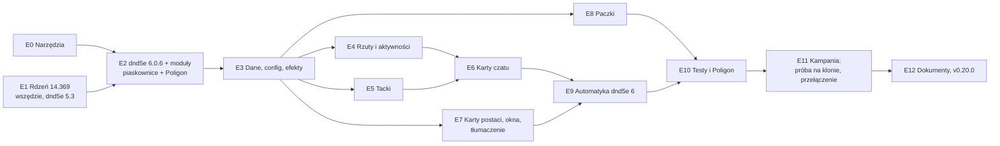

# PLAN — Migracja: Foundry 14.369 i dnd5e 6.0.x

> Status: **PROJEKT** (2026-10-17). Decyzje MG D1–D11 (§1). Rozmiar: **L–XL**. Wywołanie: `PLAN_beta.md` §0, krok 2.
> **Foundry 14.369 zainstalowany przez MG 2026-10-17** w ten sam folder (`Program Files`) — ścieżki bez zmian; E1 zaczyna
> się od bramki. Workspace „FVTT v14 Source” to już 14.369 (numery linii rdzenia z 14.364 w tym planie — do odświeżenia).
> Punkt odniesienia: **v0.19.1** (bramka: Quench 1185/1185, e2e 40/40 w świecie gołym i zalecanym; Foundry 14.364,
> dnd5e 5.3.0). Kopia kampanii sprzed migracji: 2026-10-17 (opis w vaulcie, `Integracje/backups/`).
>
> **Metoda.** Inwentarz statyczny z dwóch drzew źródeł dnd5e (`C:\Git\fvtt-dnd5e` na `release-5.3.0`, worktree
> `C:\Git\fvtt-dnd5e-6.0.6` na `release-6.0.6`; różnice: `git -C C:\Git\fvtt-dnd5e diff release-5.3.0 release-6.0.6`),
> notatek wydań Foundry 14.365–14.369 i dnd5e 6.0.0–6.0.6 oraz naszego kodu. Liczby w §3 to stan na 2026-10-17 —
> etap, który je dotyka, zaczyna od ich odświeżenia. Wszystko, co wymaga uruchomienia, jest w etapach albo na liście PM
> (§9), nie zgadywane tutaj.

---

## 0. W skrócie

- **Kolejność (D1):** narzędzia → rdzeń 14.369 dla wszystkich (na dnd5e 5.3, bramka = regresja samego rdzenia) →
  dnd5e 6.0.6 w piaskownicach i na Poligonie → port warstwa po warstwie → próba generalna na klonie kampanii →
  przełączenie kampanii → v0.20.0.
- **Gdzie boli:** karty czatu (szablony 12 → 33, karty renderowane z `message.system`, stare flagi wiadomości kasowane
  migracją), tacka obrażeń (przepisana; metoda, którą nadpisujemy, zniknęła), **9 naszych typów aktywności** (tryby
  ognia, magazynki, test zestawem — klasa bazowa przepisana), 12 tabel `CONFIG.DND5E`, które zmieniły kształt,
  **przemianowane ścieżki danych** (ruch, zmysły, premie do rzutów), karty postaci (84 pliki szablonów i klas; nasze
  arkusze i okna KO/DO to podklasy dnd5e), **tłumaczenie** (dnd5e ma tylko angielski: 19 naszych kluczy znika, 697
  nowych), paczki (budowniczy pisze dane w kształcie 5.3).
- **Co się nie psuje:** wszystkie 25 hooków `dnd5e.*`, których używamy, istnieją; dynamiczne hooki rzutów działają tak
  samo; większość metod, które nadpisujemy, jest na miejscu; wszystkie 20 odwołań do API `dnd5e.*` (klasy, funkcje,
  elementy HTML) istnieje w 6.0.6; 21 ścieżek grafik i szablonów `systems/dnd5e/…` istnieje; rdzeń v14 sam przenosi
  `changes` efektu do `system.changes` (z podkładką).
- **Podkładki to nie rozwiązanie:** dnd5e 6 ma 41 ostrzeżeń zgodności (stare klucze efektów, flagi, metody) — działają
  dziś, znikną w 6.1+. Bramka E10: zero ostrzeżeń zgodności z naszego kodu (§7).
- **Zasada (D4, D6):** przenosimy zachowanie 1:1; mechanizm dnd5e 6 bierzemy od razu tylko tam, gdzie nasz punkt
  zaczepienia zniknął albo statyczna analiza daje czystą linię wzroku; reszta — dokładnie prowadzona lista PM (§9).

---

## 1. Decyzje MG (2026-10-17)

**D1 — W miejscu, rdzeń najpierw.** Wspólna instalacja Foundry idzie na 14.369 dla wszystkich ścieżek danych, jeszcze na
dnd5e 5.3; potem dnd5e 6.0.6. Sesji nie ma do bety — „jedyna droga wiedzie przez środek”.

**D2 — Master w miejscu.** Bez gałęzi i drugiego drzewa roboczego. Kampania jest zamrożona do przełączenia (E11).

**D3 — Twarde cięcie.** `module.json`: dnd5e `minimum` = `verified` = 6.0.6; Foundry `minimum` 14.367 (wymóg dnd5e
6.0.6), `verified` 14.369. Bez równoległego wsparcia 5.3 — użytkowników praktycznie nie ma, lepiej teraz niż później.

**D4 — Port 1:1 i plan przejęcia funkcji.** W migracji przenosimy zachowanie. Mechanizm dnd5e 6 zastępuje nasz od razu
tylko tam, gdzie nasz punkt zaczepienia zniknął (karty czatu, tacki) albo statyczna analiza daje czystą linię wzroku i
niskie ryzyko. Wszystko, co wymaga uruchomienia i opłaca się dopiero po migracji, trafia na listę PM (§9) — prowadzoną
dokładnie, razem z innymi znaleziskami po drodze.

**D5 — Karty czatu: port i kompakt teraz.** Nasze karty i wstawki budujemy od razu na modelu danych kart 6.0 i w ich
zwartym stylu; dopieszczenie wyglądu — w etapie stylów.

**D6 — Automatyka dnd5e 6: najpierw ponowne użycie.** Każde zderzenie przeglądamy. Jeśli mechanizm dnd5e daje ten sam
efekt RAW, bierzemy go — mniej nadpisywania karty 5e jest lepsze. Twardy konflikt z zasadami → moduł wymusza wartości
ustawień i domyślne (§5).

**D7 — Tacki tylko dla MG** (było O1). `allowPlayerDamageTray`, `allowPlayerEffectsTray` zostają `false` (domyślne,
nie wymuszane): obrażenia i efekty nakłada MG, jak dziś. E5 i testy obejmują tylko klienta MG. Powrót po becie (PM12).

**D8 — Najpierw działanie, potem wygląd** (było O2). Cała praca nad wyglądem idzie po fazie funkcjonalnej. D5 w migracji
znaczy: struktura i dane kart 6.0, nie stylizacja. CSS w E6–E7 tylko tam, gdzie bez niego coś nie działa albo jest
nieczytelne. Ustawienia wyglądu czatu (`chatCardSummary`, `chatLogTheme`, `autoCollapseChatTrays`) — domyślne do etapu
stylów.

**D9 — Bez koncentracji** (było O3). NOE nie ma koncentracji ani jej odpowiednika (sterowanie dronem jej nie wymaga;
autor jej nie lubi). **Wymuś `disableConcentration = true`** (§5).

**D10 — Tłumaczenie: wszystko, co widać na naszych ekranach.** Tacka, karty czatu, okna rzutów, karty postaci i
przedmiotów, TT, KO/DO, efekty, ustawienia pilnowane przez NOE. Funkcje czysto fantasy (bastiony, czary, pobożność,
okno powitalne) zostają po angielsku (§3.13).

**D11 — Moduły innych autorów w E2** razem z dnd5e 6 (Dice So Nice 6.4.4, JB2A 0.9.4, Sequencer 4.3.0, Splatter 6.0.2).
E1 testuje 14.369 na dzisiejszych wersjach. **Push na koniec każdego etapu** — użytkownicy instalują z wydań
(`releases/latest`), więc master może wyprzedzać v0.19.1.

---

## 2. Co się zmienia u źródła

### 2.1 Foundry 14.365–14.369

| Zmiana | Wersja | Dla nas |
|---|---|---|
| Instalator Windows domyślnie w `%LOCALAPPDATA%\Programs`, nie w `Program Files`; wersja przenośna ma własne dane Electrona | 14.366 | Ścieżka instalacji jest zaszyta w 8 miejscach narzędzi (§3.9) — 14.369 stoi w tym samym folderze, więc PM11 |
| Świat nie ładuje po cichu niezgodnych modułów | 14.369 | Po D3 kampania na 5.3 nie załaduje modułu — dlatego zamrożenie kampanii (E0) |
| Nowe, nadpisywalne API „czy zmiana efektu ma się zastosować”; `getReplacementData` efektów | 14.365–366 | Do PM (warunkowe efekty) |
| `ChatMessage` bez powiadomienia, `options.scroll` | 14.365 | Do E6 (szepty MG, karty pomocnicze) |
| `ContextMenu` z klasą CSS; poprawki menu kontekstowych przy przyciskach | 14.369 | Do E7 |
| Wygasłe efekty bez zdarzeń wygaśnięcia nie wiszą do przesunięcia czasu | 14.368 | E3 — sprawdzić efekty z czasem |
| Poprawki: `setProperty(…, undefined)`, `expandObject` z `undefined`, `ObjectField#clean` ze starymi kluczami `-=` | 14.369 | E3 — nasze flagi kasujemy kluczem `-=` (znalezisko M5 E8) |

Bez zmian łamiących API w notatkach 14.365–14.369. E1 to sprawdza bramką.

### 2.2 dnd5e 6.0.0–6.0.6 (wymaga Foundry ≥ 14.367)

| Obszar | Zmiana | Dla nas |
|---|---|---|
| Karty czatu | modele danych `ChatMessage` (20 typów, m.in. `attack`, `damage`, `save`, `check`, `usage`, `request`, `timePassed`); dane przedmiotu i aktywności w `message.system`; karty renderowane z danych; HTML zmieniony; flagi `flags.dnd5e.item/activity/targets/originatingMessage` → `system.item/activity/targets/origin` (migracja kasuje stare); `_usageChatButtons` jako deskryptory, `activateChatListeners` przestarzałe, `getCardData` zwraca dane; karta rzutu przeciw śmierci jest jedną kartą | E3 (flagi), E6 (karty) |
| Tacki | tacka obrażeń i efektów przepisana: cele grupowane, korekty z menu kontekstowego; `DamageApplicationElement#_onChangeOptions` nie istnieje, `buildTargetListEntry` przeniesione (`recorded-targets.mjs`) | E5 |
| KP | `system.attributes.ac.calcs` i `ac.formulas` (lista), wybór najlepszego; `ac.base` → `ac.armor` | E3 (port), PM1 (TT) |
| Efekty | warunki efektów i zmian, zmiany typu „rule” stosowane przy rzucie, czasy „do początku następnej tury”, zdarzenia wygaśnięcia (KO/DO), pochodzenie w `system.origin.*`, wygasłe efekty usuwane poza walką | E3, PM |
| Konfiguracja | `senses` jako obiekty; `bloodied.threshold` w procentach; `requests` dostał `save`; 12 tabel, których dotykamy, zmieniło kształt (§3.5) | E3 |
| Automatyka | spadanie z Levels, wyczerpanie (ustawienie), stan przy 0 PW (`autoApplyDowned`), grupowanie inicjatywy, rozmiar żetonu z rozmiaru aktora, zmysły → wzrok żetonu, ciężki pancerz → prędkość, przeciążenie, koncentracja z komunikatem, kalendarz (odnawianie „dzień/świt/zmierzch”, karta upływu czasu) | E9 (§4, §5) |
| Ścieżki danych | `attributes.movement.<rodzaj>` → `movement.speeds.<rodzaj>`; `senses.<zmysł>` → `senses.ranges.<zmysł>`; `system.bonuses.{mwak,rwak,msak,rsak}.{attack,damage}` → `system.rolls.{attack,damage}.*.bonus`; `bonuses.abilities.*` → `rolls.ability.*.bonus`; `abilities/skills/tools.*.bonuses.{check,save}` → `….roll.bonus`; `init.bonus`, `death.bonuses.save`, `concentration.bonuses.save` → `….roll.bonus`; `rarity` → `rarities`. Dane źródłowe przenosi `_migrateData`; **klucze zmian efektów tylko podkładka** (`ActiveEffect5e.SHIM_FIELDS`; w 6.0.6 bez ostrzeżenia — poprawka z E10) — migracja świata ich nie przepisuje | E3 (kod), E8 (paczki), E11 (efekty w świecie) |
| Język | `en.json`: +697 kluczy, −205, 53 ze zmienioną treścią; innych języków dnd5e nie ma | E7 (§3.13) |
| Paczki systemu | nowa paczka `dnd5e.effects` | E8 (`srd-cleanup.mjs`) |
| Ustawienia | nowe: `toggleSheetMode`, `openCompendiumBrowser`, `firstRun`, `disableFalling`, `tokenSizeSync`, `senseVisionSync`, `pietyScore`, `disableExhaustion`, `chatCardSummary`, `chatLogTheme`, `allowPlayerDamageTray`, `allowPlayerEffectsTray`, `bastionTurns`, `encounterPlacementBehavior`, `initiativeGroupCombatants`, `initiativeGroupRoll`, `autoApplyDowned`, `defaultDocumentSubtypes`; usunięte: `theme`, `moduleArtConfiguration` (nie używamy) | §5 |
| Migracja świata | `needsMigrationVersion` 6.0.0: aktorzy (KP, flagi, ruch i zmysły, grafika żetonu), przedmioty (`uses`), efekty (zmiany, pochodzenie, przeniesienie), wiadomości, sceny, makra, tabele, ustawienia | E11 |
| Inne | okno powitalne nowego świata (`firstRun`), identyfikatory aktorów, wielopoziomowe stany dla modułów, mnożnik ruchu, własne rodzaje ruchu, obszary działania z zachowaniami regionów, podział stosu z menu | E10 (`firstRun`), PM |

---

## 3. Nasza powierzchnia styku (stan 2026-10-17)

### 3.1 Hooki

Wszystkie 25 hooków `dnd5e.*` istnieje w 6.0.6; dynamiczne `preRoll*`/`postBuild*RollConfig` idą tym samym mechanizmem
(`hookNames` w `roll-configuration-dialog.mjs`). Do sprawdzenia w E2–E4 są **argumenty**, nie nazwy — najczęstsze:
`preUseActivity` ×28, `postUseActivity` ×16, `restCompleted` ×8, `postRollAttack` ×6, `applyDamage` ×4,
`preRollAttack` ×4, `calculateDamage` / `preCalculateDamage` / `rollDamage` ×3, `renderChatMessage` ×13. Render hooki:
`renderChatMessageHTML` ×22, `renderItemSheet5e` ×11, `renderCharacterActorSheet` ×10, `renderChatLog` ×4,
`renderVehicleActorSheet` ×3 i pojedyncze (grupa, okna rzutów, HUD-y, ustawienia).

### 3.2 Nadpisania metod dnd5e

| Plik | Cel | 6.0.6 | Werdykt |
|---|---|---|---|
| `weapons/damage-reduction.mjs` | `DamageApplicationElement#buildTargetListEntry`, `_onChangeOptions`, `refreshListEntry`, `_onApplyDamage` | `_onChangeOptions` **nie istnieje**; reszta przeniesiona (`damage-application.mjs:357/443/601`) | przepisać (E5) |
| `weapons/emiter-emp.mjs` | `buildTargetListEntry` (tacka efektów) | mixin celów zastąpiony `recorded-targets.mjs` | przepisać (E5) |
| `combat/cover.mjs` | `AttackActivity#_triggerSubsequentActions`, `rollAttack`, `getDamageConfig`, `rollDamage`; okna ataku i obrażeń `_prepareConfigurationContext`, `_buildConfig`, `_onRender` | wszystkie są (`attack.mjs:68/83`, `attack-data.mjs:303`, `attack-configuration-dialog.mjs:25`, `damage-configuration-dialog.mjs:84`) | porównać ciała, dostosować (E4) |
| `weapons/ammo.mjs` | `_processDamagePart`, `rollDamage` | są (`attack-data.mjs:407`, `base-activity.mjs:903`); krytyki przepisane | dostosować (E4) |
| `weapons/magazine.mjs` | `AttackActivity#rollAttack` (drugie owinięcie) | jest | dostosować razem z `cover.mjs` (E4) |
| `config/validation.mjs` | `Item#use` | jest (`item.mjs:750`) | sprawdzić (E4) |
| `actors/drony-bron.mjs` | `getAttackData` | jest (`attack-data.mjs:274`) | sprawdzić (E4) |
| `actors/armor-rules.mjs`, `pw.mjs`, `sp.mjs` | `Actor#prepareDerivedData` (trzy owinięcia) | kolejność przygotowania i KP zmienione; `prepareFinalAttributes` automatyczne | dostosować (E3, KP) |
| `actors/inventory-toggle-fix.mjs` | `InventoryElement#_onToggleExpand` | jest (`inventory.mjs:744`) | sprawdzić, czy błąd naprawiony u źródła (E7) |
| `actors/drony.mjs`, `production/przenoszenie.mjs` | `_onDropCreateItems`, `_onDropItemContainer` | są | sprawdzić (E7) |
| `actors/towarzysze-tworzenie.mjs` | `_onDropSingleItem` | jest | sprawdzić (E7) |
| `actors/kobalt-advancement.mjs` | `Flow#_prepareContentContext` | jest (`advancement-flow-v2.mjs:139`) | sprawdzić (E7) |
| `scenes/poscig-snap.mjs` | `Token#getSnappedPosition` (rdzeń) | rdzeń | E1 |

### 3.3 Czat

- **DOM kart dnd5e** czyta 21 plików (`.chat-card`, `.card-tray`, `.card-header`, `damage-application`…): m.in.
  `combat/okolicznosci.mjs`, `obalajaca.mjs`, `melee-maneuvers.mjs`, `drop-on-fail.mjs`, `weapon-save-properties.mjs`,
  `grip.mjs`, `weapons/dozownik.mjs` (4), `damage-reduction.mjs` (3), `addons.mjs` (2), `jams.mjs`, `ammo.mjs`,
  `emiter-emp.mjs`, `items/toolkit-medyk.mjs` (3), `kolczatka.mjs`, `toolkit-check-activity.mjs`, `actors/*-inventory.mjs`.
- **Flagi wiadomości** `flags.dnd5e.item|activity|targets|originatingMessage` czyta 17 plików (28 miejsc): `combat/obrona`,
  `knockout`, `trafienie`, `armour-piercing`, `cover`, `drop-on-fail`, `melee-maneuvers`, `weapon-save-properties`,
  `weapons/addons`, `dozownik`, `fire-modes`, `emiter-emp`, `config/validation`, `actors/addons-inventory`,
  `drony-sterowanie`, `wkk/items/pistolet-na-race`, `main.mjs`. Migracja świata **kasuje** te flagi — zamiana na
  `message.system.*`, `getAssociatedItem()`, `getAssociatedActivity()`, `getOriginatingMessage()` (E3).
- **Prośby o rzut** (`CONFIG.DND5E.requests`: `neuroSzabrowanie`, `neuroPulapkaRO`, `neuroGamblingRO`, `neuroSenRO`,
  `neuroWodaRO`) — mechanizm i model `request` bez większych zmian (`request-message-data.mjs`: +13/−4); doszedł
  handler `save` (PM8).
- **Nasze karty** (werdykt ataku i TT, Reakcje celu, umieranie, wybuchy, M5) i e2e, które ich szukają — E6, E10.

### 3.4 Karty postaci i okna

Szablony aktorów i klasy arkuszy: 84 pliki zmienione (+2329/−1776); części (`PARTS`) karty postaci stoją; kotwice
`.currency` w ekwipunku są. Wstawki do sprawdzenia w E7: sekcje ekwipunku (amunicja, granaty, magazynki, prowiant,
surowce, leki), lalka, pas, Zasoby, pipki Wyczerpania i Fuksów, ukryty portfel, nagłówek, okna KO/DO z Zajęciami i polem
snu, karta drużyny (zastąpiona), karta pojazdu, karty przedmiotów, HUD-y. CSS: 47 selektorów na klasach dnd5e.

### 3.5 `CONFIG.DND5E`

Zmieniony kształt w 12 tabelach, które ruszamy: `activityTypes`, `itemProperties`, `actorSizes`, `conditionTypes`,
`validProperties`, `requests`, `conditionEffects`, `restTypes`, `bloodied`, `shieldIds`, `itemRarity`,
`armorProficienciesMap`. Pewne już teraz:

- `conditionEffects` **podmieniamy w całości** (`config/conditions.mjs:449`) — 6.0.6 ma nowe klucze (`crawl`,
  `dehydrated`, `malnourished`, `physical*`, `dodging`…), które kod systemu czyta; trzeba scalać, nie podmieniać.
- `bloodied.threshold = 0` (`config/conditions.mjs:454`) — w procentach 0 to nadal „wyłączone”; zostaje.
- `restTypes.long` ma teraz `exhaustionDelta` w konfiguracji — czytamy go już tak (`config/exhaustion.mjs:397`).

### 3.6 Efekty aktywne

- 27 miejsc tworzy efekty z `changes` na górze, 21 z `system.changes`. Rdzeń v14 przenosi i podkłada (`common/documents/
  active-effect.mjs:171–258`) — działa, ale jednolicie `system.changes` z `_id` (E3).
- `effect.origin` czyta 9 plików (13 miejsc) — po migracji `origin` = `null`, dane w `system.origin.{activity,effect,
  item,actor,behavior}` (E3).
- Wygasłe efekty są usuwane poza walką; zdarzenia wygaśnięcia przy KO/DO — sprawdzić nasze efekty z czasem
  (Bieganie, trucizny, Zatrucie z oparów) (E3).

### 3.7 Dane świata i migracja

`migrateWorld` (6.0.6): `_migrateActorAC`, `_migrateActorFlags`, `_migrateActorMovementSenses`, `_migrateTokenImage`,
`_migrateEffectChanges` (`ac.base` → `ac.armor`, identyfikatory zmian), `_migrateEffectOrigin`, `_migrateEffectTransfer`,
`_migrateItemUses`, `migrateMessageData` (flagi → `system`), sceny, makra, tabele, ustawienia. Nasze flagi
(`flags.neuroshima-2026-overrides.*`) nie są celem — ryzyko jest pośrednie: dane, które trzymamy obok pól dnd5e
(pochodzenie efektów, wiadomości z naszymi znacznikami, `uses`), i kolejność pierwszego ładowania (migracja dnd5e vs
nasze migracje przy `ready`). Szczegóły i skrypt weryfikujący — E11.

### 3.8 Paczki

Budowniczy (`dev/packs/build-packs.mjs`) pisze dane w kształcie 5.3 i stempluje `_stats.coreVersion` wersją z instalacji
(`:1635–1638`); nagłówek mówi „zweryfikowane z 14.364 / 5.3.0”. Czy dnd5e migruje **paczki modułów** (a nie tylko
świata) — do sprawdzenia w E8; zakładamy, że nie, więc budowniczy musi pisać dane 6.0 wprost (KP, efekty, `uses`,
awanse z `name`/`img`, aktywności).

### 3.9 Narzędzia i testy (inwentarz 2026-10-17)

- Ścieżka instalacji zaszyta: `dev/agent/fvtt.mjs:160`, `lib/config.mjs:139–147`, `dev/packs/build-packs.mjs:67`,
  `validate-packs.mjs:29`, `diff-packs.mjs:19`, `dev/release/build-zip.mjs:159–164`, `release-check.mjs:38`,
  `dev/validate-templates.js:3` (i narzędzia ikon). Jedno źródło prawdy — `cfg.installDir` (E0).
- `release-check.mjs:170` wymaga `minimum === verified` dla dnd5e; `dev/e2e/suites/boot.mjs:30–31` porównuje wersję
  systemu z `verified` — po D3 to celowo czerwone wszędzie, gdzie jest 5.3.
- Błędy konsoli w e2e: zbierane z `Runtime.exceptionThrown` i `console.error` (`dev/agent/lib/e2e.mjs:93–97`),
  opróżniane przed zasianiem paczki (`:426`), oceniane po niej (`:439–442`); lista dozwolonych tylko per suite, nikt jej
  nie używa. Łańcuch suite'ów w oknach w tle łapie dwa błędy rdzenia (`#postNotification` na `null`,
  `PreciseText.destroy`) z poprzedniej paczki (E0).
- Najbardziej narażone suite'y e2e: `postac`, `towarzysz-tworzenie`, `combat`, `rekonwalescencja`, `handel`, `postoj`,
  `dron`, `umieranie`, `towarzysz`, `zagrozenia`, `poligon`; Quench: `config`, `ekwipunek-dane`, `sztuczki-combat`,
  `rekonwalescencja-dzien`, `produkcja`, `drony`, `obrona`, `magazynki`, `stany-broni`, `wyczerpanie`.
- Moduły innych autorów w piaskownicach to dowiązania do folderów kampanii — aktualizacja Sequencera, Splattera,
  Quench dotyczy wszystkich naraz (zgodne z D1).

### 3.10 Nasze podklasy klas dnd5e

| Plik | Klasy | Baza | Co się zmieniło |
|---|---|---|---|
| `weapons/fire-modes.mjs` | krótka seria, dublet (atak); długa seria, ogień zaporowy, seria miażdżąca (RO) | `activityTypes.attack/save.documentClass` | mixin aktywności: 582 zmienione linie; `_usageChatButtons` zwraca deskryptory (`action`, `label: {value, hidden}`, `icon` jako klasa, `visibility`, `canGroup`); akcje z `metadata.usage.actions`; nowe `targetPhase`, `hasOutcomes` |
| `weapons/magazine.mjs` | przeładowanie, ładowanie pojedyncze, wymiana magazynka | `utility` | jw. |
| `items/toolkit-check-activity.mjs` | test zestawem | `check` | jw.; `check.mjs`: 60 zmienionych linii |
| `actors/sheet-shell.mjs` | nasze arkusze aktorów | arkusze dnd5e (`_stockSheetClass`) | `base-actor-sheet.mjs`: 358 zmienionych linii, `character-sheet.mjs`: 109 |
| `actors/party-sheet.mjs` | karta drużyny | `GroupActorSheet` | 33 zmienione linie; doszło `PartyRequestDialog` |
| `config/rest.mjs`, `actors/rest-activities.mjs` | okno DO, Zajęcia | `LongRestDialog` | `base-rest-dialog.mjs`: 167 zmienionych linii |
| `config/detection-termowizja.mjs`, `items/gogle.mjs` | tryb wykrywania, shadery wzroku | rdzeń | E1 |

Nadpisane w 9 aktywnościach: `metadata` ×9, `use` ×9, `rollSave` (akcja czatu, 3 klasy RO), `rollDamage` ×4, `_usageChatButtons` ×3,
`rollAttack` ×2, `_triggerSubsequentActions` ×2 — **E4**. Arkusze i okna — **E7**.

### 3.11 API `dnd5e.*`

20 odwołań, wszystkie istnieją w 6.0.6 (sygnatury do porównania w etapie właściciela): `applications.Award` (+
`awardCurrency`), `actor.BaseActorSheet`, `actor.CharacterActorSheet`, `advancement.AdvancementManager(.forNewItem)`,
`advancement.ItemChoiceFlow`, `compendium`, `components.ProficiencyCycleElement`, `dice.{D20,Attack,Damage}RollConfigurationDialog`,
`documents.Trait.keyLabel`, `documents.Proficiency`, `utils.getSceneTargets`, `canvas.TokenPlacement`,
`dataModels.fields.AdvantageModeField.setMode`, `dataModels.activity.AttackActivityData`; elementy `damage-application`,
`dnd5e-inventory`, `proficiency-cycle`.

### 3.12 Przemianowane ścieżki danych (§2.2)

W naszym kodzie (`scripts/`, `dev/`): ruch (`movement.walk|fly|…`) — 31 miejsc w 12 plikach (Bieganie, udźwig, drony,
pościg); zmysły (`senses.darkvision|…`) — 9 w 4 (noktowizor, termowizor); `system.bonuses.*` — 3 w 3;
`death|concentration.bonuses` — 2 w 2; `ac.base|flat|calc|formula` — 3 w 2. Kod czytający dane przygotowane nie ma
podkładki — po starym kluczu dostaje `undefined`. Klucze zmian efektów działają przez podkładkę (w 6.0.6 cichą —
poprawka z E10: żaden wpis `SHIM_FIELDS` nie ma `warning`) — przepisujemy je w kodzie (E3), w paczkach (E8) i w efektach już zapisanych w świecie (E11, nasza migracja).

### 3.13 Tłumaczenie

`lang/pl.json` tłumaczy 527 kluczy dnd5e (najwięcej `ACTIVATION` 46, `ATTACK` 38, `REST` 32, `SAVE` 24, `MOVEMENT` 16).
W 6.0.6 **znika 19** z nich — w tym nazwy obliczeń KP (`ArmorClassEquipment|Unarmored|Natural` — nasze nazwy TT),
odporności (`DamImm|DamRes|DamVuln|ConImm`), rzuty przeciw śmierci (`DeathSave*`), rzadkości (`ItemRarity*`), `Effects`;
ich następcy wyświetlą się po angielsku. 2 zmieniły treść (`ABILITY.SECTIONS.*.Hint` — premie z cechy obejmują teraz
ataki). **697 nowych** (m.in. `EFFECT` 83, `ROLL` 67, `TRAIT` 47, `ARMORCLASS` 44, `ADVANCEMENT` 41, `SETTINGS` 38,
`CHATMESSAGE` 19). Zakres wg D10; test statyczny: każdy klucz dnd5e w `pl.json` istnieje w `en.json` zainstalowanej wersji.

### 3.14 Ustawienia dnd5e, które już pilnujemy

- `metricWeightUnits|metricLengthUnits|metricVolumeUnits` = `true` — `config/encumbrance-config.mjs` (raz, przy `ready`).
- `packSourceConfiguration` — `config/srd-cleanup.mjs` ukrywa paczki fantasy; 6.0.6 dodaje `dnd5e.effects`.
- `rulesVersion` — tylko ostrzeżenie (`main.mjs`).
- Czytamy: `attackRollVisibility` ×4, `primaryParty`, `autoCollapseChatTrays` — istnieją w 6.0.6.

Wszystkie trafiają do jednego pliku z §5.

### 3.15 Poza modułem

- **Źródło dnd5e dla piaskownic:** `fvtt sandbox:init` kopiuje dnd5e **z kampanii**, raz (`sandbox.mjs` `copyPackage`).
  Istniejące piaskownice da się podnieść osobno; każda nowa ścieżka danych założona w czasie zamrożenia (czysta
  instalacja B6, odtworzona piaskownica wydania) dostałaby 5.3 — E0.
- **Ekran ustawień Foundry na ścieżce kampanii:** „Aktualizuj wszystko” podniesie dnd5e kampanii do 6.0.6, a następne
  otwarcie świata uruchomi migrację — E0 zakłada blokadę pakietu (`dnd5e.lock`, ten sam mechanizm co w piaskownicach).
- **Mapy** (`Maps/tools/push.py`): kopiuje tła wprost do `worlds/output`, a `game.neuroshima.maps.update()` działa w
  uruchomionym świecie — zamrożenie `fvtt` go nie obejmuje. Do E11 mapy powstają w Tiled; wypychanie do kampanii czeka.
- **Vault:** `foundry-mcp` czyta LevelDB ogólnie (bez ścieżek dnd5e) — bez zmian; skille FVTT (`index-sources`) po E1 i E2.

---

## 4. Funkcje: nasze ↔ dnd5e 6

Kolumna „Kiedy”: **E#** — w migracji; **PM#** — po migracji (§9); **Wymuś** — ustawienie pilnowane przez moduł (§5).

| Funkcja | Dziś u nas | dnd5e 6 | Ten sam efekt RAW? | Kiedy |
|---|---|---|---|---|
| Karty ataku, werdykt TT, Reakcje celu, wstawki do kart (amunicja, zacięcia, dozownik, chwyt, okoliczności) | wstawki w DOM kart 5.3 | karty z `message.system`, deskryptory przycisków, `content` | — (nasza treść) | **E6** na modelu 6.0 (D5) |
| Tacka obrażeń: pancerz, progi, przebicie | nadpisane metody tacki (tylko MG) | tacka z grupami celów, korekty per cel; opcjonalnie dla graczy | tak, po porcie | **E5** (tylko MG, D7); gracze — **PM12** |
| Tacka efektów: EMP | nadpisanie listy celów | `recorded-targets` | tak | **E5** |
| Prośby o RO (sen, woda, pułapki, gambling) | własne handlery `requests` | jest handler `save` | częściowo (nasze skutki po rzucie) | E3 port; **PM8** |
| KP / TT „metody konkurują, premie się sumują” | owinięcie `prepareDerivedData` | lista obliczeń KP, wybór najlepszego | prawdopodobnie tak | E3 port 1:1; **PM1** |
| Bieganie, okoliczności, warunkowe premie ulepszeń | efekty + hooki rzutów | zmiany „rule”, warunki, czasy turowe | tak | E3 port; **PM2** |
| Wyczerpanie (−2 na poziom do k20, DO −1) | źródła w flagach + reguły „modern” dnd5e | to samo + ustawienie `disableExhaustion` | tak (już używamy) | **Wymuś** `disableExhaustion = false` |
| Odwodnienie, Niedożywienie | stany `dehydration`, `malnutrition` (te same id co dnd5e) | `conditionEffects.dehydrated/malnourished` | do sprawdzenia | **E3** (scalanie `conditionEffects`) |
| Zranienie (4 stopnie), Skażenie (poziomy) | własne tory i pipki | wielopoziomowe stany dla modułów | prawdopodobnie tak | **PM3** |
| Stan przy 0 PW, BN pada | `combat/umieranie.mjs` (karta MG, D1/D2 M1) | `autoApplyDowned` | nie (u nas decyduje karta MG) | **Wymuś** `none` |
| Spadanie | `combat/falling.mjs` (1k6 na 1,5 m, woda, Powalenie, Osteoporoza) | wykrywanie z Levels + `CONFIG.DND5E.falling` (kość / odległość / maks.) | liczby — tak przez konfigurację; dodatki — nie | **E9**: konfiguracja NOE + nasze dodatki na hooku; jeśli nie da się — **Wymuś** `disableFalling` |
| Grupy inicjatywy towarzyszy (M3) | własny porządek tury po właścicielu | `initiativeGroupCombatants`, `initiativeGroupRoll` | do sprawdzenia | **E9**; konflikt → Wymuś; **PM4** |
| Skala żetonów (Bestiariusz, drony) | kalibracja żetonów | `tokenSizeSync` | do sprawdzenia | **E9**; konflikt → Wymuś `false` |
| Noktowizor, termowizor, 220° | tryby wzroku żetonu ustawiane przez nas | `senseVisionSync` (zmysły aktora → żeton) | do sprawdzenia | **E9**; konflikt → Wymuś `false`; **PM5** |
| Ciężki pancerz, przeciążenie | `armor-rules.mjs`, udźwig | prędkość z ciężkiego pancerza, stany przeciążenia | do sprawdzenia z RAW | **E9** |
| Koncentracja | — | RO koncentracji po obrażeniach, zrywanie efektów | NOE jej nie ma (D9) | **Wymuś** `disableConcentration = true` |
| Krytyki | zasady NOE w potoku obrażeń | przepisane obliczanie krytyków | do sprawdzenia | **E4** |
| Wybór cechy w oknie ataku | cecha z broni | wybór cechy w oknie | oznaczać, nie blokować | **E4** (domyślna z naszych reguł) |
| Kalendarz, doba, przeskok | `world-clock.mjs`, doba M5 | odnawianie dzień/świt/zmierzch, karta upływu czasu | do sprawdzenia (szum na czacie) | **E9** (`dnd5e.preCreateTimePassedMessage`) |
| Strefy dymu, gazu, kolczatki | szablony i własne kafelki | obszary działania z zachowaniami regionów | prawdopodobnie tak | **PM6** |
| Identyfikatory istot | id w flagach | `identifier` aktora | tak | **PM7** |
| Szybkość ×2 (Bieganie), spowolnienie (udźwig) | efekty / kod | `attributes.movement.multiplier` | tak | **PM2** |
| Podział stosu w wymianie | własny | podział stosu z menu | częściowo | **PM9** |
| Okno powitalne nowego świata | — | `firstRun` | — | **E10 zrobione**: zostaje (oficjalne moduły, przygody); zamknięte zapisuje jednostki i źródła paczek — MG przywraca nasze (`895d582`) |

---

## 5. Ustawienia dnd5e 6

Wymuszanie: przy `ready`, aktywny MG, tylko gdy wartość różni się od wymaganej; linia w konsoli i jednorazowa karta MG
z listą zmian; ustawienie zablokowane w oknie ustawień (podpowiedź „pilnuje NOE”). Jeden plik (`config/dnd5e-settings.mjs`)
i test warstwy 1 dla tabeli. Plik przejmuje dzisiejsze wymuszenia z §3.14 (jednostki metryczne, źródła paczek).

| Ustawienie | Domyślne | NOE | Polityka |
|---|---|---|---|
| `disableExhaustion` | `false` | nasze Wyczerpanie stoi na regułach dnd5e | **Wymuś `false`** |
| `autoApplyDowned` | `none` | 0 PW rozstrzyga nasza karta | **Wymuś `none`** |
| `disableFalling` | `false` | Spadanie (s. 43): 1k6 za 1,5 m, Powalenie | **Wymuś `false`** (E9): mechanizm dnd5e z liczbami NOE (`spadanie.mjs`: 5 ft na kość, bez limitu) — karta obrażeń dla MG, Powalenie przy obrażeniach |
| `initiativeGroupRoll` | `true` | s. 25: grupa identycznych przeciwników — jeden rzut na Inicjatywę | **Wymuś `true`** (E9: dokładnie RAW) |
| `initiativeGroupCombatants` | `true` | grupowanie tej samej Inicjatywy w trackerze (wygląd) | domyślne; e2e `towarzysz*` zielone (M3 bez zmian) |
| `tokenSizeSync` | `true` | kalibracja żetonów | **Wymuś `false`** (E3: dron 2×2, skale żetonów — A15) |
| `senseVisionSync` | `true` | nasze tryby wzroku | **Wymuś `false`** (E3: kamera drona — A16) |
| `disableConcentration` | `false` | NOE nie ma koncentracji (D9) | **Wymuś `true`** |
| `rulesVersion` | — | „modern” (Wyczerpanie) | **Wymuś `modern`** (dziś tylko ostrzeżenie, `main.mjs:679`) |
| `metricWeightUnits`, `metricLengthUnits`, `metricVolumeUnits` | `false` | NOE jest metryczny | **Wymuś `true`** (już dziś, `encumbrance-config.mjs`) |
| `packSourceConfiguration` | — | paczki fantasy ukryte | jak dziś (`srd-cleanup.mjs`); `dnd5e.effects` **widoczna** (E8: ogólne efekty — przewaga, odporności, szybkości — przydatne MG; podfolder czarów to drobiazg) |
| `defaultDocumentSubtypes` | — | nasze tworzenie przedmiotów i aktorów | domyślne (E9: ustawienie klienta, pamięta tylko ostatni wybór w oknie tworzenia rdzenia) |
| `encounterPlacementBehavior` | `none` | `TokenPlacement` przy towarzyszach i dronach | domyślne (E9: dotyczy tylko aktorów spotkań dnd5e; nasze rozmieszczenie to `TokenPlacement` wprost) |
| `bastionTurns`, `pietyScore` | — | brak w NOE | domyślne |
| `bloodied` | — | brak w NOE | zostaje (próg 0) |
| `allowPlayerDamageTray`, `allowPlayerEffectsTray` | `false` | tacki tylko dla MG (D7) | domyślne, nie wymuszamy; PM12 |
| `chatCardSummary` (klienta) | `true` | RO i test rzucone z karty użycia znikają z dziennika (zostaje podsumowanie na karcie) — a z nimi pasek Fuksa i Forsowania i adnotacje rzutów | **Wymuś `false`** na każdym kliencie (E6); przyjąć razem z portem paska do podsumowania (§9) |
| `chatLogTheme`, `autoCollapseChatTrays` | różne | wygląd (D8) | domyślne do etapu stylów |

---

## 6. Etapy

| Etap | Zakres | Rozmiar | Gotowe gdy |
|---|---|---|---|
| **E0** | **Narzędzia przed dnd5e 6** (warunek E2; równolegle z E1). (1) **Zamrożenie kampanii**: tryb, w którym `fvtt` nie uruchamia świata kampanii do E11, a polecenia domyślnie celujące w kampanię (`packs`, `reload`, `quench`) idą do piaskownicy; blokada `dnd5e.lock` na ścieżce kampanii (§3.15); `doctor` pokazuje zamrożenie oraz wersje rdzenia i dnd5e w każdym profilu. (2) **Źródło dnd5e** dla nowych ścieżek danych z konfiguracji (folder albo zip wydania), nie kopia z kampanii; polecenie wymiany dnd5e w istniejącym profilu (folder, blokada). (3) `fvtt backup` (cicha ścieżka danych, archiwum świata, systemu, cudzych modułów, `Data/assets`, `options.json`; SHA256, manifest wersji; katalog z lokalnej konfiguracji). (4) e2e: ponowne opróżnienie błędów po `settleBetweenSuites`; lista dozwolona na poziomie przebiegu tylko dla dwóch znanych błędów rdzenia; **zbieranie ostrzeżeń zgodności** (rdzeń i dnd5e: `logCompatibilityWarning`) z podziałem wg źródła w stosie (nasz moduł / dnd5e / rdzeń / inne) — w raporcie, bez porażki do E10. (5) Skrypt `index-sources` gotowy do uruchomienia po E1/E2. Jedno źródło ścieżki instalacji — odroczone (PM11): 14.369 stoi w tym samym folderze. | M | `npm test` i testy narzędzi zielone; `fvtt backup` sprawdzony na piaskownicy; `doctor` pokazuje zamrożenie i wersje; nowa piaskownica dostaje dnd5e ze źródła z konfiguracji |
| **E1** | **Rdzeń 14.369 w miejscu (D1).** Instalacja zrobiona (MG, 2026-10-17, ten sam folder). Wszystkie profile na dnd5e 5.3.0 i dzisiejszych modułach innych autorów (D11). Bramka wydania v0.19.1 na 14.369 = regresja samego rdzenia (w tym tryby wzroku i shadery, §3.10; `Token#getSnappedPosition`); poprawki; ewentualnie v0.19.2. `index-sources` dla 14.369. | S–M | bramka zielona na 14.369 + dnd5e 5.3 (Quench, e2e w obu światach); `module.json` `verified` 14.369 |
| **E2** | **dnd5e 6.0.6 i moduły innych autorów** (warunek: E0, E1). dnd5e z zipa wydania GitHub do piaskownicy, piaskownicy wydania i na Poligon (polecenie z E0). Moduły (D11): Dice So Nice 6.4.4, JB2A 0.9.4, Sequencer 4.3.0, Splatter 6.0.2 — leżą w folderach kampanii, więc zmieniają się wszędzie naraz (stare wersje są w kopii). Kampania zostaje na dnd5e 5.3 i zamrożona. `module.json` wg D3. `index-sources` dla 6.0.6. Triaż: start, błędy konsoli, ostrzeżenia zgodności z naszego kodu, pełny Quench → **mapa awarii** (§11), podział na E3–E9; lista kluczy z §3.13 widocznych na naszych ekranach. | S + triaż | mapa awarii w §11; każdy czerwony test i każde ostrzeżenie zgodności z naszego kodu ma etap |
| **E3** | **Dane, konfiguracja, efekty** (§3.5–3.7, §3.12): scalanie `conditionEffects` i pozostałych 11 tabel; efekty na `system.changes` i **nowych kluczach** (ruch, zmysły, premie do rzutów); kod czytający dane przygotowane — na nowe ścieżki; pochodzenie z `system.origin`; flagi wiadomości → `message.system` i metody `ChatMessage5e` (17 plików); KP (`ac.armor`, owinięcia `prepareDerivedData`); ścieżki Wyczerpania; efekty z czasem wobec usuwania wygasłych. **Plik ustawień (§5)** z wymuszeniami już pewnymi (`disableExhaustion`, `autoApplyDowned`, `disableConcentration`, `rulesVersion`, jednostki), żeby automatyka dnd5e 6 nie mieszała w testach E4–E8. | M–L | Quench `config`, `wyczerpanie`, `rekonwalescencja*`, `lalka`, `tt`, `zdolnosci-dane`, `drony` zielone; zero ostrzeżeń zgodności o kluczach efektów i flagach wiadomości z naszego kodu |
| **E4** | **Rzuty, aktywności, obrażenia** (§3.2, §3.10): **9 naszych aktywności** (tryby ognia, magazynki, test zestawem) na nowym mixinie — `metadata`, `use`, przyciski jako deskryptory, akcje czatu (`rollSave`), `targetPhase`; `cover.mjs`, `ammo.mjs`, `magazine.mjs`, `validation.mjs`, `drony-bron.mjs` — ciała porównane z 6.0.6, owinięcia dopasowane; argumenty hooków użycia aktywności i rzutów; krytyki NOE; wybór cechy w oknie ataku. | L | Quench `sztuczki-combat`, `obrona`, `magazynki`, `amunicja`, `stany-broni`, `przebicie`; każdy z 9 typów aktywności użyty w teście; e2e `combat` |
| **E5** | **Tacki** (tylko klient MG, D7): `damage-reduction.mjs` i `emiter-emp.mjs` na nowej tacce (grupy celów, korekty per cel), `armour-piercing.mjs`. | M | Quench `przebicie`, `emiter-emp`; e2e `combat` (obrażenia przez tackę MG) |
| **E6** | **Karty czatu — port i kompakt (D5, D8).** Nasze karty (werdykt ataku i TT, Reakcje celu, umieranie i karta rzutu przeciw śmierci, wybuchy, M5, szepty MG) na danych i strukturze 6.0; wstawki do kart dnd5e przez dane wiadomości i deskryptory przycisków zamiast DOM; mniej osobnych wiadomości tam, gdzie 6.0 dopina wyniki do karty. Bez pracy nad wyglądem. | L | e2e `combat`, `umieranie`, `handel`, `postoj`, `szabrowanie`, `bebeszenie`, `autodestrukcja`; zrzuty kart przed / po w przekazaniu |
| **E7** | **Karty postaci, okna, tłumaczenie**: podklasy arkuszy, karty drużyny i okien KO/DO (§3.10); render hooki, sekcje ekwipunku, lalka, pas, Zasoby, pipki, portfel, okna KO/DO (Zajęcia, sen, odsypianie), karta pojazdu, przedmiotów, HUD-y; nadpisania upuszczania i rozwijania; 47 selektorów CSS — tylko tam, gdzie bez nich coś nie działa (D8). **Tłumaczenie wg D10** (§3.13) i test statyczny kluczy. | L | e2e `postac`, `towarzysz*`, `dron`, `rekonwalescencja`, `postoj`; test kluczy zielony; zrzuty bez angielskich napisów na ekranach z D10 |
| **E8** | **Paczki**: budowniczy pisze dane 6.0 (KP, efekty z nowymi kluczami, `uses`, awanse, aktywności); `validate-packs` sprawdza kształt 6.0 i odrzuca stare klucze efektów; przebudowa 18 paczek; po starcie rekordy = świeży build (B3); `srd-cleanup.mjs` wobec nowej paczki `dnd5e.effects`. | M | `validate-packs` zielone; `diff-packs` 0 różnic po starcie |
| **E9** | **Automatyka dnd5e 6** (§4, §5): reszta pliku ustawień; przegląd każdego zderzenia na żywo; konfiguracja spadania NOE albo wyłączenie; wiersze §5 „E9: sprawdzić”. Zmiana odczytu RAW → pytanie do MG. | M | tabela §5 bez „sprawdzić”; testy warstwy 1 dla tabeli |
| **E10** | **Testy i Poligon**: selektory e2e, okno `firstRun` w harnessie, Quench poprawiony, stanowiska i Obsada Poligonu przebudowane na 6.0 (awans przez prawdziwy AdvancementManager). **Ostrzeżenia zgodności z naszego kodu = porażka** (Quench i e2e). Pełna bramka w piaskownicy wydania. | M–L | Quench 100%; e2e 40/40 w obu światach; `poligon` zielony; 0 ostrzeżeń zgodności z naszego kodu |
| **E11** | **Kampania.** Świeży `fvtt backup`. Próba: `poligon:clone --refresh` → otwarcie na Poligonie (6.0.6) → migracja dnd5e → **nasza migracja** efektów w świecie ze starymi kluczami (§3.12; dnd5e ich nie przepisuje) → skrypt weryfikujący (liczby dokumentów, nasze flagi: Fuksy, źródła Wyczerpania, magazynki, towarzysze i drony, stan M5: szkice doby, handlarze, pamięć ruin; wiadomości; sceny; ostrzeżenia zgodności po załadowaniu) → przejście MG po stanowiskach. Potem przełączenie: dnd5e 6.0.6 na ścieżce kampanii (zdjęcie blokady), otwarcie, te same kroki, koniec zamrożenia, wypychanie map wraca. Wycofanie = kopia. | M | skrypt bez rozbieżności na klonie i w kampanii; MG potwierdza |
| **E12** | **Dokumenty i v0.20.0**: `DEV_GUIDE.md` (rozdziały integracji z dnd5e), `ARCHITECTURE.md` §11, `AGENTS.md`, `TESTING.md`, `RELEASING.md`, `IMPLEMENTATION.md` (macierz, pliki, changelog), `docs/` (co gracz zobaczy inaczej), `PLAN_beta.md` §0. Notatka wydania: wymaga dnd5e 6.0.6 i Foundry 14.367+; na dnd5e 5.3 zostań przy v0.19.1. `npm run release:check -- --tag`; tag wydania — MG. | S–M | wydanie v0.20.0 |

**Sesje (orientacyjnie):** E0–E1, E2–E3, E4–E5, E6, E7, E8–E9, E10, E11–E12.

### 6.1 Przekazanie i punkty zatrzymania

- Każdy etap kończy się wpisem w §11 (co zrobione, liczby testów, nowe pozycje PM, zrzuty dla UI), commitami
  `Obszar: co` i pushem (D11). Znalezisko spoza etapu → §9 albo mapa awarii, nie „przy okazji”.
- Etap zaczyna od odświeżenia swoich liczb z §3 (stan z 2026-10-17).
- **MG potrzebny:** E9 — tylko gdy przegląd zderzenia zmienia odczyt RAW; E10 — przejście po Poligonie (warstwa 7);
  E11 — przejście po klonie i zgoda na przełączenie kampanii; E12 — tag. Reszta bez MG.
- Nigdy: otwieranie świata kampanii przed E11, aktualizacje w ekranie ustawień Foundry na ścieżce kampanii, testy w
  kampanii (AGENTS.md).

---

## 7. Testy

- **Punkt odniesienia:** v0.19.1 — Quench 1185/1185, e2e 40/40 (goły i zalecany), testy narzędzi. Po E1 ten sam zestaw na
  14.369; po E10 — na dnd5e 6.0.6. Spadek liczby testów tylko z wpisem „usunięty, bo…” w §11.
- **Warstwy 1–5 (Quench):** każdy etap zaczyna od czerwonej listy z mapy awarii (E2) i kończy zielono na swoich
  paczkach. Nowe testy: scalanie `conditionEffects` (nic z kluczy 6.0.6 nie znika), tabela ustawień (§5), flagi
  wiadomości (stare odczyty nie istnieją w kodzie — test statyczny), KP po migracji (`ac.armor`), stare ścieżki danych z
  §3.12 (test statyczny: ani w kodzie, ani w kluczach efektów paczek), klucze tłumaczenia (§3.13).
- **Ostrzeżenia zgodności:** zbierane od E0, raportowane od E2, od E10 każde ze stosem w naszym module = porażka. To
  one mówią, co pęknie przy dnd5e 6.1+ i v15.
- **Warstwa 6 (e2e):** mutacje dla przepisanych miejsc — tacka (próg pancerza nie zadziałał → czerwone), karta ataku
  (werdykt bez danych z `message.system` → czerwone), wymuszanie ustawień (ręczna zmiana `autoApplyDowned` → moduł ją
  cofa). Błędy konsoli: lista dozwolona tylko dla dwóch znanych błędów rdzenia (E0) — każdy nowy błąd = porażka.
- **Warstwa 7 (Poligon):** po E10 przejście MG po stanowiskach: Strzelnica (karty ataku, tacka), Garderoba (karta
  postaci), Lazaret (KO/DO, umieranie), Bazar i Złomowisko (karty M5), Hangar (drony), Kreator (awans). Werdykt MG o
  kompakcie kart (D5) zapisywany jako Uwagi.
- **Kampania (E11):** skrypt weryfikujący jest testem — uruchomiony na klonie i w kampanii, wynik w §11.

---

## 8. Ryzyka i wycofanie

| Ryzyko | Ograniczenie |
|---|---|
| Migracja świata jest jednokierunkowa | kopia z 2026-10-17 (przed 14.369); `fvtt backup` przed E2 i przed E11; próba na klonie; wycofanie = odtworzenie kopii (aplikacja 14.364, dnd5e 5.3.0, świat) |
| Aktualizacja rdzenia dotyka wszystkich ścieżek naraz (D1) | kopia aplikacji w backupie z 2026-10-17; bramka E1 przed jakąkolwiek zmianą dnd5e |
| Ktoś otworzy kampanię przed E11 (migracja dnd5e albo świat bez modułu) | zamrożenie kampanii w `fvtt` (E0) |
| „Aktualizuj wszystko” w ekranie ustawień Foundry podnosi dnd5e kampanii | `dnd5e.lock` na ścieżce kampanii (E0); zdjęcie w E11 |
| Podkładki dnd5e 6 ukrywają stare klucze i metody, a znikną w 6.1+ | ostrzeżenia zgodności jako bramka E10; nasza migracja efektów świata w E11 |
| Nowa piaskownica w czasie zamrożenia dostaje dnd5e 5.3 z kampanii | źródło dnd5e z konfiguracji (E0) |
| Mapy wypychane do kampanii w czasie zamrożenia | wypychanie czeka do E11 (§3.15); notatka w dokumentacji repo map |
| dnd5e nie migruje paczek modułu | budowniczy pisze dane 6.0 wprost; `validate-packs` sprawdza kształt (E8) |
| Moduły innych autorów nieprzetestowane z dnd5e 6 | świat „zalecany” bramki (Quench, Sequencer, Splatter); w razie niezgodności — notatka w wydaniu i wyłączenie w świecie zalecanym |
| Zegar B2 wraca do zera | wliczone w `PLAN_beta.md` §0 (dwie sesje przed betą) |
| Rozrost zakresu przez „skoro już tu jesteśmy” | D4: przejęcia funkcji tylko z linią wzroku; reszta na liście PM z rozmiarem i warunkiem wejścia |
| Wydajność kart i czatu po kompakcie | zrzuty i stopery w przekazaniach E6; uwagi MG w E10 |

---

## 9. Po migracji — lista PM

Prowadzona przez cały czas migracji: każde znalezisko spoza zakresu etapu dopisuje się tutaj z datą, etapem, w którym
wyszło, i warunkiem wejścia. Kolejność — według stosunku zysku do kosztu po migracji.

| # | Co | Dlaczego | Warunek wejścia | Rozmiar |
|---|---|---|---|---|
| PM1 | TT jako obliczenia KP dnd5e 6 (`ac.calcs`: 10 + ZRC, pancerz, Goła klata, Tarcza wiary; premie stałe jako premie KP) | koniec owinięcia `prepareDerivedData`; arkusz 5e pokazuje prawdziwe KP i okno konfiguracji | E3 zielone; dymek z rozkładem TT odtworzony z danych dnd5e | M |
| PM2 | Bieganie, okoliczności, warunkowe premie ulepszeń jako zmiany „rule” i czasy turowe; szybkość przez `movement.multiplier` | mniej hooków rzutów i ręcznego zdejmowania efektów | E4 zielone; testy wzorcowe na obecnym zachowaniu | M–L |
| PM3 | Zranienie i Skażenie jako wielopoziomowe stany dnd5e | mniej własnych pipek i HUD-ów | E7 zielone; decyzja MG o wyglądzie | M |
| PM4 | Grupy inicjatywy towarzyszy przez mechanizm dnd5e | mniej własnego porządku walki | wynik E9 | S–M |
| PM5 | Noktowizor i termowizor przez zmysły aktora i `senseVisionSync` | mniej ręcznego ustawiania wzroku żetonu | wynik E9; `PLAN_nvg_thermal.md` | M |
| PM6 | Dym, gaz, kolczatka, ogień jako obszary działania z zachowaniami regionów (efekt w strefie, trudny teren) | mniej kafelków i własnych stref; spójne z mapami (Tiled) | E5–E6 zielone | M |
| PM7 | Identyfikatory istot Bestiariusza w `identifier` aktora | mniej flag, wyszukiwanie przez system | E8 | S |
| PM8 | Prośby o RO przez handler `save` dnd5e + hook skutków | mniej własnych handlerów | E6 | S |
| PM9 | Podział stosu w wymianie przez menu dnd5e | mniej kodu M5 | E7 | S |
| PM10 | Wydajność Pościgu (doradcze progi z bramki v0.19.0) | odłożone z v0.19.0 | po E10 | S–M |
| PM11 | `fvtt` i skrypty z §3.9: jedno źródło ścieżki instalacji (`cfg.installDir`, `FOUNDRY_APP` w `runNode`), potem instalacja per profil (wersja przenośna obok) | dziś 8 zaszytych ścieżek; przyszłe aktualizacje bez zatrzymywania kampanii | po E12 | S–M |
| PM12 | Tacki obrażeń i efektów dla graczy (`allowPlayerDamageTray`, `allowPlayerEffectsTray`) | gracz nakłada na własny żeton; mniej klikania MG | po becie, decyzja stołu (D7); testy klienta gracza, ochrona przed podwójnym nałożeniem | S–M |
| PM13 | Podsumowania kart dnd5e 6 (`chatCardSummary`): pasek Fuksa i Forsowania, adnotacje rzutów (choroby, chemia, dostępność narzędzi) i nasze RO/testy z `system.origin` w podsumowaniu na karcie użycia (2026-10-18, E6) | mniej osobnych wiadomości — cel E6, odłożony, bo dziś podsumowanie chowa kartę rzutu z naszym paskiem | po etapie stylów (D8); testy paska na karcie użycia | M |
| PM14 | Budowniczy paczek pisze aktywności zestawów jak `createToolkits()`: `nativeCheck` → `NeuroToolCheckActivity` z bramkami (kowal: Naostrzenie, Naprawa) (2026-10-18, E4) | zestaw kowala z kompendium i z Produkcji nie ma bramek | **zrobione w E8** (`f855fda`) | S |

---

## 10. Po wdrożeniu — do zaktualizowania

- `PLAN_beta.md` §0 (krok 2 odhaczony, link do tego planu), B2 (data resetu), B6 (czysta instalacja na dnd5e 6).
- `DEV_GUIDE.md`, `ARCHITECTURE.md` §11 (pułapki v14 i dnd5e 6), `AGENTS.md` (wersje, zamrożenie, `fvtt backup`),
  `TESTING.md`, `RELEASING.md` („Version policy”: dnd5e 6.0.6, Foundry 14.367+).
- `IMPLEMENTATION.md`: macierz (wiersze, które zmieniły realizację), tabela plików, changelog v0.20.0.
- `docs/`: co gracz zobaczy inaczej (karty czatu, tacki), ustawienia pilnowane przez NOE.
- `scripts/wkk/README.md`: jeśli któreś przejęcie funkcji zmienia odczyt RAW.
- Vault: `Integracje/backups/` (nowe kopie), skille FVTT (`index-sources`).

## 11. Postęp

**2026-10-17 — projekt.** Inwentarz statyczny (§2–§4), decyzje MG D1–D6. Środowisko: worktree dnd5e 6.0.6 obok 5.3.0;
narzędzia sprawdzone pod kątem ścieżek i wersji (§3.9). Następny krok: E0; MG — instalacja 14.369 na początku E1.

**2026-10-17 — przegląd luk, decyzje D7–D11.** MG zainstalował 14.369 w ten sam folder (`fvtt doctor`: bez problemów
poza wyłączonym Chrome; profile nieaktywne). Dopisane: podklasy aktywności i arkuszy (§3.10), API `dnd5e.*` —
wszystko istnieje (§3.11), przemianowane ścieżki danych i podkładki efektów (§3.12), tłumaczenie (§3.13), ustawienia
już pilnowane (§3.14), źródło dnd5e piaskownic, blokada w ekranie ustawień, mapy (§3.15), ostrzeżenia zgodności jako
bramka. E0 bez `installDir` (PM11). Następny krok: E0 i E1 (niezależne).

**2026-10-17 — E0 zrobione** (Claude Code). `npm test` zielone, testy narzędzi 46/46 (było 29; nowy
`dev/agent/test/migration.test.mjs`), `check_doc_paths` 0 martwych.
- **Zamrożenie** (`fvtt freeze on|off`, stan w lokalnym `freeze.json`): **włączone** 2026-10-17 do E11. Bez `--profile`
  każde polecenie idzie do piaskownicy; `start`, `restart`, `packs`, `login`, `reload`, `eval`, `quench`,
  `system:install` na kampanii — odmowa; `stop`, odczyty, `backup`, `poligon:clone` — wolno. `dnd5e.lock` na ścieżce
  kampanii już był (D7) — Foundry czyta go jako `locked`, „Aktualizuj wszystko” go omija. `options.json` kampanii nie
  ma `world`, więc ręczne uruchomienie Foundry staje na ekranie ustawień. `doctor`: zamrożenie, wersja rdzenia,
  zainstalowane dnd5e i moduł na każdej ścieżce wobec `module.json` (problem, gdy dnd5e poniżej minimum — dla
  zamrożonej kampanii tylko notatka) oraz **kopia `module.json` w piaskownicy/na Poligonie różna od drzewa**
  (Poligon ma dziś kopię z 0.18.0 — przy zmianie `module.json` w E2 trzeba ją odświeżyć: `poligon:init`).
- **Źródło dnd5e:** `init --dnd5e-source=<zip|folder>` (ustawione: zip wydania 6.0.6 w lokalnym folderze `fvtt`,
  `packages/`); nowa ścieżka danych dostaje dnd5e stamtąd, nie z kampanii. `fvtt system:install --profile=
` wymienia
  dnd5e zatrzymanej ścieżki (stary folder do `<dataPath>/agent-state/systems/`, nowy z blokadą); odrzuca checkout
  źródeł (paczki bez LevelDB) i inny system; kampania tylko z `--campaign` i nie w zamrożeniu. Sprawdzone na zipie
  6.0.6 w folderze tymczasowym (1478 plików, 2 s). `init --force` nie gubi już `loginUser` (scala, nie zeruje).
- **`fvtt backup --profile=
`** (katalog: `init --backup-dir`, ustawiony na dysk kopii): zip na świat, dnd5e, cudze
  moduły, `Data/assets` (opcjonalnie `--app`), `Config-options.json`, `manifest.json` (wersje, commit, liczby
  dokumentów), `SHA256SUMS`, `README.md` z odtwarzaniem; CRC każdego archiwum i każdy świat rozpakowany do folderu
  tymczasowego i otwarty. Archiwizator: `lib/archive.py` (zipfile, ZIP64). Sprawdzony na piaskownicy (świat
  `agent-m3e4`, 117 MB, 13 s, `sha256sum -c` OK; 27 dowiązań cudzych modułów piaskownicy wypisanych, nie śledzonych).
- **e2e — błędy konsoli w czterech koszykach** (boot, seed, paczka, late — „late” doliczane do paczki, która je
  zostawiła); lista dozwolona na poziomie przebiegu: `KNOWN_CORE_ERRORS` (`#postNotification`, scrolling text — w
  starych raportach `set y`/`#animateFrame` zawsze szło z `PreciseText.destroy`, 15/15), tylko bez ramek pakietów.
  **Znalezisko:** błędy z ładowania klientów były dotąd po cichu wyrzucane (opróżnienie przed pierwszą paczką), choć
  `boot` obiecuje zero błędów — teraz koszyk `boot` i porażka przebiegu. **Ostrzeżenia zgodności** (rdzeń i dnd5e)
  z CDP: `caller` = właściciel ramki wołającej przestarzałe API (dnd5e woła `logCompatibilityWarning` wprost z
  gettera/settera, sprawdzone w 6.0.6), plus `involvesModule`; w raporcie e2e i w wyniku `fvtt quench`. Uwaga na
  E10: ostrzeżenia z podkładki kluczy efektów (`SHIM_FIELDS`) przychodzą z przygotowania danych aktora — w stosie
  nie ma naszego kodu, tylko nasze dane; łapie je test statyczny z §7, nie stos.
- **`index-sources`:** mapa w vaulcie przegenerowana dla 14.369 + dnd5e 5.3.0 (14.364 → 14.369: jedna nowa klasa
  rdzenia, `HTMLAutocompleteTagsElement`, jedna zmiana bazy). Po E2: `--dnd5e=C:/Git/fvtt-dnd5e-6.0.6` (albo checkout
  głównego klonu na `release-6.0.6`) i ścieżka w skillu `fvtt-api`.
- Nowe e2e (koszyki, ostrzeżenia) potwierdzi pierwszy przebieg na żywo — bramka E1.

**2026-10-17 — E1 w toku: część bez przeglądarki zielona; czeka na Chrome** (port DevTools nie odpowiada przez całą
sesję; Chrome uruchamia tylko człowiek).
- `release:check -- --skip-sandbox` na 14.369: static, generators, zip, packs, versions — zielone. Jedyna różnica
  paczek: `_stats.coreVersion` 14.364 → 14.369 na 1717 rekordach; przebudowane i zacommitowane (`Packs: rebuild on
  Foundry 14.369`). Zamrożona kampania odmawia `fvtt packs`; dla `packs/` w drzewie: `npm run build:packs`.
- Serwer: świat piaskownicy (`agent-m3e4`) na 14.369 — migracja rdzenia, wszystkie 18 paczek modułu i dnd5e 5.3.0
  załadowane, log bez ostrzeżeń.
- Statyczny diff rdzenia 14.364 → 14.369 (`client/`, `common/`; 14.364 z kopii przed migracją): 172 + 22 pliki. Dla
  nas: `ActiveEffect` czyta wreszcie `CHANGE_TYPES[type].defaultPriority` — zmiany bez priorytetu idą drabiną
  rdzenia (multiply 10 < add 20); nasze mają jawne priorytety (`effect-changes.mjs` to przewidział), cudze
  (ręczne efekty świata, dnd5e) zmieniają kolejność. `combatTurnChange` tylko przy zmianie rundy/tury/walczącego, a
  `combat.previous` aktualizowany w miejscu (my: bez `turnEvents: false`, odczyt w `updateCombat` bez zmian).
  `nextCombatant` pomija pokonanych (`skipDefeated`). `notify(…, {format})` lokalizuje także bez `localize` (nie
  używamy). `DetectionMode` woła `this.constructor._testCollision` (nie nadpisujemy). `Token#getSnappedPosition` —
  bez zmian w sygnaturze. Nic, co wymagałoby poprawki przed bramką.
- **Liczby §3 wg `npm run scan:dnd5e6`** (nowy skaner, `dev/migration/`; `--list` daje miejsca, `--fail-on` trzyma
  zero): flagi wiadomości 36 miejsc / 20 plików (z `dev/e2e`); **`effect.origin` — 0 odczytów**, tylko 5 zapisów
  `origin: <uuid>` przy tworzeniu efektów (4 pliki; §3.6 zawyżało); `changes` na górze 38/12; ruch 31/13; zmysły
  9/4; `system.bonuses.*` 3/3 (w tym wygenerowany `bestiary-data.mjs` — poprawka w generatorze Bestiariusza, E8);
  premie check/save/death/init 6/5; KP 3/2 (`tt.mjs` pisze `ac.base`); tabele `CONFIG.DND5E` 103 użycia / 34
  pliki; API aktywności 8/2; tacka 20/5; DOM kart 21/10. Tłumaczenie: 508 kluczy `DND5E.*` w `pl.json`, z nich
  **19 dnd5e usunął** (jak w §3.13), a **47 to nasze własne klucze w przestrzeni `DND5E.`** (cechy broni, grupy) —
  test z §3.13 musi sprawdzać „klucze dnd5e, które zniknęły” (`--lang-before`), nie „każdy `DND5E.*` istnieje”.
- **Dla E3:** `getAssociatedItem/Activity/Actor/Rolls` i `getOriginatingMessage` są już w dnd5e 5.3, a w 6.0.6
  czytają `message.system.*` z powrotem do starych flag — port odczytów flag wiadomości na te metody działa w obu
  wersjach. Nasze zapisy `{ data: { "flags.dnd5e.originatingMessage": id } }` w konfiguracji rzutów (`cover.mjs`,
  `fire-modes.mjs`) → w 6.0 `system.origin` (tak robi `basic-roll.mjs:171`); `flags.dnd5e.roll.type` → typ
  wiadomości (`message.type`).
- Zostaje (Chrome): pełna bramka `npm run release:check` (piaskownica wydania na 14.369 + dnd5e 5.3.0: e2e w świecie
  gołym i zalecanym, Quench), potem `module.json` `compatibility.verified` = 14.369 i wpis „E1 zrobione”.

**2026-10-17 — E1 zrobione.** Bramka `release:check` zielona na Foundry 14.369 + dnd5e 5.3.0 (raport
`logs/release/0.19.1-2026-10-17T17-37-27.json`): e2e **40/40** (świat goły i zalecany), Quench **1185/1185**, czasy
jak w bramce v0.19.1 (`poligon` 556 s, strumienie ~182 s). `module.json` `verified` = 14.369. Bez v0.19.2 — kod
modułu bez zmian; zepsuło się tylko nasze narzędzie:
- **14.369 zmienił trasy HTTP serwera** (wszystko w `dev/agent/lib/foundry-http.mjs`): (1) każdy POST musi być
  same-origin — `Origin` serwera, inaczej 400 „The request could not be processed.”; (2) `/auth` przy działającym
  świecie już nie loguje admina (tylko renderuje stronę) — hasło sprawdza jedynie ścisła kontrola na początku każdego
  `POST /setup`, więc tędy idzie sesja admina dla `loginAs` (logowania `fvtt login`, klientów e2e, przywracania
  sesji); (3) zamknięcie świata przeniesione z `/join {action:"shutdown"}` na `/setup {action:"worldShutdown"}`
  (przekierowanie na `/setup` = sukces, na `/join` = odmowa). Stary klient brał odrzucone logowanie za sukces.
- **Koszyki błędów konsoli:** `boot`, `seed`, `late` — puste w obu światach; lista dozwolona rdzenia nie zadziałała ani
  razu (okna w tle bez dławienia). Ostrzeżenia zgodności — **0 z naszym kodem jako wywołującym**; 117 w świecie
  zalecanym: Quench (globalne `Game`, `SearchFilter`, `FilePicker`), harness (`CONST.WALL_SENSE_TYPES` w
  `dev/poligon/lib/kit.mjs`, `togglePause(push)`, `BasePlaceableHUD#clear` w paczkach e2e), V1 `Dialog` rdzenia oraz
  **`senses.<zmysł>` → `senses.ranges.<zmysł>` już w dnd5e 5.3** (72×, klient gracza; czytane przez `deepClone`
  — prawdziwy wywołujący był pod obciętym stosem V8). Poprawione po bramce: atrybucja pomija ramki rdzenia (np.
  `deepClone`) do pierwszego pakietu, kod ewaluowany przez harness (`<anonymous>:l:k`) to `harness`, a strony e2e
  dostają `Error.stackTraceLimit = 50` przed pierwszym skryptem — E2 pokaże, czyj to odczyt.
- Do E2 gotowe: `fvtt module:install` (moduły innych autorów w folderach kampanii + ponowne dowiązanie piaskownic),
  zipy DsN 6.4.4, JB2A 0.9.4, Sequencer 4.3.0, Splatter 6.0.2 pobrane i sprawdzone (CRC).

**2026-10-17 — E2 zrobione: dnd5e 6.0.6 w piaskownicach, mapa awarii.**
- Kopie przed E2 (`fvtt backup`, dysk kopii): kampania `2026-10-17_campaign-przed-e2` (2,4 GB, 55 s, CRC i świat
  otwarty) i Poligon `2026-10-17_poligon-przed-e2`. Liczby dokumentów w tych dwóch manifestach liczą też osadzone
  (poprawione później: `fvtt backup: count top-level documents only`).
- Moduły innych autorów (D11, `fvtt module:install`, w folderach kampanii, stare w `agent-state/modules/`
  kampanii): Dice So Nice 6.3.1 → 6.4.4, Sequencer 4.2.2 → 4.3.0, Splatter 6.0.1 → 6.0.2, JB2A 0.9.0 → 0.9.4 (paczki
  NeDB `.db`, Foundry konwertuje przy pierwszym załadowaniu — `fvtt` je przyjmuje i kopiuje do dowiązań).
- dnd5e 6.0.6 (`fvtt system:install`): piaskownica, piaskownica wydania, Poligon (5.3.0 w `agent-state/systems/`).
  Kampania odmówiona (zamrożenie). `module.json` wg D3 (`1fabd61`). Poligon po `poligon:init`: świat wstaje, moduł
  ładuje się; log serwera — 388× `{-=riders: null}` (dnd5e 5.x zapisało dosłowne klucze `-=riders` w danych;
  w kampanii są w `actors` — **E11**: nasza migracja usuwa dosłowne klucze `-=…` z danych).
- Źródła: główny klon `C:\Git\fvtt-dnd5e` na `release-6.0.6`, worktree `C:\Git\fvtt-dnd5e-5.3.0` (worktree
  `-6.0.6` zostaje, zbędny); mapa źródeł przegenerowana (14.369 + 6.0.6: 397 klas dnd5e); skille vaultu zaktualizowane.
- **Triaż** (`fvtt e2e --quench --keep`, świat `agent-e2e-20261017` zostawiony; raport `logs/e2e/2026-10-17T17-45-29`):
  boot **bez błędów** (moduł ładuje się na 6.0.6), e2e **5/20** zielone (`nevada-*`, `urban-*`, `poscig`), Quench
  **1155/1185**. Ostrzeżenia zgodności: 377, z tego **243 z naszym kodem**.

**Mapa awarii (E2 → etapy)**

| # | Objaw | Gdzie / przyczyna | Etap |
|---|---|---|---|
| A1 | 37 błędów przy **każdym** zasianiu, w każdej paczce; ~1500 w `poligon` | `actors/sp.mjs:110` pisze `abilities.*.saveProf` — w 6.0 tylko getter (→ `save.prof`); SP/PB każdej istoty z Bestiariusza pada; 108 ostrzeżeń | **E3** |
| A2 | Quench `emiter-emp` „PB z podręcznika w rzutach” (11 ≠ 5) | to samo co A1 | **E3** |
| A3 | Quench `tt-karta` ×13, `sztuczki-walka` Samuraj ×2 (timeout) | KP/TT: `ac.calc`/metoda `null`, premie; nasze owinięcie `prepareDerivedData` wobec `ac.calcs` 6.0 | **E3** (KP) |
| A4 | Quench `wyczerpanie` ×2, `rekonwalescencja-dzien` ×8: `Infinite is not defined` | **błąd dnd5e 6.0.6** (`data/active-effect/condition.mjs:173` — `Infinite` zamiast `Infinity`; też na `master` i `6.0.x`): każda zmiana stanu z poziomami bez `options.dnd5e.originalLevel` rzuca na wszystkich klientach (także wyłączenie, zmiana nazwy, wygaśnięcie Wyczerpania) | **E3** — podkładka `globalThis.Infinite ??= Infinity` (do zdjęcia, gdy dnd5e naprawi); zgłoszenie u autorów — MG |
| A5 | e2e `rekonwalescencja`: dwie pipki zamiast trzech | Wyczerpanie / stany z poziomami (A4 i `conditionEffects`) | **E3** |
| A6 | `Invalid Asset systems/dnd5e/icons/svg/statuses/bloodied-1.svg` (44×, `Token5e._drawEffect`) | ikona stanu z poziomem — konfiguracja stanów (`conditions.mjs`) wobec wielopoziomowych stanów 6.0 | **E3** |
| A7 | Quench `konfiguracja`: „rzucanie czarów jest wyłączone” (`Cannot convert undefined or null to object`) | tabela `CONFIG.DND5E` zmieniła kształt | **E3** |
| A8 | `WeaponData.getSheetData` — `label` z `undefined` (`handel`, `poligon`) | nasze typy/cechy broni wobec tabel 6.0 | **E3** (konfiguracja), sprawdzić w **E7** |
| A9 | ruch `movement.*` (`armor-rules.mjs:145`, 20 ostrz.), `CONST.ACTIVE_EFFECT_MODES` (`towarzysze.mjs:364`, `maszyny.mjs:210`), `{-=klucz: null}` (~60 ostrz., 58 miejsc w kodzie) | przemianowane ścieżki i składnia usuwania | **E3** |
| A10 | Quench `drony` „kara −2 do ataku drona” (4 ≠ 2) | premie do ataku: `system.bonuses.*` → `system.rolls.*` | **E3**/**E4** |
| A11 | e2e `combat`: naturalny wynik `null` w werdykcie krytyka | dane rzutu/wiadomości ataku (flagi → `message.system`) | **E4** |
| A12 | e2e `umieranie`: karta ataku bez znacznika „wręcz” | flagi wiadomości / karta ataku | **E3** (flagi) → **E6** |
| A13 | `DamageApplicationElement.buildTargetListEntry` — `uuid` z `undefined` (`combat`, `umieranie`) | nasze nadpisanie tacki | **E5** |
| A14 | e2e `zagrozenia`: przycisk Fuksa i potwierdzenie | karta czatu rzutu MG | **E6** |
| A15 | e2e `dron`: żeton po kliknięciu w (-1200, -800) zamiast obok PC | `TokenPlacement` w 6.0 / `encounterPlacementBehavior` | **E9** |
| A16 | Quench `drony` „kamera drona”: `darkvision` zamiast `neuroshimaKameraDrona` | **`senseVisionSync`** nadpisuje tryb wzroku żetonu — przewidziane w §4/§5 | **E9** → Wymuś `false` (w pliku ustawień już w E3) |
| A17 | `Scene#templates` (97 ostrz., `fire-modes.mjs:2272/2276`, `grenade-inventory.mjs:208`, testy) | rdzeń v14: MeasuredTemplate wchłonięty przez Region | **E4** |
| A18 | `ClientDocument#getRelativeUUID` (`surowce-inventory.mjs:354`) | rdzeń v14 | **E7** |
| A19 | harness: `CONST.WALL_SENSE_TYPES` (`dev/poligon/lib/kit.mjs:211`), `togglePause(push)`, `BasePlaceableHUD#clear` (paczki e2e) | rdzeń v14, nasze narzędzia | **E10** |
| A20 | pozostałe czerwone paczki e2e tylko z błędów konsoli (`autodestrukcja`, `bebeszenie`, `boot`, `handel`, `postac`, `postoj`, `szabrowanie`, `towarzysz*`) | zasiew (A1) | **E3** — ponowny triaż po A1 |

Klucze §3.13 widoczne na naszych ekranach: wszystkie 19 usuniętych (nazwy obliczeń KP = TT na karcie, odporności
na karcie postaci, rzuty przeciw śmierci przy umieraniu, rzadkości na kartach przedmiotów, zakładka „Efekty”) — **E7**.
Skaner: nowe reguły `deletion-syntax` (58/29), `scene-templates` (6/4), `effect-modes` (5/3).

**2026-10-18 — E3 zrobione: dane, konfiguracja, efekty na dnd5e 6.0.6** (Claude Code; commity `c01ef79`, `1253a8e`,
`09039f3`, `408e14d`, `12f58a0`, `d5f0217`). Pełny przebieg `fvtt e2e --quench` (raport `logs/e2e/2026-10-17T21-34-01`):
Quench **1190/1190** (po E2: 1155/1185), e2e **15/20** (po E2: 5/20). Czerwone: `combat` i `umieranie` — poprawione
na początku E4 (niżej), `dron` — też, a `handel` i `poligon` padały tylko od pozostałości po `dron` (błąd serwera
rdzenia przy zapisie do skasowanego dokumentu, gdy sesja zdalna drona została otwarta). Ostrzeżenia zgodności z
naszym kodem: 113 — 110 to `Scene#templates` (A17, E4), reszta E7.
- **Wiadomości czatu** (§3.3): dnd5e 6.0 zrobił z nich typowane modele danych (`attack`, `damage`, `save`, `check`,
  `usage`…; przedmiot, aktywność, cele i pochodzenie w `message.system`), a jego migracja świata kasuje flagi 5.3.
  Jeden adapter — `config/chat-message-data.mjs` (`rollInfo`, `rollTypeOf`, `itemUuidOf`, `activityRefOf`,
  `originIdOf`, `targetsOf`, `isUsageCard`) — zastąpił każdy odczyt flag w 24 plikach; powiązania rzutów piszemy jako
  `system.origin`; nasze karty obrażeń mają typ `damage`; przerzut Fuksem ataku znów jest wiadomością ataku z
  powiązaniami oryginału (przestał nią być — werdykt i Reakcje go nie widziały; A14).
- **Ścieżki** (§3.12): `movement.speeds`, `senses.ranges`, `rolls.*.bonus`, `abilities.*.check.roll.bonus`,
  `death.roll.bonus`, `save.prof` (A1/A2 — SP i PB każdej istoty z Bestiariusza), `ability.attack.value`, premia
  ataku drona (A10). **Znalezisko:** kary Chemii do testów cech celowały w `bonuses.check`, którego podkładka
  efektów 6.0 nie przekierowuje — po cichu nic nie robiły. Usuwanie `{-=k: null}` → `_del` (58 miejsc), tryby
  efektów → typy zmian, pochodzenie efektów w `system.origin` (`effectOrigin`).
- **KP / TT** (A3): „NOE (automatycznie)” = domyślne `calcs` (unarmored + armored) bez `formulas` i `override`;
  `ac.base` zostaje (6.0 nadal go przygotowuje), `ac.calc` to teraz identyfikator zwycięskiej formuły.
- **Konfiguracja:** `conditionEffects` scalane z tabelą dnd5e (A6); `healingTypes` scalane (nowy typ `maximum` 6.0
  łamał każdą kartę broni, A8); rzucanie czarów (A7); `armorSpeedReduction = 0` (kara Udźwigu jest nasza).
- **Stany z poziomami** (A5, A6): Zranienie, Upojenie, Skażenie to efekty dnd5e typu `condition` z
  `system.type`/`system.level`; wcześniej każdy pokazywał poziom 1 i złą ikonę. Ikony per poziom (`09039f3`).
- **Wyczerpanie:** błąd dnd5e 6.0.6 `Infinite` (A4) — podkładka `config/dnd5e-fixes.mjs`, do zdjęcia, gdy dnd5e
  naprawi (zgłoszenie u autorów — MG). **Znalezisko (e2e `rekonwalescencja`):** 6.0 odtwarza zapis poziomu na
  efekcie stanu bez `await`; dwa zapisy z rzędu dawały efekt 3 przy zapisanym 2 (kara −6 zamiast −4). Nasza jedyna
  ścieżka zapisu czeka na to odtworzenie i poprawia efekt (`exhaustion.mjs`).
- **Plik ustawień** (§5, `config/dnd5e-settings.mjs`): `rulesVersion` modern, `disableExhaustion` false,
  `disableConcentration` true (D9), `autoApplyDowned` none, `senseVisionSync` false (A16), `tokenSizeSync` false
  (A15: dron 2×2 i skale żetonów), jednostki metryczne. Pilnowane u aktywnego MG przy starcie, z szeptem do MG; pola
  zablokowane w obu oknach ustawień; dla ustawień „wymaga przeładowania” poprawiany też bufor `dnd5e.settings`.
- **Tacka obrażeń** (A13, z E5): 6.0 grupuje cele o tym samym wyniku w jedną pigułkę i liczy wszystko z
  `calculateDamage`; redukcja materiałowa siedzi w opcjach celu, a hak `dnd5e.preCalculateDamage` robi z niej
  mnożnik — wyświetlanie, grupowanie i zastosowanie zgadzają się z konstrukcji (`408e14d`). EMP: ×0 dla żywych.
- **Skaner:** reguły na zerze pilnowane przez `npm test` (`test:dnd5e6`). Zostają do E8 (generator Bestiariusza,
  budowniczy paczek, `validate-packs`): `movement` 1 (odczyt zapasowy w `character-defaults.mjs`), `senses` 7,
  `roll-bonuses` 1, `check-save-bonuses` 3, `armor-class` 1.
- Błędy konsoli klientów graczy w Quench (`#postNotification` rdzenia, „Nie możesz tak po prostu wcisnąć tego
  komuś!”, odmowa uprawnień) są takie same jak w bramce E1 na 5.3 — nie z migracji.

**Decyzje MG (2026-10-18), zamiast pytań z E9:** (1) **Unikanie** — Ułatwienie w RO ZRC (NOE s. 30) przez natywną
regułę dnd5e 6 (`dodging` → `conditionEffects.dexteritySaveAdvantage`), bo daje dokładnie RAW: dnd5e gasi ją przy
`incapacitated` i stanach `noMovement`; efekt Udźwigu przy maksymalnym obciążeniu (s. 258, Szybkość 0) niesie stan
`udzwigMaksymalny` z tej listy (`5efd6be`; w 5.3 Unikanie tego Ułatwienia nie dawało wcale). (2) **Przeciążenie
dnd5e 2024** (`heavilyEncumbered` → Utrudnienie fizycznych testów, RO i ataków) — wyłączone: Udźwig ma być RAW NOE,
a mechanika dnd5e ponad RAW nie jest pytaniem do MG, tylko zawsze „nie”.

**Stan mapy awarii:** A1–A11, A13–A16 — zrobione (A11: naturalny wynik w werdykcie wrócił z portem powiązań rzutów);
A12 (znacznik „wręcz” na karcie ataku) — zielone; A20 — wszystkie paczki z samymi błędami zasiewu zielone; A17 —
zrobione w E4; A18 → E7; A19 → E10.

**Dla E11 (dane kampanii):** dosłowne klucze `-=riders` w aktorach (dnd5e 5.x); zapisane efekty z kluczami
`abilities.*.bonuses.check` — podkładka 6.0 ich nie przekierowuje, nasza migracja musi je przepisać.

**Dla E6:** wiadomość typu `damage` renderuje wyłącznie szablon dnd5e — jej `content` przepada. **Dozownik traci
przycisk „Rzuć RO”** (trucizna, ST Kondycji); w 6.0 jest na to wiadomość `prompt` z przyciskiem `save` (D6). Nasze
`rollSave`/`rollCheck` nie łączą rzutów z kartą użycia (`system.origin`) ani nie dodają premii aktywności — 5.3 też
tego nie robiło; 6.0 tak (dopina wyniki do karty). Karty czatu 6.0 są ciemne (D8: wygląd później).

**2026-10-18 — E4 w toku** (commity `df691a0`, `57b5525`, `1e533a5`, `c60867d`, `31bed53`, `e84bca5`). Po
poprawkach: e2e `dron`, `combat`, `umieranie`, `handel`, `autodestrukcja` zielone; Quench **1193/1193**.
- **Szablony** (A17): dnd5e 6.0 stawia szablony aktywności jako Regiony (`TemplatePlacement`) i woła
  `dnd5e.createMeasuredTemplate` z danymi regionów; hak 5.3 `preCreateActivityTemplate` odpala już tylko przestarzały
  `AbilityTemplate`. **Znalezisko:** każdy szablon DS/MS i strefa Ognia zaporowego po cichu straciły flagę — bez
  wygasania i bez RO przy wejściu w strefę. Flagi na danych regionu, szukanie po naszej fladze w `scene.regions`
  (regiony dnd5e nie mają nawet `core.MeasuredTemplate`), kasowanie jako Region, obecność żetonu `region.testPoint`.
  Ostrzeżeń `Scene#templates` było 110 na przebieg — zero.
- **Przyciski czatu:** 6.0 trzyma deskryptory (`action`, `label: {value, hidden}`) w wiadomości; nasza lokalizacja
  ST i etykiet RO szukała `dataset.action` i nigdy nie działała. Kliknięty przycisk czytany przez
  `message.system.getButton` — przycisk zgrupowany (MS: dwie cechy) nie ma własnego `data-dc` (też test zestawem).
- **Owinięcia z nowymi argumentami:** `_processDamagePart` (`ammo.mjs`) i `getDamageConfig` (`cover.mjs`) gubiły
  `{formulaOptions, rules}` 6.0 — każdy atak bez kalibru tracił premie obrażeń z reguł (AppliedRules), etykiety
  obrażeń dane rzutu. Pozostałe owinięte metody — sygnatury jak w 6.0.6; wszystkie słuchane haki `dnd5e.*` istnieją.
- **Umieranie:** `dnd5e.rollDeathSave` daje w 6.0 `details.outcome` („stable”/„revive”/„death”), nie klucz napisu —
  trzeci własny sukces zostawiał postać umierającą.
- **Drony:** rozmieszczenie 6.0 (core `placeTokens`) zwalnia wszystkie żetony, więc rdzeń brał żeton drona stworzony
  przez MG pod kontrolę gracza; wejście w tryb zdalny z dronem już wybranym nie przeliczało wzroku innych żetonów
  (postać operatora widziała dalej — także w grze, po kliknięciu drona przed Steruj). Bramka przelicza wszystkie
  żetony, [Rozłóż] oddaje graczowi wybór. Test czeka na start rozmieszczenia (dnd5e najpierw minimalizuje okna).
- Zostaje w E4: każdy z 9 typów aktywności użyty w teście (dziś `.use()` tylko KS w e2e `combat`; DS/MS/OZ mają
  testy typu, dublet, trzy aktywności magazynków i test zestawem — nic); rozmieszczenie szablonu w teście przez
  podstawienie `TemplatePlacement.prototype._place`.

**2026-10-18 — E4 zrobione** (commity jw. oraz `33bd9b9`, `f5d61f7`). Quench **1193/1193**; e2e `combat`, `dron`,
`umieranie`, `handel`, `autodestrukcja`, `poligon` zielone po poprawkach (osobne przebiegi `--reuse`), nowa paczka
**`aktywnosci`** zielona.
- **Każdy z 9 typów aktywności użyty w teście:** KS w `combat`; paczka `aktywnosci` — MS (Minimi, szablon-Region z
  flagą serii), dublet (dwururka), Doładuj 1 nabój, Przeładowanie (R700), Wymiana magazynka (zapas z okna), test
  zestawem (kowal: przycisk karty → test, ST 20); w walce DS (cele na karcie, deskryptory przycisków, RO celu z karty
  przez okno osłony, wygasanie szablonu z końcem tury strzelca) i Ogień zaporowy (strefa przeżywa turę strzelca,
  wejście CYWILA → RO MDR u MG, przygwożdżenie, koniec strefy i przygwożdżenia na następnej turze strzelca).
  Rozmieszczenie szablonu dnd5e 6 jest interaktywne — test podstawia tylko ostatni krok (`_place`).
- **Znaleziska:** (1) karty użycia DS/MS/OZ nie miały celów — 5.3 niosło je w `Activity#messageFlags`, którego 6.0
  nie ma; teraz `system.targets` jak w `use()` 6.0. (2) Ogień zaporowy: haki walki i żetonów szły na każdym kliencie
  (każdy kasował te same regiony, gracze padali na cudzych dokumentach, RO strefy rzucał każdy klient) — pisze aktywny
  MG. (3) Przygwożdżenie na niepowiązanym żetonie (większość BN-ów na mapie) nie schodziło nigdy — zamiatanie czytało
  tylko `game.actors`. (4) Okna wyboru serii i osłony — DialogV2 (V1 `Dialog` z E7 wcześniej, bo test musi je klikać).
- **Dla E8:** budowniczy paczek pisze dla każdego zestawu zwykłe aktywności `check` i pomija `nativeCheck` oraz
  bramki — zestaw kowala z kompendium (i z Produkcji) nie ma bramek Naostrzenia i Naprawy; ma je tylko kopia z
  `createToolkits()`. Stan sprzed migracji.
- **Dla E9:** rzuty upadku 6.0 idą przez haki `damage` — nasze `preRollDamage` je zobaczą (ustawienie
  `disableFalling` w §5).

**2026-10-18 — E5 zrobione** (w E3, `408e14d`): tacka obrażeń na grupach celów 6.0 — redukcja materiałowa w opcjach
celu i `dnd5e.preCalculateDamage`, EMP ×0 dla żywych z plakietką na grupie. Quench `przebicie`, `emiter-emp`; e2e
`combat` (tacka MG, sonda czyta scalone opcje celu — `31bed53`). Skaner: `damage-tray-api` na zerze, pilnowany.

**2026-10-18 — E6 zrobione** (`c8e405c`, `bc6ab6d`). Quench **1202/1202** (nowa paczka `karty-czatu`); e2e `combat`,
`umieranie`, `handel`, `postoj`, `szabrowanie`, `bebeszenie`, `autodestrukcja`, `aktywnosci`, `zagrozenia`,
`rekonwalescencja` zielone.
- **Nasze karty** (werdykt ataku i TT, Reakcje celu, umieranie, wybuchy, M5, szepty MG) to wiadomości z treścią —
  w 6.0 typ `base` renderuje `content` jak w 5.3; karty próśb dnd5e (`request`: pomocnicy przy bebeszeniu, RO
  gamblingu, doba, szabrowanie, stół wymiany) mają w 6.0 ten sam schemat. Bez zmian w danych.
- **Wstawki do kart dnd5e:** 6.0 nie ma `.card-buttons` ani `ul.card-footer.pills` — nasze przyciski lądowały pod
  kartą, a pigułka dozy Dozownika i czyszczenie pigułek aktywności nie znajdowały nic. Jeden pomocnik
  (`config/chat-card-dom.mjs`): pigułki do wiersza karty (nigdy do listy celów ataku), przyciski na końcu
  `.chat-card`. Przyciski przechwytujące akcję dnd5e (`drop-on-fail`) działają dalej: 6.0 słucha na elemencie
  wiadomości w fazie bąbelkowania.
- **Dozownik:** wiadomość typu `damage` renderuje tylko szablon dnd5e — przycisk „Rzuć RO” (trucizna) zniknął. Karta i
  obrażenia znowu osobno; cel na tacce tylko z żetonem (tacka 6.0 wywraca się na samym aktorze).
- **Podsumowania kart (`chatCardSummary`):** domyślnie 6.0 chowa RO i test rzucone z karty użycia (podsumowanie na
  karcie) — a z nimi nasz pasek Fuksa/Forsowania i adnotacje rzutów. Wymuszone `false` na każdym kliencie (§5);
  przeniesienie paska do podsumowania i mniej osobnych wiadomości — PM13. Ataki i obrażenia 6.0 nie są chowane.
- **Zrzuty przed / po:** 5.3 — `logs/e2e/2026-10-17T16-49-49/` (bramka E1), 6.0 — `logs/e2e/2026-10-17T21-34-01/` i
  przebiegi E4–E6 w `logs/e2e/2026-10-18*`. Karty 6.0 są ciemne i wyżej upakowane (D8: wygląd później).
- Niestabilne w świecie używanym ponownie (`--reuse`), zielone przy powtórce: `bebeszenie` (wiadomość D10 przed
  rzutem) i błąd zasiewu „Scene … does not exist” w pierwszej paczce przebiegu — do E10.

**2026-10-18 — E7 zrobione** (`dd616b4`, `40a6f78`, e2e `zagrozenia` dopasowane). Pełny przebieg w świeżym świecie
(`logs/e2e/2026-10-18T03-01-20`): Quench **1204/1204**, e2e **20/21** — jedyna czerwona `zagrozenia` szukała okna
Fuksa V1; po poprawce zielona (21/21). **Ostrzeżenia zgodności z naszego kodu: 0** (po E2: 243, po E3: 113).
- **Okna:** ostatnie V1 `Dialog` → DialogV2 (Fuks, Forsowanie, Nokautowanie, źródło i usunięcie Wyczerpania,
  synchronizacja zbrojowni; wcześniej w E4 wybór serii i osłona); `getRelativeUUID` → `buildRelativeUuid` (A18).
  Skaner pilnuje `v1-dialog` i `relative-uuid` na zerze.
- **Tłumaczenie (D10):** 19 kluczy usuniętych przez dnd5e na następcach; audyt naszych ekranów (karty postaci i BN
  z zakładkami i trybem edycji, karty przedmiotów, okna rzutów, odpoczynki, efekt, karty czatu 6.0 z tacką, ustawienia
  dnd5e) — z 221 angielskich napisów po polsku wszystkie poza funkcjami czysto fantasy (cechy specjalne D&D, akcje
  legendarne, kryjówki, siedliska, skarby, czary) i napisami rdzenia. **Znalezisko:** `pl.json` miał zdublowane klucze
  (trzy bloki `DND5E.ITEM`, dwa `DND5E.WEAPON`) — JSON bierze ostatni, więc 34 tłumaczenia (m.in. nazwy cech przedmiotów)
  nigdy się nie wyświetlały; scalone, a 48 kluczy, których żaden dnd5e od 5.3 nie ma, usunięte. `npm test` łapie
  duplikaty (`dev/lang-check.mjs`), Quench — klucze `DND5E.*` spoza zainstalowanego `en.json`.
- Arkusze, okna KO/DO, lalka, pas, Zasoby, karta pojazdu, HUD-y: e2e `postac`, `towarzysz*`, `dron`,
  `rekonwalescencja`, `postoj` zielone; audyt otworzył każdą zakładkę bez błędu. Selektory CSS — bez zmian (D8).

**2026-10-18 — E8 zrobione** (`f855fda`). `validate-packs` zielone; `diff-packs`: świeży build = paczki, które
Foundry otworzył w piaskownicy — 18 paczek, 0 różnic (B3).
- dnd5e nie migruje paczek modułów na dysku, tylko w pamięci przy każdym wczytaniu — budowniczy pisze więc kształty
  źródłowe 6.0: cechy i umiejętności z obiektami `roll` (`check`/`save`/`attack`), `init.roll.bonus`, szybkości jako
  tekst, KP `{flat, calcs, formulas, override}`, awanse jako obiekt po `_id` z `name`/`img`, pancerze bez
  `magicalBonus`. Wyrocznia: `new Doc(rekord).toObject()` w przeglądarce wobec rekordu — zostały tylko pola
  domyślne dopisywane przez schemat.
- **Znaleziska:** (1) TT towarzyszy: wzór obok domyślnych `calcs` — 6.0 liczyłoby swoje obliczenia obok wzoru; teraz
  `calcs: []` i jeden wzór. (2) Palcożerca (RAW: −1 do Testów Cech opartych na ZRC) stał na
  `bonuses.abilities.check` — od zawsze −1 do **każdego** testu cechy; teraz `abilities.dex.check.roll.bonus` (klucz
  6.0 dla jednej cechy). Test na żywo: −1 do testu ZRC i umiejętności ZRC, nic na SIŁ. Quench pilnuje też, że żaden
  efekt w paczkach nie stoi na kluczu-podkładce 6.0 (`SHIM_FIELDS`, `abilities.*.bonuses.check|save`) — w 6.0.6
  podkładki są ciche (żaden wpis nie ma `warning`, sprawdzone w E10), więc bramka ostrzeżeń ich nie łapie.
- **PM14 zrobione:** zestawy z `nativeCheck` dostają w budowniczym `NeuroToolCheckActivity` z bramkami (wspólne
  `buildToolkitCheckActivity` z `createToolkits()`); e2e `aktywnosci` bierze zestaw kowala z paczki.
- `dnd5e.effects` zostaje widoczna (§5). `towarzysz-tworzenie` w świecie używanym ponownie: stary Lucky z
  poprzedniego przebiegu (drużyna dawno usunięta) odpowiadał na `getName` — paczka najpierw sprząta swoje.
- **Dla E11:** towarzysze już w kampanii mają TT jako wzór przy domyślnych `calcs` (ustawić `calcs: []`); efekty w
  świecie na `abilities.*.bonuses.check|save` i dosłowne klucze `-=riders` — do naszej migracji (§3.12); kopie
  Palcożercy już w świecie mają stary klucz (−1 do każdego testu) — podmienić albo przenieść z paczki.

**2026-10-18 — E9 zrobione** (`5efd6be`, `72b1284`). Tabela §5 bez „sprawdzić”. MG (2026-10-18): mechanizm dnd5e
tam, gdzie daje dokładnie RAW; ponad RAW — wyłączone bez pytania.
- **Unikanie:** Ułatwienie RO ZRC (s. 30) — w 5.3 go nie było; teraz `dexteritySaveAdvantage` dnd5e 6, bez
  własnego kodu. 6.0 samo zdejmuje je przy Niezdolności i stanach bez ruchu (`noMovement`, tam też
  `udzwigMaksymalny`).
- **Spadanie (s. 43):** mechanizm dnd5e 6 (stan Spadanie nad niższą powierzchnią; MG klika ikonę stanu → upadek i
  karta obrażeń z ofiarą na tacce, Powalenie przy obrażeniach) z liczbami NOE — 1k6 za 1,5 m (5 ft w metryce
  dnd5e), bez limitu 20k6 (`spadanie.mjs`); `disableFalling` wymuszone `false`. Dopiero w E10 wyszło, że nasze
  narzędzie MG „Spadanie” (`combat/falling.mjs`) mnoży upadek przez Osteoporozę (×2/×4) — karta dnd5e tego nie
  robiła, więc nie była dokładnie RAW; teraz mnożnik idzie na tacce per cel (`dnd5e.preCalculateDamage`, test
  Quencha). Narzędzie MG zostaje: sceny bez powierzchni (prawie wszystkie) i upadek do cieczy.
- **Inicjatywa:** `initiativeGroupRoll` wymuszone `true` (s. 25: grupa identycznych przeciwników — jeden rzut);
  `initiativeGroupCombatants` domyślne (wygląd trackera), M3 bez zmian (`towarzysz*` zielone).
- **Ciężkie przeciążenie dnd5e** (utrudnienia ponad Udźwig NOE) — wyłączone: zestawy `physical*` w
  `conditions.mjs` puste.
- Testy warstwy 1: upadek (1 m → nic, 1,5 m → 1k6, 60 m → 40k6), Unikanie, wymuszenia z tabeli.

**2026-10-18 — E10 w toku** (`c39020e`, `895d582`). Piaskownica agenta: e2e **21/21** w jednym przebiegu
(`logs/e2e/2026-10-18T10-23-01`, z `poligon` — Obsada przez prawdziwy AdvancementManager), Quench **1208/1208** w
świeżym świecie (`logs/e2e/2026-10-18T10-52-04`); **ostrzeżenia zgodności z naszego kodu: 0**.
- Ostrzeżenie zgodności z kodu modułu albo stron paczek e2e oblewa teraz `fvtt e2e` i `fvtt quench`; trzy z harnessu
  usunięte (`CONST.EDGE_SENSE_TYPES`, `togglePause(…, {broadcast})`, `hud.close()`). Rdzeń, dnd5e i inne moduły —
  notatka w raporcie.
- **Znalezisko:** okno powitalne dnd5e 6 (`firstRun`) otwiera się w świeżym świecie po naszym `ready`, pokazuje
  jednostki sprzed wymuszenia i **zapisuje formularz przy zamknięciu**, także bez odpowiedzi — kilogramy, metry i
  litry wracały do funtów, stóp i galonów, a źródła paczek do reguł 2024 (klasy i czary fantasy z powrotem w
  przeglądarce kompendiów). Zależne od wyścigu: świeży przebieg E7 zielony, ten — 9 czerwonych w Quenchu (każdy
  Udźwig ×2). Aktywny MG przywraca teraz każde pilnowane ustawienie zmienione na złą wartość (jedno przejście naraz)
  i ponownie ukrywa paczki fantasy po zapisie źródeł; test Quencha przechodzi przez prawdziwe okno. Dotyczy też B6
  (czysta instalacja u kogoś innego).
- Dokumenty tymczasowe w 6.0 działają (postać z klasą przygotowuje się bez błędu) — TESTING.md §5 poprawione.
- **Bramka wydania** (`239d70b`, `logs/release/0.19.1-2026-10-18T11-44-28.json`): static, generatory, zip, paczki,
  wersje zielone; e2e **21/21 w świecie gołym i 21/21 w zalecanym**, 0 ostrzeżeń zgodności z naszego kodu; Quench
  1207/1208 — nowy test okna powitalnego przekroczył 10 s. Pierwsze podejrzenie (lista modułów z GitHuba, `ea6626b`)
  było złe: powtórka (`ea6626b`, `logs/release/0.19.1-2026-10-18T12-36-22.json`) — znowu 1208/1209, ten sam test.
  Przyczyna: w świecie zalecanym Quench idzie **po** 21 paczkach e2e (202 aktorów, 3001 przedmiotów), a każda zmiana
  jednostki przeliczała wszystkich aktorów (`encumbrance-config.mjs`, ~2 s) — trzy przełączniki w tę i z powrotem to
  6 przeliczeń, ~12 s. Teraz jedno przeliczenie na serię zmian (debounce), test ma 30 s. W świeżym świecie
  (tylko `boot`) tego nie widać.
- **Bramka wydania zielona** (`b210621`, `logs/release/0.19.1-2026-10-18T13-28-29.json`): wszystkie kroki; e2e
  **21/21 + 21/21** (goły, zalecany), Quench **1211/1211**, **0 ostrzeżeń zgodności z naszego kodu**. Kryteria E10
  spełnione poza przejściem MG po Poligonie.
- **Poprawka inwentarza:** podkładki kluczy efektów dnd5e 6.0.6 są **ciche** (żaden wpis `SHIM_FIELDS` nie ma
  `warning`) — bramka ostrzeżeń ich nie złapie; pilnuje test kluczy w Quenchu (`70e3779`).
- Zostaje: przejście MG po Poligonie (warstwa 7).

**2026-10-18 — E11 przygotowane** (`94388b9`, bez MG — kampania nietknięta). Nasza migracja danych świata:
`game.modules.get("neuroshima-2026-overrides").api.migration.migrateDnd5e6()` — sucha próba (raport w konsoli),
`{ commit: true }` zapisuje; drugi przebieg pusty. Robi to, czego `migrateWorld` dnd5e nie zrobi:
- stare klucze zmian efektów → klucze 6.0 tym samym odwzorowaniem, którego używa dnd5e (`_applyChangeShim`);
- Palcożerca: „Odgryziony palec” na ofiarach i jeździec na kopiach Palcożercy w świecie → tylko testy ZRC (RAW);
- towarzysze z wzorem TT → `calcs: []` (5.3 `calc: "custom"` wraca w 6.0 obok domyślnych obliczeń, wygrywa wyższe).
Quench prowadzi ją na aktorach testowych (1211/1211 w świeżym świecie). Kolejność w E11: kopia → klon na Poligonie →
otwarcie na 6.0.6 (migracja dnd5e) → `migrateDnd5e6()` na sucho, raport do MG → `{ commit: true }` → skrypt
weryfikujący → przejście MG.
